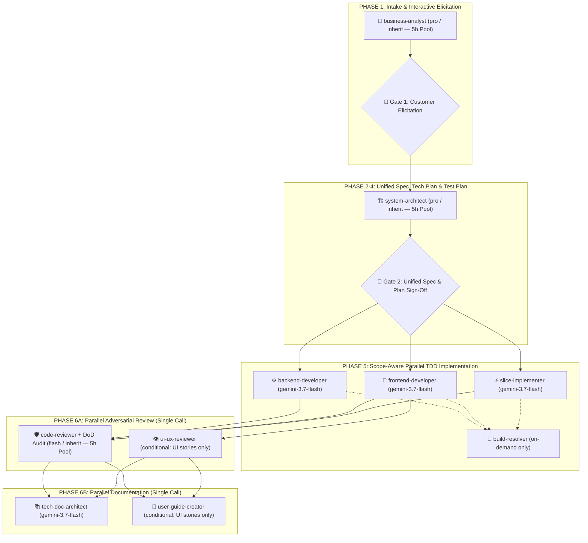

# WordStreak Development Workflow

## Unified Pipeline: BA Skill Pack (Analysis) + Speckit (Planning) + Superpowers (Execution)

**Core Principle:** BA Skill Pack gates all work with a signed-off domain baseline. Speckit handles technical planning. Superpowers executes code.

### Pipeline for New Features (Fast-Accurate Multi-Agent Lifecycle)

#### Lean Canonical Artifact Set in `.specify/features/<slug>/` (Zero-Duplication Rule)

To maximize execution speed without sacrificing traceability (`BR-`, `REQ-`, `US-`, `ASM-`, `RISK-`, `TC-`), features use a **Lean 6-File Structure** (avoiding duplicate BA vs. Speckit files):

1. **`baseline.md`** — Unified Intake classification, confirmed `ASM-` elicitation decisions, RBAC matrix, Mermaid `stateDiagram-v2`, `BR-` business rules (with anti-abuse pass), `RISK-` register, MoSCoW scope (with Won't-Have), and `SIGNED-OFF v1.0` status.
2. **`spec.md`** — Single canonical specification combining `REQ-` requirements (`Derived from`), `US-` Given-When-Then scenarios (happy + edge cases), Edge Case Matrix, IEEE 29148 validation, and Traceability Matrix (`Goal → REQ → US → TC`).
3. **`plan.md`** — Unified Technical Architecture, Data Model (`erDiagram` + types), API/Storage Contracts (`/api/v1/...`), and dependency-ordered Tasks.
4. **`test-plan.md`** — Maps every `US-` scenario and edge case to a concrete `TC-###` test case and test file path before coding begins.
5. **`review-report.md`** — Unified fresh-context Adversarial Code Review, UI/UX Anti-Slop Review (if UI touched), and DoD Scorecard.
6. **`CHANGELOG.md`** — Version history (`v0.1-draft` → `v1.0 SIGNED-OFF` → `v1.1 Verified`).

#### Phase 1: Single-Pass Intake & Interactive Elicitation (Gate 1)

- **Single-Pass Intake + Elicitation Prep**: Dispatch `business-analyst` (`pro` / `inherit`) to classify complexity (`Spike` | `Bounded Task` | `Full Feature`), inspect existing code/types, and prepare **2–3 targeted Elicitation Questions** with `(Recommended)` defaults.
- **🛑 GATE 1 — MANDATORY INTERACTIVE CUSTOMER INTERVIEW**:
  - Pause and present the 2–3 clarification questions to the user via `ask_question` or chat.
  - **Strict Zero-Hallucination & Zero-Silent-Assumption Policy**: Never invent business rules, default configurations, or edge-case behaviors silently. Record confirmed decisions as `ASM-<SLUG>-###`.

#### Phases 2–4: Unified Spec, Technical Plan & Test Plan (Gate 2 — with `ponytail` Architecture Ladder)

- Once Gate 1 is answered, generate `baseline.md`, `spec.md`, `plan.md`, and `test-plan.md` in one unified pass without duplicating `spec/srs.md`, `spec/user-stories.md`, `data-model.md`, or `tasks.md`.
- **Enforce `ponytail` Architecture Ladder in `plan.md`**: Reuse existing monorepo types/helpers first, prefer stdlib & native platform APIs (`Intl`, native DOM/CSS, Prisma constraints) over new dependencies, forbid single-implementation interfaces/wrappers, and minimize new files.
- **🛑 GATE 2 — UNIFIED SPEC & TECHNICAL PLAN SIGN-OFF**:
  - Present a concise summary covering: (1) Scope & `BR-` Business Rules, (2) Technical Architecture & Contracts, and (3) `TC-###` Test Plan.
  - Wait for explicit user approval, then mark `baseline.md` as `SIGNED-OFF v1.0` and proceed to Phase 5.

#### Phase 5: Scope-Aware Parallel TDD Implementation (with Scoped `ponytail`)

- **Zero Direct Feature Coding by Orchestrator**: Delegate all feature and test coding via `invoke_subagent`.
- **Scoped `ponytail` Rules**:
  - **Production Code (`ponytail` ON)**: Apply the `ponytail` 7-rung ladder — reuse existing utilities, use stdlib/native features before custom classes, zero speculative abstractions/configs, fewest files, shortest working diff.
  - **Tests & Requirements (`ponytail` OFF)**: Never apply `ponytail` YAGNI to skip approved `REQ-`/`BR-` rules or `TC-###` test cases in `test-plan.md`.
- **No Redundant `code-explorer`**: File paths and existing patterns are already documented in `plan.md`.
- **Scope-Aware Dispatch**:
  - **Single-App Story** (`apps/extension`, `apps/api`, or `apps/web` only): Dispatch **1 scoped implementer subagent** to execute the full TDD loop (`Red` failing tests from `test-plan.md` → `Green` minimal `ponytail` code → `Refactor` → `pnpm test && pnpm build`) in a single turn.
  - **Fullstack Story (`apps/api` + `apps/web`)**: Update `packages/shared-types` first, then dispatch **`backend-developer` and `frontend-developer` concurrently in a single parallel `invoke_subagent` call**.
  - **On-Demand `build-resolver`**: Invoke only if a build/lint error remains unresolved.
- **MANDATORY**: Read and comply with Mandatory Tech Skills (below).

#### Phase 6: Parallel Review, Tech Docs & Delivery

- **Batch 1: Parallel Adversarial Review (Single `invoke_subagent` Call)**:
  - Dispatch `code-reviewer` (`flash` / `inherit`) in a fresh context to audit code quality, security, `BR-`/`REQ-` compliance, DoD scorecard, and a **`ponytail-review` over-engineering pass** (`delete:`, `stdlib:`, `native:`, `yagni:`, `shrink:`) into `review-report.md`.
  - **Conditionally** include `ui-ux-reviewer` (`gemini-3.7-flash`) in the **same parallel call** **only if** UI files were modified.
  - Enforce **Bug Severity Gate**: Zero `Critical` bugs permitted.
- **Batch 2: Parallel Technical Documentation & User Guides (Single `invoke_subagent` Call — `ponytail` OFF)**:
  - Dispatch `tech-doc-architect` (`gemini-3.7-flash`) to create `docs/features/<feature-slug>/README.md` and update `docs/features/README.md` (plus `docs/architecture/` or `docs/algorithms/` if applicable).
  - **Conditionally** include `user-guide-creator` (`gemini-3.7-flash`) in the **same parallel call** to generate `docs/user-guides/<slug>.md` with real Playwright screenshots if user-facing UI changed.
- **Close-Out**:
  - Verify passing test evidence, update `.specify/features/<slug>/CHANGELOG.md`, and mark the User Story `[x]` in `docs/PRODUCT_BACKLOG_ROADMAP.md`.

---

## Mandatory Tech Skills

**CRITICAL: Before writing ANY code or documentation, AI MUST read the corresponding skill BEFORE execution.**

| Context / File type                                                           | MANDATORY Skill / Reference                                    |
| ----------------------------------------------------------------------------- | -------------------------------------------------------------- |
| **Mandatory Design System Tokens (ALL UI in `apps/web/`)**                    | `apps/web/DESIGN.md` (MUST read before any UI work)            |
| **Product Nature, Flame Mascot & Animation Physics**                          | `apps/web/MEMORY.md` (MUST read before any UI work)            |
| **Architecture & Production Code Simplicity (Phase 3 & 5)**                   | `ponytail` (Production code only — NEVER skip `TC-###` tests)  |
| **Adversarial Over-Engineering Code Review (Phase 6A)**                       | `ponytail-review` (`delete:`, `stdlib:`, `yagni:`, `shrink:`)  |
| **New feature intake / complexity classification**                            | `intake-classifier`                                            |
| **Business value & 6-pillar domain elicitation**                              | `elicitation-interview`                                        |
| **AS-IS / TO-BE / gap analysis (Full Feature)**                               | `gap-analysis`                                                 |
| **RBAC, state machines, business rules, ERD**                                 | `domain-modeling`                                              |
| **Risk register, contradiction scan, MoSCoW**                                 | `risk-contradiction-scanner`                                   |
| **Spec documents (BRD, PRD, SRS, user stories)**                              | `spec-writer`                                                  |
| **IEEE 29148 quality gate & traceability matrix**                             | `spec-validator`                                               |
| **Baseline sign-off & dev handover**                                          | `handover`                                                     |
| **Feature execution, slice delegation & review**                              | `implementation-orchestrator`                                  |
| Technical documentation, feature README, architecture, AGENTS                 | `technical-documentation` (Agent: `tech-doc-architect`)        |
| **Interactive Architecture, Sequence, Dataflow, State Lifecycle & Diff Maps** | `archify` (`node .agents/skills/archify/bin/archify.mjs`)      |
| Any `.tsx`, `.jsx` file, React component                                      | `frontend-patterns` + `frontend-a11y`                          |
| **UI Design: Landing, Marketing, Public surfaces**                            | `frontend-design` + `design-taste-frontend` + `ui-taste-pro`   |
| **UI Design: In-App, Dashboard, Study/Flashcards, Decks**                     | `frontend-design` + `design-taste-product` + `ui-taste-pro`    |
| **UI Animation, Motion, Micro-interactions**                                  | `motion-design`                                                |
| **UI visual review & component QA**                                           | `ui-design-review`                                             |
| **User guide / end-user docs with screenshots**                               | `user-guide-with-screenshots` (Agent: `user-guide-creator`)    |
| iOS Native UI / Widgets (SwiftUI/UIKit only)                                  | `liquid-glass-design` (iOS ONLY)                               |
| Any NestJS file (controller, service, module, DTO)                            | `nestjs-patterns` + `backend-patterns`                         |
| API endpoint, REST resource                                                   | `api-design` + `backend-patterns`                              |
| Prisma schema, query, migration                                               | `prisma-patterns`                                              |
| PostgreSQL query, index, RLS policy                                           | `postgres-patterns`                                            |
| Dockerfile, docker-compose.yml                                                | `docker-patterns`                                              |
| E2E test, Playwright test                                                     | `e2e-testing`                                                  |
| Git branch, commit, merge                                                     | `git-workflow`                                                 |
| **Command: Resume project development from roadmap**                          | `/command-continue-project` (`command-continue-project` skill) |
| **Command: Automated modular commit & push**                                  | `/command-git-push` (`command-git-push` skill)                 |
| **Command: Generate end-user guide with real screenshots**                    | `/command-user-guide` (`command-user-guide` skill)             |

---

## Tech Stack

| Layer                  | Technology                                                |
| ---------------------- | --------------------------------------------------------- |
| Frontend               | React TypeScript + Vite                                   |
| Backend                | NestJS                                                    |
| Database               | PostgreSQL                                                |
| ORM                    | Prisma                                                    |
| Unit/Component Testing | Vitest + React Testing Library (frontend), Jest (backend) |
| E2E Testing            | Playwright                                                |
| Containerization       | Docker + Docker Compose                                   |

---

## Corporate Governance & Code Quality Rules

- **Zero Code Before Approved Spec**: Never write code or create mockups without an approved domain baseline and specification.
- **Mandatory Automatic Subagent Delegation (STRICT)**: The orchestrator AI MUST NOT execute implementation slices or documentation directly in the primary context. Once Gate 2 (Technical Plan & Tasks) is approved, the orchestrator MUST automatically decompose tasks and dispatch dedicated subagents (`backend-developer`, `frontend-developer`, `ui-ux-reviewer`, `tech-doc-architect`, `user-guide-creator`) via `invoke_subagent`.
- **Subagent Transparency & Notification Protocol (MANDATORY)**: Whenever a subagent (e.g. `implementation-orchestrator`, `ui-design-review`, `tech-doc-writer`, `browser_subagent`) is dispatched or finishes, the AI MUST explicitly notify the user in chat with a clear announcement block specifying: (1) Subagent Name & Role, (2) Active Model Name (e.g. `Gemini 3.7 Flash`), (3) Exact Task Scope, and (4) Output Artifact / Report Link.
- **5-Hour Quota Pool Priority & Early Warning Gate**: Prioritize Gemini 5-hour rolling pool models (`flash`, `pro`, `inherit`) across all subagent delegations. Whenever the `PreInvocation` quota monitor (`session-context-init.js`) flags `WARNING` (≥ 75%) or `CRITICAL` (≥ 90%), the AI MUST surface an immediate warning banner in chat with the exact 5h reset time and mitigation options.
- **Design System & Anti-AI-Slop Gate (STRICT)**: Before creating or modifying any UI in `apps/web/`, AI MUST read [apps/web/DESIGN.md](file:///Users/vutuanhau/Documents/PROJECT/WordStreak/apps/web/DESIGN.md) and [apps/web/MEMORY.md](file:///Users/vutuanhau/Documents/PROJECT/WordStreak/apps/web/MEMORY.md). All UI must strictly adhere to the document-first minimal canvas (`#ffffff`), 1px hairline borders (`#e5e5e5`), Obsidian pure black pills (`#000000`, `rounded-full`), Nunito/Inter/JetBrains Mono typography, and stable outer anchor hover physics. Generic AI slop (unrequested multi-color gradients, neon blobs, glassmorphism, fake pricing tiers) is strictly forbidden.
- **UI Visual Review Gate**: Every UI slice must undergo an independent anti-slop verification using `ui-design-review` before closing.
- **Bug Severity Gate**: No feature branch can be merged or marked complete with unresolved `Critical` bugs.
- **Post-Review Documentation Gate**: Every delivered feature must have technical documentation updated/created by `tech-doc-writer` (`technical-documentation` skill) before closing the task.
- **User Guide Gate**: Every feature with a UI must have a user-facing guide created or updated via the `user-guide-with-screenshots` skill (100% mandatory real screenshots with Red Highlights `#EF4444` & numbered callout badges, non-technical language, saved to `docs/user-guides/<slug>.md`) before the feature is considered done. Do not close tasks or push code without this verified.
- **Immutable Data Patterns**: Create new copies, do not mutate state directly.
- **KISS, DRY, YAGNI**: Avoid over-engineering and speculative features.
- **Code Limits**: File < 800 lines, function < 50 lines.
- **Feature-based Folder Structure**: Keep components, services, and tests organized by domain feature.
- **Boundary Validation**: Validate all inputs at boundaries via DTOs and schema validators.
- **Error Handling**: Handle errors explicitly, never swallow silently.
- **Data Privacy**: Strictly anonymize test data; never use real production credentials in dev.
- **Traceability**: All scope changes must be documented in the feature's Change Log.
- **Git Commit Governance (Strict Human-In-The-Loop Gate)**:
  - **Zero Autonomous Git Execution**: AI is STRICTLY FORBIDDEN from running `git add`, `git commit`, or `git push` autonomously. Staging, committing, and pushing can ONLY be executed when the user explicitly runs `/command-git-push` (or `/push`, `/ship`, `/auto-git-push`), or when the AI explicitly proposes the exact git changes to the user and receives explicit approval.
  - **Modular Commits**: Break down commits into granular, logical parts (Spec/Docs -> Shared Types -> Backend API -> Frontend UI -> Feature Docs).
  - **Single-Line English Commits**: Strictly single-line Conventional Commits in English (e.g. `feat(scope): concise description`).
  - **Branch Reuse Priority**: Always prioritize existing active branches for related work, fixes, or refinements; avoid creating new branches unless strictly necessary for completely independent scope separation.
  - **Auto-Sync & Drift Refresh**: Before coding, auto-fetch `origin/main` and rebase active branch; auto-refresh `pnpm install` and Prisma client on schema/dependency updates.
  - **Smart Conflict Resolution**: Auto-merge conflict markers semantically, verify with passing tests, and abort safely if business logic is ambiguous.
  - **Multi-Scope Isolation**: Auto-detect cross-domain changes, notify user, and isolate files into their respective dedicated branches.
  - **English PR Brief**: Always provide a ready-to-copy English PR title and description upon remote push.
