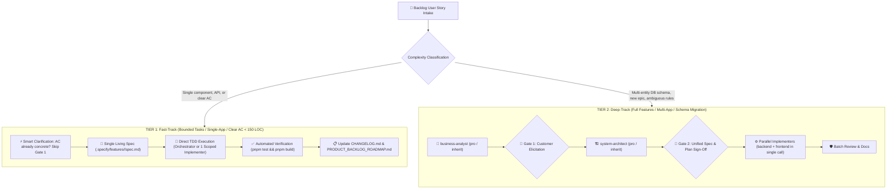

# WordStreak Development Workflow

## Unified Pipeline: BA Skill Pack (Analysis) + Speckit (Planning) + Superpowers (Execution)

**Core Principle:** BA Skill Pack gates all work with a signed-off domain baseline. Speckit handles technical planning. Superpowers executes code.

### Pipeline for New Features (Adaptive 2-Tier Fast-Accurate Lifecycle)

To prevent severe token inflation and subagent cold-start latency while maintaining 100% test and architectural rigor, development follows an **Adaptive 2-Tier Pipeline**:

#### Artifact Governance (Zero Duplication Rule)

- **Tier 1 (Fast-Track - Default for standard stories)**:
  Maintain only **2 files** in `.specify/features/<slug>/`:
  1. **`spec.md`** — Single living specification combining Acceptance Criteria (`REQ-`), Technical Design/Contracts, and `TC-###` Test Cases.
  2. **`CHANGELOG.md`** — Version and verification log (`v1.0 Done`).
  *(Do NOT generate separate `baseline.md`, `plan.md`, `test-plan.md`, or `review-report.md` for Tier 1 tasks).*

- **Tier 2 (Deep-Track - For complex epics & schema migrations)**:
  Maintain the Lean 6-File canonical set (`baseline.md`, `spec.md`, `plan.md`, `test-plan.md`, `review-report.md`, `CHANGELOG.md`).

#### Execution Modes by Tier:

- **⚡ Tier 1: Fast-Track Execution (Micro Tasks & Bounded Tasks)**:
  1. **Micro Tasks** (≤1 file, <50 lines, no new DB/API): Implement directly $\rightarrow$ `pnpm test`. Zero spec files needed.
  2. **Bounded Tasks** (single-app changes, additive changes, or clear AC $\le 150$ LOC):
     - **Smart Clarification**: If Acceptance Criteria in `PRODUCT_BACKLOG_ROADMAP.md` are clear and actionable, do NOT pause for artificial Gate 1 questions. Automatically treat confirmed AC as `ASM-` and begin.
     - **Direct TDD Loop**: Write failing tests (`Red`) $\rightarrow$ Implement minimal code (`Green` with `ponytail` simplicity) $\rightarrow$ Refactor $\rightarrow$ Verify passing with `pnpm test` and `pnpm build`.
     - **Single Living Spec**: Maintain only `.specify/features/<slug>/spec.md` and `CHANGELOG.md`.
     - **Streamlined Review & Verification**: Automated verification through test suite execution and type-checking; update `CHANGELOG.md` and check off `[x]` in `docs/PRODUCT_BACKLOG_ROADMAP.md`.

- **🏗️ Tier 2: Deep-Track Execution (Full Features / Multi-App / Schema Migration)**:
  Follow the full multi-agent pipeline: Phase 1 (BA + Gate 1) $\rightarrow$ Phases 2–4 (Architect + Gate 2) $\rightarrow$ Phase 5 (Parallel implementers) $\rightarrow$ Phase 6 (Batch Review & Documentation).

#### Phase 6: Proportional Review & 4 Stopping Rules
1. **Match Review Overhead to Change Size**:
   - Micro / Bounded Tasks: Inline review or test suite verification.
   - Full Feature (no UI changes): `code-reviewer` + `tech-doc-architect`.
   - Full Feature (with UI changes): `code-reviewer` + `ui-ux-reviewer` in batch 1, `tech-doc-architect` + `user-guide-creator` in batch 2.
2. **4 Strict Review Stopping Rules**:
   - **Max 3 Iterations**: Hard stop at Round 3; non-critical nits auto-accepted.
   - **Incremental Diff Only**: Rounds 2 & 3 review only `git diff HEAD~1`.
   - **Categorized Findings**: Group issues into Security, Logic, Performance, Cleanliness.
   - **No Regurgitation**: Never re-report resolved or accepted issues.

---

## Mandatory Tech Skills

**CRITICAL: Before writing ANY code or documentation, AI MUST read the corresponding skill BEFORE execution.**

| Context / File type                                                           | MANDATORY Skill / Reference                                    |
| ----------------------------------------------------------------------------- | -------------------------------------------------------------- |
| **Mandatory Design System Tokens (ALL UI in `apps/web/`)**                    | `apps/web/DESIGN.md` (MUST read before any UI work)            |
| **Product Nature, Flame Mascot & Animation Physics**                          | `apps/web/MEMORY.md` (MUST read before any UI work)            |
| **Architecture & Production Code Simplicity (Phase 3 & 5)**                   | `ponytail` (Production code only — NEVER skip `TC-###` tests)  |
| **Adversarial Over-Engineering Code Review (Phase 6A)**                       | `ponytail-review` (`delete:`, `stdlib:`, `yagni:`, `shrink:`)  |
| **New feature intake / complexity classification**                            | `intake-classifier`                                            |
| **Business value & 6-pillar domain elicitation**                              | `elicitation-interview`                                        |
| **AS-IS / TO-BE / gap analysis (Full Feature)**                               | `gap-analysis`                                                 |
| **RBAC, state machines, business rules, ERD**                                 | `domain-modeling`                                              |
| **Risk register, contradiction scan, MoSCoW**                                 | `risk-contradiction-scanner`                                   |
| **Spec documents (BRD, PRD, SRS, user stories)**                              | `spec-writer`                                                  |
| **IEEE 29148 quality gate & traceability matrix**                             | `spec-validator`                                               |
| **Baseline sign-off & dev handover**                                          | `handover`                                                     |
| **Pipeline entry-point & routing (single orchestrator)**                      | `wordstreak-ba-skills` ← use this, NOT wordstreak-workflow     |
| Technical documentation, feature README, architecture, AGENTS                 | `technical-documentation` (Agent: `tech-doc-architect`)        |
| **Interactive Architecture, Sequence, Dataflow, State Lifecycle & Diff Maps** | `archify` (`node .agents/skills/archify/bin/archify.mjs`)      |
| Any `.tsx`, `.jsx` file, React component                                      | `frontend-patterns` + `frontend-a11y`                          |
| **UI Design: Landing, Marketing, Public surfaces**                            | `frontend-design` + `design-taste-frontend` + `ui-taste-pro`   |
| **UI Design: In-App, Dashboard, Study/Flashcards, Decks**                     | `frontend-design` + `design-taste-product` + `ui-taste-pro`    |
| **UI Animation, Motion, Micro-interactions**                                  | `motion-design`                                                |
| **UI visual review & component QA**                                           | `ui-design-review`                                             |
| **User guide / end-user docs with screenshots**                               | `user-guide-with-screenshots` (Agent: `user-guide-creator`)    |
| iOS Native UI / Widgets (SwiftUI/UIKit only)                                  | `liquid-glass-design` (iOS ONLY)                               |
| Any NestJS file (controller, service, module, DTO)                            | `nestjs-patterns` + `backend-patterns`                         |
| API endpoint, REST resource                                                   | `api-design` + `backend-patterns`                              |
| Prisma schema, query, migration                                               | `prisma-patterns`                                              |
| PostgreSQL query, index, RLS policy                                           | `postgres-patterns`                                            |
| Dockerfile, docker-compose.yml                                                | `docker-patterns`                                              |
| E2E test, Playwright test                                                     | `e2e-testing`                                                  |
| Git branch, commit, merge                                                     | `git-workflow`                                                 |
| **Command: Resume project development from roadmap**                          | `/command-continue-project` (`command-continue-project` skill) |
| **Command: Automated modular commit & push**                                  | `/command-git-push` (`command-git-push` skill)                 |
| **Command: Generate end-user guide with real screenshots**                    | `/command-user-guide` (`command-user-guide` skill)             |

---

## Tech Stack

| Layer                  | Technology                                                |
| ---------------------- | --------------------------------------------------------- |
| Frontend               | React TypeScript + Vite                                   |
| Backend                | NestJS                                                    |
| Database               | PostgreSQL                                                |
| ORM                    | Prisma                                                    |
| Unit/Component Testing | Vitest + React Testing Library (frontend), Jest (backend) |
| E2E Testing            | Playwright                                                |
| Containerization       | Docker + Docker Compose                                   |

---

## Corporate Governance & Code Quality Rules

- **Zero Code Before Approved Spec**: Never write code or create mockups without an approved domain baseline or clear Acceptance Criteria documented in `spec.md`.
- **Adaptive Delegation & Tier 1 Fast-Track Authorization**: For Tier 1 (Bounded Tasks / Single-App / clear AC < 150 LOC), the primary orchestrator is **AUTHORIZED** to execute TDD implementation (`Red` $\rightarrow$ `Green` $\rightarrow$ `Refactor`) and automated verification directly in the primary context. This eliminates subagent cold-start overhead and saves up to 80% token consumption. For Tier 2 (complex Epics / multi-app / DB schema migrations), structured subagent delegation (`invoke_subagent`) is mandatory.
- **Subagent Transparency & Notification Protocol (MANDATORY)**: Whenever a subagent (e.g. `business-analyst`, `system-architect`, `backend-developer`, `frontend-developer`, `code-reviewer`) is dispatched or finishes, the AI MUST explicitly notify the user in chat with a clear announcement block specifying: (1) Subagent Name & Role, (2) Active Model Name (e.g. `Gemini 3.8 Flash`), (3) Exact Task Scope, and (4) Output Artifact / Report Link.
- **5-Hour Quota Pool Priority & Early Warning Gate**: Prioritize Gemini 5-hour rolling pool models (`flash`, `pro`, `inherit`) across all subagent delegations. Whenever the `PreInvocation` quota monitor (`session-context-init.js`) flags `WARNING` (≥ 75%) or `CRITICAL` (≥ 90%), the AI MUST surface an immediate warning banner in chat with the exact 5h reset time and mitigation options.
- **Design System & Anti-AI-Slop Gate (STRICT)**: Before creating or modifying any UI in `apps/web/`, AI MUST read [apps/web/DESIGN.md](file:///Users/vutuanhau/Documents/PROJECT/WordStreak/apps/web/DESIGN.md) and [apps/web/MEMORY.md](file:///Users/vutuanhau/Documents/PROJECT/WordStreak/apps/web/MEMORY.md). All UI must strictly adhere to the document-first minimal canvas (`#ffffff`), 1px hairline borders (`#e5e5e5`), Obsidian pure black pills (`#000000`, `rounded-full`), Nunito/Inter/JetBrains Mono typography, and stable outer anchor hover physics. Generic AI slop (unrequested multi-color gradients, neon blobs, glassmorphism, fake pricing tiers) is strictly forbidden.
- **UI Visual Review Gate**: Every UI slice must undergo an independent anti-slop verification using `ui-design-review` before closing.
- **Bug Severity Gate**: No feature branch can be merged or marked complete with unresolved `Critical` bugs.
- **Post-Review Documentation Gate**: Every delivered feature must have technical documentation updated/created by `tech-doc-writer` (`technical-documentation` skill) before closing the task.
- **User Guide Gate**: User-facing guides with Playwright screenshots (`docs/user-guides/<slug>.md`) are generated at the **Epic / User-Facing Milestone level** (via `/command-user-guide`). For individual Bounded Tasks or micro-stories under Tier 1, automated test suites and `CHANGELOG.md` updates satisfy the completion criteria.
- **Immutable Data Patterns**: Create new copies, do not mutate state directly.
- **KISS, DRY, YAGNI**: Avoid over-engineering and speculative features.
- **Code Limits**: File < 800 lines, function < 50 lines.
- **Feature-based Folder Structure**: Keep components, services, and tests organized by domain feature.
- **Boundary Validation**: Validate all inputs at boundaries via DTOs and schema validators.
- **Error Handling**: Handle errors explicitly, never swallow silently.
- **Data Privacy**: Strictly anonymize test data; never use real production credentials in dev.
- **Traceability**: All scope changes must be documented in the feature's Change Log.
- **Git Commit Governance (Strict Human-In-The-Loop Gate)**:
  - **Zero Autonomous Git Execution**: AI is STRICTLY FORBIDDEN from running `git add`, `git commit`, or `git push` autonomously. Staging, committing, and pushing can ONLY be executed when the user explicitly runs `/command-git-push` (or `/push`, `/ship`, `/auto-git-push`), or when the AI explicitly proposes the exact git changes to the user and receives explicit approval.
  - **Adaptive Logical Commits**: Group commits into clean logical units (typically Code/Tests vs. Docs/Roadmap) using compound commands to prevent API turn bloat while keeping git history clean.
  - **Single-Line English Commits**: Strictly single-line Conventional Commits in English (e.g. `feat(scope): concise description`).
  - **Branch Reuse Priority**: Always prioritize existing active branches for related work, fixes, or refinements; avoid creating new branches unless strictly necessary for completely independent scope separation.
  - **Auto-Sync & Drift Refresh**: Before coding, auto-fetch `origin/main` and rebase active branch; auto-refresh `pnpm install` and Prisma client on schema/dependency updates.
  - **Smart Conflict Resolution**: Auto-merge conflict markers semantically, verify with passing tests, and abort safely if business logic is ambiguous.
  - **Multi-Scope Isolation**: Auto-detect cross-domain changes, notify user, and isolate files into their respective dedicated branches.
  - **English PR Brief**: Always provide a ready-to-copy English PR title and description upon remote push.
