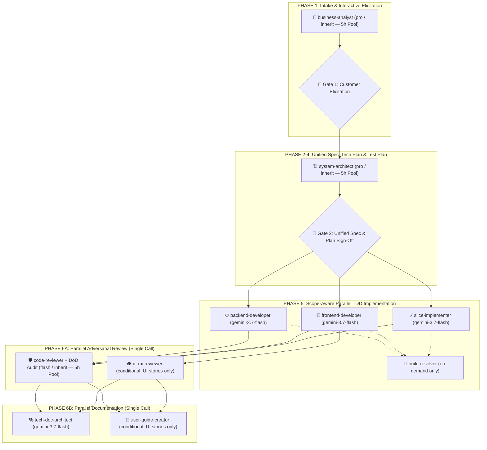

# WordStreak Unified Workflow

This skill orchestrates the end-to-end development pipeline for WordStreak, placing strong emphasis on **rigorous business analysis and domain requirement elicitation** before writing specifications or code, adhering to company-wide AI-Augmented SDLC governance.

---

## Unified Pipeline: BA Skill Pack (Analysis) + Speckit (Planning) + Superpowers (Execution)

**Core Principle:** BA Skill Pack gates all work with a signed-off domain baseline. Speckit handles technical planning. Superpowers executes code.

---

## When to Use

- Starting a **new feature** or **user story**
- Beginning any **significant code change** (not trivial one-line fixes)
- Clarifying complex business requirements, domain rules, or user flows
- Unsure which planning/implementation tools to use

---

## Pipeline Overview (Fast-Accurate Multi-Agent Lifecycle)

---

## Lean Canonical Artifact Set (Zero-Duplication Rule)

To prevent LLM token bloat while preserving 100% traceability (`BR-`, `REQ-`, `US-`, `ASM-`, `RISK-`, `TC-`), every feature in `.specify/features/<slug>/` uses a **Lean 6-File Canonical Structure**:

1. **`baseline.md`** — Unified BA & Domain Decision Baseline:
   - Combines Intake classification (`Spike` | `Bounded Task` | `Full Feature`), confirmed Elicitation decisions (`ASM-<SLUG>-###`), RBAC matrix, Mermaid `stateDiagram-v2`, Business Rules (`BR-<SLUG>-###` with anti-abuse pass), Risk Register (`RISK-<SLUG>-###`), MoSCoW scope (with mandatory Won't-Have), and `Status: SIGNED-OFF v1.0`.
   - _(Replaces separate `00-intake.md`, `01-elicitation.md`, `03-domain-model.md`, `04-risk-scope.md` for Bounded Tasks)._
2. **`spec.md`** — Single Canonical Specification & Traceability Matrix:
   - Combines Functional/Non-Functional Requirements (`REQ-<SLUG>-###` with `Derived from`), User Stories (`US-<SLUG>-###` with Given-When-Then happy + edge cases), Edge Case Matrix, IEEE 29148 validation checklist, and Traceability Matrix (`Goal → REQ → US → TC`).
   - _(Eliminates duplicate `spec/srs.md`, `spec/user-stories.md`, `06-validation-report.md`, and `checklists/requirements.md`)._
3. **`plan.md`** — Unified Technical Architecture, Data Model, Contracts & Tasks:
   - Combines Technical Plan, Data Model (`erDiagram` + DTO/schema definitions), API/Storage Contracts (`/api/v1/...`), and dependency-ordered implementation tasks.
   - _(Eliminates separate `data-model.md`, `contracts/`, and `tasks.md` unless a Full Feature exceeds 500 lines)._
4. **`test-plan.md`** — TDD Test Specification:
   - Maps every `US-<SLUG>-###` scenario (happy + edge cases) to a numbered `TC-###` test case and concrete test file path before any code is written.
5. **`review-report.md`** — Unified Adversarial Review & DoD Scorecard:
   - Records fresh-context `code-reviewer` findings, Bug Severity check, `ui-ux-reviewer` audit (when UI touched), and DoD verification (`08-dod-scorecard.md`).
6. **`CHANGELOG.md`** — Version audit trail (`v0.1-draft` → `v1.0 SIGNED-OFF` → `v1.1 Verified`).

---

## Phase 1: Business Analysis & Domain Elicitation

**Entry Point:** Always classify complexity first (`intake-classifier` logic).

### Protocol Routing

| Protocol                | Execution Path                                                                 | When                                                   |
| ----------------------- | ------------------------------------------------------------------------------ | ------------------------------------------------------ |
| **Spike**               | Intake + short technical note in chat. No folder, no spec.                     | Research / "is this even possible?"                    |
| **Bounded Task**        | Single-pass Intake+Elicitation (Gate 1) → Unified Spec+Plan+TestPlan (Gate 2)  | Well-scoped User Story or change to existing flow      |
| **Full Feature / Epic** | Full 8-stage depth (may separate Gate 1B BA Sign-off and Gate 2 Plan Sign-off) | New flow, new entity, cross-cutting, gamification core |

### Stage Execution Rules

1. **Single-Pass Intake + Elicitation Preparation**:
   - `business-analyst` (`pro` / `inherit`) classifies complexity, inspects existing codebase/schema, and immediately prepares **2–3 targeted Elicitation Questions** with `(Recommended)` options.
2. **🛑 GATE 1 — Interactive Elicitation Interview (MANDATORY CUSTOMER GATE)**:
   - AI pauses and asks the user 2–3 targeted questions via `ask_question` or chat covering ambiguities in business rules, state transitions, or edge cases.
   - **Strict Zero-Hallucination Policy**: Never invent or silently assume business logic; all ambiguities must be confirmed by the customer and logged as `ASM-<SLUG>-###`.
3. **Domain Modeling, Risk Scan & Spec Generation**:
   - Once the user answers Gate 1, compile `baseline.md` (`ASM-`, `BR-`, State Machine, `RISK-`, MoSCoW) and `spec.md` (`REQ-`, `US-` Given-When-Then, IEEE 29148 check, Traceability Matrix).

---

## Phases 2–4: Unified Specify, Plan & Tasks (with `ponytail` Architecture Ladder)

For **Bounded Tasks** and standard Backlog User Stories, `system-architect` (`pro` / `inherit`) runs in the same planning phase right after Gate 1 answers to produce:

1. **`spec.md`** — Formal requirements (`REQ-`), scenarios (`US-`), edge cases, and traceability matrix.
2. **`plan.md`** — Technical architecture, data model (`erDiagram`), `/api/v1/...` or Extension contracts, and dependency-ordered implementation tasks. **Enforce the `ponytail` 7-rung ladder in architecture planning**: reuse existing helpers/types first, prefer stdlib & native platform APIs over new libraries or custom classes, forbid single-implementation interfaces/factories, and minimize touched/created files.
3. **`test-plan.md`** — `TC-###` test cases mapped 1:1 to every `US-` scenario and edge case (**`ponytail` YAGNI never applies to test coverage**).
4. **🛑 GATE 2 — Unified Spec & Technical Plan Sign-Off**:
   - Present the unified summary (Scope/`BR-`, Technical Architecture/Contracts, and `TC-###` Test Plan) to the user.
   - Upon user approval, mark `baseline.md` as `SIGNED-OFF v1.0` and advance to Phase 5.

---

## Phase 5: Scope-Aware Parallel TDD Implementation (with Scoped `ponytail`)

1. **Zero Direct Feature Coding by Orchestrator**: Always delegate implementation slices to subagents via `invoke_subagent`.
2. **Scoped `ponytail` Enforcement**:
   - **Production Code (`ponytail` ON)**: Subagents MUST apply the `ponytail` ladder — reuse existing repo utilities, use native/stdlib features (`Intl`, native DOM/CSS, Prisma constraints), write zero unrequested abstractions/wrappers, and keep the diff as short and boring as possible.
   - **Tests & Spec Conformance (`ponytail` OFF)**: Subagents MUST implement 100% of approved `REQ-`/`BR-` rules and 100% of `TC-###` test cases in `test-plan.md`.
3. **No Redundant `code-explorer`**: File paths and existing patterns are already documented in `plan.md`.
4. **Scope-Aware Subagent Dispatch**:
   - **Single-App / Single-Layer Story** (e.g., `apps/extension` only, `apps/api` only, or `apps/web` only):
     - Dispatch **1 scoped implementer subagent** (`slice-implementer`, `backend-developer`, or `frontend-developer`) to execute the complete TDD loop (`Red` failing tests from `test-plan.md` → `Green` minimal `ponytail` code → `Refactor` → `pnpm test && pnpm build`) in a single turn.
   - **Multi-App Fullstack Story (`apps/api` + `apps/web`)**:
     - Update and build `packages/shared-types` first, then dispatch **`backend-developer` and `frontend-developer` concurrently in a single parallel `invoke_subagent` call**.
   - **On-Demand `build-resolver`**: Only invoke `build-resolver` if a compilation or lint issue remains unresolved.
5. **MANDATORY Tech Skills**: Comply with Tech Skills in `.agents/skills/` and read `apps/web/DESIGN.md` + `apps/web/MEMORY.md` before any UI work.

---

## Phase 6: Parallel Quality Review, Docs & Delivery

1. **Batch 1 — Parallel Adversarial Review (Single `invoke_subagent` Call)**:
   - Dispatch `code-reviewer` (`flash` / `inherit`) in a fresh context (no implementer reasoning) to audit:
     - Code quality, security, `BR-`/`REQ-` compliance, and DoD scorecard.
     - **`ponytail-review` Over-Engineering Audit**: Hunt unnecessary complexity using `delete:`, `stdlib:`, `native:`, `yagni:`, and `shrink:` tags in `review-report.md`.
   - **Conditionally** dispatch `ui-ux-reviewer` (`gemini-3.7-flash`) in the **same parallel call** **only if** UI files were modified.
   - **Bug Severity Gate**: Zero `Critical` bugs permitted prior to completion.
2. **Batch 2 — Parallel Technical Docs & User Guide (Single `invoke_subagent` Call — `ponytail` OFF)**:
   - Dispatch `tech-doc-architect` (`gemini-3.7-flash`) to create `docs/features/<feature-slug>/README.md` and update `docs/features/README.md` (plus `docs/architecture/` or `docs/algorithms/` if changed).
   - **Conditionally** dispatch `user-guide-creator` (`gemini-3.7-flash`) in the **same parallel call** to create/update `docs/user-guides/<slug>.md` with real Playwright screenshots if user-facing UI changed.
3. **Close-Out**:
   - Verify all automated test suites pass, update `.specify/features/<slug>/CHANGELOG.md`, and mark the User Story as `[x]` in `docs/PRODUCT_BACKLOG_ROADMAP.md`.

---

## Done When

- [ ] Gate 1 (Interactive Elicitation Interview) completed with zero silent assumptions (`ASM-` IDs recorded)
- [ ] Lean canonical artifacts (`baseline.md`, `spec.md`, `plan.md`, `test-plan.md`, `CHANGELOG.md`) created with zero duplicate files
- [ ] Gate 2 (Unified Spec & Tech Plan Sign-Off) approved by user and `baseline.md` marked `SIGNED-OFF v1.0`
- [ ] All `TC-###` test cases implemented via TDD and passing (`pnpm test && pnpm build`)
- [ ] Parallel Adversarial Review (`review-report.md`) passed with zero `Critical` bugs
- [ ] **If feature has UI**: `docs/user-guides/<slug>.md` created/updated with real screenshots **BEFORE any `git commit`**
- [ ] `docs/features/<slug>/README.md` created and `docs/features/README.md` index updated
- [ ] `CHANGELOG.md` and `docs/PRODUCT_BACKLOG_ROADMAP.md` (`[x]`) updated
