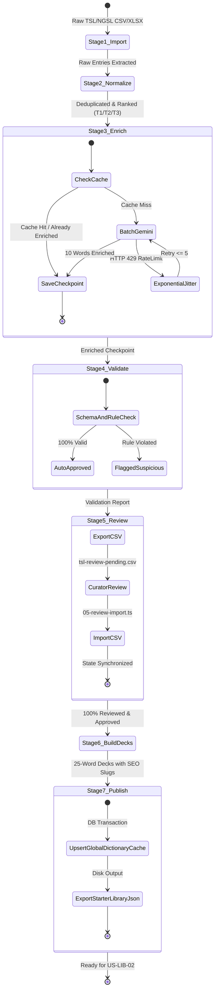

# 🏛️ Domain Decision Baseline: Content Enrichment Pipeline

- **Feature ID**: US-LIB-01
- **Feature Slug**: `content-enrichment-pipeline`
- **Epic**: EPIC-13: Vocabulary Starter Library & Content Strategy (TSL/NGSL)
- **Sprint**: Sprint 9 (Activation & Retention)
- **Protocol**: Bounded Task
- **Status**: SIGNED-OFF v1.0
- **Version**: v1.0 (Signed-Off)
- **Last Updated**: 2026-10-14
- **Lead Architect**: WordStreak System Architect

---

## 1. Business Context & Problem Statement

### 1.1 Context
WordStreak hiện tại đối mặt với rào cản "ứng dụng trống" (empty state): người dùng mới đăng ký phải tự tạo deck hoặc tìm kiếm từ vựng thủ công. Để đạt độ phủ từ vựng giao tiếp và bài thi TOEIC lên tới ~98.5%, WordStreak cần nạp kho từ vựng học thuật chuẩn hóa: **TSL 1.2 (~1.200 từ vựng TOEIC)** và **NGSL 1.2 (~2.800 từ vựng giao tiếp nền tảng)** của tác giả Browne, Culligan & Phillips (CC BY-SA 4.0).

### 1.2 Problem Statement
Nạp thủ công 1.200 từ là bất khả thi. Nếu gọi AI đơn lẻ cho từng từ trên production, hệ thống sẽ gặp:
1. Chi phí token cao và độ trễ lớn.
2. Nguy cơ lỗi Rate Limit (HTTP 429) và gián đoạn giữa chừng gây mất dữ liệu.
3. Rủi ro AI ảo giác (sai phiên âm IPA, nghĩa tiếng Việt gượng gạo, ví dụ không chứa từ mục tiêu).
4. Thiếu cơ chế kiểm duyệt và xuất bản có cấu trúc.

---

## 2. Confirmed Gate 1 Elicitation Decisions (Decisions Log)

- **ASM-LIB-001 (Destination Strategy - Hybrid Model)**:
  - Hệ thống sử dụng mô hình lai:
    1. Upsert trực tiếp dữ liệu từ vựng đã làm giàu vào bảng `GlobalDictionaryCache` của PostgreSQL với `source = 'TSL_OFFICIAL'` (hoặc `'MANUAL_CURATED'`) và `hitCount = 1`.
    2. Đóng gói và xuất artifact tiêu chuẩn `starter-library-decks.json` vào thư mục `scripts/seed/data/output/` làm nguồn cấp cho US-LIB-02 (`OfficialCard`, `OfficialDeck`).
- **ASM-LIB-002 (Batching & Rate Limit Control - Cache-First + Jitter)**:
  - Thứ tự ưu tiên: Check Disk Checkpoint -> Check `GlobalDictionaryCache` DB -> Gọi Gemini Flash API.
  - Gom cụm batch 10 từ/lô prompt.
  - Lưu checkpoint lũy tiến xuống đĩa sau mỗi batch thành công (`03-enrichment-checkpoint.json`).
  - Tự động retry khi gặp lỗi HTTP 429 theo thuật toán Exponential Backoff + Random Jitter (1s, 2s, 4s, 8s, 16s + jitter 0–500ms, tối đa 5 lần thử).
- **ASM-LIB-003 (Curator Review Flow - Auto-flag & Two-way CSV Sync)**:
  - Các từ đạt 100% luật validation được tự động gắn cờ `APPROVED_CANDIDATE`.
  - Các từ vi phạm (thiếu IPA chuẩn slashes, câu ví dụ thiếu từ, nghĩa không tự nhiên) được gắn cờ `FLAGGED` và xuất ra `scripts/seed/data/stages/tsl-review-pending.csv`.
  - Biên tập viên (Curator) có thể mở file CSV trên Excel/Google Sheets để duyệt, sửa trực tiếp.
  - Script `05-review-import.ts` nạp lại CSV đã duyệt, đồng bộ ngược vào checkpoint trước khi đóng gói deck.

---

## 3. State Machine & Pipeline Lifecycle

---

## 4. Business Rules & Guardrails

- **BR-LIB-001 (Idempotency Key)**: Mọi từ vựng xuyên suốt 7 giai đoạn được định danh duy nhất bằng khóa tổng hợp: `idempotencyKey = `${listCode}:${headword.toLowerCase().trim()}:${pos.toLowerCase().trim()}` (Ví dụ: `TSL:accommodate:verb`).
- **BR-LIB-002 (Cross-List Deduplication)**: TSL 1.2 là tập từ vựng kinh doanh chuyên sâu (~1.200 từ), NGSL 1.2 là từ vựng tổng quát (~2.800 từ). Khi từ xuất hiện ở cả hai danh sách, nếu mang nét nghĩa thương mại chuyên biệt trong TSL thì ưu tiên TSL và lưu tham chiếu `crossListRef = "NGSL"`. Khử trùng lặp tuyệt đối để không sinh 2 thẻ giống nhau trong cùng deck.
- **BR-LIB-003 (POS Canonical Mapping)**: Mọi ký hiệu từ loại viết tắt từ nguồn gốc (`n`, `v`, `adj`, `adv`, `prep`, `conj`, `pron`) bắt buộc chuẩn hóa về danh từ đầy đủ: `noun`, `verb`, `adjective`, `adverb`, `preposition`, `conjunction`, `pronoun`.
- **BR-LIB-004 (Tier & Level Stratification)**: Phân tầng ~1.200 từ TSL 1.2 thành 3 cấp độ học thuật dựa trên `freqRank`:
  - **Tier 1 (T1 - Foundational Business)**: Rank 1 – 400.
  - **Tier 2 (T2 - Intermediate Workplace)**: Rank 401 – 800.
  - **Tier 3 (T3 - Advanced Commercial & Strategy)**: Rank 801 – 1.200+.
- **BR-LIB-005 (Deck Sizing & Thematic Packaging)**:
  - Kích thước mỗi deck cố định: đúng **25 từ/deck** (tương đương 48 decks cho 1.200 từ TSL).
  - Decks được phân bổ theo 10 chủ đề chuẩn TOEIC (Office & Administration, Sales & Marketing, Finance & Accounting, HR & Recruitment, Travel & Hospitality, Logistics, Technology, Management, Legal, Customer Service).
  - Mỗi deck có tiêu đề song ngữ (Anh/Việt) và URL Slug chuẩn SEO (Ví dụ: `toeic-t1-office-communication-01`).
- **BR-LIB-006 (Strict Validation & Flagging)**: Một từ bị đánh dấu `FLAGGED` nếu:
  1. Phiên âm IPA không khớp định dạng `/^\/[^\/]+\/$/` (ví dụ: thiếu dấu gạch chéo `/.../`).
  2. Câu ví dụ không chứa headword/lemma hoặc dạng chia thì của nó.
  3. Nghĩa tiếng Việt dưới 2 ký tự hoặc giữ nguyên tiếng Anh.
  4. Số lượng collocations < 2 cụm.
  5. JSON trả về sai schema.
- **BR-LIB-007 (Token Optimization & Cost Control)**:
  - Nhiệt độ LLM cố định: `temperature = 0.2` để đảm bảo tính chuẩn xác từ điển, chống sáng tạo bừa bãi.
  - Batch size: 10 từ/lần gọi Gemini API để tận dụng tối đa context window, giảm 75% prompt overhead so với gọi lẻ từng từ.
  - Mô hình ưu tiên: `gemini-2.5-flash` (nhanh, rẻ, hỗ trợ JSON schema output).
- **BR-LIB-008 (Publishing Integrity)**:
  - Upsert vào `GlobalDictionaryCache` theo cơ chế `onConflict(word).merge()`: không ghi đè nếu bản ghi hiện có đã được kiểm duyệt bởi quản trị viên (`source = 'MANUAL_CURATED'`). Nếu chưa có hoặc nguồn là tự động cũ, cập nhật và set `source = 'TSL_OFFICIAL'`.
  - Artifact xuất ra `scripts/seed/data/output/starter-library-decks.json` phải đạt chuẩn JSON Schema của US-LIB-02.

---

## 5. Risk Register & Mitigations

| Risk ID | Tên rủi ro | Mức độ | Hậu quả | Biện pháp giảm thiểu |
| :--- | :--- | :---: | :--- | :--- |
| **RISK-LIB-001** | Lỗi Rate Limit (HTTP 429) & cạn quota Gemini | Cao | Pipeline bị gián đoạn giữa chừng, mất dữ liệu tạm | Checkpoint lũy tiến từng batch ra đĩa + Exponential backoff với random jitter (1s -> 16s + 0–500ms). |
| **RISK-LIB-002** | AI Hallucination (IPA sai, nghĩa tiếng Việt gượng) | Trung bình | Chất lượng học liệu của WordStreak bị suy giảm | Stage 4 Validate quét tự động bằng Regex + Stage 5 cho phép Curator sửa nhanh qua CSV rồi nạp ngược lại. |
| **RISK-LIB-003** | Tiến trình Node.js bị dừng đột ngột (Crash / SIGINT) | Trung bình | File checkpoint bị hỏng (corrupted JSON) | Ghi file an toàn qua cơ chế Atomic Write: ghi vào file `.tmp` trước rồi mới rename đè lên file chính. |
| **RISK-LIB-004** | Sai lệch schema giữa seed script và US-LIB-02 DB | Thấp | US-LIB-02 không đọc được dữ liệu để nạp official decks | Chuẩn hóa hợp đồng dữ liệu qua `@wordstreak/shared-types` và xuất cả 2 kênh: DB `GlobalDictionaryCache` + File `starter-library-decks.json`. |

---

## 6. MoSCoW Scope Boundary

### 6.1 Must Have (Bắt buộc trong US-LIB-01)
- [x] Bộ 7 script TypeScript thực thi độc lập qua CLI (`scripts/seed/01-import.ts` -> `07-publish.ts`).
- [x] Parser đọc file nguồn CSV TSL 1.2 / NGSL 1.2.
- [x] Bộ quy tắc chuẩn hóa POS, phân cấp T1/T2/T3 và dedupe chéo.
- [x] Engine gọi Gemini theo batch 10 từ kèm cơ chế retry backoff jitter và checkpoint lũy tiến.
- [x] Engine kiểm tra tính hợp lệ dữ liệu (IPA regex, lemma trong câu ví dụ, schema).
- [x] Cơ chế xuất và nạp CSV hai chiều cho biên tập viên.
- [x] Bộ đóng gói deck 25 từ với SEO slug và tiêu đề Anh - Việt.
- [x] Xuất bản dữ liệu vào `GlobalDictionaryCache` và sinh file `starter-library-decks.json`.
- [x] Bộ kiểm thử tự động (Unit test + Mock Integration test) đạt độ phủ 100% test case trong `test-plan.md`.

### 6.2 Won't Have (Hoãn sang các User Story sau)
- Không xây dựng giao diện Web Admin để review từ (Curator dùng CSV trên Excel/Google Sheets; Web Admin thuộc backlog tương lai).
- Không tạo các bảng mới (`OfficialCard`, `OfficialDeck`) trong Prisma migration ở US-LIB-01 (đây là phạm vi trực tiếp của US-LIB-02).
- Không tự sinh file âm thanh phát âm TTS binary (trường `audioUrl` sử dụng link phát âm chuẩn từ FreeDictionary API hoặc để null chờ CDN).
