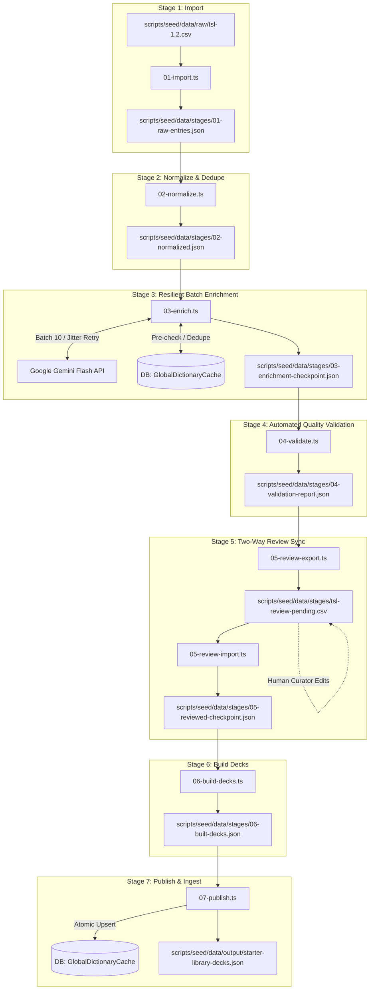

# 🏗️ Technical Architecture & Implementation Plan: Content Enrichment Pipeline (US-LIB-01)

- **Feature ID**: US-LIB-01
- **Architectural Paradigm**: Modular TypeScript CLI Runner with Disk Checkpoint Persistence
- **Execution Target**: Monorepo Root / `apps/api` Seeding Infrastructure
- **Simplicity Guideline**: Ponytail 7-Rung Architecture Ladder (Minimal Files, Stdlib First, Zero Speculative Abstractions)

---

## 1. Component Architecture & Data Flow



---

## 2. Ponytail Architecture Ladder Compliance

1. **Rung 1: Reuse existing monorepo code**: Tái sử dụng các kiểu dữ liệu từ `packages/shared-types` (`AiGeneratedCardData`, `AiCardSource`, `GlobalDictionaryCacheRecord`).
2. **Rung 2: Native Standard Library First**:
   - Sử dụng `node:fs/promises` và `node:path` cho thao tác file.
   - Sử dụng `node:crypto` (`randomUUID()`) để tạo ID bản ghi khi cần.
   - Sử dụng native `fetch` của Node 20+ cho các lệnh gọi HTTP nếu không có SDK.
3. **Rung 3: Prisma Client Integration**: Tận dụng trực tiếp `@prisma/client` đã sinh sẵn tại `apps/api/prisma` để thực hiện upsert cơ sở dữ liệu tốc độ cao, không viết lại raw SQL trừ khi cần bulk insert tối ưu.
4. **Rung 4: Zero Speculative Micro-wrappers**:
   - Không tạo các service class rườm rà (LoggerService, ConfigWrapper, ValidationStrategyPattern).
   - Từng stage là một file kịch bản độc lập xuất hàm `runStageX()`, có thể chạy riêng lẻ (`tsx scripts/seed/0X-name.ts`) hoặc chạy toàn bộ qua file điều phối `run-pipeline.ts`.
5. **Rung 5: Atomic Checkpoint Writes**: Cơ chế chống lỗi file JSON hỏng khi ghi đè đĩa: ghi file tạm `filename.tmp` -> gọi `rename()` đè lên file chính.

---

## 3. Directory & File Layout

```
WordStreak/
├── scripts/
│   └── seed/
│       ├── run-pipeline.ts               # Điều phối toàn bộ pipeline từ 1 -> 7
│       ├── 01-import.ts                  # Đọc CSV thô, trích xuất dữ liệu gốc
│       ├── 02-normalize.ts               # POS mapping, dedupe chéo, gán level T1/T2/T3
│       ├── 03-enrich.ts                  # Batch 10 words, Gemini call, retry jitter, checkpoint
│       ├── 04-validate.ts                # Regex IPA, lemma sentence check, gắn cờ FLAGGED
│       ├── 05-review-export.ts           # Xuất CSV các từ FLAGGED để curator duyệt
│       ├── 05-review-import.ts           # Đọc CSV đã duyệt, đồng bộ ngược vào checkpoint
│       ├── 06-build-decks.ts             # Cắt 25 từ/deck, tạo tiêu đề & slug SEO
│       ├── 07-publish.ts                 # Upsert vào DB GlobalDictionaryCache, xuất JSON output
│       ├── lib/
│       │   ├── gemini-batch-client.ts    # Helper gọi Gemini batch 10 từ kèm backoff
│       │   ├── validation-rules.ts       # Các hàm pure validator (IPA regex, lemma match)
│       │   └── file-utils.ts             # Atomic write helper
│       ├── data/
│       │   ├── raw/
│       │   │   ├── tsl-1.2.csv           # Dữ liệu gốc TSL
│       │   │   └── ngsl-1.2.csv          # Dữ liệu gốc NGSL
│       │   ├── stages/                   # Thư mục chứa checkpoints qua từng bước
│       │   │   ├── 01-raw-entries.json
│       │   │   ├── 02-normalized.json
│       │   │   ├── 03-enrichment-checkpoint.json
│       │   │   ├── 04-validation-report.json
│       │   │   ├── tsl-review-pending.csv
│       │   │   ├── 05-reviewed-checkpoint.json
│       │   └── 06-built-decks.json
│       │   └── output/
│       │       └── starter-library-decks.json # Artifact chuẩn cho US-LIB-02
│       └── __tests__/                    # Bộ test tự động
│           ├── normalizer.spec.ts
│           ├── validator.spec.ts
│           ├── deck-builder.spec.ts
│           ├── csv-sync.spec.ts
│           └── gemini-batch.spec.ts
```

---

## 4. Detailed Stage Specification & Contracts

### 4.1 Stage 1: `01-import.ts`
- **Input**: `scripts/seed/data/raw/tsl-1.2.csv`.
- **Output**: `scripts/seed/data/stages/01-raw-entries.json`.
- **Contract Type**:
```typescript
export interface RawWordEntry {
  headword: string;
  pos: string;
  freqRank: number;
  freqValue: number;
  listCode: 'TSL' | 'NGSL';
}
```

### 4.2 Stage 2: `02-normalize.ts`
- **Input**: `01-raw-entries.json`.
- **Output**: `02-normalized.json`.
- **Contract Type**:
```typescript
export interface NormalizedWordEntry {
  idempotencyKey: string; // TSL:word:pos
  word: string;
  partOfSpeech: 'noun' | 'verb' | 'adjective' | 'adverb' | 'preposition' | 'conjunction' | 'pronoun' | 'phrase';
  freqRank: number;
  level: 'T1' | 'T2' | 'T3';
  topicCategory: string;
  crossListRef?: string;
}
```

### 4.3 Stage 3: `03-enrich.ts`
- **Input**: `02-normalized.json` + `03-enrichment-checkpoint.json` (nếu có).
- **Prompt Structure for 10-Word Batch**:
```
You are a lexicographer for WordStreak. Enrich these 10 English business/workplace words for Vietnamese learners.
Output a JSON array of 10 objects matching:
[{
  "word": string,
  "partOfSpeech": string,
  "phonetic": "/.../ (valid IPA with slashes)",
  "meaningVi": "nghĩa tiếng Việt ngắn gọn, chuẩn xác",
  "meaningEn": "concise English definition",
  "exampleSentence": "A professional sentence containing the exact word or its inflected form",
  "exampleTranslation": "Bản dịch tiếng Việt của câu ví dụ",
  "collocations": ["collocation 1", "collocation 2"],
  "mnemonic": "Mẹo nhớ từ trực quan cho người Việt"
}]
Words: [...]
```

### 4.4 Stage 4: `04-validate.ts`
- **Rules applied**:
  - `IPA_FORMAT`: `/^\/[^\/]+\/$/`
  - `LEMMA_IN_SENTENCE`: `sentence.toLowerCase().includes(word.toLowerCase())` (hoặc kiểm tra stemming cơ bản)
  - `MEANING_VI_VALID`: độ dài $\ge 2$ ký tự, không chứa chuỗi báo lỗi "undefined", "n/a"
  - `COLLOCATIONS_MIN`: `Array.isArray(collocations) && collocations.length >= 2`

### 4.5 Stage 5: `05-review-export.ts` & `05-review-import.ts`
- **CSV Headers**: `idempotencyKey,word,partOfSpeech,phonetic,meaningVi,exampleSentence,status,curatorNotes`
- **Status values**: `APPROVED`, `FLAGGED`, `REJECTED`.

### 4.6 Stage 6: `06-build-decks.ts`
- **Logic**: Sắp xếp từ theo `freqRank`, gom cụm theo `topicCategory` và chia thành các nhóm 25 từ.
- **Slug generation**: `${listCode.toLowerCase()}-${level.toLowerCase()}-${kebabCase(topic)}-${pad2(deckIndex)}` (Ví dụ: `tsl-t1-office-communication-01`).

### 4.7 Stage 7: `07-publish.ts`
- **Action 1**: Bulk Upsert vào PostgreSQL table `global_dictionary_cache` qua Prisma:
```typescript
await prisma.globalDictionaryCache.upsert({
  where: { word: item.word },
  update: {
    partOfSpeech: item.partOfSpeech,
    phonetic: item.phonetic,
    meaningVi: item.meaningVi,
    meaningEn: item.meaningEn,
    exampleSentence: item.exampleSentence,
    exampleTranslation: item.exampleTranslation,
    collocations: JSON.stringify(item.collocations),
    mnemonic: item.mnemonic,
    source: 'TSL_OFFICIAL',
    updatedAt: new Date(),
  },
  create: {
    word: item.word,
    partOfSpeech: item.partOfSpeech,
    phonetic: item.phonetic,
    meaningVi: item.meaningVi,
    meaningEn: item.meaningEn,
    exampleSentence: item.exampleSentence,
    exampleTranslation: item.exampleTranslation,
    collocations: JSON.stringify(item.collocations),
    mnemonic: item.mnemonic,
    source: 'TSL_OFFICIAL',
    hitCount: 1,
  },
});
```
- **Action 2**: Ghi file `starter-library-decks.json` sẵn sàng làm input cho US-LIB-02.

---

## 5. Dependency-Ordered Implementation Tasks (Phase 5 Roadmap)

| Task ID | Giai đoạn | Mô tả công việc | File mục tiêu | Độ phụ thuộc | Parallel? |
| :--- | :--- | :--- | :--- | :---: | :---: |
| **TSK-LIB-01** | Contracts & Lib | Khai báo types và các hàm tiện ích dùng chung (atomic write, retry backoff) | `scripts/seed/lib/file-utils.ts`, `validation-rules.ts` | Không | [P] |
| **TSK-LIB-02** | Test First (TDD) | Viết bộ Unit test cho Normalizer, Validator và Deck Builder | `scripts/seed/__tests__/*.spec.ts` | TSK-LIB-01 | [P] |
| **TSK-LIB-03** | Stage 1 (Import) | Viết parser đọc raw CSV và xuất `01-raw-entries.json` | `scripts/seed/01-import.ts` | TSK-LIB-01 | Không |
| **TSK-LIB-04** | Stage 2 (Normalize) | Viết logic POS mapping, dedupe và gán level T1/T2/T3 | `scripts/seed/02-normalize.ts` | TSK-LIB-03 | Không |
| **TSK-LIB-05** | Stage 3 (Enrich) | Viết client gọi Gemini batch 10 từ, xử lý 429 backoff jitter và checkpoint đĩa | `scripts/seed/03-enrich.ts`, `lib/gemini-batch-client.ts` | TSK-LIB-04 | Không |
| **TSK-LIB-06** | Stage 4 (Validate) | Viết engine tự động kiểm tra IPA regex, lemma sentence check | `scripts/seed/04-validate.ts` | TSK-LIB-05 | Không |
| **TSK-LIB-07** | Stage 5 (CSV Review) | Viết script xuất và nạp CSV hai chiều cho Curator | `scripts/seed/05-review-export.ts`, `05-review-import.ts` | TSK-LIB-06 | Không |
| **TSK-LIB-08** | Stage 6 (Decks) | Viết logic gom cụm 25 từ/deck và sinh SEO slug | `scripts/seed/06-build-decks.ts` | TSK-LIB-07 | Không |
| **TSK-LIB-09** | Stage 7 (Publish) | Viết logic upsert vào `GlobalDictionaryCache` và xuất `starter-library-decks.json` | `scripts/seed/07-publish.ts` | TSK-LIB-08 | Không |
| **TSK-LIB-10** | Orchestrator | Viết file runner điều phối và thêm lệnh `pnpm seed:pipeline` vào `package.json` | `scripts/seed/run-pipeline.ts`, `package.json` | TSK-LIB-09 | Không |
