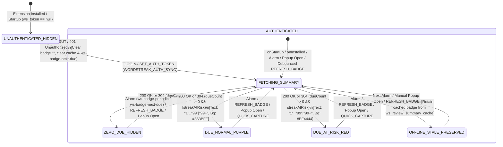
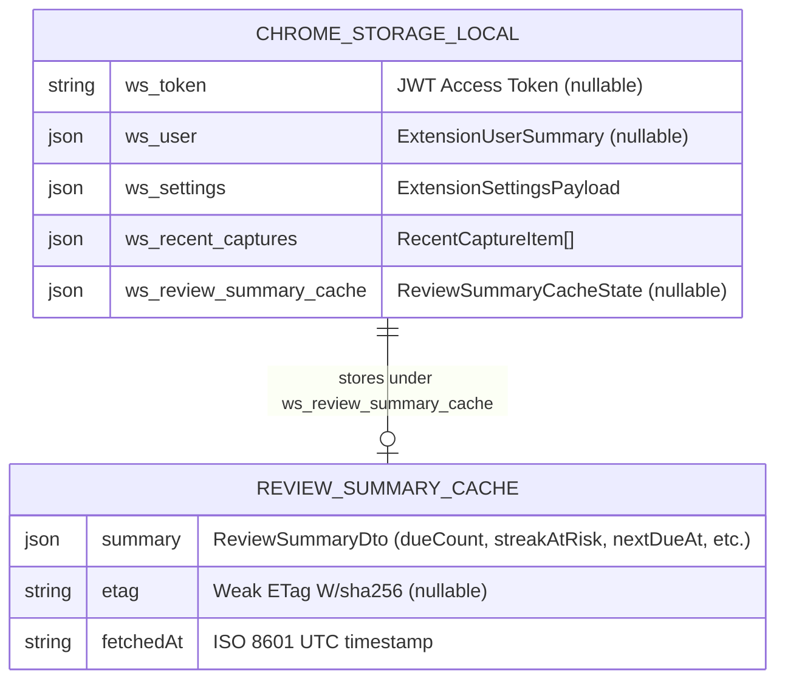

# Domain Model: Extension Due Cards Badge (`US-ECO-05`)

- **Feature Slug**: `extension-due-badge`
- **Protocol Depth**: Bounded Task (Light Domain Model)
- **Date**: 2026-10-12
- **Source Artifacts**: [00-intake.md](./00-intake.md), [01-elicitation.md](./01-elicitation.md)

---

## 1. RBAC & Access Control Matrix

| Role / State | Fetch `GET /api/reviews/summary` | View Extension Toolbar Badge | Trigger `WORDSTREAK_REVIEW_SYNC` | Storage & Ownership Boundary |
| :--- | :---: | :---: | :---: | :--- |
| **Unauthenticated / Guest (`ws_token === null`)** | Denied (`401` if called; skipped client-side when `ws_token === null`) | Hidden (`text = ""`) | Ignored (no token in Extension storage) | Local storage `ws_review_summary_cache` is empty/cleared. |
| **Authenticated Learner (`ws_token !== null`)** | Allowed (`Bearer <ws_token>`, scoped to `user.sub` via `JwtAuthGuard`) | Visible when `dueCount > 0` (`"1".."99"` or `"99+"`); Hidden (`""`) when `dueCount === 0` | Allowed (relayed from `apps/web` via content script to background worker) | Strictly isolated to the authenticated user's non-archived decks (`BR-REM-002`). Purged immediately on `LOGOUT` or `401`. |

---

## 2. State Machine & Badge Lifecycle



---

## 3. Business Rules & Algorithms (`BR-EDB-###`)

- **BR-EDB-001 (Badge Text Formatting & 4-Char Cap)**:
  - The Extension toolbar badge (`chrome.action.setBadgeText`) is driven exclusively by `ReviewSummaryDto.dueCount` (`ASM-EDB-001`, `ASM-EDB-002`):
    - If unauthenticated (`ws_token === null`) or `dueCount <= 0`: badge text MUST be `""` (empty string, hiding the badge).
    - If `1 <= dueCount <= 99`: badge text MUST be `String(dueCount)` (e.g., `"1"`, `"42"`, `"99"`).
    - If `dueCount > 99`: badge text MUST be `"99+"` (capped at 3 characters so it never truncates inside Chrome's 4-character badge box).

- **BR-EDB-002 (Badge Color Semantics & Urgency Shift)**:
  - When `dueCount > 0` and `streakAtRisk === false`: badge background color (`chrome.action.setBadgeBackgroundColor`) MUST be Brand Purple `#863BFF`, and badge text color (`chrome.action.setBadgeTextColor`, if supported by the browser runtime) MUST be `#FFFFFF` (`ASM-EDB-003`).
  - When `dueCount > 0` and `streakAtRisk === true`: badge background color MUST shift to Danger Red `#EF4444` with white text `#FFFFFF` (`ASM-EDB-003`).

- **BR-EDB-003 (Unauthenticated & `401 Unauthorized` Cleanup)**:
  - Before calling `GET /api/reviews/summary`, if `ws_token` in `chrome.storage.local` is `null` or empty, the service worker MUST NOT make a network request; instead it MUST clear `ws_review_summary_cache`, cancel any active `ws-badge-next-due` alarm, and set badge text to `""`.
  - If `GET /api/reviews/summary` returns `401 Unauthorized`, `ExtensionApiClient` / badge service MUST clear `ws_token`, `ws_user`, and `ws_review_summary_cache` in `chrome.storage.local`, cancel `ws-badge-next-due`, and set badge text to `""`.

- **BR-EDB-004 (Offline & Transient `5xx` Error Resilience)**:
  - If `GET /api/reviews/summary` fails due to a network error (`TypeError: Failed to fetch` / offline) or HTTP `5xx` server error while `ws_token` is still present, the service worker MUST retain `ws_review_summary_cache` in `chrome.storage.local` and re-apply (or keep) the badge rendered from `ws_review_summary_cache.summary` if available, without throwing an unhandled rejection.

- **BR-EDB-005 (Periodic Fallback Alarm `ws-badge-periodic`)**:
  - `apps/extension/manifest.json` MUST declare the `"alarms"` permission.
  - On `chrome.runtime.onInstalled` and `chrome.runtime.onStartup`, the background service worker MUST ensure a recurring alarm named `"ws-badge-periodic"` exists with `periodInMinutes: 30` (`ASM-EDB-004`).

- **BR-EDB-006 (Dynamic One-Shot `nextDueAt` Alarm `ws-badge-next-due`)**:
  - After every successful summary evaluation (`200 OK` or `304 Not Modified`), the background service worker MUST inspect `summary.nextDueAt` (`ASM-EDB-004`):
    - Let `now = Date.now()` and `nextDueMs = summary.nextDueAt ? Date.parse(summary.nextDueAt) : NaN`.
    - If `!Number.isNaN(nextDueMs)` and `nextDueMs > now` and `nextDueMs - now < 30 * 60 * 1000` (sooner than the 30-minute periodic cycle): schedule/overwrite a one-shot alarm `"ws-badge-next-due"` with `when: Math.max(now + 60_000, nextDueMs)` (enforcing Chrome MV3's 60-second minimum delay floor).
    - Otherwise (when `nextDueAt === null`, invalid, in the past, or `>= 30` minutes in the future): clear any existing `"ws-badge-next-due"` alarm via `chrome.alarms.clear("ws-badge-next-due")`.

- **BR-EDB-007 (Conditional ETag Caching & Timezone Header)**:
  - The extension MUST store `ReviewSummaryCacheState` (`{ summary: ReviewSummaryDto, etag: string | null, fetchedAt: string }`) under key `ws_review_summary_cache` in `chrome.storage.local` (`ASM-EDB-005`).
  - Every request to `GET /api/reviews/summary` MUST include header `X-Timezone: Intl.DateTimeFormat().resolvedOptions().timeZone || "UTC"`.
  - If `ws_review_summary_cache?.etag` is non-null, the request MUST include header `If-None-Match: <etag>`.
  - On `200 OK`: extract `response.headers.get("etag")` (or `"ETag"`), persist `{ summary: body.data, etag, fetchedAt: new Date().toISOString() }` in `chrome.storage.local`, update badge (`BR-EDB-001`, `BR-EDB-002`), and schedule/clear `"ws-badge-next-due"` (`BR-EDB-006`).
  - On `304 Not Modified`: retain `ws_review_summary_cache.summary` and `etag`, update `fetchedAt`, re-apply badge from cached `summary`, and schedule/clear `"ws-badge-next-due"` (`BR-EDB-006`).
  - Backend CORS in `apps/api/src/main.ts` MUST include `exposedHeaders: ['ETag']` so cross-origin extension/browser `fetch` calls can always read the `ETag` header (`ASM-EDB-005`).

- **BR-EDB-008 (Web App → Extension Real-Time Review Sync & 3s Trailing Debounce)**:
  - The Web App (`apps/web`) MUST call `window.postMessage({ type: "WORDSTREAK_REVIEW_SYNC" }, "*")` after:
    1. A successful online review submission (`reviewsService.submitReview` in `useReviewSession.ts`).
    2. A successful offline review batch sync (`reconnectionSyncEngine.ts` when `syncedCount > 0`).
  - The Extension content script (`apps/extension/src/content/index.ts`) MUST listen for `message` events where `event.source === window && event.data?.type === "WORDSTREAK_REVIEW_SYNC"` and send `{ type: "REFRESH_BADGE" }` via `chrome.runtime.sendMessage`.
  - When the background service worker receives `{ type: "REFRESH_BADGE" }` without `immediate: true`, it MUST coalesce calls using a **3,000ms trailing debounce timer** (`setTimeout` reset on each message within 3s) and a single-flight lock so rapid flashcard grading or malicious web page `postMessage` spam cannot flood `GET /api/reviews/summary`.
  - **Anti-Abuse Note**: This flow is strictly read-only (`GET /api/reviews/summary`) and awards zero XP/streak mutations; the 3-second trailing debounce + single-flight lock caps `WORDSTREAK_REVIEW_SYNC`-triggered API calls to at most 1 request per 3 seconds.

- **BR-EDB-009 (Immediate Badge Refresh Triggers)**:
  - The background service worker MUST execute an **immediate** (un-debounced, clearing any pending debounce timer) badge refresh on:
    1. `chrome.runtime.onInstalled`
    2. `chrome.runtime.onStartup`
    3. `chrome.alarms.onAlarm` when `alarm.name === "ws-badge-periodic"` or `alarm.name === "ws-badge-next-due"`
    4. `LOGIN` and `SET_AUTH_TOKEN` message handlers in background service worker
    5. `GET_AUTH_STATUS` (invoked when the user opens the Extension Popup `PopupApp`) or `{ type: "REFRESH_BADGE", payload: { immediate: true } }`
    6. Successful `QUICK_CAPTURE` (both from message handler and context menu handler)

---

## 4. Workflows & Edge-Case Resolutions

### Happy Path Sequence
1. User starts Chrome (`onStartup`) or logs into WordStreak on Web App (`WORDSTREAK_AUTH_SYNC` → `SET_AUTH_TOKEN`).
2. Background service worker ensures alarm `ws-badge-periodic` (`30 min`) is active and immediately invokes `refreshBadge()`.
3. `refreshBadge()` reads `ws_token` and `ws_review_summary_cache` from `chrome.storage.local`, then calls `GET /api/reviews/summary` with `Authorization: Bearer <token>`, `X-Timezone`, and `If-None-Match`.
4. Backend returns `200 OK` with `ReviewSummaryDto` (`dueCount: 14, streakAtRisk: false, nextDueAt: "+12m"`) and `ETag: W/"abc..."`.
5. Background service worker saves `{ summary, etag, fetchedAt }` to `ws_review_summary_cache`, sets badge text to `"14"` and background color to `#863BFF`, and schedules one-shot alarm `ws-badge-next-due` for `nextDueAt`.
6. User reviews all 14 cards on the Web App (`/review`). After each card, Web App emits `WORDSTREAK_REVIEW_SYNC`; content script sends `REFRESH_BADGE`. Background worker debounces rapid events by 3 seconds, fetches `GET /api/reviews/summary` (`dueCount: 0`), and clears badge text to `""`.

### Edge-Case Resolutions
1. **Service Worker Terminated Mid-Debounce (MV3 Ephemeral Worker)**:
   - *Resolution*: While a 3-second `setTimeout` is short enough that Chrome MV3 keeps the service worker alive (~30s idle timeout after `onMessage`), if the user closes the tab or the worker sleeps, the next Popup open, `ws-badge-next-due`, or `ws-badge-periodic` alarm guarantees convergence.
2. **Concurrent Refresh Calls (In-Flight Deduplication)**:
   - *Resolution*: If `refreshBadge()` is already in flight when another trigger fires (e.g., `onInstalled` + `SET_AUTH_TOKEN` simultaneously), reuse the active Promise or queue a single follow-up pass so duplicate network calls are never sent simultaneously.
3. **`nextDueAt` Timestamp Already in the Past or `< 60s` Away**:
   - *Resolution*: Per `BR-EDB-006`, if `nextDueAt <= now`, `ws-badge-next-due` is not scheduled (the cards are already counted in `dueCount`). If `0 < nextDueAt - now < 60_000`, `when` is clamped to `now + 60_000` to satisfy Chrome's 1-minute alarm floor without warnings.
4. **304 Not Modified When Service Worker Restarts (Cold Browser Launch)**:
   - *Resolution*: On browser restart, Chrome clears volatile badge state in some OS/profiles while `ws_review_summary_cache` in `chrome.storage.local` persists. When `onStartup` receives `304 Not Modified`, `BR-EDB-007` explicitly re-applies `setBadgeText` and `setBadgeBackgroundColor` using the cached `summary` from `chrome.storage.local`.
5. **User Logs Out on Web App (`WORDSTREAK_AUTH_SYNC` with `token: null`)**:
   - *Resolution*: Content script sends `{ type: "LOGOUT" }` to background service worker. `LOGOUT` clears `ws_token`, `ws_user`, `ws_review_summary_cache`, clears `ws-badge-next-due` alarm, cancels any pending debounce timer, and sets badge text to `""` (`BR-EDB-003`).
6. **Offline Study on Web App Followed by Reconnection Sync**:
   - *Resolution*: While offline, Web App queues reviews in IndexedDB and Extension retains its last cached badge (`BR-EDB-004`). As soon as `reconnectionSyncEngine.ts` completes `syncReviewBatch` on reconnect, it posts `WORDSTREAK_REVIEW_SYNC`, causing the Extension to refresh and clear/update the badge within 3 seconds.

---

## 5. Entities, Data Boundaries & Privacy



- **Shared Types Contract (`packages/shared-types/src/extension.ts`)**:
  - Add `ReviewSummaryCacheState`:
    ```ts
    export interface ReviewSummaryCacheState {
      summary: ReviewSummaryDto;
      etag: string | null;
      fetchedAt: string;
    }
    ```
  - Extend `ExtensionMessage` union with:
    `{ type: "REFRESH_BADGE"; payload?: { immediate?: boolean } }`
- **Deletion & Retention Policy**:
  - `ws_review_summary_cache` is overwritten on every `200 OK` summary fetch and hard-deleted (`chrome.storage.local.remove`) immediately on `LOGOUT` or `401 Unauthorized`.
- **Privacy & Compliance**:
  - Contains only aggregate numeric counts and timestamps (`ReviewSummaryDto`); zero PII or flashcard text is stored in `ws_review_summary_cache`.

---

## 6. UX States & Non-Functional Requirements

- **UX Visual States (Extension Toolbar Icon Badge)**:
  - **Hidden State (`dueCount === 0` or Logged Out)**: `badgeText = ""` (clean WordStreak icon with no badge overlay).
  - **Normal Due State (`1 <= dueCount <= 99`, `streakAtRisk === false`)**: `badgeText = "<dueCount>"`, `backgroundColor = "#863BFF"`, `textColor = "#FFFFFF"`.
  - **Overflow Due State (`dueCount > 99`, `streakAtRisk === false`)**: `badgeText = "99+"`, `backgroundColor = "#863BFF"`, `textColor = "#FFFFFF"`.
  - **Streak-At-Risk Due State (`dueCount > 0`, `streakAtRisk === true`)**: `badgeText = "<dueCount | 99+>"`, `backgroundColor = "#EF4444"`, `textColor = "#FFFFFF"`.
  - **Offline / Error State**: Preserves last rendered badge from `ws_review_summary_cache` without intrusive popups or error badges.
- **Performance Targets**:
  - Immediate badge update after `200 OK` / `304 Not Modified`: `< 50ms` local execution time.
  - Web App review completion to Extension badge update: `<= 3.5s` (3,000ms debounce + `< 500ms` network & render).
- **Security**:
  - Content script validates `event.source === window` before relaying `WORDSTREAK_REVIEW_SYNC`.
  - Background worker never trusts payload counts from `window.postMessage`; `WORDSTREAK_REVIEW_SYNC` is treated solely as a cache-invalidation signal that triggers an authenticated `GET /api/reviews/summary` fetch using `ws_token`.
- **i18n / l10n**: N/A for badge text (`"1".."99"` and `"99+"` are language-neutral numeric strings).
- **Accessibility**: Toolbar badge uses high-contrast white text (`#FFFFFF`) on `#863BFF` (Brand Purple) and `#EF4444` (Danger Red).
- **Observability**: Silent defensive error handling in background service worker (`console.warn` on transient fetch failure) so MV3 extension error logs remain clean during offline browsing.
