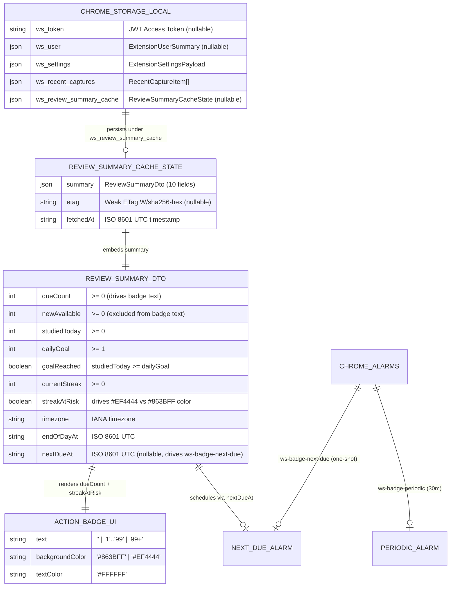

# Data Model & Storage Schema: Extension Due Cards Badge (`US-ECO-05`)

**Feature**: `US-ECO-05`: Badge số thẻ đến hạn trên icon Extension  
**Slug**: `extension-due-badge`  
**Date**: 2026-10-12  
**Status**: Approved (Phase 3 - Plan)  
**Database Schema Migrations Required**: **0 (Zero database schema changes — `CON-EDB-002`)**

---

## 1. Storage & Messaging Entity-Relationship Overview

`US-ECO-05` operates across Chrome Extension Manifest V3 local storage (`chrome.storage.local`), Chrome Alarms (`chrome.alarms`), and cross-context message channels (`window.postMessage` and `chrome.runtime.sendMessage`). No PostgreSQL tables or Prisma models are added or modified.



---

## 2. Shared TypeScript Contracts (`packages/shared-types/src/extension.ts`)

### 2.1. `ReviewSummaryCacheState`

Added to [`packages/shared-types/src/extension.ts`](file:///Users/vutuanhau/Documents/PROJECT/WordStreak/packages/shared-types/src/extension.ts) and re-exported via [`packages/shared-types/src/index.ts`](file:///Users/vutuanhau/Documents/PROJECT/WordStreak/packages/shared-types/src/index.ts):

```typescript
import type { ReviewSummaryDto } from "./reviews.js";

export interface ReviewSummaryCacheState {
  /** Cached 10-field study summary from GET /api/reviews/summary */
  summary: ReviewSummaryDto;
  /** Weak ETag header (e.g. W/"<sha256-hex>") for If-None-Match conditional requests */
  etag: string | null;
  /** ISO 8601 UTC timestamp when this cache entry was last validated (200 OK or 304 Not Modified) */
  fetchedAt: string;
}
```

### 2.2. `ExtensionStorageState` & `ExtensionMessage` Extensions

```typescript
export interface ExtensionStorageState {
  token: string | null;
  user: ExtensionUserSummary | null;
  settings: ExtensionSettingsPayload;
  recentCaptures: RecentCaptureItem[];
  reviewSummaryCache?: ReviewSummaryCacheState | null;
}

export type ExtensionMessage =
  | { type: "QUICK_CAPTURE"; payload: QuickCaptureCardDto }
  | { type: "GET_AUTH_STATUS" }
  | { type: "LOGIN"; payload: { identifier: string; password: string } }
  | { type: "SET_AUTH_TOKEN"; payload: { token: string } }
  | { type: "LOGOUT" }
  | { type: "FETCH_DECKS" }
  | { type: "GET_SETTINGS" }
  | { type: "UPDATE_SETTINGS"; payload: Partial<ExtensionSettingsPayload> }
  | { type: "REFRESH_BADGE"; payload?: { immediate?: boolean } };
```

---

## 3. Extension Local Storage Keys & Lifecycle (`apps/extension/src/shared/`)

| Storage Key Constant | Raw Key in `chrome.storage.local` | Value Type | Write Triggers | Clear / Delete Triggers |
| :--- | :--- | :--- | :--- | :--- |
| `STORAGE_KEYS.TOKEN` | `"ws_token"` | `string \| null` | `LOGIN`, `SET_AUTH_TOKEN` | `LOGOUT`, `401 Unauthorized` (`BR-EDB-003`) |
| `STORAGE_KEYS.USER` | `"ws_user"` | `ExtensionUserSummary \| null` | `LOGIN`, `SET_AUTH_TOKEN`, `GET_AUTH_STATUS` | `LOGOUT`, `401 Unauthorized` (`BR-EDB-003`) |
| `STORAGE_KEYS.REVIEW_SUMMARY_CACHE` | `"ws_review_summary_cache"` | `ReviewSummaryCacheState \| null` | `200 OK` (updates `summary`, `etag`, `fetchedAt`) and `304 Not Modified` (updates `fetchedAt`) | Missing `ws_token`, `LOGOUT`, or `401 Unauthorized` (`BR-EDB-003`). Preserved on offline / `5xx` errors (`BR-EDB-004`). |

---

## 4. Chrome Alarms Model (`chrome.alarms`)

| Alarm Name Constant | Raw Alarm Name | Mode | Schedule Rule | Business Rule |
| :--- | :--- | :--- | :--- | :--- |
| `ALARM_NAMES.BADGE_PERIODIC` | `"ws-badge-periodic"` | Recurring | `chrome.alarms.create("ws-badge-periodic", { periodInMinutes: 30 })` on `onInstalled` and `onStartup`. Never cleared on logout so periodic recovery continues when user logs back in. | `BR-EDB-005` |
| `ALARM_NAMES.BADGE_NEXT_DUE` | `"ws-badge-next-due"` | One-shot (`when`) | Scheduled after `200 OK` or `304` when `summary.nextDueAt` is valid and `0 < nextDueMs - now < 30 * 60 * 1000`, with `when = Math.max(now + 60_000, nextDueMs)`. Cleared via `chrome.alarms.clear("ws-badge-next-due")` otherwise or on logout/`401`. | `BR-EDB-003`, `BR-EDB-006` |

---

## 5. Badge Visual State Derivation Matrix (`BR-EDB-001`, `BR-EDB-002`)

| Auth State (`ws_token`) | `dueCount` | `streakAtRisk` | Badge Text (`setBadgeText`) | Badge Background (`setBadgeBackgroundColor`) | Badge Text Color (`setBadgeTextColor`) |
| :--- | :---: | :---: | :---: | :---: | :---: |
| `null` (Unauthenticated) | Any | Any | `""` (Hidden) | *(Not called / N/A)* | *(Not called / N/A)* |
| Present (`!== null`) | `<= 0` | `false` or `true` | `""` (Hidden) | *(Not called / N/A)* | *(Not called / N/A)* |
| Present (`!== null`) | `1 .. 99` | `false` | `String(dueCount)` (`"1"`..`"99"`) | `#863BFF` (Brand Purple) | `#FFFFFF` (White) |
| Present (`!== null`) | `> 99` | `false` | `"99+"` | `#863BFF` (Brand Purple) | `#FFFFFF` (White) |
| Present (`!== null`) | `1 .. 99` | `true` | `String(dueCount)` (`"1"`..`"99"`) | `#EF4444` (Danger Red) | `#FFFFFF` (White) |
| Present (`!== null`) | `> 99` | `true` | `"99+"` | `#EF4444` (Danger Red) | `#FFFFFF` (White) |
