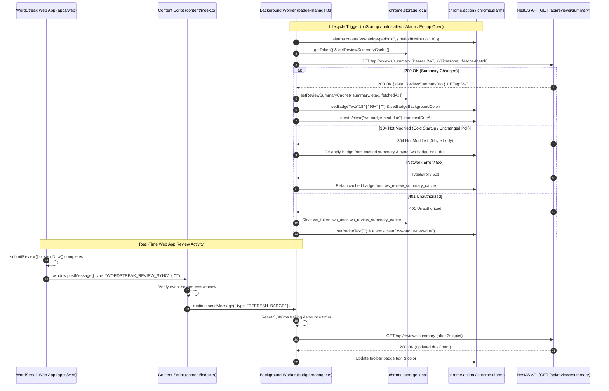

# Implementation Plan: Extension Due Cards Badge (`US-ECO-05`)

**Branch**: `feat/extension-due-badge` | **Date**: 2026-10-12 | **Spec**: [`spec.md`](file:///Users/vutuanhau/Documents/PROJECT/WordStreak/.specify/features/extension-due-badge/spec.md)  
**Domain Baseline**: [`baseline.md`](file:///Users/vutuanhau/Documents/PROJECT/WordStreak/.specify/features/extension-due-badge/baseline.md) (`SIGNED-OFF v1.0`)

---

## 1. Summary

This plan defines the technical architecture and TDD implementation strategy for **US-ECO-05: Badge số thẻ đến hạn trên icon Extension (`extension-due-badge`)**. The feature connects the WordStreak Chrome Extension (Manifest V3) to `GET /api/reviews/summary` (`US-REM-01`) to render an always-accurate due cards count (`"1"`..`"99"`, `"99+"`, or `""`) and streak-at-risk color shift (`#863BFF` Brand Purple vs `#EF4444` Danger Red) on the browser toolbar icon. It introduces persistent Weak `ETag` caching (`ws_review_summary_cache` in `chrome.storage.local`), dual-alarm scheduling (`"ws-badge-periodic"` every 30 minutes + dynamic one-shot `"ws-badge-next-due"`), offline stale-cache preservation, and a real-time `WORDSTREAK_REVIEW_SYNC` bridge from the Web App with a 3,000ms trailing debounce.

---

## 2. Technical Context

- **Language/Version**: TypeScript 5.7+ / 6.0 (strict mode enabled across monorepo)
- **Primary Dependencies**:
  - Extension (`apps/extension`): Chrome Extension Manifest V3 APIs (`chrome.action`, `chrome.alarms`, `chrome.storage.local`, `chrome.runtime`), Vite 8, Vitest 4
  - Shared Contracts (`packages/shared-types`): `@wordstreak/shared-types`
  - Backend (`apps/api`): NestJS 11 CORS configuration (`exposedHeaders: ['ETag']`)
  - Web App (`apps/web`): React 19 hooks (`useReviewSession.ts`) & Offline Sync Engine (`reconnectionSyncEngine.ts`)
- **Storage**: `chrome.storage.local` key `ws_review_summary_cache` (`ReviewSummaryCacheState`) — **0 database schema migrations**
- **Testing**: Vitest (`apps/extension` and `apps/web`), Jest (`apps/api`)
- **Target Platform**: Chromium Manifest V3 Browser Extension + WordStreak Web App
- **Project Type**: Fullstack Monorepo (`pnpm` workspaces)
- **Performance Goals**:
  - Local badge render execution `< 50ms`; immediate trigger refresh `< 500ms` (`SC-001`)
  - Web App review sync latency `<= 3.5s` (`3,000ms` trailing debounce + fetch) (`SC-002`)
  - `0 bytes` response body on `304 Not Modified` via persistent `If-None-Match` ETag (`SC-003`)
- **Constraints**:
  - MV3 service worker is ephemeral; all cached summary and ETag state MUST live in `chrome.storage.local` (`CON-EDB-001`)
  - Zero Prisma schema or database migration changes (`CON-EDB-002`)
  - File `< 800` lines, function `< 50` lines, immutable data updates, strict TypeScript

---

## 3. Constitution Check

*GATE: Evaluation against [`.specify/memory/constitution.md`](file:///Users/vutuanhau/Documents/PROJECT/WordStreak/.specify/memory/constitution.md) (v1.0.0)*

| Principle | Status | Compliance Verification |
| :--- | :--- | :--- |
| **I. Code Quality First** | ✅ PASS | Strict TypeScript, shared contracts in `packages/shared-types/src/extension.ts`, single-responsibility `badge-manager.ts` (`< 250` lines, functions `< 50` lines), immutable state objects. |
| **II. Testing Standards** | ✅ PASS | Strict TDD workflow (`test-plan.md` → failing unit tests → implementation). Unit tests cover `badge-manager.spec.ts`, `api-client.spec.ts`, `storage.spec.ts`, and Web App `WORDSTREAK_REVIEW_SYNC` emission. |
| **III. UX Consistency** | ✅ PASS | Uses official WordStreak brand palette (`#863BFF` Brand Purple, `#EF4444` Danger Red, `#FFFFFF` text) and hides cleanly (`""`) when `dueCount === 0` or unauthenticated; preserves last known state offline without intrusive errors. |
| **IV. Performance Requirements** | ✅ PASS | Conditional `If-None-Match` ETag caching yields `304 Not Modified` (`0 bytes`), 3s trailing debounce prevents request storms during rapid flashcard grading, and single-flight deduplication prevents concurrent fetches. |
| **Technology Constraints** | ✅ PASS | Uses `@wordstreak/shared-types`, `pnpm` workspaces, Vitest, and Chrome MV3 native APIs. |

*Gate Result: ALL GATES PASSED.*

---

## 4. Project Structure & File Layout

### Documentation (`.specify/features/extension-due-badge/`)

```text
.specify/features/extension-due-badge/
├── 00-intake.md                                  # Stage 1: Bounded Task classification
├── 01-elicitation.md                             # Stage 2: Customer interview decisions & ASM-EDB-001..006
├── 03-domain-model.md                            # Stage 4: RBAC, state machine, BR-EDB-001..009, ERD
├── 04-risk-scope.md                              # Stage 5: Contradiction scan, RISK-EDB-001..005, MoSCoW
├── 06-validation-report.md                       # Stage 7: IEEE 29148 validation report
├── baseline.md                                   # Stage 8: Signed-off Domain Baseline v1.0
├── CHANGELOG.md                                  # Version log
├── spec/
│   ├── srs.md                                    # Stage 6: Formal REQ-EDB-001..009
│   └── user-stories.md                           # Stage 6: US-ECO-05 Gherkin scenarios (Scenarios 1..8)
├── checklists/
│   └── requirements.md                           # Phase 2: Spec quality checklist
├── spec.md                                       # Phase 2: Formal technical specification
├── data-model.md                                 # Phase 3: Storage, alarm & badge state data model
├── contracts/
│   └── extension-badge-sync.contract.md          # Phase 3: HTTP ETag, postMessage & runtime message contracts
├── plan.md                                       # Phase 3: Technical implementation plan (this file)
├── tasks.md                                      # Phase 4: Dependency-ordered TDD tasks
└── test-plan.md                                  # Phase 5 (T001): Gherkin test cases mapped to US-ECO-05
```

### Source Code (Repository Root)

```text
packages/shared-types/
└── src/
    └── extension.ts                              # [MODIFY] Add ReviewSummaryCacheState & REFRESH_BADGE message

apps/api/
└── src/
    └── main.ts                                   # [MODIFY] Add exposedHeaders: ['ETag'] to app.enableCors()

apps/extension/
├── manifest.json                                 # [MODIFY] Add "alarms" to permissions array
└── src/
    ├── shared/
    │   ├── constants.ts                          # [MODIFY] Add REVIEW_SUMMARY_CACHE key, BADGE_COLORS, ALARM_NAMES, BADGE_LIMITS
    │   ├── storage.ts                            # [MODIFY] Add getReviewSummaryCache() & setReviewSummaryCache()
    │   └── storage.spec.ts                       # [NEW] Unit tests for review summary cache storage helpers
    ├── background/
    │   ├── api-client.ts                         # [MODIFY] Add getReviewSummary() with X-Timezone, If-None-Match, 200/304/401 handling
    │   ├── api-client.spec.ts                    # [NEW] Unit tests for getReviewSummary() (200, 304, 401, network error)
    │   ├── badge-manager.ts                      # [NEW] Badge formatting, color shift, alarms, 3s debounce & single-flight refresh
    │   ├── badge-manager.spec.ts                 # [NEW] Unit tests for BR-EDB-001..009 & Scenarios 1..8
    │   └── index.ts                              # [MODIFY] Wire onInstalled, onStartup, onAlarm, LOGIN, SET_AUTH_TOKEN, LOGOUT, GET_AUTH_STATUS, QUICK_CAPTURE, REFRESH_BADGE
    └── content/
        └── index.ts                              # [MODIFY] Verify event.source === window and relay WORDSTREAK_REVIEW_SYNC -> REFRESH_BADGE

apps/web/
└── src/
    ├── features/reviews/hooks/
    │   ├── useReviewSession.ts                   # [MODIFY] Emit window.postMessage({ type: "WORDSTREAK_REVIEW_SYNC" }, "*") after online submitReview
    │   └── useReviewSession.spec.ts              # [MODIFY] Verify WORDSTREAK_REVIEW_SYNC emission on online review submit
    └── services/offline/
        ├── reconnectionSyncEngine.ts             # [MODIFY] Emit window.postMessage({ type: "WORDSTREAK_REVIEW_SYNC" }, "*") in dispatchSyncCompleted
        └── __tests__/
            └── reconnectionSyncEngine.spec.ts    # [MODIFY] Verify WORDSTREAK_REVIEW_SYNC emission after batch sync
```

---

## 5. Detailed Technical Design by Vertical Slice

### 5.1. Slice 1: Shared Types & Backend CORS (`packages/shared-types`, `apps/api`)

1. **`packages/shared-types/src/extension.ts`**:
   - Import `type { ReviewSummaryDto } from "./reviews.js";`
   - Define and export `ReviewSummaryCacheState`:
     ```typescript
     export interface ReviewSummaryCacheState {
       summary: ReviewSummaryDto;
       etag: string | null;
       fetchedAt: string;
     }
     ```
   - Add optional `reviewSummaryCache?: ReviewSummaryCacheState | null` to `ExtensionStorageState`.
   - Extend `ExtensionMessage` union with `{ type: "REFRESH_BADGE"; payload?: { immediate?: boolean } }`.

2. **`apps/api/src/main.ts`**:
   - Add `exposedHeaders: ['ETag']` inside `app.enableCors({ ... })` so browser/extension `fetch` calls can inspect `response.headers.get('etag')` (`BR-EDB-007`, `RISK-EDB-003`).

### 5.2. Slice 2: Extension Storage & API Client (`apps/extension/src/shared/`, `src/background/api-client.ts`)

1. **`apps/extension/src/shared/constants.ts`**:
   - Add `REVIEW_SUMMARY_CACHE: "ws_review_summary_cache"` to `STORAGE_KEYS`.
   - Export `BADGE_COLORS`, `ALARM_NAMES`, and `BADGE_LIMITS`:
     ```typescript
     export const BADGE_COLORS = {
       NORMAL_PURPLE: "#863BFF",
       AT_RISK_RED: "#EF4444",
       TEXT_WHITE: "#FFFFFF",
     } as const;

     export const ALARM_NAMES = {
       BADGE_PERIODIC: "ws-badge-periodic",
       BADGE_NEXT_DUE: "ws-badge-next-due",
     } as const;

     export const BADGE_LIMITS = {
       MAX_DISPLAY_COUNT: 99,
       PERIODIC_MINUTES: 30,
       MIN_ALARM_DELAY_MS: 60_000,
       MAX_NEXT_DUE_WINDOW_MS: 30 * 60 * 1000,
       DEBOUNCE_MS: 3_000,
     } as const;
     ```

2. **`apps/extension/src/shared/storage.ts`**:
   - Add `getReviewSummaryCache(): Promise<ReviewSummaryCacheState | null>` and `setReviewSummaryCache(cache: ReviewSummaryCacheState | null): Promise<void>`.
   - Update `getAll()` to include `reviewSummaryCache`.

3. **`apps/extension/src/background/api-client.ts`**:
   - Add `getReviewSummary(options?: { etag?: string | null; timezone?: string }): Promise<GetReviewSummaryResult>`:
     - Resolves `timezone = options?.timezone || Intl.DateTimeFormat().resolvedOptions().timeZone || "UTC"`.
     - Reads `token = await extensionStorage.getToken()`.
     - Builds headers with `Authorization: Bearer ${token}`, `X-Timezone: ${timezone}`, and conditional `If-None-Match: ${options.etag}`.
     - Calls `fetch(`${this.baseUrl}/reviews/summary`, { method: "GET", headers })`.
     - Handles `304 Not Modified` before checking `!response.ok`: returns `{ status: 304, etag: response.headers.get("etag") ?? options?.etag ?? null }`.
     - On `401 Unauthorized`: clears `ws_token`, `ws_user`, and `ws_review_summary_cache` via `extensionStorage`, then throws `Error("UNAUTHORIZED: Phiên đăng nhập hết hạn. Vui lòng đăng nhập lại.")`.
     - On `200 OK`: parses `body = await response.json()`, unwraps `const summary: ReviewSummaryDto = body?.data ?? body`, and returns `{ status: 200, summary, etag: response.headers.get("etag") }`.

### 5.3. Slice 3: Badge & Alarm Manager (`apps/extension/src/background/badge-manager.ts`, `index.ts`, `manifest.json`)

1. **`apps/extension/manifest.json`**:
   - Add `"alarms"` to `"permissions"`.

2. **Pure Domain Functions in `badge-manager.ts`**:
   - `formatBadgeText(dueCount: number, isAuthenticated: boolean): string`:
     - If `!isAuthenticated || dueCount <= 0` → `""`
     - If `dueCount > BADGE_LIMITS.MAX_DISPLAY_COUNT` (`99`) → `"99+"`
     - Else → `String(Math.floor(dueCount))` (`BR-EDB-001`)
   - `resolveBadgeColor(streakAtRisk: boolean): string`:
     - Returns `streakAtRisk ? BADGE_COLORS.AT_RISK_RED : BADGE_COLORS.NORMAL_PURPLE` (`BR-EDB-002`)
   - `computeNextDueAlarmTime(nextDueAt: string | null | undefined, nowMs: number = Date.now()): number | null`:
     - If `!nextDueAt` → `null`
     - `const nextDueMs = Date.parse(nextDueAt)`
     - If `Number.isNaN(nextDueMs) || nextDueMs <= nowMs || nextDueMs - nowMs >= BADGE_LIMITS.MAX_NEXT_DUE_WINDOW_MS` → `null`
     - Else → `Math.max(nowMs + BADGE_LIMITS.MIN_ALARM_DELAY_MS, nextDueMs)` (`BR-EDB-006`, `RISK-EDB-001`)

3. **`BadgeManager` Orchestration Class in `badge-manager.ts`**:
   - `applyBadgeVisuals(summary: ReviewSummaryDto | null, isAuthenticated: boolean): Promise<void>`:
     - Computes `text = summary ? formatBadgeText(summary.dueCount, isAuthenticated) : ""`.
     - Calls `await chrome.action?.setBadgeText?.({ text })`.
     - If `text !== ""` and `summary`:
       - Calls `await chrome.action?.setBadgeBackgroundColor?.({ color: resolveBadgeColor(summary.streakAtRisk) })`.
       - Safely calls `await chrome.action?.setBadgeTextColor?.({ color: BADGE_COLORS.TEXT_WHITE })` wrapped in `try / catch` (`RISK-EDB-005`).
   - `ensurePeriodicAlarm(): Promise<void>`:
     - Calls `await chrome.alarms?.create?.(ALARM_NAMES.BADGE_PERIODIC, { periodInMinutes: BADGE_LIMITS.PERIODIC_MINUTES })` (`BR-EDB-005`).
   - `syncNextDueAlarm(nextDueAt: string | null, nowMs: number = Date.now()): Promise<void>`:
     - Computes `when = computeNextDueAlarmTime(nextDueAt, nowMs)`.
     - If `when !== null`, calls `await chrome.alarms?.create?.(ALARM_NAMES.BADGE_NEXT_DUE, { when })`; else calls `await chrome.alarms?.clear?.(ALARM_NAMES.BADGE_NEXT_DUE)` (`BR-EDB-006`).
   - `clearAuthAndBadge(): Promise<void>`:
     - Clears pending `debounceTimer`.
     - Clears `token`, `user`, and `reviewSummaryCache` in `extensionStorage`.
     - Clears `ALARM_NAMES.BADGE_NEXT_DUE` via `chrome.alarms?.clear`.
     - Sets badge text to `""` via `chrome.action?.setBadgeText({ text: "" })` (`BR-EDB-003`).
   - `refreshBadgeNow(): Promise<ReviewSummaryDto | null>`:
     - Cancels any pending 3s `debounceTimer` (`BR-EDB-009`).
     - If `inFlightPromise` exists, sets `pendingFollowUp = true` and awaits `inFlightPromise` (single-flight deduplication).
     - Inside `executeRefresh()`:
       - Reads `token = await extensionStorage.getToken()`.
       - If `!token`: calls `await this.clearAuthAndBadge()` and returns `null` (`BR-EDB-003`).
       - Reads `cached = await extensionStorage.getReviewSummaryCache()`.
       - Calls `const result = await apiClient.getReviewSummary({ etag: cached?.etag })`.
       - If `result.status === 200`:
         - Persists `{ summary: result.summary, etag: result.etag, fetchedAt: new Date().toISOString() }`.
         - Calls `await this.applyBadgeVisuals(result.summary, true)` and `await this.syncNextDueAlarm(result.summary.nextDueAt)`.
         - Returns `result.summary`.
       - If `result.status === 304` and `cached?.summary`:
         - Persists `{ ...cached, etag: result.etag ?? cached.etag, fetchedAt: new Date().toISOString() }`.
         - Calls `await this.applyBadgeVisuals(cached.summary, true)` (`RISK-EDB-004`) and `await this.syncNextDueAlarm(cached.summary.nextDueAt)`.
         - Returns `cached.summary`.
       - Catch block:
         - If `error.message?.includes("UNAUTHORIZED") || error.message?.includes("401")`: calls `await this.clearAuthAndBadge()` and returns `null` (`BR-EDB-003`).
         - Otherwise (offline / network `TypeError` / `5xx`): preserves `cached`, re-applies `await this.applyBadgeVisuals(cached.summary, true)` if `cached?.summary` exists, logs `console.warn`, and returns `cached?.summary ?? null` (`BR-EDB-004`).
   - `scheduleDebouncedRefresh(): void`:
     - Clears existing `debounceTimer` and starts a new `setTimeout(() => { void this.refreshBadgeNow(); }, BADGE_LIMITS.DEBOUNCE_MS)` (`3,000ms`, `BR-EDB-008`).

4. **Lifecycle Wiring in `apps/extension/src/background/index.ts`**:
   - `chrome.runtime.onInstalled`: `await badgeManager.ensurePeriodicAlarm(); void badgeManager.refreshBadgeNow();`
   - `chrome.runtime.onStartup`: `await badgeManager.ensurePeriodicAlarm(); void badgeManager.refreshBadgeNow();`
   - `chrome.alarms.onAlarm`: if `alarm.name === ALARM_NAMES.BADGE_PERIODIC || alarm.name === ALARM_NAMES.BADGE_NEXT_DUE`, call `void badgeManager.refreshBadgeNow()`.
   - Context menu `ws-quick-capture` & message `QUICK_CAPTURE`: call `void badgeManager.refreshBadgeNow()` after capture succeeds.
   - Message `LOGIN` & `SET_AUTH_TOKEN`: call `void badgeManager.refreshBadgeNow()`.
   - Message `GET_AUTH_STATUS`: when `token` is valid, call `void badgeManager.refreshBadgeNow()`; when `401` or `!token`, call `await badgeManager.clearAuthAndBadge()`.
   - Message `LOGOUT`: call `await badgeManager.clearAuthAndBadge()`.
   - Message `REFRESH_BADGE`: if `message.payload?.immediate`, call `await badgeManager.refreshBadgeNow()`; else call `badgeManager.scheduleDebouncedRefresh()`.

### 5.4. Slice 4: Web App → Extension Real-Time Review Sync Bridge (`apps/web`, `apps/extension/src/content/index.ts`)

1. **`apps/web/src/features/reviews/hooks/useReviewSession.ts`**:
   - After `const response = await reviewsService.submitReview({ cardId: currentCard.cardId, rating });` succeeds in `rateCard`, emit:
     ```typescript
     if (typeof window !== "undefined") {
       window.postMessage({ type: "WORDSTREAK_REVIEW_SYNC" }, "*");
     }
     ```
2. **`apps/web/src/services/offline/reconnectionSyncEngine.ts`**:
   - Inside `dispatchSyncCompleted(data: SyncReviewResponseDto)`, emit:
     ```typescript
     window.postMessage({ type: "WORDSTREAK_REVIEW_SYNC" }, "*");
     ```
3. **`apps/extension/src/content/index.ts`**:
   - Guard `if (event.source !== window) return;` in the `window.addEventListener("message", ...)` handler and relay `WORDSTREAK_REVIEW_SYNC` as `chrome.runtime.sendMessage({ type: "REFRESH_BADGE" })`.

---

## 6. End-to-End Sequence Diagram



---

## 7. Unit Testing Strategy

1. **`apps/extension/src/shared/storage.spec.ts` (Vitest)**:
   - Verifies `getReviewSummaryCache()`, `setReviewSummaryCache()`, and `getAll()` read/write/remove `ws_review_summary_cache` in `chrome.storage.local` (and `localStorage` fallback).
2. **`apps/extension/src/background/api-client.spec.ts` (Vitest)**:
   - Verifies `getReviewSummary()` sends `Authorization`, `X-Timezone`, and `If-None-Match` headers.
   - Verifies `200 OK` returns `{ status: 200, summary, etag }`.
   - Verifies `304 Not Modified` returns `{ status: 304, etag }` without parsing JSON.
   - Verifies `401 Unauthorized` clears `ws_token`, `ws_user`, and `ws_review_summary_cache`.
3. **`apps/extension/src/background/badge-manager.spec.ts` (Vitest with Fake Timers)**:
   - **Scenario 1 & 3 (`BR-EDB-001`, `BR-EDB-002`, `BR-EDB-005`)**: `formatBadgeText` (`0` → `""`, `1..99` → `"1".."99"`, `142` → `"99+"`, unauthenticated → `""`), `resolveBadgeColor` (`#863BFF` vs `#EF4444`), and `ensurePeriodicAlarm` (`periodInMinutes: 30`).
   - **Scenario 2 (`BR-EDB-001`, `BR-EDB-002`)**: `dueCount = 142, streakAtRisk = true` renders `"99+"` and `#EF4444`.
   - **Scenario 4 (`BR-EDB-006`, `EC-EDB-03`, `EC-EDB-04`)**: `computeNextDueAlarmTime` and `syncNextDueAlarm` schedule `"ws-badge-next-due"` when `0 < nextDueMs - now < 30m`, clamp `< 60s` to `now + 60_000`, and clear `"ws-badge-next-due"` when `null`, in the past, or `>= 30m`.
   - **Scenario 5 (`BR-EDB-007`, `EC-EDB-05`)**: On `304 Not Modified`, re-applies badge text and color from `ws_review_summary_cache.summary`.
   - **Scenario 6 (`BR-EDB-008`, `EC-EDB-06`)**: Rapid `scheduleDebouncedRefresh()` calls within 2 seconds coalesce into a single `getReviewSummary` call after `3,000ms`, and an immediate `refreshBadgeNow()` cancels the pending timer.
   - **Scenario 7 (`BR-EDB-003`)**: Missing `ws_token`, `clearAuthAndBadge()`, or `401` clears storage, cancels `"ws-badge-next-due"`, and sets badge text to `""`.
   - **Scenario 8 (`BR-EDB-004`)**: Network `TypeError` or `503` preserves `ws_review_summary_cache` and keeps the cached badge without throwing.
4. **`apps/web` Review Sync Emission Tests (Vitest)**:
   - `useReviewSession.spec.ts` & `reconnectionSyncEngine.spec.ts`: Verify `window.postMessage({ type: "WORDSTREAK_REVIEW_SYNC" }, "*")` is called after online review submission and offline batch sync completion.

---

## 8. Rollback & Compatibility Plan

- **Zero DB Migration Risk**: No database tables or migrations are touched.
- **Additive Contracts**: `ReviewSummaryCacheState`, `REFRESH_BADGE`, `WORDSTREAK_REVIEW_SYNC`, and `exposedHeaders: ['ETag']` are backward-compatible and do not alter any existing Extension or Web App flows.
