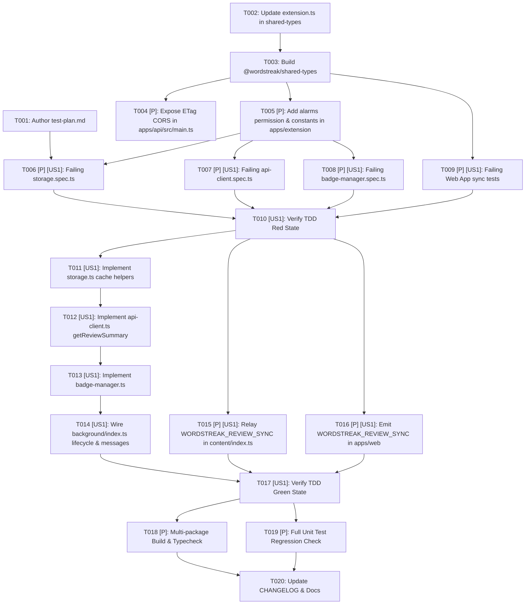

# Tasks: Extension Due Cards Badge (`US-ECO-05`)

**Input**: Design documents from `/Users/vutuanhau/Documents/PROJECT/WordStreak/.specify/features/extension-due-badge/`  
**Prerequisites**: [`baseline.md`](./baseline.md) (`SIGNED-OFF v1.0`), [`spec.md`](./spec.md), [`plan.md`](./plan.md), [`data-model.md`](./data-model.md), [`contracts/extension-badge-sync.contract.md`](./contracts/extension-badge-sync.contract.md)  
**Tests**: **MANDATORY (TDD Red → Green → Refactor)** per WordStreak Constitution Principle II and `wordstreak-workflow`.  
**Organization**: Tasks are structured around `US-ECO-05` (`[US1]`) across 4 vertical slices with a strict TDD-first execution order.

## Format: `[ID] [P?] [Story?] Description`

- **[P]**: Can run in parallel (different files, no dependencies on incomplete tasks)
- **[Story]**: `[US1]` maps to `US-ECO-05: Badge số thẻ đến hạn trên icon Extension`
- Exact repository file paths are included in every task description.

---

## Phase 1: Setup & Shared Contracts (Blocking Prerequisites)

**Purpose**: Author the Gherkin TDD test plan (`test-plan.md`), publish the shared `ReviewSummaryCacheState` & `REFRESH_BADGE` contracts in `@wordstreak/shared-types`, expose the `ETag` CORS header in `apps/api`, and declare the `"alarms"` permission in `apps/extension/manifest.json`.

- [x] T001 Create Gherkin test plan mapping all 8 scenarios of `US-ECO-05` (`Scenario 1`..`Scenario 8`) and edge cases (`EC-EDB-01`..`EC-EDB-08`) to numbered test cases (`TC-EDB-001`..`TC-EDB-014`) in `.specify/features/extension-due-badge/test-plan.md`
- [x] T002 Define and export `ReviewSummaryCacheState`, add optional `reviewSummaryCache?: ReviewSummaryCacheState | null` to `ExtensionStorageState`, and add `{ type: "REFRESH_BADGE"; payload?: { immediate?: boolean } }` to `ExtensionMessage` in `packages/shared-types/src/extension.ts`
- [x] T003 Build `@wordstreak/shared-types` via `pnpm --filter @wordstreak/shared-types build` and verify zero TypeScript errors
- [x] T004 [P] Add `exposedHeaders: ['ETag']` to `app.enableCors(...)` in `apps/api/src/main.ts` (`REQ-EDB-007`, `RISK-EDB-003`)
- [x] T005 [P] Add `"alarms"` to the `"permissions"` array in `apps/extension/manifest.json` and define `STORAGE_KEYS.REVIEW_SUMMARY_CACHE`, `BADGE_COLORS`, `ALARM_NAMES`, and `BADGE_LIMITS` in `apps/extension/src/shared/constants.ts` (`REQ-EDB-005`)

**Checkpoint**: `test-plan.md` is complete, `@wordstreak/shared-types` exports `ReviewSummaryCacheState` and `REFRESH_BADGE`, backend CORS exposes `ETag`, and extension constants/permissions are in place.

---

## Phase 2: User Story 1 — TDD Red Phase (Failing Unit Tests) 🎯 MVP

**Goal**: Write comprehensive, failing unit tests across `apps/extension` and `apps/web` covering all 9 requirements (`REQ-EDB-001`..`REQ-EDB-009`), 8 Gherkin scenarios (`Scenario 1`..`Scenario 8`), and 8 edge cases (`EC-EDB-01`..`EC-EDB-08`) before writing implementation code.

**Independent Test**: Run `pnpm --filter @wordstreak/extension test` and `pnpm --filter web test -- reconnectionSyncEngine.spec.ts` and confirm the newly added test cases fail (Red state) because the storage, API client, badge manager, and Web App postMessage methods are not yet implemented.

- [x] T006 [P] [US1] Write failing unit tests for `extensionStorage.getReviewSummaryCache` and `extensionStorage.setReviewSummaryCache` (`TC-EDB-001`) in `apps/extension/src/shared/storage.spec.ts`
- [x] T007 [P] [US1] Write failing unit tests for `ExtensionApiClient.getReviewSummary` in `apps/extension/src/background/api-client.spec.ts` covering:
  - `TC-EDB-002` (`REQ-EDB-007`): Sends `Authorization: Bearer <token>`, `X-Timezone`, and `If-None-Match` headers and returns `{ status: 200, summary, etag }` on `200 OK`
  - `TC-EDB-003` (`Scenario 5`, `REQ-EDB-007`): Returns `{ status: 304, etag }` without parsing JSON body on `304 Not Modified`
  - `TC-EDB-004` (`Scenario 7`, `REQ-EDB-003`): Clears `ws_token`, `ws_user`, and `ws_review_summary_cache` in `extensionStorage` and throws `UNAUTHORIZED` on `401 Unauthorized`
- [x] T008 [P] [US1] Write failing unit tests for `BadgeManager` and pure helpers in `apps/extension/src/background/badge-manager.spec.ts` covering:
  - `TC-EDB-005` (`Scenario 1`, `Scenario 3`, `EC-EDB-01`, `EC-EDB-02`, `REQ-EDB-001`): `formatBadgeText` returns `""` when unauthenticated or `dueCount <= 0`, `"1"`..`"99"` for `1 <= dueCount <= 99`, and `"99+"` for `dueCount > 99`
  - `TC-EDB-006` (`Scenario 1`, `Scenario 2`, `EC-EDB-07`, `REQ-EDB-002`): `resolveBadgeColor` and `applyBadgeVisuals` set `#863BFF` when `streakAtRisk === false`, `#EF4444` when `streakAtRisk === true`, `#FFFFFF` text color (guarded against missing `setBadgeTextColor`), and skip color calls when `dueCount === 0`
  - `TC-EDB-007` (`Scenario 1`, `REQ-EDB-005`): `ensurePeriodicAlarm` registers `"ws-badge-periodic"` with `{ periodInMinutes: 30 }`
  - `TC-EDB-008` (`Scenario 4`, `EC-EDB-03`, `EC-EDB-04`, `REQ-EDB-006`): `computeNextDueAlarmTime` and `syncNextDueAlarm` schedule `"ws-badge-next-due"` when `0 < nextDueMs - now < 30m`, clamp `< 60s` to `now + 60_000`, and clear `"ws-badge-next-due"` when `nextDueAt` is `null`, `<= now`, or `>= 30m`
  - `TC-EDB-009` (`Scenario 5`, `EC-EDB-05`, `REQ-EDB-007`): `refreshBadgeNow` re-applies cached `summary` badge visuals and reschedules `"ws-badge-next-due"` on `304 Not Modified` (cold startup recovery)
  - `TC-EDB-010` (`Scenario 6`, `EC-EDB-06`, `REQ-EDB-008`, `REQ-EDB-009`): `scheduleDebouncedRefresh` coalesces rapid bursts using a 3,000ms trailing debounce timer into a single fetch, while immediate `refreshBadgeNow` cancels any pending debounce timer and deduplicates concurrent in-flight calls
  - `TC-EDB-011` (`Scenario 7`, `REQ-EDB-003`): Missing `ws_token`, `clearAuthAndBadge()`, or `401 Unauthorized` clears storage cache, clears `"ws-badge-next-due"`, and sets badge text to `""` without making unauthenticated API calls
  - `TC-EDB-012` (`Scenario 8`, `REQ-EDB-004`): Offline network `TypeError` or `503 Service Unavailable` preserves `ws_review_summary_cache` and retains/re-applies the cached badge without throwing an unhandled rejection
- [x] T009 [P] [US1] Add failing unit test cases verifying `window.postMessage({ type: "WORDSTREAK_REVIEW_SYNC" }, "*")` emission after online review submission (`TC-EDB-013`, `REQ-EDB-008`) in `apps/web/src/features/reviews/hooks/useReviewSession.spec.ts` and after offline batch sync (`TC-EDB-014`, `REQ-EDB-008`) in `apps/web/src/services/offline/__tests__/reconnectionSyncEngine.spec.ts`
- [x] T010 [US1] Run `pnpm --filter @wordstreak/extension test` and `pnpm --filter web test -- useReviewSession.spec.ts reconnectionSyncEngine.spec.ts` to verify the newly added tests fail as expected (Red state)

**Checkpoint**: All `TC-EDB-001`..`TC-EDB-014` unit tests exist and fail cleanly in Red state.

---

## Phase 3: User Story 1 — TDD Green Phase (Implementation) 🎯 MVP

**Goal**: Implement storage helpers, `ExtensionApiClient.getReviewSummary`, `BadgeManager`, background service worker lifecycle hooks, content script relay, and Web App `WORDSTREAK_REVIEW_SYNC` emission so all unit tests pass.

**Independent Test**: Run `pnpm --filter @wordstreak/extension test` and `pnpm --filter web test -- useReviewSession.spec.ts reconnectionSyncEngine.spec.ts` and confirm 100% of test suites pass (Green state).

- [x] T011 [US1] Implement `getReviewSummaryCache()`, `setReviewSummaryCache()`, and updated `getAll()` in `apps/extension/src/shared/storage.ts` (`REQ-EDB-003`, `REQ-EDB-007`)
- [x] T012 [US1] Implement `ExtensionApiClient.getReviewSummary(options?)` with `X-Timezone`, conditional `If-None-Match`, `200 OK`, `304 Not Modified`, and `401 Unauthorized` cache cleanup in `apps/extension/src/background/api-client.ts` (`REQ-EDB-003`, `REQ-EDB-007`)
- [x] T013 [US1] Implement `formatBadgeText`, `resolveBadgeColor`, `computeNextDueAlarmTime`, and `BadgeManager` (`applyBadgeVisuals`, `ensurePeriodicAlarm`, `syncNextDueAlarm`, `clearAuthAndBadge`, `refreshBadgeNow`, `scheduleDebouncedRefresh`) in `apps/extension/src/background/badge-manager.ts` (`REQ-EDB-001`..`REQ-EDB-009`)
- [x] T014 [US1] Wire `badgeManager` into `chrome.runtime.onInstalled`, `chrome.runtime.onStartup`, `chrome.alarms.onAlarm`, context menu `ws-quick-capture`, and `chrome.runtime.onMessage` (`LOGIN`, `SET_AUTH_TOKEN`, `LOGOUT`, `GET_AUTH_STATUS`, `QUICK_CAPTURE`, `REFRESH_BADGE`) in `apps/extension/src/background/index.ts` (`REQ-EDB-005`, `REQ-EDB-008`, `REQ-EDB-009`)
- [x] T015 [P] [US1] Update `window.addEventListener("message", ...)` in `apps/extension/src/content/index.ts` to validate `event.source === window` and relay `WORDSTREAK_REVIEW_SYNC` as `{ type: "REFRESH_BADGE" }` (`REQ-EDB-008`, `EC-EDB-08`)
- [x] T016 [P] [US1] Emit `window.postMessage({ type: "WORDSTREAK_REVIEW_SYNC" }, "*")` after online `reviewsService.submitReview` in `apps/web/src/features/reviews/hooks/useReviewSession.ts` and inside `dispatchSyncCompleted` in `apps/web/src/services/offline/reconnectionSyncEngine.ts` (`REQ-EDB-008`)
- [x] T017 [US1] Run `pnpm --filter @wordstreak/extension test` and `pnpm --filter web test -- useReviewSession.spec.ts reconnectionSyncEngine.spec.ts` and verify 100% of unit tests pass (Green state)

**Checkpoint**: All 14 test cases (`TC-EDB-001`..`TC-EDB-014`) across `apps/extension` and `apps/web` pass.

---

## Phase 4: Refactor, Quality Gates & Documentation

**Purpose**: Ensure strict TypeScript compilation, zero lint/build errors across `@wordstreak/shared-types`, `apps/api`, `apps/extension`, and `apps/web`, and up-to-date feature documentation.

- [x] T018 [P] Run build and typecheck verification across touched workspaces (`pnpm --filter @wordstreak/shared-types build && pnpm --filter @wordstreak/extension build && pnpm --filter api build && pnpm --filter web build`)
- [x] T019 [P] Run unit test suites across `apps/extension`, `apps/api`, and `apps/web` (`pnpm --filter @wordstreak/extension test && pnpm --filter api test -- main.spec.ts reviews.controller.spec.ts && pnpm --filter web test -- useReviewSession.spec.ts reconnectionSyncEngine.spec.ts`) to verify zero regressions
- [x] T020 Update `.specify/features/extension-due-badge/CHANGELOG.md` and `docs/features/extension-due-badge/README.md` + `docs/user-guides/extension-due-badge.md` upon completion

---

## Dependencies & Execution Order

### Parallel Opportunities

- **Phase 1 (Setup)**: `T004` (`apps/api/src/main.ts`) and `T005` (`apps/extension/manifest.json` + `constants.ts`) touch separate packages and can run in parallel after `T003`.
- **Phase 2 (Red Tests)**: `T006` (`storage.spec.ts`), `T007` (`api-client.spec.ts`), `T008` (`badge-manager.spec.ts`), and `T009` (`useReviewSession.spec.ts` + `reconnectionSyncEngine.spec.ts`) touch distinct spec files and can be authored in parallel.
- **Phase 3 (Green Implementation)**: `T015` (`content/index.ts`) and `T016` (`apps/web` hooks/services) can be implemented in parallel with `T011`–`T014` (`apps/extension/src/background/`).

### Implementation Strategy

1. **Contract-First (`T001`–`T005`)**: Publish shared types and constants first so all tests and implementation modules compile cleanly.
2. **Strict TDD (`T006`–`T010` Red → `T011`–`T017` Green)**: Write failing Vitest tests for every scenario and edge case before implementing storage, API client, badge manager, and Web App sync emission.
3. **Verification & Polish (`T018`–`T020`)**: Verify full workspace builds (`shared-types`, `extension`, `api`, `web`) and test suites with zero warnings or regressions.
