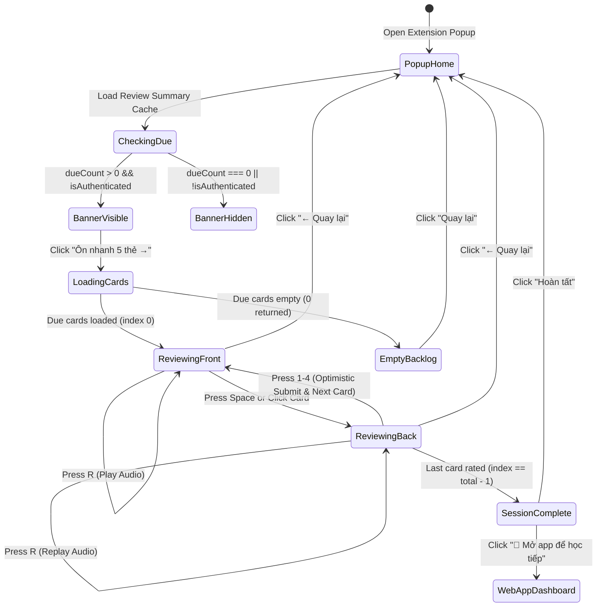

# Domain Decision Baseline — US-ECO-08: Ôn nhanh trong Popup (Micro-review) (`extension-micro-review`)

- **Feature Slug**: `extension-micro-review`
- **Backlog ID**: `US-ECO-08`
- **Status**: `SIGNED-OFF v1.0`
- **Complexity Classification**: `Bounded Task`
- **Target Apps**: `packages/shared-types`, `apps/extension`

---

## 1. Intake Classification & Business Objective

- **Classification**: `Bounded Task` (extends `packages/shared-types`, `apps/extension` background API client & message router, and adds 3 popup components without backend schema alterations).
- **Business Goal (`GOAL-MICREV-01`)**: Provide learners with a frictionless, in-context 5-card micro-review experience directly within the Chrome Extension popup window. By enabling reviews with keyboard hotkeys without context-switching to the full web app, users can effortlessly maintain their daily streak and tackle spaced-repetition due backlogs in seconds.

---

## 2. Confirmed Customer Elicitation Decisions (Gate 1)

- **ASM-MICREV-001 (Session Size & Card Sourcing)**:
  - Fetch up to 5 due cards (`limit: 5`) from `GET /reviews/due?limit=5`.
  - If fewer than 5 cards are due (e.g., 2), the session reviews all available due cards.
  - If 0 cards are due, the micro-review banner is not shown, and direct entry displays an empty-state message.
- **ASM-MICREV-002 (Banner Surface & In-Popup Entry)**:
  - Display `MicroReviewBanner` in `PopupApp.tsx` directly below `AuthStatusCard` when an authenticated user has `dueCount > 0`.
  - Banner presents `🔥 Có {dueCount} thẻ cần ôn` and an Obsidian black pill button `Ôn nhanh 5 thẻ →` (or `{dueCount} thẻ →` if `dueCount < 5`).
  - Clicking the banner switches the popup view mode from `'home'` to `'review'`.
- **ASM-MICREV-003 (Card Presentation & Flip Architecture)**:
  - `MicroCard.tsx` implements a 2-sided flip card:
    - **Front**: Deck badge (deck title and color), target word in bold Nunito font, IPA phonetic transcript, audio speaker button, and navigation helper `[Nhấn Space hoặc click để lật]`.
    - **Back**: Vietnamese meaning, contextual example sentence (line-clamped), replay audio button, and 4 standard SRS rating buttons:
      - Rating 1: Again (`Chưa thuộc`, `#ef4444`)
      - Rating 2: Hard (`Khó`, `#f97316`)
      - Rating 3: Good (`Nhớ tốt`, `#10b981`)
      - Rating 4: Easy (`Rất dễ`, `#863bff`)
- **ASM-MICREV-004 (Keyboard Hotkeys & Interaction Model)**:
  - `Space` flips front to back (click also toggles flip).
  - `R` / `r` triggers audio pronunciation.
  - `1`, `2`, `3`, `4` select the corresponding SRS rating ONLY when the back is revealed. Pressing numbers on the front face does nothing.
  - All hotkeys are suppressed if focus is currently inside an `<input>`, `<textarea>`, or content-editable field.
- **ASM-MICREV-005 (Optimistic Review Submission & Flow)**:
  - When the user selects a rating, the UI advances to the next card immediately without waiting for server response.
  - Background submits rating via `SUBMIT_MICRO_REVIEW` (`apiClient.submitReview({ cardId, rating })`).
  - Upon submitting, the background triggers `badgeManager.refreshBadgeNow(true)` to keep badge counts up to date.
- **ASM-MICREV-006 (Completion Screen & Exit Navigation)**:
  - Reaching the end of the session presents a celebration card: `🎉 Hoàn thành phiên ôn nhanh!`, count of cards reviewed, and streak status.
  - Action buttons: `[🚀 Mở app để học tiếp]` (opens `${WEB_APP_URL}/dashboard`) and `[Hoàn tất]` (returns to popup home).
  - Header has a `← Quay lại` button allowing users to cancel/return to home at any point.

---

## 3. RBAC & Access Matrix

| Actor / Context | View Banner | Fetch Due Cards | Submit Card Reviews | Launch Full Web App |
| :--- | :--- | :--- | :--- | :--- |
| **Unauthenticated User** | Hidden | Disallowed (returns error / prompt to login) | Disallowed | Allowed (opens login/landing) |
| **Authenticated User (`dueCount = 0`)** | Hidden (or "Đã hoàn thành!") | Returns empty array `[]` | Allowed for ad-hoc reviews | Allowed (`/dashboard`) |
| **Authenticated User (`dueCount > 0`)** | Visible (`Ôn nhanh`) | Allowed (`limit: 5`) | Allowed (optimistic SRS rating) | Allowed (`/dashboard`) |

---

## 4. Entity & Review Session State Machine

---

## 5. Business Rules (`BR-MICREV-###`)

- **BR-MICREV-01 (Session Size Guarantee)**: The micro-review session MUST fetch at most 5 cards (`limit: 5`). If the backend returns fewer than 5 cards, the session length adapts to the returned count.
- **BR-MICREV-02 (Front-Face Protection)**: Hotkeys `1`, `2`, `3`, `4` MUST NOT trigger review ratings while the card front is visible. The learner MUST flip to the back before grading.
- **BR-MICREV-03 (Audio Fallback Guarantee)**: If `card.audioUrl` is absent, invalid, or fails to play, the component MUST gracefully fallback to browser Web Speech API (`window.speechSynthesis.speak(new SpeechSynthesisUtterance(word))`).
- **BR-MICREV-04 (Optimistic Submission & Non-Blocking Progression)**: Selecting a rating MUST advance the review session immediately to `currentIndex + 1`. Server submission occurs asynchronously via `chrome.runtime.sendMessage({ type: "SUBMIT_MICRO_REVIEW", payload: { cardId, rating } })`.
- **BR-MICREV-05 (Badge & Cache Re-synchronization)**: Upon rating submission in the background, `badgeManager.refreshBadgeNow(true)` MUST be invoked to ensure toolbar badge numbers reflect decremented due cards. When the review session completes, the popup also refreshes badge & summary state.
- **BR-MICREV-06 (Keyboard Hotkey Isolation)**: All global key listeners (`Space`, `R`, `1`, `2`, `3`, `4`) MUST be suppressed when focus is within `<input>`, `<textarea>`, or `isContentEditable` elements.
- **BR-MICREV-07 (WordStreak Design System Conformance)**: The popup review UI MUST strictly adhere to:
  - Canvas: Minimal `#ffffff` with hairline `#e5e5e5` borders.
  - Typography: Nunito bold for headwords, Inter for meanings and body, JetBrains Mono for hotkey tags (`[Space]`, `[1]`, `[2]`, `[3]`, `[4]`).
  - Button styling: Obsidian `#000000` pills for primary actions, rating-specific colors (`#ef4444`, `#f97316`, `#10b981`, `#863bff`).

---

## 6. MoSCoW Scope Classification

### Must Have (P0)
- `FETCH_DUE_CARDS` and `SUBMIT_MICRO_REVIEW` extension message types in `packages/shared-types`.
- Background API methods `getDueCards` and `submitReview` in `apps/extension/src/background/api-client.ts`.
- Background message handlers with badge refresh in `apps/extension/src/background/index.ts`.
- `MicroReviewBanner` displayed when `dueCount > 0` and logged in.
- `MicroCard` supporting front/back flip, audio pronunciation, phonetic, and 4 SRS rating actions.
- `MicroReviewSession` handling loading, 5-card progression, hotkeys, progress bar, and completion screen.
- Integration in `PopupApp.tsx` with seamless `'home' | 'review'` view switching.

### Should Have (P1)
- Web Speech API fallback when audio audioUrl fails or is missing.
- Keyboard hints `[Space]` and `[1-4]` displayed on card interface.
- Deck name badge with optional deck color styling.

### Could Have (P2)
- Replay audio hotkey `R` on both front and back faces.
- Animated progress bar transitions.

### Won't Have (v1.0)
- Offline indexedDB sync queue for extension micro-reviews (online-first background API).
- Configurable session card count from popup settings (standardized to 5 cards).

---

## 7. Risk Register (`RISK-MICREV-###`)

| Risk ID | Description | Severity | Likelihood | Mitigation Strategy |
| :--- | :--- | :--- | :--- | :--- |
| **RISK-MICREV-01** | Rapid rating clicks causes out-of-order review submissions | Medium | Low | Use unique `cardId` per submission; optimistic state increments index instantly so card cannot be double-submitted. |
| **RISK-MICREV-02** | Popup window closes before async submit request completes | Medium | Medium | Submissions are dispatched to background service worker via `chrome.runtime.sendMessage`, which persists independently of popup lifetime. |
| **RISK-MICREV-03** | Audio playback fails due to autoplay policy or missing audioUrl | Low | Medium | Audio playback is user-initiated (click or `R` key) and falls back to browser Web Speech API. |
| **RISK-MICREV-04** | Hotkeys interfere with quick-word search or input fields | High | Low | Explicit input target guard `if (isInputElement(e.target)) return;` before processing any keyboard shortcut. |
