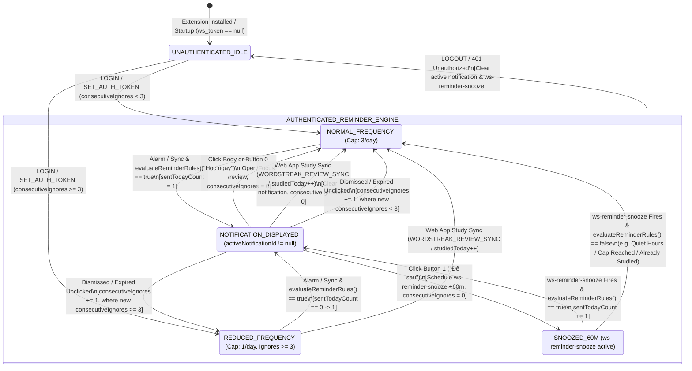
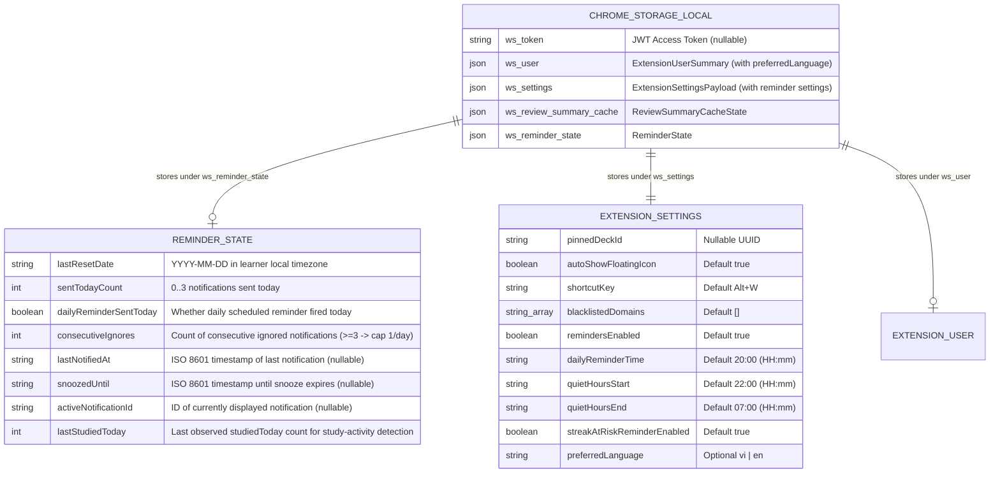

# Domain Model: Conditional Study Reminder Notifications (`US-ECO-06`)

- **Feature Slug**: `extension-reminder-notifications`
- **Protocol Depth**: Bounded Task (Light Domain Model)
- **Date**: 2026-10-13
- **Source Artifacts**: [00-intake.md](./00-intake.md), [01-elicitation.md](./01-elicitation.md)

---

## 1. RBAC & Access Control Matrix

| Role / State | Evaluate `reminderRules.ts` | Receive OS Notification (`chrome.notifications`) | Trigger Action Buttons (`Học ngay` / `Để sau`) | Storage & Ownership Boundary |
| :--- | :---: | :---: | :---: | :--- |
| **Unauthenticated / Guest (`ws_token === null`)** | Suppressed (`shouldNotify: false, reason: "UNAUTHENTICATED"`) | Denied (no notifications created; any active notification & snooze alarm cleared) | N/A | `ws_reminder_state` reset/cleared on logout or `401`; zero API calls made. |
| **Authenticated Learner (`ws_token !== null`)** | Allowed (pure evaluation over user's `ReviewSummaryDto` + `ExtensionSettingsPayload` + `ReminderState`) | Allowed when `shouldNotify === true` (max 3/day, or max 1/day when `consecutiveIgnores >= 3`, outside quiet hours) | Allowed (`Học ngay` focuses/opens `/review`; `Để sau` snoozes for 60m) | Strictly scoped to the authenticated learner's summary and local browser profile. |

---

## 2. State Machine & Reminder / Backoff Lifecycle

---

## 3. Business Rules & Algorithms (`BR-REMD-###`)

- **BR-REMD-001 (Manifest Permission & Default Reminder Settings)**:
  - `apps/extension/manifest.json` MUST declare the `"notifications"` permission alongside `"alarms"`, `"storage"`, and `"tabs"`.
  - `ExtensionSettingsPayload` and `DEFAULT_SETTINGS` MUST include the following reminder fields (`ASM-REMD-001`):
    - `remindersEnabled: boolean` (default: `true`)
    - `dailyReminderTime: string` (24-hour `"HH:mm"` format, default: `"20:00"`)
    - `quietHoursStart: string` (24-hour `"HH:mm"` format, default: `"22:00"`)
    - `quietHoursEnd: string` (24-hour `"HH:mm"` format, default: `"07:00"`)
    - `streakAtRiskReminderEnabled: boolean` (default: `true`)
    - `preferredLanguage?: "vi" | "en"` (optional override; falls back to `user.preferredLanguage`)

- **BR-REMD-002 (Local Date Rollover & Daily Counter Normalization)**:
  - Before evaluating reminder rules or mutating `ReminderState`, the state normalizer `normalizeReminderStateForDate(state, currentLocalDate)` MUST compare `state.lastResetDate` (`"YYYY-MM-DD"` in `summary.timezone` or browser local timezone) against `currentLocalDate`:
    - If `state.lastResetDate !== currentLocalDate`:
      - If `state.activeNotificationId !== null` (a notification from a previous day was never clicked), increment `consecutiveIgnores = state.consecutiveIgnores + 1` and clear `activeNotificationId = null`.
      - Reset `sentTodayCount = 0`, `dailyReminderSentToday = false`, `lastResetDate = currentLocalDate`, and `lastStudiedToday = summary?.studiedToday ?? 0`.
      - Preserve `consecutiveIgnores` across midnight rollovers until explicitly reset by user engagement (`ASM-REMD-004`, `ASM-REMD-005`).

- **BR-REMD-003 (Quiet Hours Evaluation with Overnight Wrap-Around)**:
  - Let `parseTimeToMinutes(hhmm)` convert `"HH:mm"` (`00:00`..`23:59`) into integer minutes since midnight (`0`..`1439`).
  - Given `currentMinutes` (in the learner's timezone `summary.timezone || Intl.DateTimeFormat().resolvedOptions().timeZone`), `startMinutes = parseTimeToMinutes(settings.quietHoursStart)`, and `endMinutes = parseTimeToMinutes(settings.quietHoursEnd)` (`ASM-REMD-002`):
    - If `startMinutes === endMinutes`: quiet hours are disabled (`isWithinQuietHours = false`).
    - If `startMinutes < endMinutes` (same-day window, e.g., `01:00` to `06:00`): `isWithinQuietHours = currentMinutes >= startMinutes && currentMinutes < endMinutes`.
    - If `startMinutes > endMinutes` (overnight wrap-around window, e.g., `22:00` to `07:00`): `isWithinQuietHours = currentMinutes >= startMinutes || currentMinutes < endMinutes`.
  - When `isWithinQuietHours === true`, `evaluateReminderRules` MUST return `{ shouldNotify: false, reason: "QUIET_HOURS" }`.

- **BR-REMD-004 (Daily Notification Ceiling & Consecutive-Ignore Frequency Backoff)**:
  - The effective daily notification cap is determined by `state.consecutiveIgnores` (`ASM-REMD-004`):
    - If `state.consecutiveIgnores >= 3`: `effectiveDailyCap = 1` (frequency backoff mode: maximum 1 notification per calendar day).
    - If `state.consecutiveIgnores < 3`: `effectiveDailyCap = 3` (normal mode: maximum 3 notifications per calendar day).
  - When normalized `state.sentTodayCount >= effectiveDailyCap`, `evaluateReminderRules` MUST return `{ shouldNotify: false, reason: "DAILY_CAP_REACHED", effectiveDailyCap }`.

- **BR-REMD-005 (Intra-Day Cooldown & Active Snooze Suppression)**:
  - For non-snooze triggers (`triggerSource !== "SNOOZE_ALARM"`):
    - If `state.snoozedUntil` is non-null and `Date.parse(state.snoozedUntil) > nowMs`, `evaluateReminderRules` MUST return `{ shouldNotify: false, reason: "SNOOZED_ACTIVE" }` so periodic syncs do not interrupt an active user snooze.
    - If `state.lastNotifiedAt` is non-null on the same calendar day and `nowMs - Date.parse(state.lastNotifiedAt) < 120 * 60 * 1000` (120 minutes), `evaluateReminderRules` MUST return `{ shouldNotify: false, reason: "COOLDOWN_ACTIVE" }` (`ASM-REMD-003`).
  - When `triggerSource === "SNOOZE_ALARM"` (the user's 60-minute snooze timer just expired), the 120-minute cooldown is bypassed so the requested snooze reminder can fire (still subject to auth, `remindersEnabled`, quiet hours, daily cap, and study need).

- **BR-REMD-006 (Pure Conditional Rule Matrix in `reminderRules.ts`)**:
  - `evaluateReminderRules(input: ReminderEvaluationInput): ReminderDecision` MUST be a 100% pure, deterministic function with zero Chrome API or I/O side effects:

| Step | Condition Checked | Result if Matched |
| :---: | :--- | :--- |
| **1** | `!input.isAuthenticated || !input.summary` | `{ shouldNotify: false, reason: "UNAUTHENTICATED" }` |
| **2** | `!input.settings.remindersEnabled` | `{ shouldNotify: false, reason: "REMINDERS_DISABLED" }` |
| **3** | `isWithinQuietHours(now, timezone, quietHoursStart, quietHoursEnd)` | `{ shouldNotify: false, reason: "QUIET_HOURS" }` |
| **4** | `normalizedState.sentTodayCount >= effectiveDailyCap` (`1` if `consecutiveIgnores >= 3` else `3`) | `{ shouldNotify: false, reason: "DAILY_CAP_REACHED" }` |
| **5** | `triggerSource !== "SNOOZE_ALARM"` and `snoozedUntil > nowMs` | `{ shouldNotify: false, reason: "SNOOZED_ACTIVE" }` |
| **6** | `triggerSource !== "SNOOZE_ALARM"` and `nowMs - lastNotifiedAtMs < 120 * 60 * 1000` | `{ shouldNotify: false, reason: "COOLDOWN_ACTIVE" }` |
| **7** | `summary.dueCount <= 0 && summary.goalReached && !(summary.streakAtRisk && settings.streakAtRiskReminderEnabled)` | `{ shouldNotify: false, reason: "NO_STUDY_NEEDED" }` |
| **8** | `triggerSource === "SNOOZE_ALARM"` and (`streakAtRiskEligible \|\| summary.dueCount > 0 \|\| !summary.goalReached`) | `{ shouldNotify: true, reason: "SNOOZE_REMINDER", notificationType }` |
| **9** | (`triggerSource === "DAILY_ALARM"` OR (`triggerSource === "PERIODIC_SYNC"` and `!normalizedState.dailyReminderSentToday` and `currentMinutes >= dailyReminderMinutes`)) and (`streakAtRiskEligible \|\| summary.dueCount > 0 \|\| !summary.goalReached`) | `{ shouldNotify: true, reason: "DAILY_SCHEDULED", notificationType, markDailyReminderSent: true }` |
| **10** | `triggerSource === "PERIODIC_SYNC"` and `summary.streakAtRisk === true && settings.streakAtRiskReminderEnabled === true` | `{ shouldNotify: true, reason: "STREAK_AT_RISK", notificationType: "STREAK_AT_RISK" }` |
| **11** | Otherwise (e.g., `PERIODIC_SYNC` before `dailyReminderTime` with `streakAtRisk === false`) | `{ shouldNotify: false, reason: "NOT_YET_SCHEDULED_TIME" }` |

  - **Notification Type Priority (`notificationType`)**:
    - `STREAK_AT_RISK` if `summary.streakAtRisk && settings.streakAtRiskReminderEnabled`
    - `DUE_CARDS` else if `summary.dueCount > 0`
    - `DAILY_GOAL` otherwise (`!summary.goalReached`)
  - **Anti-Abuse & Anti-Spam Note**: Notifications are strictly read-only client-side prompts that never award XP or increment streaks directly; the combination of quiet hours (`BR-REMD-003`), daily cap 3/day + 1/day backoff (`BR-REMD-004`), and 120-minute cooldown (`BR-REMD-005`) guarantees learners are never spammed even if summary sync runs frequently.

- **BR-REMD-007 (Scheduled `daily-reminder` Alarm & One-Shot `ws-reminder-snooze` Alarm)**:
  - On `chrome.runtime.onInstalled`, `chrome.runtime.onStartup`, `LOGIN`, `SET_AUTH_TOKEN`, and `UPDATE_SETTINGS` (when `dailyReminderTime` or `remindersEnabled` changes):
    - If `settings.remindersEnabled === false` or unauthenticated: clear `"daily-reminder"` and `"ws-reminder-snooze"` alarms.
    - If `settings.remindersEnabled === true`: compute `nextDailyReminderWhenMs(settings.dailyReminderTime, nowMs, timezone)` — the next occurrence of `HH:mm` in local time (`today` at `HH:mm` if strictly in the future `> nowMs`, otherwise `tomorrow` at `HH:mm`, clamped to `>= nowMs + 60_000`) and create/replace alarm `"daily-reminder"` (`chrome.alarms.create("daily-reminder", { when, periodInMinutes: 1440 })`).
  - When the learner clicks button index `1` (**"Để sau" / "Snooze"**):
    - Schedule one-shot alarm `"ws-reminder-snooze"` via `chrome.alarms.create("ws-reminder-snooze", { delayInMinutes: 60 })` (`ASM-REMD-003`).

- **BR-REMD-008 (Consecutive Ignore Tracking & Engagement Reset)**:
  - When a notification is created (`chrome.notifications.create(notificationId, options)`), persist in `ws_reminder_state`:
    - `sentTodayCount: normalizedState.sentTodayCount + 1`
    - `lastNotifiedAt: new Date(nowMs).toISOString()`
    - `dailyReminderSentToday: normalizedState.dailyReminderSentToday || decision.markDailyReminderSent === true`
    - `activeNotificationId: notificationId`
    - `snoozedUntil: null`
  - **When `chrome.notifications.onClicked` or `chrome.notifications.onButtonClicked` (buttonIndex `0` — "Học ngay") fires** (`ASM-REMD-005`, `ASM-REMD-006`):
    - Set `consecutiveIgnores = 0`, `activeNotificationId = null`, `snoozedUntil = null`.
    - Clear `"ws-reminder-snooze"` alarm and clear the notification via `chrome.notifications.clear(notificationId)`.
    - Execute smart `/review` tab navigation (`BR-REMD-009`).
  - **When `chrome.notifications.onButtonClicked` (buttonIndex `1` — "Để sau") fires** (`ASM-REMD-003`, `ASM-REMD-005`):
    - Set `consecutiveIgnores = 0`, `activeNotificationId = null`, `snoozedUntil = new Date(nowMs + 60 * 60 * 1000).toISOString()`.
    - Schedule `"ws-reminder-snooze"` with `delayInMinutes: 60` and clear the notification via `chrome.notifications.clear(notificationId)`.
  - **When `chrome.notifications.onClosed(notificationId, byUser)` fires**:
    - If `state.activeNotificationId === notificationId` (meaning it was not already cleared by `onClicked`, `onButtonClicked`, or Web App study sync):
      - Increment `consecutiveIgnores = state.consecutiveIgnores + 1` and set `activeNotificationId = null` (`ASM-REMD-005`).
  - **When Web App study activity occurs** (`WORDSTREAK_REVIEW_SYNC` / `REFRESH_BADGE` or summary refresh where `summary.studiedToday > state.lastStudiedToday` on the same date, or `summary.dueCount === 0 && summary.goalReached`):
    - Reset `consecutiveIgnores = 0`.
    - Update `lastStudiedToday = summary.studiedToday`.
    - If `summary.dueCount === 0 && summary.goalReached` and `state.activeNotificationId !== null`: clear the active notification (`activeNotificationId = null` first so `onClosed` does not count it as an ignore) and clear `"ws-reminder-snooze"`.

- **BR-REMD-009 (Smart `/review` Tab Navigation on "Học ngay" / Notification Click)**:
  - On clicking the notification body or button `0` (**"Học ngay"** / **"Study Now"**) (`ASM-REMD-006`):
    - Query open tabs via `chrome.tabs.query({ url: `${WEB_APP_URL}/*` })`.
    - If at least one matching tab exists (preferring a tab already on `/review`, or the first matching tab):
      - Call `chrome.tabs.update(targetTab.id, { active: true, url: `${WEB_APP_URL}/review` })`.
      - If `targetTab.windowId` is defined, call `chrome.windows?.update?.(targetTab.windowId, { focused: true })`.
    - If no matching tab exists:
      - Call `chrome.tabs.create({ url: `${WEB_APP_URL}/review`, active: true })`.

- **BR-REMD-010 (Bilingual EN/VI Notification Localization via `preferredLanguage`)**:
  - Resolve language `lang: "vi" | "en"` in priority order (`ASM-REMD-007`):
    1. `user?.preferredLanguage` (from `ws_user` in `chrome.storage.local`)
    2. `settings?.preferredLanguage` (from `ws_settings` in `chrome.storage.local`)
    3. `chrome.i18n?.getUILanguage?.()` (if starts with `"vi"` case-insensitively → `"vi"`; if starts with `"en"` → `"en"`)
    4. Default fallback: `"vi"`.
  - Notification copy templates (`buildReminderNotificationCopy(notificationType, summary, lang)`):
    - **Vietnamese (`vi`)**:
      - Buttons: `[{ title: "Học ngay" }, { title: "Để sau" }]`
      - `STREAK_AT_RISK`:
        - Title: `"🔥 Chuỗi ${summary.currentStreak} ngày sắp mất!"`
        - Message: `summary.dueCount > 0 ? "Bạn còn ${summary.dueCount} thẻ đến hạn. Ôn ngay để giữ chuỗi ngày học!" : "Hoàn thành phiên ôn tập hôm nay trước nửa đêm để bảo vệ chuỗi ngày học!"`
      - `DUE_CARDS`:
        - Title: `"📚 Đến giờ ôn tập WordStreak!"`
        - Message: `"Bạn có ${summary.dueCount} thẻ từ vựng đến hạn cần ôn tập hôm nay."`
      - `DAILY_GOAL`:
        - Title: `"🎯 Hoàn thành mục tiêu từ vựng hôm nay!"`
        - Message: `"Bạn đã học ${summary.studiedToday}/${summary.dailyGoal} thẻ hôm nay. Chỉ còn ${Math.max(1, summary.dailyGoal - summary.studiedToday)} thẻ nữa để đạt mục tiêu!"`
    - **English (`en`)**:
      - Buttons: `[{ title: "Study Now" }, { title: "Snooze" }]`
      - `STREAK_AT_RISK`:
        - Title: `"🔥 Your ${summary.currentStreak}-day streak is at risk!"`
        - Message: `summary.dueCount > 0 ? "You have ${summary.dueCount} due cards waiting. Review now to keep your streak alive!" : "Complete a quick review before midnight to protect your study streak!"`
      - `DUE_CARDS`:
        - Title: `"📚 Time for your WordStreak review!"`
        - Message: `"You have ${summary.dueCount} vocabulary cards due for review today."`
      - `DAILY_GOAL`:
        - Title: `"🎯 Reach your daily vocabulary goal!"`
        - Message: `"You've studied ${summary.studiedToday}/${summary.dailyGoal} cards today. Just ${Math.max(1, summary.dailyGoal - summary.studiedToday)} more to hit your daily goal!"`

---

## 4. Workflows & Edge-Case Resolutions

### Happy Path Sequence
1. User is authenticated in the Extension; `daily-reminder` alarm is scheduled for `20:00` local time (`BR-REMD-007`).
2. At `20:00`, `chrome.alarms.onAlarm` fires for `"daily-reminder"`.
3. `reminderManager.handleAlarm("daily-reminder")` triggers `badgeManager.refreshBadgeNow()` to get the latest `ReviewSummaryDto` (`dueCount: 15, streakAtRisk: true, currentStreak: 7`), loads `settings`, `user`, and `ws_reminder_state` from `chrome.storage.local`, and calls pure `evaluateReminderRules(...)`.
4. `evaluateReminderRules` verifies auth (`true`), `remindersEnabled` (`true`), quiet hours (`20:00` is outside `22:00–07:00`), `sentTodayCount` (`0 < 3`), and returns `{ shouldNotify: true, reason: "DAILY_SCHEDULED", notificationType: "STREAK_AT_RISK", markDailyReminderSent: true }`.
5. `reminderManager` resolves `lang = "vi"`, builds the localized notification with buttons `["Học ngay", "Để sau"]`, calls `chrome.notifications.create("ws-study-reminder", ...)`, and saves `sentTodayCount: 1, dailyReminderSentToday: true, activeNotificationId: "ws-study-reminder"` in `ws_reminder_state`.
6. User clicks **"Học ngay"** (`buttonIndex === 0`). `reminderManager` resets `consecutiveIgnores = 0`, clears `activeNotificationId`, focuses/opens `${WEB_APP_URL}/review`, and clears the notification.

### Edge-Case Resolutions
1. **Laptop Asleep or Browser Closed at `20:00` (`dailyReminderTime`)**:
   - *Resolution*: When the user opens the browser at `20:45`, `onStartup` or `ws-badge-periodic` refreshes the summary. Because `currentMinutes (20:45) >= dailyReminderMinutes (20:00)`, `isWithinQuietHours === false` (before `22:00`), and `dailyReminderSentToday === false`, Step 9 of `BR-REMD-006` triggers the catch-up daily reminder once and marks `dailyReminderSentToday = true`. If the user opens the browser at `22:30` (already inside quiet hours `22:00–07:00`), Step 3 (`QUIET_HOURS`) suppresses the notification so the user is never disturbed late at night.
2. **Snooze Fires Inside Quiet Hours (e.g., User Clicks "Để sau" at `21:15`, Snooze Fires at `22:15`)**:
   - *Resolution*: When `ws-reminder-snooze` fires at `22:15`, `evaluateReminderRules` checks Step 3 (`QUIET_HOURS`) before Step 8 (`SNOOZE_ALARM`) and suppresses the notification (`reason: "QUIET_HOURS"`), clearing `snoozedUntil`.
3. **Race Condition Between `onButtonClicked` / `onClicked` and `onClosed`**:
   - *Resolution*: When the user clicks a button or the notification body, `onButtonClicked` / `onClicked` immediately sets `state.activeNotificationId = null` and `consecutiveIgnores = 0` in `chrome.storage.local` *before* calling `chrome.notifications.clear(notificationId)`. When `chrome.notifications.onClosed` subsequently fires for that notification, it sees `state.activeNotificationId !== notificationId` and does not increment `consecutiveIgnores`.
4. **Notification Replaced While Previous Notification Still Open**:
   - *Resolution*: If a previous notification (`activeNotificationId !== null`) is still unclicked when a new notification is about to be created (e.g., 2+ hours later), `consecutiveIgnores` is incremented by `1` for the unclicked notification before creating the new one (and if that increment reaches `3` and `sentTodayCount >= 1`, the new notification is suppressed by the updated cap).
5. **User Studies Directly on Web App Without Clicking Notification**:
   - *Resolution*: When the learner completes a review on the Web App (`WORDSTREAK_REVIEW_SYNC` or `summary.studiedToday` increases), `BR-REMD-008` resets `consecutiveIgnores = 0`. If all due cards and the daily goal are now complete (`dueCount === 0 && goalReached`), any open reminder notification and pending snooze alarm are automatically cleared without counting as an ignore.
6. **User Logs Out or Session Expires (`401`) While Snooze Alarm is Pending**:
   - *Resolution*: `LOGOUT` and `401 Unauthorized` clear any active notification (`chrome.notifications.clear`), clear `"ws-reminder-snooze"` and `"daily-reminder"` alarms, and clear `activeNotificationId` / `snoozedUntil` in `ws_reminder_state`.

---

## 5. Entities, Data Boundaries & Privacy

- **Shared Types Contract (`packages/shared-types/src/extension.ts`)**:
  - Extend `ExtensionUserSummary` with `preferredLanguage?: AppLanguage`.
  - Extend `ExtensionSettingsPayload` with `remindersEnabled: boolean`, `dailyReminderTime: string`, `quietHoursStart: string`, `quietHoursEnd: string`, `streakAtRiskReminderEnabled: boolean`, `preferredLanguage?: AppLanguage`.
  - Add `ReminderState`, `ReminderTriggerSource`, `ReminderNotificationType`, `ReminderDecision`, and `ReminderEvaluationInput`.
- **Deletion & Retention Policy**:
  - `ws_reminder_state` is stored locally in `chrome.storage.local`. On `LOGOUT` or `401 Unauthorized`, `activeNotificationId` and `snoozedUntil` are cleared (or `ws_reminder_state` is reset to default).
- **Privacy & Compliance**:
  - `ws_reminder_state` stores only timestamps, boolean flags, and small integer counters (`sentTodayCount`, `consecutiveIgnores`); zero PII or vocabulary content is persisted.

---

## 6. UX States & Non-Functional Requirements

- **UX Notification States (`chrome.notifications.create`)**:
  - `type: "basic"`, `iconUrl: chrome.runtime.getURL("icons/icon128.png")`, `priority: 2` for `STREAK_AT_RISK` and `1` for `DUE_CARDS` / `DAILY_GOAL`.
  - Action buttons:
    - Index `0`: `"Học ngay"` (`vi`) / `"Study Now"` (`en`)
    - Index `1`: `"Để sau"` (`vi`) / `"Snooze"` (`en`)
- **Performance Targets**:
  - `evaluateReminderRules` pure function execution: `< 5ms`.
  - Notification click / button click handler execution: `< 150ms`.
- **Security**:
  - Navigation target on notification click is strictly hardcoded to `${WEB_APP_URL}/review` (never constructed from untrusted external input).
- **i18n / l10n**:
  - Full bilingual support (`vi` and `en`) for all 3 notification types (`STREAK_AT_RISK`, `DUE_CARDS`, `DAILY_GOAL`) and both action buttons, resolved via `user.preferredLanguage ?? settings.preferredLanguage ?? browserUiLang ?? "vi"`.
- **Accessibility**:
  - Uses native OS system notifications (`chrome.notifications`), inheriting OS-level screen reader announcements (VoiceOver on macOS, NVDA/Narrator on Windows) and keyboard action button focus.
- **Observability**:
  - Every `evaluateReminderRules` invocation returns an explicit machine-readable `reason` enum (`"DAILY_SCHEDULED"`, `"STREAK_AT_RISK"`, `"SNOOZE_REMINDER"`, `"UNAUTHENTICATED"`, `"REMINDERS_DISABLED"`, `"QUIET_HOURS"`, `"DAILY_CAP_REACHED"`, `"SNOOZED_ACTIVE"`, `"COOLDOWN_ACTIVE"`, `"NO_STUDY_NEEDED"`, `"NOT_YET_SCHEDULED_TIME"`) for deterministic unit testing and debug logging.
