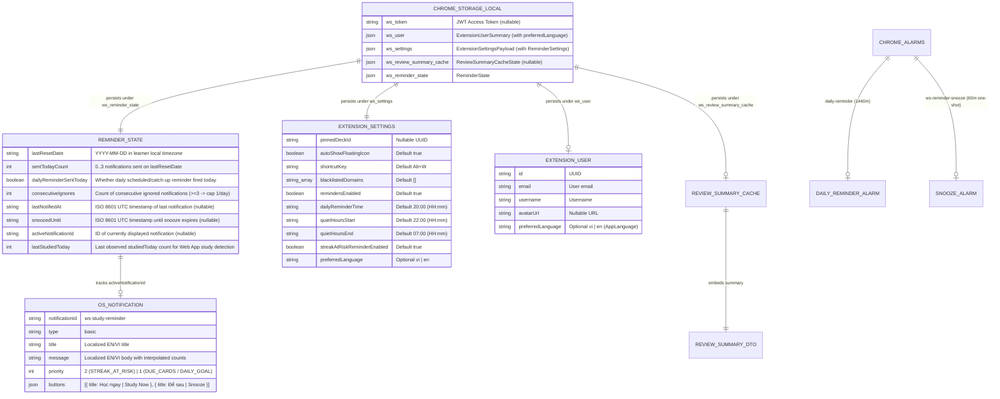

# Data Model & Storage Schema: Conditional Study Reminder Notifications (`US-ECO-06`)

**Feature**: `US-ECO-06`: Thông báo nhắc học theo luật điều kiện (Conditional Study Reminder Notifications)  
**Slug**: `extension-reminder-notifications`  
**Date**: 2026-10-13  
**Status**: Approved (Phase 3 - Plan)  
**Database Schema Migrations Required**: **0 (Zero database schema changes — `CON-REMD-003`)**

---

## 1. Storage, Alarm & Notification Entity-Relationship Overview

`US-ECO-06` operates across Chrome Extension Manifest V3 local storage (`chrome.storage.local`), Chrome Alarms (`chrome.alarms`), Chrome Notifications (`chrome.notifications`), and Chrome Tabs (`chrome.tabs`). No PostgreSQL tables or Prisma models are added or modified.



---

## 2. Shared TypeScript Contracts (`packages/shared-types/src/extension.ts`)

Added to [`packages/shared-types/src/extension.ts`](file:///Users/vutuanhau/Documents/PROJECT/WordStreak/packages/shared-types/src/extension.ts) and re-exported via [`packages/shared-types/src/index.ts`](file:///Users/vutuanhau/Documents/PROJECT/WordStreak/packages/shared-types/src/index.ts):

```typescript
import type { AppLanguage } from "./auth.js";
import type { CardResponse } from "./cards.js";
import type { ReviewSummaryDto } from "./reviews.js";

export interface ExtensionUserSummary {
  id: string;
  email: string;
  username: string;
  avatarUrl?: string | null;
  preferredLanguage?: AppLanguage;
}

export interface ReminderSettings {
  remindersEnabled: boolean;
  dailyReminderTime: string;
  quietHoursStart: string;
  quietHoursEnd: string;
  streakAtRiskReminderEnabled: boolean;
  preferredLanguage?: AppLanguage;
}

export interface ExtensionSettingsPayload extends ReminderSettings {
  pinnedDeckId: string | null;
  autoShowFloatingIcon: boolean;
  shortcutKey: string;
  blacklistedDomains: string[];
}

export interface ReminderState {
  /** Local calendar date ("YYYY-MM-DD") when daily counters were last reset */
  lastResetDate: string;
  /** Number of reminder notifications sent on lastResetDate (0..3) */
  sentTodayCount: number;
  /** Whether the scheduled daily reminder (or catch-up) has already fired on lastResetDate */
  dailyReminderSentToday: boolean;
  /** Consecutive notifications closed/superseded without click, snooze, or Web App study (>= 3 reduces cap to 1/day) */
  consecutiveIgnores: number;
  /** ISO 8601 timestamp of the most recent notification shown (nullable) */
  lastNotifiedAt: string | null;
  /** ISO 8601 timestamp until which automatic reminders are snoozed (nullable) */
  snoozedUntil: string | null;
  /** Notification ID currently displayed and awaiting user interaction or close (nullable) */
  activeNotificationId: string | null;
  /** Last observed ReviewSummaryDto.studiedToday on lastResetDate to detect Web App study activity */
  lastStudiedToday: number;
}

export type ReminderTriggerSource =
  | "DAILY_ALARM"
  | "SNOOZE_ALARM"
  | "PERIODIC_SYNC";

export type ReminderNotificationType =
  | "STREAK_AT_RISK"
  | "DUE_CARDS"
  | "DAILY_GOAL";

export type ReminderTriggerReason =
  | "DAILY_SCHEDULED"
  | "STREAK_AT_RISK"
  | "SNOOZE_REMINDER";

export type ReminderSuppressionReason =
  | "UNAUTHENTICATED"
  | "REMINDERS_DISABLED"
  | "QUIET_HOURS"
  | "DAILY_CAP_REACHED"
  | "SNOOZED_ACTIVE"
  | "COOLDOWN_ACTIVE"
  | "NO_STUDY_NEEDED"
  | "NOT_YET_SCHEDULED_TIME";

export type ReminderReason =
  | ReminderTriggerReason
  | ReminderSuppressionReason;

export interface ReminderEvaluationInput {
  isAuthenticated: boolean;
  summary: ReviewSummaryDto | null;
  settings: ReminderSettings;
  state: ReminderState;
  triggerSource: ReminderTriggerSource;
  now?: Date | number;
  timezone?: string;
}

export type ReminderEvaluationContext = ReminderEvaluationInput;

export interface ReminderDecision {
  shouldNotify: boolean;
  reason: ReminderReason;
  notificationType?: ReminderNotificationType;
  effectiveDailyCap: 1 | 3;
  markDailyReminderSent?: boolean;
  normalizedState: ReminderState;
}

export interface ReminderNotificationCopy {
  title: string;
  message: string;
  buttons: [{ title: string }, { title: string }];
  priority: 1 | 2;
}

export interface ExtensionStorageState {
  token: string | null;
  user: ExtensionUserSummary | null;
  settings: ExtensionSettingsPayload;
  recentCaptures: RecentCaptureItem[];
  reviewSummaryCache?: ReviewSummaryCacheState | null;
  reminderState?: ReminderState;
}
```

---

## 3. Extension Local Storage Keys & Default State (`apps/extension/src/shared/`)

| Storage Key Constant | Raw Key in `chrome.storage.local` | Value Type | Default Value | Lifecycle & Retention Policy |
| :--- | :--- | :--- | :--- | :--- |
| `STORAGE_KEYS.SETTINGS` | `"ws_settings"` | `ExtensionSettingsPayload` | `{ pinnedDeckId: null, autoShowFloatingIcon: true, shortcutKey: "Alt+W", blacklistedDomains: [], remindersEnabled: true, dailyReminderTime: "20:00", quietHoursStart: "22:00", quietHoursEnd: "07:00", streakAtRiskReminderEnabled: true }` | Merged via `{ ...DEFAULT_SETTINGS, ...stored }` on read (`BR-REMD-001`). |
| `STORAGE_KEYS.REMINDER_STATE` | `"ws_reminder_state"` | `ReminderState` | `DEFAULT_REMINDER_STATE`: `{ lastResetDate: "", sentTodayCount: 0, dailyReminderSentToday: false, consecutiveIgnores: 0, lastNotifiedAt: null, snoozedUntil: null, activeNotificationId: null, lastStudiedToday: 0 }` | Normalized on date rollover (`BR-REMD-002`); updated on notification create/click/snooze/close/web-study (`BR-REMD-008`); reset/cleaned on logout or `401`. |
| `STORAGE_KEYS.USER` | `"ws_user"` | `ExtensionUserSummary \| null` | `null` | Populated on `LOGIN`, `SET_AUTH_TOKEN`, and `GET_AUTH_STATUS` with `preferredLanguage?: "vi" \| "en"`; cleared on logout/`401`. |

---

## 4. Chrome Alarms Model (`chrome.alarms`)

| Alarm Name Constant | Raw Alarm Name | Mode | Schedule Rule | Business Rule |
| :--- | :--- | :--- | :--- | :--- |
| `ALARM_NAMES.DAILY_REMINDER` | `"daily-reminder"` | Recurring (`periodInMinutes: 1440`) | Scheduled with `{ when: computeNextDailyReminderTime(settings.dailyReminderTime, nowMs, timezone), periodInMinutes: 1440 }` on `onInstalled`, `onStartup`, `LOGIN`, `SET_AUTH_TOKEN`, and `UPDATE_SETTINGS` when authenticated and `settings.remindersEnabled === true`. Cleared when `remindersEnabled === false`, unauthenticated, `LOGOUT`, or `401`. | `BR-REMD-007` |
| `ALARM_NAMES.REMINDER_SNOOZE` | `"ws-reminder-snooze"` | One-shot (`delayInMinutes: 60`) | Scheduled via `chrome.alarms.create("ws-reminder-snooze", { delayInMinutes: 60 })` when the learner clicks button index `1` (**"Để sau" / "Snooze"**). Cleared when the learner clicks **"Học ngay"**, completes all due/goal cards on the Web App, disables reminders, or logs out. | `BR-REMD-007`, `BR-REMD-008` |

---

## 5. Pure Rule Evaluation State & Decision Matrix (`BR-REMD-006`)

| Priority Step | Condition | `shouldNotify` | `reason` (`ReminderReason`) | `notificationType` |
| :---: | :--- | :---: | :--- | :--- |
| **1** | `!isAuthenticated \|\| !summary` | `false` | `"UNAUTHENTICATED"` | `undefined` |
| **2** | `!settings.remindersEnabled` | `false` | `"REMINDERS_DISABLED"` | `undefined` |
| **3** | `isWithinQuietHours(now, timezone, quietHoursStart, quietHoursEnd)` | `false` | `"QUIET_HOURS"` | `undefined` |
| **4** | `normalizedState.sentTodayCount >= effectiveDailyCap` (`1` if `consecutiveIgnores >= 3` else `3`) | `false` | `"DAILY_CAP_REACHED"` | `undefined` |
| **5** | `triggerSource !== "SNOOZE_ALARM"` and `snoozedUntil > nowMs` | `false` | `"SNOOZED_ACTIVE"` | `undefined` |
| **6** | `triggerSource !== "SNOOZE_ALARM"` and `nowMs - lastNotifiedAtMs < 120 * 60 * 1000` (on same day) | `false` | `"COOLDOWN_ACTIVE"` | `undefined` |
| **7** | `!streakAtRiskEligible && summary.dueCount <= 0 && summary.goalReached` | `false` | `"NO_STUDY_NEEDED"` | `undefined` |
| **8** | `triggerSource === "SNOOZE_ALARM"` | `true` | `"SNOOZE_REMINDER"` | `STREAK_AT_RISK` > `DUE_CARDS` > `DAILY_GOAL` |
| **9** | `triggerSource === "DAILY_ALARM"` OR (`triggerSource === "PERIODIC_SYNC" && !normalizedState.dailyReminderSentToday && currentMinutes >= dailyReminderMinutes`) | `true` | `"DAILY_SCHEDULED"` (`markDailyReminderSent: true`) | `STREAK_AT_RISK` > `DUE_CARDS` > `DAILY_GOAL` |
| **10** | `triggerSource === "PERIODIC_SYNC" && streakAtRiskEligible` | `true` | `"STREAK_AT_RISK"` | `"STREAK_AT_RISK"` |
| **11** | All other cases (e.g., `PERIODIC_SYNC` before `dailyReminderTime` with `streakAtRisk === false`) | `false` | `"NOT_YET_SCHEDULED_TIME"` | `undefined` |
