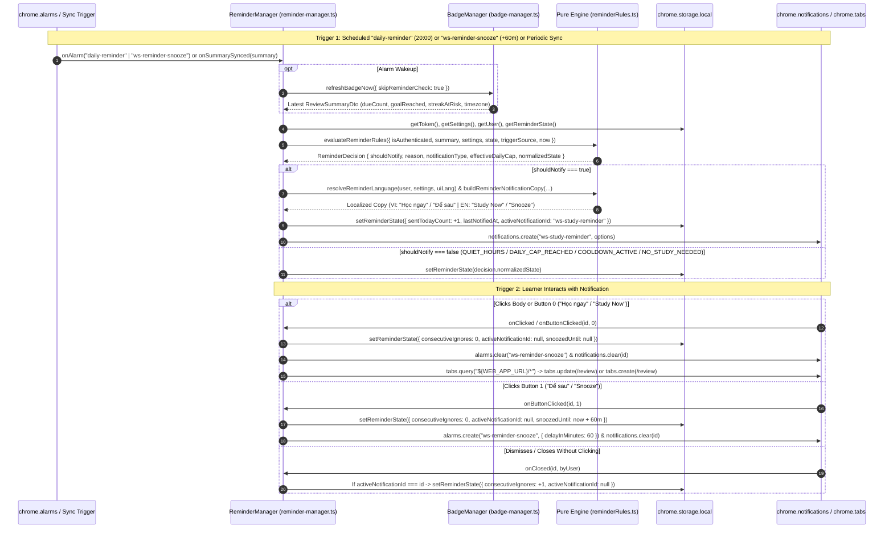

# Implementation Plan: Conditional Study Reminder Notifications (`US-ECO-06`)

**Branch**: `feat/extension-reminder-notifications` | **Date**: 2026-10-13 | **Spec**: [`spec.md`](file:///Users/vutuanhau/Documents/PROJECT/WordStreak/.specify/features/extension-reminder-notifications/spec.md)  
**Domain Baseline**: [`baseline.md`](file:///Users/vutuanhau/Documents/PROJECT/WordStreak/.specify/features/extension-reminder-notifications/baseline.md) (`SIGNED-OFF v1.0`)

---

## 1. Summary

This plan defines the technical architecture and TDD implementation strategy for **US-ECO-06: Thông báo nhắc học theo luật điều kiện (`extension-reminder-notifications`)**. Building on the `GET /api/reviews/summary` endpoint (`US-REM-01`) and the Extension badge/alarm infrastructure (`US-ECO-05`), this feature introduces:
1. A 100% pure, deterministic rule evaluation and bilingual EN/VI copy module (`apps/extension/src/background/reminderRules.ts`).
2. Persistent reminder state (`ws_reminder_state`) and default reminder settings (`ws_settings`) in `chrome.storage.local`.
3. A background `ReminderManager` (`apps/extension/src/background/reminder-manager.ts`) that schedules the recurring `"daily-reminder"` alarm (`periodInMinutes: 1440` at `dailyReminderTime`, default `"20:00"`) and one-shot `"ws-reminder-snooze"` alarm (`delayInMinutes: 60`), creates native OS notifications with **"Học ngay" / "Study Now"** and **"Để sau" / "Snooze"** buttons, handles `onClicked` / `onButtonClicked` / `onClosed` without race conditions, focuses or opens `${WEB_APP_URL}/review`, and resets `consecutiveIgnores` when the learner studies on the Web App.

---

## 2. Technical Context

- **Language/Version**: TypeScript 5.7+ / 6.0 (strict mode enabled across monorepo)
- **Primary Dependencies**:
  - Extension (`apps/extension`): Chrome Extension Manifest V3 APIs (`chrome.notifications`, `chrome.alarms`, `chrome.storage.local`, `chrome.tabs`, `chrome.windows`, `chrome.i18n`, `chrome.runtime`), Vite 8, Vitest 4
  - Shared Contracts (`packages/shared-types`): `@wordstreak/shared-types`
- **Storage**: `chrome.storage.local` keys `ws_reminder_state` (`ReminderState`), `ws_settings` (`ExtensionSettingsPayload`), and `ws_user` (`ExtensionUserSummary`) — **0 database schema migrations**
- **Testing**: Vitest (`apps/extension`)
- **Target Platform**: Chromium Manifest V3 Browser Extension
- **Project Type**: Fullstack Monorepo (`pnpm` workspaces)
- **Performance Goals**:
  - Pure `evaluateReminderRules` execution `< 5ms` (`SC-001`)
  - Notification click / button click handling `< 150ms` (`SC-002`)
  - Zero notifications during quiet hours (`[quietHoursStart, quietHoursEnd)`), within the 120-minute non-snooze cooldown, or above the effective daily ceiling (`3/day` normal, `1/day` when `consecutiveIgnores >= 3`) (`SC-003`)
- **Constraints**:
  - `reminderRules.ts` MUST be a 100% pure TypeScript module with zero direct `chrome.*` API calls or side effects (`CON-REMD-001`)
  - MV3 service worker is ephemeral; all reminder state MUST be persisted in `chrome.storage.local` (`CON-REMD-002`)
  - Zero Prisma schema or backend database changes (`CON-REMD-003`)
  - File `< 800` lines, function `< 50` lines, immutable data updates, strict TypeScript

---

## 3. Constitution Check

*GATE: Evaluation against [`.specify/memory/constitution.md`](file:///Users/vutuanhau/Documents/PROJECT/WordStreak/.specify/memory/constitution.md) (v1.0.0)*

| Principle | Status | Compliance Verification |
| :--- | :--- | :--- |
| **I. Code Quality First** | ✅ PASS | Strict TypeScript, shared contracts in `packages/shared-types/src/extension.ts`, pure single-responsibility `reminderRules.ts` (`< 300` lines) and `reminder-manager.ts` (`< 350` lines), functions `< 50` lines, immutable state transitions. |
| **II. Testing Standards** | ✅ PASS | Strict TDD workflow (`test-plan.md` → failing unit tests → implementation). Unit tests cover `reminderRules.spec.ts`, `reminder-manager.spec.ts`, `storage.spec.ts`, and `api-client.spec.ts` with `>= 80%` branch coverage. |
| **III. UX Consistency** | ✅ PASS | Uses localized EN/VI copy matching WordStreak's encouraging tone, respects quiet hours (`22:00–07:00`), enforces 3/day cap + 3-ignore backoff (`1/day`), and reuses open WordStreak tabs on `/review` navigation. |
| **IV. Performance Requirements** | ✅ PASS | Pure in-memory rule evaluation executes in `< 1ms` (`< 5ms` budget), reuses `ReviewSummaryDto` fetched by `BadgeManager`, and avoids redundant network polling. |
| **Technology Constraints** | ✅ PASS | Uses `@wordstreak/shared-types`, `pnpm` workspaces, Vitest, and Chrome MV3 native APIs. |

*Gate Result: ALL GATES PASSED.*

---

## 4. Project Structure & File Layout

### Documentation (`.specify/features/extension-reminder-notifications/`)

```text
.specify/features/extension-reminder-notifications/
├── 00-intake.md                                    # Stage 1: Bounded Task classification
├── 01-elicitation.md                               # Stage 2: Customer interview decisions & ASM-REMD-001..007
├── 03-domain-model.md                              # Stage 4: RBAC, state machine, BR-REMD-001..010, ERD
├── 04-risk-scope.md                                # Stage 5: Contradiction scan, RISK-REMD-001..005, MoSCoW
├── 06-validation-report.md                         # Stage 7: IEEE 29148 validation report
├── baseline.md                                     # Stage 8: Signed-off Domain Baseline v1.0
├── CHANGELOG.md                                    # Version log
├── spec/
│   ├── srs.md                                      # Stage 6: Formal REQ-REMD-001..010
│   └── user-stories.md                             # Stage 6: US-ECO-06 Gherkin scenarios (Scenarios 1..8)
├── checklists/
│   └── requirements.md                             # Phase 2: Spec quality checklist
├── spec.md                                         # Phase 2: Formal technical specification
├── data-model.md                                   # Phase 3: Storage, alarm & reminder state data model
├── contracts/
│   └── extension-reminder-contracts.md             # Phase 3: Storage, pure rules, alarms & notification contracts
├── plan.md                                         # Phase 3: Technical implementation plan (this file)
├── tasks.md                                        # Phase 4: Dependency-ordered TDD tasks
└── test-plan.md                                    # Phase 5 (T001): Gherkin test cases mapped to US-ECO-06
```

### Source Code (Repository Root)

```text
packages/shared-types/
└── src/
    └── extension.ts                                # [MODIFY] Add ReminderSettings, ReminderState, ReminderDecision, ReminderEvaluationInput, preferredLanguage on ExtensionUserSummary

apps/extension/
├── manifest.json                                   # [MODIFY] Add "notifications" to permissions array
└── src/
    ├── shared/
    │   ├── constants.ts                            # [MODIFY] Add STORAGE_KEYS.REMINDER_STATE, ALARM_NAMES.DAILY_REMINDER & REMINDER_SNOOZE, REMINDER_NOTIFICATION_ID, REMINDER_LIMITS, DEFAULT_REMINDER_STATE, and reminder defaults in DEFAULT_SETTINGS
    │   ├── storage.ts                              # [MODIFY] Add getReminderState(), setReminderState(), resetReminderState(), and include reminderState in getAll() & clearAuth()
    │   └── storage.spec.ts                         # [MODIFY] Add unit tests for getReminderState, setReminderState, resetReminderState, and default reminder settings merge
    └── background/
        ├── api-client.ts                           # [MODIFY] Return ExtensionUserSummary (preserving preferredLanguage) in getMe() and login(), and reset reminder active state on 401
        ├── api-client.spec.ts                      # [MODIFY] Verify preferredLanguage preservation in getMe()
        ├── reminderRules.ts                        # [NEW] Pure rule engine & EN/VI notification copy builder (zero Chrome API calls)
        ├── reminderRules.spec.ts                   # [NEW] Unit tests for BR-REMD-002..006, BR-REMD-010 & Scenarios 1, 3, 4, 5, 6, 7, 8
        ├── reminder-manager.ts                     # [NEW] Alarm scheduling, notification creation, onClicked/onButtonClicked/onClosed, smart /review tab navigation, Web App study reset
        ├── reminder-manager.spec.ts                # [NEW] Unit tests for BR-REMD-007..009 & Scenarios 1, 2, 3, 6, 8 + EC-REMD-01..06
        ├── badge-manager.ts                        # [MODIFY] Notify reminderManager on summary refresh (onSummarySynced) and auth cleanup (clearAuthAndBadge)
        └── index.ts                                # [MODIFY] Wire reminderManager into onInstalled, onStartup, onAlarm, notifications listeners, LOGIN, SET_AUTH_TOKEN, LOGOUT, UPDATE_SETTINGS
```

---

## 5. Detailed Technical Design by Vertical Slice

### 5.1. Slice 1: Shared Types, Manifest & Storage (`packages/shared-types`, `apps/extension/manifest.json`, `src/shared/`)

1. **`packages/shared-types/src/extension.ts`**:
   - Import `type { AppLanguage } from "./auth.js";`
   - Add `preferredLanguage?: AppLanguage` to `ExtensionUserSummary`.
   - Define `ReminderSettings` and extend `ExtensionSettingsPayload` with `remindersEnabled`, `dailyReminderTime`, `quietHoursStart`, `quietHoursEnd`, `streakAtRiskReminderEnabled`, and `preferredLanguage?: AppLanguage`.
   - Define and export `ReminderState`, `ReminderTriggerSource`, `ReminderNotificationType`, `ReminderTriggerReason`, `ReminderSuppressionReason`, `ReminderReason`, `ReminderEvaluationInput`, `ReminderEvaluationContext`, `ReminderDecision`, and `ReminderNotificationCopy`.
   - Add optional `reminderState?: ReminderState` to `ExtensionStorageState`.

2. **`apps/extension/manifest.json`**:
   - Add `"notifications"` to `"permissions"`:
     ```json
     "permissions": ["storage", "activeTab", "contextMenus", "scripting", "tabs", "alarms", "notifications"]
     ```

3. **`apps/extension/src/shared/constants.ts`**:
   - Add `REMINDER_STATE: "ws_reminder_state"` to `STORAGE_KEYS`.
   - Add `DAILY_REMINDER: "daily-reminder"` and `REMINDER_SNOOZE: "ws-reminder-snooze"` to `ALARM_NAMES`.
   - Export `REMINDER_NOTIFICATION_ID = "ws-study-reminder"`.
   - Export `REMINDER_LIMITS` and `DEFAULT_REMINDER_STATE`.
   - Extend `DEFAULT_SETTINGS` with:
     ```typescript
     remindersEnabled: true,
     dailyReminderTime: "20:00",
     quietHoursStart: "22:00",
     quietHoursEnd: "07:00",
     streakAtRiskReminderEnabled: true,
     ```

4. **`apps/extension/src/shared/storage.ts`**:
   - Add `getReminderState(): Promise<ReminderState>`: reads `STORAGE_KEYS.REMINDER_STATE` from `chrome.storage.local` (or `localStorage` fallback) and merges `{ ...DEFAULT_REMINDER_STATE, ...stored }`.
   - Add `setReminderState(state: ReminderState): Promise<void>`: persists `state` under `STORAGE_KEYS.REMINDER_STATE`.
   - Add `resetReminderState(): Promise<ReminderState>`: writes `DEFAULT_REMINDER_STATE` (or removes `STORAGE_KEYS.REMINDER_STATE`) and returns `{ ...DEFAULT_REMINDER_STATE }`.
   - Update `getAll()` to include `reminderState: await this.getReminderState()`.

5. **`apps/extension/src/background/api-client.ts`**:
   - Update `getMe()` and `login()` return types to use `ExtensionUserSummary` (preserving `preferredLanguage` when returned by `/users/me` or `/auth/login`).

### 5.2. Slice 2: Pure Reminder Rules & Bilingual Copy Engine (`apps/extension/src/background/reminderRules.ts`)

`reminderRules.ts` is 100% pure and deterministic (`CON-REMD-001`):

1. **Time & Timezone Utilities**:
   - `parseTimeToMinutes(hhmm: string, fallbackMinutes: number = 20 * 60): number`:
     - Validates `/^([01]\d|2[0-3]):([0-5]\d)$/`. Returns `hours * 60 + minutes`, or `fallbackMinutes` if malformed.
   - `getLocalDateAndMinutes(now: Date | number, timezone?: string): { localDate: string; currentMinutes: number }`:
     - Uses `Intl.DateTimeFormat("en-CA", { timeZone, year: "numeric", month: "2-digit", day: "2-digit", hour: "2-digit", minute: "2-digit", hour12: false })` (falling back safely to system timezone / `"UTC"` if `timezone` is invalid) to extract `localDate` (`"YYYY-MM-DD"`) and `currentMinutes` (`0..1439`) (`BR-REMD-002`, `RISK-REMD-004`).

2. **Quiet Hours Check (`BR-REMD-003`)**:
   - `isWithinQuietHours(now: Date | number, timezone: string | undefined, quietHoursStart: string, quietHoursEnd: string): boolean`:
     - Computes `startMinutes = parseTimeToMinutes(quietHoursStart, 22 * 60)` and `endMinutes = parseTimeToMinutes(quietHoursEnd, 7 * 60)`.
     - If `startMinutes === endMinutes`, returns `false`.
     - Computes `{ currentMinutes } = getLocalDateAndMinutes(now, timezone)`.
     - If `startMinutes < endMinutes` (same-day): returns `currentMinutes >= startMinutes && currentMinutes < endMinutes`.
     - Else (`startMinutes > endMinutes`, overnight wrap-around `22:00–07:00`): returns `currentMinutes >= startMinutes || currentMinutes < endMinutes`.

3. **Date Rollover State Normalizer (`BR-REMD-002`)**:
   - `normalizeReminderStateForDate(state: ReminderState, currentLocalDate: string, currentStudiedToday?: number): ReminderState`:
     - If `!state.lastResetDate`: returns `{ ...state, lastResetDate: currentLocalDate, lastStudiedToday: currentStudiedToday ?? state.lastStudiedToday }`.
     - If `state.lastResetDate === currentLocalDate`: returns `{ ...state }`.
     - When `state.lastResetDate !== currentLocalDate` (midnight rollover):
       - Increments `consecutiveIgnores = state.activeNotificationId !== null ? state.consecutiveIgnores + 1 : state.consecutiveIgnores` (`RISK-REMD-005`).
       - Resets `sentTodayCount: 0`, `dailyReminderSentToday: false`, `activeNotificationId: null`, `lastResetDate: currentLocalDate`, `lastStudiedToday: currentStudiedToday ?? 0`.

4. **Next Daily Alarm Calculator (`BR-REMD-007`)**:
   - `computeNextDailyReminderTime(dailyReminderTime: string, nowMs: number = Date.now(), timezone?: string): number`:
     - Computes target minutes `targetMinutes = parseTimeToMinutes(dailyReminderTime, 20 * 60)` and current `{ currentMinutes } = getLocalDateAndMinutes(nowMs, timezone)`.
     - Computes delta in minutes until next occurrence (`targetMinutes > currentMinutes ? targetMinutes - currentMinutes : 1440 - currentMinutes + targetMinutes`, subtracting current seconds/ms for exact minute alignment) and clamps to `Math.max(nowMs + REMINDER_LIMITS.MIN_ALARM_DELAY_MS, scheduledMs)`.

5. **11-Step Pure Rule Evaluator (`BR-REMD-004`, `BR-REMD-005`, `BR-REMD-006`)**:
   - `evaluateReminderRules(input: ReminderEvaluationInput): ReminderDecision`:
     - Resolves `nowMs`, `tz = input.timezone || input.summary?.timezone`, and `{ localDate, currentMinutes } = getLocalDateAndMinutes(nowMs, tz)`.
     - Normalizes `normalizedState = normalizeReminderStateForDate(input.state, localDate, input.summary?.studiedToday)`.
     - Computes `effectiveDailyCap: 1 | 3 = normalizedState.consecutiveIgnores >= REMINDER_LIMITS.IGNORE_BACKOFF_THRESHOLD ? 1 : 3`.
     - Evaluates Steps 1–11 from `BR-REMD-006` in strict order and returns `{ shouldNotify, reason, notificationType, effectiveDailyCap, markDailyReminderSent, normalizedState }`.

6. **Bilingual EN/VI Localization (`BR-REMD-010`)**:
   - `resolveReminderLanguage(user, settings, browserUiLang)`: returns `"en"` or `"vi"` following `user?.preferredLanguage ?? settings?.preferredLanguage ?? browserUiLang ?? "vi"`.
   - `buildReminderNotificationCopy(notificationType, summary, lang)`: returns `{ title, message, buttons, priority }` matching the exact VI and EN templates in `BR-REMD-010`.

### 5.3. Slice 3: Background `ReminderManager` & Service Worker Integration (`reminder-manager.ts`, `badge-manager.ts`, `index.ts`)

1. **`ReminderManager` Class (`apps/extension/src/background/reminder-manager.ts`)**:
   - `syncDailyReminderAlarm(nowMs: number = Date.now()): Promise<void>`:
     - Reads `token`, `settings`, and `cached = await extensionStorage.getReviewSummaryCache()`.
     - If `!token || !settings.remindersEnabled`: clears `ALARM_NAMES.DAILY_REMINDER` and `ALARM_NAMES.REMINDER_SNOOZE`.
     - Else: computes `when = computeNextDailyReminderTime(settings.dailyReminderTime, nowMs, cached?.summary?.timezone)` and calls `await chrome.alarms?.create?.(ALARM_NAMES.DAILY_REMINDER, { when, periodInMinutes: REMINDER_LIMITS.DAILY_PERIOD_MINUTES })` (`BR-REMD-007`).
   - `evaluateAndNotify(triggerSource: ReminderTriggerSource, summaryOverride?: ReviewSummaryDto | null, nowMs: number = Date.now()): Promise<ReminderDecision>`:
     - Reads `token`, `settings`, `user`, `state`, and `cached`.
     - Resolves `summary = summaryOverride !== undefined ? summaryOverride : (cached?.summary ?? null)`.
     - Normalizes `state` for current local date (`getLocalDateAndMinutes`).
     - **Web App Study Detection (`BR-REMD-008`, `EC-REMD-05`)**:
       - If `summary`:
         - If `summary.studiedToday > normalizedState.lastStudiedToday` or (`summary.dueCount <= 0 && summary.goalReached`):
           - Resets `normalizedState.consecutiveIgnores = 0`.
         - Updates `normalizedState.lastStudiedToday = summary.studiedToday`.
         - If `summary.dueCount <= 0 && summary.goalReached`:
           - If `normalizedState.activeNotificationId !== null`: sets `normalizedState.activeNotificationId = null` and `normalizedState.snoozedUntil = null` first, persists state, and clears the active OS notification and `"ws-reminder-snooze"` alarm.
     - **Unclicked Notification Supersede Check (`EC-REMD-04`, `RISK-REMD-005`)**:
       - If a new evaluation is about to run and `normalizedState.activeNotificationId !== null` and `triggerSource !== "PERIODIC_SYNC"` (or cooldown has elapsed): accounts for the unclicked notification by incrementing `consecutiveIgnores` and clearing `activeNotificationId = null` before evaluating rules.
     - Calls `decision = evaluateReminderRules({ isAuthenticated: Boolean(token), summary, settings, state: normalizedState, triggerSource, now: nowMs, timezone: summary?.timezone })`.
     - If `!decision.shouldNotify`:
       - If `triggerSource === "SNOOZE_ALARM"`, clears `snoozedUntil: null`.
       - Persists `decision.normalizedState` and returns `decision`.
     - If `decision.shouldNotify && decision.notificationType && summary`:
       - Resolves `lang = resolveReminderLanguage(user, settings, chrome.i18n?.getUILanguage?.())`.
       - Builds `copy = buildReminderNotificationCopy(decision.notificationType, summary, lang)`.
       - Persists updated `ReminderState` (`sentTodayCount + 1`, `lastNotifiedAt: new Date(nowMs).toISOString()`, `dailyReminderSentToday: decision.normalizedState.dailyReminderSentToday || Boolean(decision.markDailyReminderSent)`, `activeNotificationId: REMINDER_NOTIFICATION_ID`, `snoozedUntil: null`).
       - Calls `await chrome.notifications?.create?.(REMINDER_NOTIFICATION_ID, { type: "basic", iconUrl, title: copy.title, message: copy.message, buttons: copy.buttons, priority: copy.priority })`.
       - Returns `decision`.
   - `handleAlarm(alarmName: string, refreshSummaryFn: () => Promise<ReviewSummaryDto | null>): Promise<void>`:
     - If `alarmName === ALARM_NAMES.DAILY_REMINDER`: refreshes summary via `await refreshSummaryFn()` (or uses returned summary) and calls `await this.evaluateAndNotify("DAILY_ALARM", summary)`.
     - If `alarmName === ALARM_NAMES.REMINDER_SNOOZE`: refreshes summary via `await refreshSummaryFn()` and calls `await this.evaluateAndNotify("SNOOZE_ALARM", summary)`.
   - `handleNotificationClicked(notificationId: string): Promise<void>`:
     - If `notificationId !== REMINDER_NOTIFICATION_ID` return.
     - Reads `state = await extensionStorage.getReminderState()`.
     - Persists `{ ...state, consecutiveIgnores: 0, activeNotificationId: null, snoozedUntil: null }` **before** clearing the notification (`RISK-REMD-001`).
     - Calls `await chrome.alarms?.clear?.(ALARM_NAMES.REMINDER_SNOOZE)` and `await chrome.notifications?.clear?.(notificationId)`.
     - Calls `await this.openOrFocusReviewTab()` (`BR-REMD-009`).
   - `handleNotificationButtonClicked(notificationId: string, buttonIndex: number, nowMs: number = Date.now()): Promise<void>`:
     - If `notificationId !== REMINDER_NOTIFICATION_ID` return.
     - If `buttonIndex === 0`: delegates to `await this.handleNotificationClicked(notificationId)`.
     - If `buttonIndex === 1` (**"Để sau" / "Snooze"**):
       - Reads `state = await extensionStorage.getReminderState()`.
       - Computes `snoozedUntil = new Date(nowMs + REMINDER_LIMITS.SNOOZE_MINUTES * 60 * 1000).toISOString()`.
       - Persists `{ ...state, consecutiveIgnores: 0, activeNotificationId: null, snoozedUntil }` **before** clearing the notification (`RISK-REMD-001`).
       - Calls `await chrome.alarms?.create?.(ALARM_NAMES.REMINDER_SNOOZE, { delayInMinutes: REMINDER_LIMITS.SNOOZE_MINUTES })`.
       - Calls `await chrome.notifications?.clear?.(notificationId)`.
   - `handleNotificationClosed(notificationId: string, _byUser: boolean): Promise<void>`:
     - If `notificationId !== REMINDER_NOTIFICATION_ID` return.
     - Reads `state = await extensionStorage.getReminderState()`.
     - If `state.activeNotificationId === notificationId`:
       - Persists `{ ...state, consecutiveIgnores: state.consecutiveIgnores + 1, activeNotificationId: null }` (`BR-REMD-008`).
   - `openOrFocusReviewTab(): Promise<void>`:
     - Queries `tabs = (await chrome.tabs?.query?.({ url: `${WEB_APP_URL}/*` })) ?? []`.
     - Target tab is `tabs.find((t) => t.url?.includes("/review")) ?? tabs[0]`.
     - If `targetTab?.id !== undefined`:
       - Calls `await chrome.tabs?.update?.(targetTab.id, { active: true, url: `${WEB_APP_URL}/review` })`.
       - If `targetTab.windowId !== undefined`: calls `await chrome.windows?.update?.(targetTab.windowId, { focused: true })`.
     - Else:
       - Calls `await chrome.tabs?.create?.({ url: `${WEB_APP_URL}/review`, active: true })`.
   - `clearRemindersOnLogout(): Promise<void>`:
     - Reads `state = await extensionStorage.getReminderState()`.
     - Persists `{ ...state, activeNotificationId: null, snoozedUntil: null }`.
     - Clears `ALARM_NAMES.DAILY_REMINDER` and `ALARM_NAMES.REMINDER_SNOOZE`.
     - Clears `REMINDER_NOTIFICATION_ID` via `await chrome.notifications?.clear?.(REMINDER_NOTIFICATION_ID)` (`EC-REMD-06`).

2. **Integration with `BadgeManager` (`apps/extension/src/background/badge-manager.ts`) & `index.ts`**:
   - In `badge-manager.ts`:
     - After `handleSuccessResult` and `handleNotModifiedResult`, invoke `await reminderManager.evaluateAndNotify("PERIODIC_SYNC", summary)` (unless suppressed by caller during explicit `DAILY_ALARM` / `SNOOZE_ALARM` handling to avoid double evaluation).
     - In `clearAuthAndBadge()`, invoke `await reminderManager.clearRemindersOnLogout()`.
   - In `apps/extension/src/background/index.ts`:
     - `onInstalled` & `onStartup`: call `await reminderManager.syncDailyReminderAlarm()`.
     - `chrome.alarms.onAlarm`: handle `ALARM_NAMES.DAILY_REMINDER` and `ALARM_NAMES.REMINDER_SNOOZE` via `void reminderManager.handleAlarm(alarm.name, () => badgeManager.refreshBadgeNow({ skipReminderCheck: true }))`.
     - Register `chrome.notifications?.onClicked?.addListener(...)`, `chrome.notifications?.onButtonClicked?.addListener(...)`, and `chrome.notifications?.onClosed?.addListener(...)`.
     - On `LOGIN`, `SET_AUTH_TOKEN`, and `UPDATE_SETTINGS`: call `await reminderManager.syncDailyReminderAlarm()`.

---

## 6. End-to-End Sequence Diagram



---

## 7. Unit Testing Strategy (Vitest TDD)

1. **`apps/extension/src/background/reminderRules.spec.ts` (Pure Rule Engine Unit Tests)**:
   - **Quiet Hours (`REQ-REMD-003`, `Scenario 4`, `EC-REMD-07`)**: Overnight wrap-around (`22:00–07:00` at `21:59`, `22:00`, `23:30`, `06:59`, `07:00`), same-day window (`01:00–06:00`), and disabled window (`00:00–00:00`).
   - **Local Date Rollover (`REQ-REMD-002`, `EC-REMD-04`, `EC-REMD-08`)**: Resets `sentTodayCount = 0` and `dailyReminderSentToday = false` at local midnight in `Asia/Ho_Chi_Minh`, preserves `consecutiveIgnores`, and increments `consecutiveIgnores` if `activeNotificationId !== null` across midnight.
   - **Daily Ceiling & 3-Ignore Frequency Backoff (`REQ-REMD-004`, `Scenarios 5 & 6`)**: Enforces `effectiveDailyCap = 3` when `consecutiveIgnores < 3` and `effectiveDailyCap = 1` when `consecutiveIgnores >= 3` (`reason: "DAILY_CAP_REACHED"`).
   - **120-Minute Cooldown & Active Snooze Suppression (`REQ-REMD-005`, `Scenarios 3 & 5`)**: Suppresses `PERIODIC_SYNC` / `DAILY_ALARM` when `lastNotifiedAt` is `< 120m` ago (`COOLDOWN_ACTIVE`) or `snoozedUntil > nowMs` (`SNOOZED_ACTIVE`), while allowing `SNOOZE_ALARM` to bypass cooldown (still subject to quiet hours & daily cap, `EC-REMD-02`).
   - **Conditional Study Evaluation & Priority Order (`REQ-REMD-006`, `Scenarios 1, 7, 8`, `EC-REMD-01`)**: Verifies `UNAUTHENTICATED`, `REMINDERS_DISABLED`, `NO_STUDY_NEEDED`, `NOT_YET_SCHEDULED_TIME`, catch-up `PERIODIC_SYNC` after `dailyReminderTime`, and priority selection `STREAK_AT_RISK` > `DUE_CARDS` > `DAILY_GOAL`.
   - **Bilingual EN/VI Localization (`REQ-REMD-010`, `Scenario 1`)**: Verifies `resolveReminderLanguage` fallback chain and `buildReminderNotificationCopy` for all 3 notification types in `"vi"` and `"en"`.

2. **`apps/extension/src/background/reminder-manager.spec.ts` (Background Orchestration Unit Tests)**:
   - **Alarm Scheduling (`REQ-REMD-007`, `Scenarios 1, 3, 8`)**: `syncDailyReminderAlarm` creates `"daily-reminder"` (`periodInMinutes: 1440`) when enabled and clears `"daily-reminder"` / `"ws-reminder-snooze"` when disabled or logged out.
   - **Notification Creation & State Persistence (`Scenario 1`)**: `evaluateAndNotify` calls `chrome.notifications.create("ws-study-reminder", ...)` with localized copy and updates `ws_reminder_state`.
   - **"Học ngay" / Body Click & Smart `/review` Tab Navigation (`REQ-REMD-008`, `REQ-REMD-009`, `Scenario 2`, `EC-REMD-03`)**: Resets `consecutiveIgnores = 0` and clears `activeNotificationId` *before* `chrome.notifications.clear`, focuses/updates an existing `${WEB_APP_URL}/*` tab to `${WEB_APP_URL}/review` if open, or creates a new tab at `${WEB_APP_URL}/review` if none exists.
   - **"Để sau" / Snooze Button Click (`REQ-REMD-007`, `REQ-REMD-008`, `Scenario 3`, `EC-REMD-03`)**: Resets `consecutiveIgnores = 0`, sets `snoozedUntil`, schedules `"ws-reminder-snooze"` (`delayInMinutes: 60`), and ensures subsequent `onClosed` does not increment `consecutiveIgnores`.
   - **Unclicked Close & Web App Study Reset (`REQ-REMD-008`, `Scenario 6`, `EC-REMD-05`, `EC-REMD-06`)**: `onClosed` increments `consecutiveIgnores` when `activeNotificationId` matches; Web App study progress (`studiedToday` increase or `dueCount === 0 && goalReached`) resets `consecutiveIgnores = 0` and clears any active notification; logout clears alarms and notifications.

3. **`apps/extension/src/shared/storage.spec.ts` & `apps/extension/src/background/api-client.spec.ts`**:
   - Verifies `getReminderState`, `setReminderState`, `resetReminderState`, default reminder settings in `getSettings()`, and `preferredLanguage` preservation in `apiClient.getMe()`.

---

## 8. Rollback & Compatibility Plan

- **Zero DB Migration Risk**: No database tables or migrations are modified.
- **Additive Storage & Manifest**: Existing `ws_settings` and `ws_user` entries in `chrome.storage.local` merge seamlessly with `DEFAULT_SETTINGS` and optional `preferredLanguage`.
