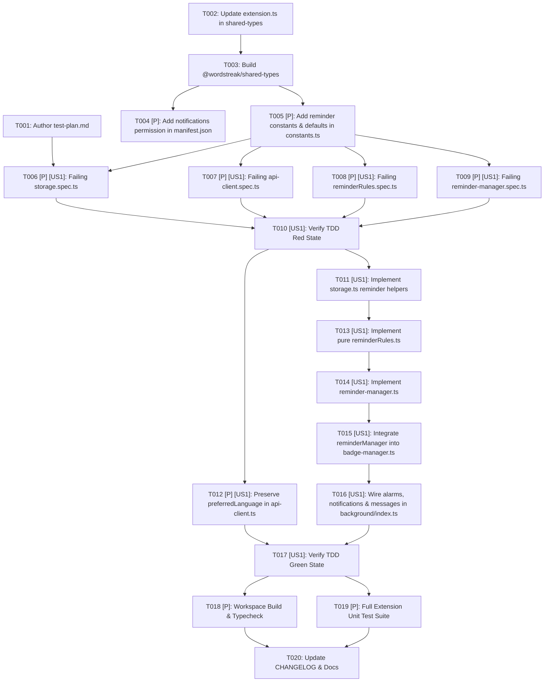

# Tasks: Conditional Study Reminder Notifications (`US-ECO-06`)

**Input**: Design documents from `/Users/vutuanhau/Documents/PROJECT/WordStreak/.specify/features/extension-reminder-notifications/`  
**Prerequisites**: [`baseline.md`](./baseline.md) (`SIGNED-OFF v1.0`), [`spec.md`](./spec.md), [`plan.md`](./plan.md), [`data-model.md`](./data-model.md), [`contracts/extension-reminder-contracts.md`](./contracts/extension-reminder-contracts.md)  
**Tests**: **MANDATORY (TDD Red → Green → Refactor)** per WordStreak Constitution Principle II and `wordstreak-workflow`.  
**Organization**: Tasks are structured around `US-ECO-06` (`[US1]`) across 4 vertical phases with a strict TDD-first execution order.

## Format: `[ID] [P?] [Story?] Description`

- **[P]**: Can run in parallel (different files, no dependencies on incomplete tasks)
- **[Story]**: `[US1]` maps to `US-ECO-06: Thông báo nhắc học theo luật điều kiện`
- Exact repository file paths are included in every task description.

---

## Phase 1: Setup & Shared Contracts (Blocking Prerequisites)

**Purpose**: Author the Gherkin TDD test plan (`test-plan.md`), publish the shared reminder contracts (`ReminderSettings`, `ReminderState`, `ReminderDecision`, `ReminderEvaluationInput`, `ExtensionUserSummary.preferredLanguage`) in `@wordstreak/shared-types`, declare the `"notifications"` permission in `apps/extension/manifest.json`, and define reminder constants and defaults in `apps/extension/src/shared/constants.ts`.

- [x] T001 Create Gherkin test plan mapping all 8 scenarios of `US-ECO-06` (`Scenario 1`..`Scenario 8`) and edge cases (`EC-REMD-01`..`EC-REMD-08`) to numbered test cases (`TC-REMD-001`..`TC-REMD-016`) in `.specify/features/extension-reminder-notifications/test-plan.md`
- [x] T002 Define and export `ReminderSettings`, `ReminderState`, `ReminderTriggerSource`, `ReminderNotificationType`, `ReminderTriggerReason`, `ReminderSuppressionReason`, `ReminderReason`, `ReminderEvaluationInput`, `ReminderEvaluationContext`, `ReminderDecision`, and `ReminderNotificationCopy`, extend `ExtensionSettingsPayload` with reminder fields, add `preferredLanguage?: AppLanguage` to `ExtensionUserSummary`, and add `reminderState?: ReminderState` to `ExtensionStorageState` in `packages/shared-types/src/extension.ts` (`REQ-REMD-001`, `REQ-REMD-002`, `REQ-REMD-010`)
- [x] T003 Build `@wordstreak/shared-types` via `pnpm --filter @wordstreak/shared-types build` and verify zero TypeScript errors
- [x] T004 [P] Add `"notifications"` to the `"permissions"` array in `apps/extension/manifest.json` (`REQ-REMD-001`)
- [x] T005 [P] Add `STORAGE_KEYS.REMINDER_STATE` (`"ws_reminder_state"`), `ALARM_NAMES.DAILY_REMINDER` (`"daily-reminder"`), `ALARM_NAMES.REMINDER_SNOOZE` (`"ws-reminder-snooze"`), `REMINDER_NOTIFICATION_ID` (`"ws-study-reminder"`), `REMINDER_LIMITS`, `DEFAULT_REMINDER_STATE`, and default reminder settings (`remindersEnabled: true`, `dailyReminderTime: "20:00"`, `quietHoursStart: "22:00"`, `quietHoursEnd: "07:00"`, `streakAtRiskReminderEnabled: true`) in `apps/extension/src/shared/constants.ts` (`REQ-REMD-001`, `REQ-REMD-007`)

**Checkpoint**: `test-plan.md` is complete, `@wordstreak/shared-types` compiles and exports all reminder contracts, `manifest.json` includes `"notifications"`, and `constants.ts` defines all reminder constants and defaults.

---

## Phase 2: User Story 1 — TDD Red Phase (Failing Unit Tests) 🎯 MVP

**Goal**: Write comprehensive, failing unit tests across `apps/extension` covering all 10 requirements (`REQ-REMD-001`..`REQ-REMD-010`), 8 Gherkin scenarios (`Scenario 1`..`Scenario 8`), and 8 edge cases (`EC-REMD-01`..`EC-REMD-08`) before writing implementation code.

**Independent Test**: Run `pnpm --filter @wordstreak/extension test` and confirm the newly added test suites/cases in `storage.spec.ts`, `api-client.spec.ts`, `reminderRules.spec.ts`, and `reminder-manager.spec.ts` fail (Red state) because the reminder rules engine, storage methods, and reminder manager are not yet implemented.

- [x] T006 [P] [US1] Write failing unit tests for `extensionStorage.getReminderState`, `extensionStorage.setReminderState`, `extensionStorage.resetReminderState`, and default reminder fields in `extensionStorage.getSettings()` (`TC-REMD-001`, `REQ-REMD-001`, `REQ-REMD-002`) in `apps/extension/src/shared/storage.spec.ts`
- [x] T007 [P] [US1] Write failing unit tests verifying `ExtensionApiClient.getMe()` and `ExtensionApiClient.login()` preserve `preferredLanguage` on `ExtensionUserSummary` (`TC-REMD-002`, `REQ-REMD-010`) in `apps/extension/src/background/api-client.spec.ts`
- [x] T008 [P] [US1] Create failing unit test suite for the pure rule engine in `apps/extension/src/background/reminderRules.spec.ts` covering:
  - `TC-REMD-003` (`Scenario 4`, `EC-REMD-07`, `REQ-REMD-003`): `parseTimeToMinutes` and `isWithinQuietHours` for overnight wrap-around (`22:00–07:00`), same-day window (`01:00–06:00`), and disabled window (`start === end`)
  - `TC-REMD-004` (`Scenario 6`, `EC-REMD-04`, `EC-REMD-08`, `REQ-REMD-002`): `normalizeReminderStateForDate` resets `sentTodayCount = 0` and `dailyReminderSentToday = false` on local date rollover (`Asia/Ho_Chi_Minh`), preserves `consecutiveIgnores`, and increments `consecutiveIgnores` when `activeNotificationId !== null` across midnight
  - `TC-REMD-005` (`Scenario 1`, `REQ-REMD-007`): `computeNextDailyReminderTime` calculates next occurrence of `dailyReminderTime` (`today` vs `tomorrow`) and clamps to `>= nowMs + 60_000`
  - `TC-REMD-006` (`Scenario 5`, `Scenario 6`, `REQ-REMD-004`): `evaluateReminderRules` enforces `effectiveDailyCap = 3` when `consecutiveIgnores < 3` and `effectiveDailyCap = 1` when `consecutiveIgnores >= 3` (`reason: "DAILY_CAP_REACHED"`)
  - `TC-REMD-007` (`Scenario 3`, `Scenario 5`, `EC-REMD-02`, `REQ-REMD-005`): `evaluateReminderRules` enforces 120-minute cooldown (`COOLDOWN_ACTIVE`) and active snooze (`SNOOZED_ACTIVE`) for non-snooze triggers while allowing `SNOOZE_ALARM` to fire outside quiet hours and below daily cap
  - `TC-REMD-008` (`Scenario 1`, `Scenario 7`, `Scenario 8`, `EC-REMD-01`, `REQ-REMD-006`): `evaluateReminderRules` handles `UNAUTHENTICATED`, `REMINDERS_DISABLED`, `NO_STUDY_NEEDED`, `NOT_YET_SCHEDULED_TIME`, catch-up `PERIODIC_SYNC` after `dailyReminderTime`, and priority order `STREAK_AT_RISK` > `DUE_CARDS` > `DAILY_GOAL`
  - `TC-REMD-009` (`Scenario 1`, `REQ-REMD-010`): `resolveReminderLanguage` fallback chain (`user.preferredLanguage` → `settings.preferredLanguage` → `browserUiLang` → `"vi"`) and `buildReminderNotificationCopy` for all 3 notification types in `"vi"` and `"en"`
- [x] T009 [P] [US1] Create failing unit test suite for `ReminderManager` in `apps/extension/src/background/reminder-manager.spec.ts` covering:
  - `TC-REMD-010` (`Scenario 1`, `Scenario 8`, `REQ-REMD-007`): `syncDailyReminderAlarm` creates `"daily-reminder"` (`periodInMinutes: 1440`) when authenticated & enabled, and clears `"daily-reminder"` / `"ws-reminder-snooze"` when disabled or unauthenticated
  - `TC-REMD-011` (`Scenario 1`, `REQ-REMD-006`, `REQ-REMD-010`): `evaluateAndNotify` creates localized OS notification `"ws-study-reminder"` with action buttons and updates `ws_reminder_state` (`sentTodayCount`, `lastNotifiedAt`, `dailyReminderSentToday`, `activeNotificationId`)
  - `TC-REMD-012` (`Scenario 2`, `EC-REMD-03`, `REQ-REMD-008`, `REQ-REMD-009`): `handleNotificationClicked` and `handleNotificationButtonClicked(id, 0)` ("Học ngay") reset `consecutiveIgnores = 0` and clear `activeNotificationId` *before* `chrome.notifications.clear`, focus/update an existing `${WEB_APP_URL}/*` tab to `${WEB_APP_URL}/review` if open, or create a new tab at `${WEB_APP_URL}/review`
  - `TC-REMD-013` (`Scenario 3`, `EC-REMD-03`, `REQ-REMD-007`, `REQ-REMD-008`): `handleNotificationButtonClicked(id, 1)` ("Để sau") resets `consecutiveIgnores = 0`, sets `snoozedUntil`, schedules `"ws-reminder-snooze"` (`delayInMinutes: 60`), and prevents subsequent `onClosed` from incrementing `consecutiveIgnores`
  - `TC-REMD-014` (`Scenario 6`, `EC-REMD-04`, `REQ-REMD-008`): `handleNotificationClosed` increments `consecutiveIgnores` when `activeNotificationId === notificationId`, and unclicked active notifications are counted when superseded
  - `TC-REMD-015` (`Scenario 6`, `EC-REMD-05`, `REQ-REMD-008`): Web App study progress (`studiedToday > lastStudiedToday` or `dueCount === 0 && goalReached`) resets `consecutiveIgnores = 0` and clears active notification & snooze alarm when study is complete
  - `TC-REMD-016` (`Scenario 8`, `EC-REMD-06`, `REQ-REMD-007`, `REQ-REMD-008`): `clearRemindersOnLogout` clears `"daily-reminder"`, `"ws-reminder-snooze"`, and active notification on logout or `401`
- [x] T010 [US1] Run `pnpm --filter @wordstreak/extension test` to verify the newly added tests fail as expected (Red state)

**Checkpoint**: All `TC-REMD-001`..`TC-REMD-016` unit tests exist and fail cleanly in Red state.

---

## Phase 3: User Story 1 — TDD Green Phase (Implementation) 🎯 MVP

**Goal**: Implement storage helpers, `apiClient` user language preservation, pure `reminderRules.ts`, `ReminderManager` in `reminder-manager.ts`, and background wiring in `badge-manager.ts` and `index.ts` so all unit tests pass.

**Independent Test**: Run `pnpm --filter @wordstreak/extension test` and confirm 100% of test suites pass (Green state).

- [x] T011 [US1] Implement `getReminderState()`, `setReminderState()`, `resetReminderState()`, and updated `getAll()` in `apps/extension/src/shared/storage.ts` (`REQ-REMD-001`, `REQ-REMD-002`)
- [x] T012 [P] [US1] Update `ExtensionApiClient.getMe()` and `ExtensionApiClient.login()` return types to `ExtensionUserSummary` (preserving `preferredLanguage`) in `apps/extension/src/background/api-client.ts` (`REQ-REMD-010`)
- [x] T013 [US1] Implement pure functions `parseTimeToMinutes`, `getLocalDateAndMinutes`, `isWithinQuietHours`, `normalizeReminderStateForDate`, `computeNextDailyReminderTime`, `evaluateReminderRules`, `resolveReminderLanguage`, and `buildReminderNotificationCopy` in `apps/extension/src/background/reminderRules.ts` (`REQ-REMD-002`..`REQ-REMD-006`, `REQ-REMD-010`)
- [x] T014 [US1] Implement `ReminderManager` (`syncDailyReminderAlarm`, `evaluateAndNotify`, `handleAlarm`, `handleNotificationClicked`, `handleNotificationButtonClicked`, `handleNotificationClosed`, `openOrFocusReviewTab`, `clearRemindersOnLogout`) in `apps/extension/src/background/reminder-manager.ts` (`REQ-REMD-007`..`REQ-REMD-009`)
- [x] T015 [US1] Integrate `reminderManager` into `BadgeManager` (`handleSuccessResult`, `handleNotModifiedResult`, `clearAuthAndBadge`, and optional `{ skipReminderCheck?: boolean }` parameter on `refreshBadgeNow`) in `apps/extension/src/background/badge-manager.ts` (`REQ-REMD-006`, `REQ-REMD-008`)
- [x] T016 [US1] Wire `reminderManager` into `chrome.runtime.onInstalled`, `chrome.runtime.onStartup`, `chrome.alarms.onAlarm` (`"daily-reminder"`, `"ws-reminder-snooze"`), `chrome.notifications.onClicked`, `chrome.notifications.onButtonClicked`, `chrome.notifications.onClosed`, and `chrome.runtime.onMessage` (`LOGIN`, `SET_AUTH_TOKEN`, `LOGOUT`, `UPDATE_SETTINGS`) in `apps/extension/src/background/index.ts` (`REQ-REMD-007`..`REQ-REMD-009`)
- [x] T017 [US1] Run `pnpm --filter @wordstreak/extension test` and verify 100% of unit tests in `apps/extension` pass (Green state)

**Checkpoint**: All 16 test cases (`TC-REMD-001`..`TC-REMD-016`) and existing extension test suites pass.

---

## Phase 4: Refactor, Quality Gates & Documentation

**Purpose**: Ensure strict TypeScript compilation, zero lint/build errors across `@wordstreak/shared-types` and `apps/extension`, and up-to-date feature documentation.

- [x] T018 [P] Run build and typecheck verification across touched workspaces (`pnpm --filter @wordstreak/shared-types build && pnpm --filter @wordstreak/extension build`)
- [x] T019 [P] Run full unit test suites in `apps/extension` (`pnpm --filter @wordstreak/extension test`) to verify zero regressions and `< 5ms` rule evaluation performance
- [x] T020 Update `.specify/features/extension-reminder-notifications/CHANGELOG.md` and create `docs/features/extension-reminder-notifications/README.md` + `docs/user-guides/extension-reminder-notifications.md` upon completion

---

## Dependencies & Execution Order

### Parallel Opportunities

- **Phase 1 (Setup)**: `T004` (`apps/extension/manifest.json`) and `T005` (`apps/extension/src/shared/constants.ts`) touch separate files and can run in parallel after `T003`.
- **Phase 2 (Red Tests)**: `T006` (`storage.spec.ts`), `T007` (`api-client.spec.ts`), `T008` (`reminderRules.spec.ts`), and `T009` (`reminder-manager.spec.ts`) touch distinct spec files and can be authored in parallel.
- **Phase 3 (Green Implementation)**: `T012` (`api-client.ts`) and `T011`/`T013` (`storage.ts` + `reminderRules.ts`) can be implemented in parallel before `T014` (`reminder-manager.ts`).

### Implementation Strategy

1. **Contract-First (`T001`–`T005`)**: Publish shared types and constants first so all tests and implementation modules compile cleanly.
2. **Strict TDD (`T006`–`T010` Red → `T011`–`T017` Green)**: Write failing Vitest tests for every scenario and edge case before implementing storage helpers, pure `reminderRules.ts`, `reminder-manager.ts`, and service worker wiring.
3. **Verification & Polish (`T018`–`T020`)**: Verify full workspace builds (`shared-types`, `extension`) and test suites with zero warnings or regressions.
