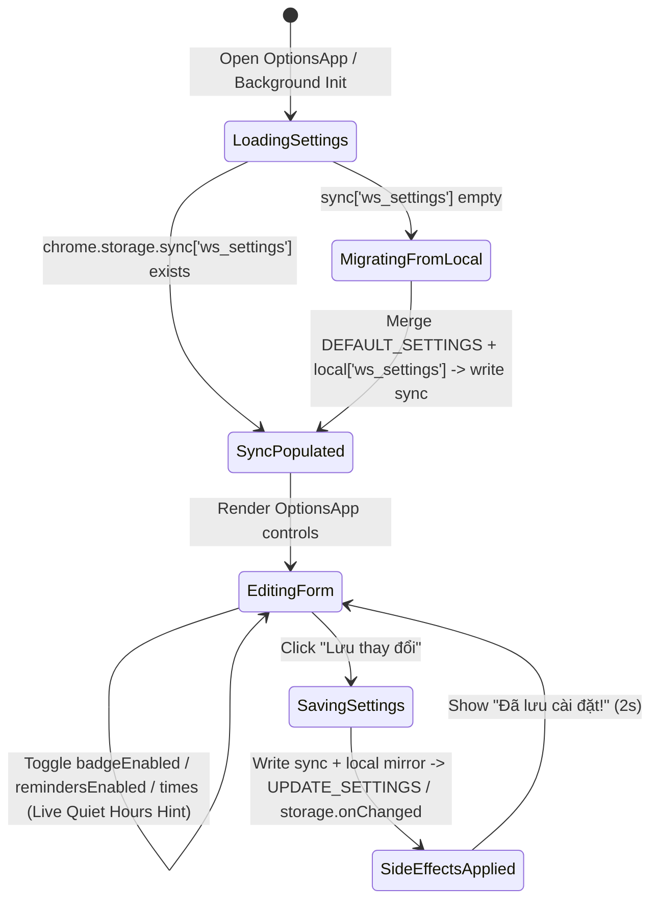

# Domain Decision Baseline — US-ECO-07: Cài đặt nhắc học (Options Page) (`extension-reminder-settings`)

- **Feature Slug**: `extension-reminder-settings`
- **Backlog ID**: `US-ECO-07`
- **Status**: `SIGNED-OFF v1.0`
- **Complexity Classification**: `Bounded Task`
- **Target Apps**: `packages/shared-types`, `apps/extension`

---

## 1. Intake Classification & Business Objective

- **Classification**: `Bounded Task` (extends existing `OptionsApp.tsx`, `extensionStorage`, `BadgeManager`, and `ReminderManager` in `apps/extension` + `ReminderSettings` in `packages/shared-types`; zero backend schema migrations).
- **Business Goal (`GOAL-ERS-01`)**: Empower learners to customize their daily study reminder schedule (`remindersEnabled`, `dailyReminderTime`), Quiet Hours (`quietHoursStart`, `quietHoursEnd`), streak-at-risk alerts (`streakAtRiskReminderEnabled`), and toolbar badge visibility (`badgeEnabled`) from the Extension Options Page, with cross-device preference synchronization via `chrome.storage.sync` and immediate runtime side-effects.

---

## 2. Confirmed Customer Elicitation Decisions (Gate 1)

- **ASM-ERS-001 (UI Surface — Confirmed Option A)**:
  - Consolidate all Study Reminder & Badge settings in a dedicated section **"Nhắc học & Huy hiệu (Study Reminders & Badge)"** inside `apps/extension/src/options/OptionsApp.tsx` (accessible via the gear icon in `PopupApp.tsx` or Chrome extension options).
  - Keep `PopupApp.tsx` clean and reserved for Quick Capture and the upcoming 5-card Micro-Review (`US-ECO-08`).
- **ASM-ERS-002 (Storage & Badge Toggle Behavior — Confirmed Option A)**:
  - Persist `ws_settings` (`ExtensionSettingsPayload`) in `chrome.storage.sync` so user preferences synchronize across Chrome profiles/devices.
  - Perform automatic one-time read-through migration: if `chrome.storage.sync['ws_settings']` is empty/undefined, read `chrome.storage.local['ws_settings']`, merge with `DEFAULT_SETTINGS`, and write to `chrome.storage.sync` (with safe fallback to `chrome.storage.local` / `localStorage` if `chrome.storage.sync` is unavailable or fails).
  - Keep device/session-scoped state (`ws_token`, `ws_user`, `ws_review_summary_cache`, `ws_reminder_state`, `ws_recent_captures`) in `chrome.storage.local`.
  - Add `badgeEnabled: boolean` (default `true`) to `ReminderSettings` / `ExtensionSettingsPayload` in `packages/shared-types/src/extension.ts` and `DEFAULT_SETTINGS` in `apps/extension/src/shared/constants.ts`.
  - When `badgeEnabled === false`, immediately clear the toolbar badge text (`chrome.action.setBadgeText({ text: "" })`), while keeping background `ReviewSummaryDto` synchronization active so `US-ECO-06` reminders (`streakAtRisk`) and Popup stats remain accurate.
- **ASM-ERS-003 (Immediate Side-Effects & Quiet Hours Warning — Confirmed Option A)**:
  - Saving settings (`UPDATE_SETTINGS` message + `chrome.storage.onChanged` listener in background for cross-device sync or direct Options page saves) immediately applies badge visibility (`badgeManager.refreshBadgeFromCache()`) and reschedules or clears reminder alarms (`reminderManager.ensureDailyReminderAlarm()`).
  - When `remindersEnabled === false`, immediately clear `daily-reminder` and `ws-reminder-snooze` alarms, clear any active reminder notification (`chrome.notifications.clear(REMINDER_NOTIFICATION_ID)`), and visually disable child reminder controls in `OptionsApp.tsx` while preserving their stored values.
  - When `dailyReminderTime` falls within `quietHoursStart`–`quietHoursEnd` (reusing `isWithinQuietHours` from `apps/extension/src/background/reminderRules.ts`), or when `quietHoursStart === quietHoursEnd` (quiet hours disabled), display a clear non-blocking inline warning/hint in `OptionsApp.tsx` while still allowing the user to save.

---

## 3. RBAC & Access Matrix

| Actor / Context | Read `ws_settings` (`chrome.storage.sync`) | Update `ws_settings` (`OptionsApp` / `UPDATE_SETTINGS`) | Trigger Background Alarm & Badge Side-Effects |
| :--- | :--- | :--- | :--- |
| **Unauthenticated Extension User** | Allowed (local/sync preferences can be pre-configured before login) | Allowed (persists settings; alarms remain inactive until authenticated per `BR-ERS-05`) | Badge remains `""`; reminder alarms stay cleared until login |
| **Authenticated Extension User** | Allowed | Allowed | Immediately updates badge visibility and reschedules/clears `daily-reminder` & `ws-reminder-snooze` alarms |

---

## 4. Entity & Settings Lifecycle State Machine

---

## 5. Business Rules (`BR-ERS-###`)

- **BR-ERS-01 (Default Settings Contract)**: `DEFAULT_SETTINGS` MUST include `badgeEnabled: true`, `remindersEnabled: true`, `dailyReminderTime: "20:00"`, `quietHoursStart: "22:00"`, `quietHoursEnd: "07:00"`, and `streakAtRiskReminderEnabled: true`. Missing fields in stored payloads MUST be hydrated from `DEFAULT_SETTINGS`.
- **BR-ERS-02 (`chrome.storage.sync` Persistence & One-Time Migration)**: `extensionStorage.getSettings()` MUST read from `chrome.storage.sync` first. If `chrome.storage.sync['ws_settings']` is `undefined`, it MUST read `chrome.storage.local['ws_settings']`, merge with `DEFAULT_SETTINGS`, persist the merged object to `chrome.storage.sync` (best-effort), and return it. If `chrome.storage.sync` is unavailable or throws, `extensionStorage` MUST gracefully fall back to `chrome.storage.local` (and `localStorage` in non-extension contexts).
- **BR-ERS-03 (Toolbar Badge Visibility Toggle)**: When `settings.badgeEnabled === false`, `BadgeManager.applyBadgeVisuals()` MUST set the toolbar badge text to `""` (`chrome.action.setBadgeText({ text: "" })`) regardless of `dueCount`. Background periodic/next-due `ReviewSummaryDto` synchronization MUST continue running so `streakAtRisk` reminders and Popup statistics stay fresh. When `badgeEnabled` is toggled back to `true`, the badge MUST immediately render from the cached `ReviewSummaryDto` without requiring a new network round-trip.
- **BR-ERS-04 (Master Reminder Toggle & Child Control Preservation)**: When `settings.remindersEnabled === false`:
  1. `ReminderManager.ensureDailyReminderAlarm()` MUST clear both `daily-reminder` and `ws-reminder-snooze` alarms and clear any active notification (`REMINDER_NOTIFICATION_ID`).
  2. In `OptionsApp.tsx`, child controls (`dailyReminderTime`, `streakAtRiskReminderEnabled`, `quietHoursStart`, `quietHoursEnd`) MUST be visually disabled (`disabled` attribute + reduced opacity) while preserving their configured values in state and storage.
- **BR-ERS-05 (Immediate Side-Effects on Save & Cross-Device Sync)**: Saving settings in `OptionsApp.tsx` (via `extensionStorage.updateSettings` and `chrome.runtime.sendMessage({ type: "UPDATE_SETTINGS" })` / `chrome.storage.onChanged` listener in `background/index.ts`) MUST immediately:
  1. Re-apply badge visuals using the cached `ReviewSummaryDto` (`badgeManager.refreshBadgeFromCache()`).
  2. Reschedule or clear `daily-reminder` / `ws-reminder-snooze` alarms (`reminderManager.ensureDailyReminderAlarm()`).
- **BR-ERS-06 (Quiet Hours Overlap & Equal-Boundary Inline Hints)**:
  1. If `quietHoursStart === quietHoursEnd`, `OptionsApp.tsx` MUST display a non-blocking hint explaining that Quiet Hours are currently disabled (`Giờ yên lặng đang tắt vì giờ bắt đầu trùng giờ kết thúc`).
  2. If `remindersEnabled === true` and `dailyReminderTime` falls within the active `[quietHoursStart, quietHoursEnd)` window (evaluated via `isWithinQuietHours` / `parseTimeToMinutes`), `OptionsApp.tsx` MUST display a non-blocking inline warning (`Giờ nhắc học hằng ngày đang nằm trong khung Giờ yên lặng — thông báo sẽ bị tạm ẩn vào thời điểm này`) while still allowing the user to save.
- **BR-ERS-07 (Time Format Validation)**: Time inputs (`dailyReminderTime`, `quietHoursStart`, `quietHoursEnd`) MUST follow 24-hour `"HH:mm"` format (`^([01]\d|2[0-3]):([0-5]\d)$`). Any invalid or empty input on save MUST fall back to the corresponding `DEFAULT_SETTINGS` time value.
- **BR-ERS-08 (Anti-Abuse & Sync Quota Guard)**: Settings updates are user-initiated via explicit form submission (`"Lưu thay đổi"`) and stored as a single compact JSON key (`ws_settings` < 1 KB, well under `chrome.storage.sync`'s 8 KB per-item limit). `extensionStorage.updateSettings()` mirrors to `chrome.storage.local` so local reads remain resilient if `chrome.storage.sync` write quota is throttled.

---

## 6. Risk Register (`RISK-ERS-###`)

| ID | Risk Description | Likelihood | Impact | Mitigation |
| :--- | :--- | :--- | :--- | :--- |
| **RISK-ERS-01** | `chrome.storage.sync` throws or is undefined in restricted/offline Chromium profiles or unit tests | Medium | Medium | Wrap `chrome.storage.sync` reads/writes in `try/catch` with automatic fallback to `chrome.storage.local` and `localStorage`. |
| **RISK-ERS-02** | Existing users upgrading from `US-ECO-01..06` lose their pinned deck or domain blacklist when switching to `chrome.storage.sync` | High | High | Implement automatic read-through migration from `chrome.storage.local['ws_settings']` when `chrome.storage.sync['ws_settings']` is empty (`BR-ERS-02`). |
| **RISK-ERS-03** | User sets `dailyReminderTime` inside Quiet Hours and wonders why daily notifications do not fire | Medium | Low | Render a live, non-blocking inline warning in `OptionsApp.tsx` using the shared `reminderRules` time math (`BR-ERS-06`). |
| **RISK-ERS-04** | User disables `badgeEnabled` and inadvertently stops `ReviewSummaryDto` polling needed by `US-ECO-06` reminders | Low | High | Decouple visual badge rendering (`applyBadgeVisuals`) from background summary polling (`executeRefresh`). |

---

## 7. MoSCoW Scope Boundary

- **Must-Have**:
  - `badgeEnabled: boolean` in `ReminderSettings` / `ExtensionSettingsPayload` and `DEFAULT_SETTINGS`.
  - `chrome.storage.sync` persistence for `ws_settings` with automatic read-through migration from `chrome.storage.local` and safe fallback.
  - Dedicated **"Nhắc học & Huy hiệu"** section in `OptionsApp.tsx` (toggles for `badgeEnabled`, `remindersEnabled`, `streakAtRiskReminderEnabled`, and `<input type="time">` for `dailyReminderTime`, `quietHoursStart`, `quietHoursEnd`).
  - Non-blocking inline Quiet Hours overlap warning and equal-boundary hint in `OptionsApp.tsx`.
  - Immediate badge and alarm side-effects on save and via `chrome.storage.onChanged`.
- **Should-Have**:
  - Visual disabling of child reminder inputs when `remindersEnabled === false` while preserving their stored values.
- **Could-Have**:
  - Helper text summarizing the anti-spam policy (max 3 reminders/day, 2-hour cooldown).
- **Won't-Have (this release)**:
  - **Backend User Profile Sync (`/api/v1/users/preferences`)**: Explicitly out of scope per roadmap `[~]` note; preferences sync across browsers via `chrome.storage.sync` only.
  - Reminder settings inside `PopupApp.tsx` (reserved for `US-ECO-08` Micro-Review).
