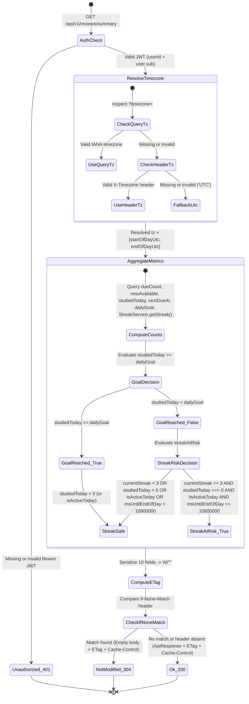
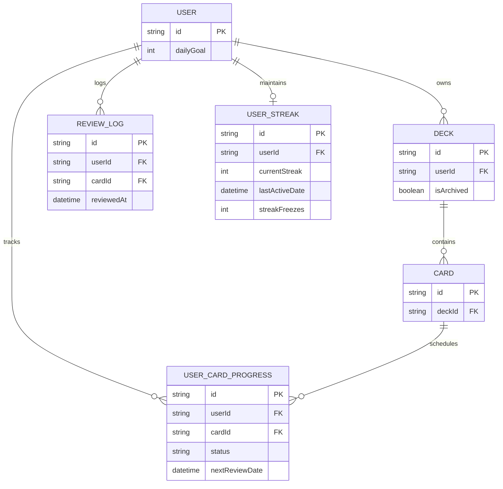

# Domain Model: Review Summary API for Extension (`US-REM-01`)

## 1. RBAC Matrix

| Role | `GET /api/v1/reviews/summary` | Ownership & Isolation Boundary |
| :--- | :--- | :--- |
| **Guest / Unauthenticated** | ❌ Denied (`401 Unauthorized` via `JwtAuthGuard`) | No access to review summary or user streak state. |
| **Authenticated Learner** | ✅ Allowed (`200 OK` or `304 Not Modified`) | Strictly scoped to `user.sub` extracted from verified JWT payload (`@CurrentUser()`). Can only read summary counts from their own non-archived decks (`deck.userId === user.sub && deck.isArchived === false`), their own `ReviewLog`, and their own `UserStreak`. |
| **Pro Subscriber / Content Creator / System Admin** | ✅ Allowed (Same as Authenticated Learner for own account) |WordStreak SRS core is 100% free (`MEMORY.md`); all authenticated accounts have identical access to their own study summary. Cross-user querying is not permitted on this endpoint. |

---

## 2. State Machine & Decision Lifecycle (`goalReached` / `streakAtRisk` / `ETag 304`)



---

## 3. Business Rules & Algorithms

- **BR-REM-001 (Timezone Resolution & Local Day Boundaries)**:
  - The endpoint accepts an optional `timezone` query parameter (`@Query('timezone')`) and an optional `X-Timezone` request header (`@Headers('x-timezone')`).
  - Resolution priority:
    1. If `query.timezone` is non-empty and passes `isValidTimezone(query.timezone)` (validated via `Intl.DateTimeFormat(undefined, { timeZone })`), use `query.timezone`.
    2. Else if `headers['x-timezone']` is non-empty and passes `isValidTimezone(headers['x-timezone'])`, use `headers['x-timezone']`.
    3. Else fallback to `'UTC'`. Invalid timezone inputs NEVER throw `400 Bad Request`.
  - Given `now = new Date()` and resolved IANA `timezone`, compute the user's current local calendar date `(year, month, day)` in `timezone`, and derive:
    - `startOfDayUtc`: UTC `Date` corresponding to `00:00:00.000` of that local date in `timezone`.
    - `endOfDayUtc`: UTC `Date` corresponding to `23:59:59.999` of that local date in `timezone`.
    - `endOfDayAt`: `endOfDayUtc.toISOString()`.
  - **Anti-Abuse Note**: Timezone resolution is read-only for `GET /api/v1/reviews/summary` and does not increment streaks or award XP. Any timezone-based freeze auto-consumption in `StreakService.getStreak(userId, timezone)` uses server-side UTC timestamps (`now = new Date()`) and `Intl.DateTimeFormat`, preventing client-clock spoofing.

- **BR-REM-002 (Active Deck Scope & Ownership Filter)**:
  - All card progress queries (`dueCount`, `newAvailable`, `nextDueAt`) MUST filter by:
    `userId: authenticatedUserId` AND `card: { deck: { userId: authenticatedUserId, isArchived: false } }`.
  - Cards inside archived decks (`isArchived: true`) are strictly excluded from `dueCount`, `newAvailable`, and `nextDueAt`.

- **BR-REM-003 (`dueCount` & `newAvailable` Separation)**:
  - `dueCount`: Count of `UserCardProgress` rows in active decks where `status !== 'NEW'` AND `nextReviewDate <= now`.
  - `newAvailable`: Total uncapped count of `UserCardProgress` rows in active decks where `status === 'NEW'`.
  - This separation guarantees that newly added cards (`NEW`) do not artificially inflate the scheduled due badge count until they have been introduced into the learning queue (`LEARNING` / `REVIEW` / `MASTERED`).

- **BR-REM-004 (`studiedToday`, `dailyGoal`, and `goalReached` Calculation)**:
  - `dailyGoal`: Read from `User.dailyGoal` (defaults to `10` if user record fallback is needed).
  - `studiedToday`: Count of `ReviewLog` rows where `userId === authenticatedUserId` AND `reviewedAt >= startOfDayUtc` AND `reviewedAt <= endOfDayUtc`.
  - Note: `studiedToday` counts all reviews logged by the user today (even if the deck was archived later today), accurately reflecting the learner's completed study effort for the day.
  - `goalReached`: Boolean evaluated as `studiedToday >= dailyGoal`.

- **BR-REM-005 (`nextDueAt` Calculation)**:
  - `nextDueAt`: Queries the minimum `nextReviewDate` (`orderBy: { nextReviewDate: 'asc' }`, `select: { nextReviewDate: true }`) among `UserCardProgress` rows in active decks where `status !== 'NEW'` AND `nextReviewDate > now`.
  - Returns `nextReviewDate.toISOString()` if a future scheduled review exists, or `null` if no future scheduled review exists.

- **BR-REM-006 (`currentStreak` & `streakAtRisk` Formula)**:
  - Retrieve current streak state via `StreakService.getStreak(userId, timezone)` which returns `{ currentStreak, isActiveToday, streakFreezes, ... }`.
  - Compute remaining milliseconds until local midnight:
    `msUntilEndOfDay = endOfDayUtc.getTime() - now.getTime()`.
  - Evaluate `streakAtRisk`:
    ```ts
    const THREE_HOURS_MS = 3 * 60 * 60 * 1000; // 10,800,000 ms
    const streakAtRisk =
      streak.currentStreak >= 3 &&
      studiedToday === 0 &&
      !streak.isActiveToday &&
      msUntilEndOfDay > 0 &&
      msUntilEndOfDay <= THREE_HOURS_MS;
    ```
  - **Streak Freeze Policy**: `streakAtRisk` ignores `streakFreezes > 0` (Option A confirmed by customer) so learners with a 3+ day streak receive a timely warning before midnight rather than silently burning a scarce Streak Freeze.
  - **Anti-Abuse Note**: `streakAtRisk` is a pure derived indicator and grants no XP or streak increment. It relies on server-side `now` and verified `ReviewLog` / `UserStreak` records.

- **BR-REM-007 (Response Envelope & `ReviewSummaryDto` Contract)**:
  - On `200 OK`, the endpoint returns `ApiResponse<ReviewSummaryDto>`:
    ```json
    {
      "success": true,
      "data": {
        "dueCount": 12,
        "newAvailable": 35,
        "studiedToday": 4,
        "dailyGoal": 10,
        "goalReached": false,
        "currentStreak": 5,
        "streakAtRisk": false,
        "timezone": "Asia/Ho_Chi_Minh",
        "endOfDayAt": "2026-10-12T16:59:59.999Z",
        "nextDueAt": "2026-10-12T15:30:00.000Z"
      }
    }
    ```

- **BR-REM-008 (Weak `ETag` Generation & `304 Not Modified` Conditional Caching)**:
  - Compute a deterministic SHA-256 hex digest over the canonical JSON serialization of the `ReviewSummaryDto` object (keys in fixed order: `dueCount`, `newAvailable`, `studiedToday`, `dailyGoal`, `goalReached`, `currentStreak`, `streakAtRisk`, `timezone`, `endOfDayAt`, `nextDueAt`), formatted as a Weak ETag: `W/"<sha256-hex>"`.
  - Always set response headers:
    - `ETag: W/"<sha256-hex>"`
    - `Cache-Control: private, must-revalidate, max-age=0`
  - Inspect incoming `If-None-Match` request header (case-insensitive header lookup, supporting comma-separated ETag values, weak/strong prefix normalization or exact match, and `*`):
    - If `If-None-Match` contains a matching ETag, return HTTP status `304 Not Modified` with an empty response body.
    - Otherwise, return HTTP status `200 OK` with the `ApiResponse<ReviewSummaryDto>` JSON payload.
  - **Anti-Abuse / Cache Safety Note**: `Cache-Control: private` ensures shared proxies/CDNs never cache one user's summary for another user, and `endOfDayAt` is fixed for the entire local calendar day so the ETag remains stable across polls until an actual state change occurs (a new card becomes due, a review is submitted, `streakAtRisk` crosses the 3-hour threshold, or local midnight rolls over).

---

## 4. Workflows & Edge Cases

### Happy Path: Extension Background Alarm Poll

1. Chrome Extension MV3 service worker wakes up on `chrome.alarms` and sends `GET /api/v1/reviews/summary?timezone=Asia/Ho_Chi_Minh` with `Authorization: Bearer <jwt>` and `If-None-Match: W/"<prev-hash>"`.
2. `JwtAuthGuard` validates the token and attaches `user.sub`.
3. `ReviewsService.getReviewSummary` resolves `timezone = "Asia/Ho_Chi_Minh"`, computes `[startOfDayUtc, endOfDayUtc]`, and executes parallel Prisma queries (`Promise.all`) alongside `StreakService.getStreak(userId, timezone)`.
4. `ReviewsController` computes `ETag: W/"<new-hash>"`.
5. If `<new-hash>` matches `If-None-Match`, controller sets `304 Not Modified` and finishes with empty body; otherwise returns `200 OK` with `ApiResponse<ReviewSummaryDto>`.

### Concrete Edge Case Resolutions

- **EC-REM-01 (`streakAtRisk` 3-Hour Boundary)**:
  - When `currentStreak === 3`, `studiedToday === 0`, `!isActiveToday`, and `msUntilEndOfDay === 3 * 3600 * 1000` (`10,800,000 ms`, i.e., exactly 3 hours remaining), `streakAtRisk` is `true`. When `msUntilEndOfDay === 10,800,001 ms` (> 3 hours), `streakAtRisk` is `false`.
- **EC-REM-02 (`currentStreak < 3` Threshold)**:
  - When `currentStreak` is `0`, `1`, or `2`, `streakAtRisk` is ALWAYS `false`, even if `studiedToday === 0` and less than 3 hours remain until `endOfDayAt`.
- **EC-REM-03 (Learner Has `streakFreezes > 0` Near Midnight)**:
  - When `currentStreak >= 3`, `studiedToday === 0`, `!isActiveToday`, `msUntilEndOfDay <= 3h`, and `streakFreezes === 2`, `streakAtRisk` is still `true` so the user is warned before burning a freeze.
- **EC-REM-04 (Archived Deck Exclusion)**:
  - Cards in decks with `isArchived: true` are ignored by `dueCount`, `newAvailable`, and `nextDueAt`. If all of a user's decks are archived, `dueCount = 0`, `newAvailable = 0`, and `nextDueAt = null`.
- **EC-REM-05 (Invalid or Missing Timezone Input)**:
  - If `?timezone=Invalid/Zone` and `X-Timezone: Mars/Phobos` (or both missing), the service does not throw an exception; it safely falls back to `timezone: "UTC"` and calculates `startOfDayUtc` / `endOfDayUtc` in UTC.
- **EC-REM-06 (Brand-New User with Zero Decks and Zero Reviews)**:
  - Returns `dueCount: 0`, `newAvailable: 0`, `studiedToday: 0`, `dailyGoal: 10`, `goalReached: false`, `currentStreak: 0`, `streakAtRisk: false`, `timezone: "<resolved>"`, `endOfDayAt: "<ISO>"`, `nextDueAt: null`.

---

## 5. Entities, Data Boundaries & Privacy



- **Deletion & Retention Policy**: Read-only endpoint; no new entities created (except lazy `UserStreak` initialization in `StreakService.getStreak` if a user has no `user_streaks` row yet, which cascades on `User` deletion via `onDelete: Cascade`).
- **Privacy**: Returns only aggregate numerical counts, booleans, and timestamps for the authenticated user. Zero PII or card content is exposed in the payload.

---

## 6. UX States & Non-Functional Requirements

- **Performance**: P95 latency `< 80ms`. All independent Prisma counts (`dueCount`, `newAvailable`, `studiedToday`, `nextDueCard`, `user.dailyGoal`, and `streakService.getStreak`) MUST run concurrently via `Promise.all`.
- **Payload Size**: `< 500 bytes` serialized JSON on `200 OK`; `0 bytes` body on `304 Not Modified`.
- **Caching & HTTP Semantics**: Weak ETag `W/"<sha256-hex>"` + `Cache-Control: private, must-revalidate, max-age=0`.
- **Security**: Protected by `JwtAuthGuard`; no user ID accepted in query/body (strictly derived from `user.sub`).
- **i18n / Accessibility**: N/A for this backend-only Bounded Task (`US-REM-01`); UI localization and notification copy are handled in `US-ECO-05` / `US-ECO-06`.
- **Observability**: Standard NestJS exception/request logging; deterministic ETag and timezone resolution make unit testing 100% reproducible with mocked system clocks.
