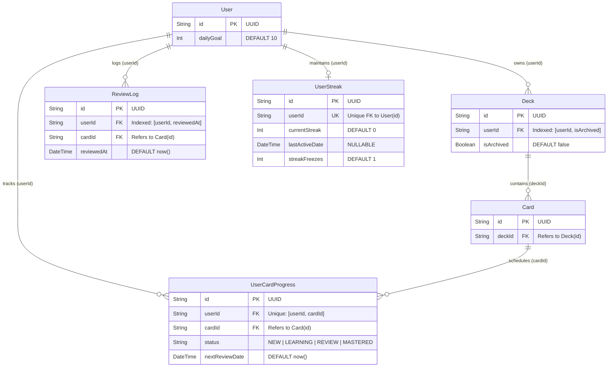

# Data Model & Access Patterns: Review Summary API for Extension (`US-REM-01`)

**Feature**: `US-REM-01`: API tóm tắt trạng thái học cho Extension (`GET /api/v1/reviews/summary`)  
**Slug**: `review-summary-api`  
**Date**: 2026-10-12  
**Status**: Approved (Phase 3 - Plan)  
**Schema Migrations Required**: **0 (Zero database schema changes — `CON-REM-001`)**

---

## 1. Entity-Relationship Model (Read-Only Aggregation Scope)

`GET /api/v1/reviews/summary` is a read-only aggregation endpoint that queries existing PostgreSQL tables managed by [`apps/api/prisma/schema.prisma`](file:///Users/vutuanhau/Documents/PROJECT/WordStreak/apps/api/prisma/schema.prisma). No new tables, columns, or migrations are introduced.



---

## 2. Existing Prisma Models & Index Utilization

| Prisma Model | Table Name | Fields Accessed | Existing Index / Constraint Used | Role in `GET /api/v1/reviews/summary` |
| :--- | :--- | :--- | :--- | :--- |
| **`User`** | `users` | `id`, `dailyGoal` | `@id` (`users_pkey`) | Fetches `dailyGoal` (fallback to `10` if null/absent) for `goalReached` evaluation (`BR-REM-004`). |
| **`Deck`** | `decks` | `id`, `userId`, `isArchived` | `@@index([userId, isArchived])` | Filters all card progress queries to active, non-archived decks owned by `userId` (`BR-REM-002`). |
| **`Card`** | `cards` | `id`, `deckId` | `@id` (`cards_pkey`) | Relational bridge between `UserCardProgress` and `Deck` (`card: { deck: { userId, isArchived: false } }`). |
| **`UserCardProgress`** | `user_card_progress` | `userId`, `cardId`, `status`, `nextReviewDate` | `@@unique([userId, cardId])` | Computes `dueCount`, `newAvailable`, and earliest future `nextDueAt` (`BR-REM-003`, `BR-REM-005`). |
| **`ReviewLog`** | `review_logs` | `userId`, `reviewedAt` | `@@index([userId, reviewedAt])` | Counts `studiedToday` within `[startOfDayUtc, endOfDayUtc]` (`BR-REM-004`). |
| **`UserStreak`** | `user_streaks` | `userId`, `currentStreak`, `lastActiveDate`, `streakFreezes`, `totalFreezesUsed`, `lastFreezeDate` | `@unique` (`userId`) | Queried via `StreakService.getStreak(userId, timezone)` to obtain `currentStreak` and `isActiveToday` (`BR-REM-006`). |

---

## 3. Concurrent Data Access Pattern (`Promise.all`)

To satisfy the `< 80ms` P95 latency requirement (`SC-001`, `RISK-REM-003`), `ReviewsService.getReviewSummary(userId, timezone)` executes all 6 independent data operations in parallel via a single `Promise.all` batch:

```typescript
const activeDeckCardFilter = {
  deck: {
    userId,
    isArchived: false,
  },
};

const [
  user,
  dueCount,
  newAvailable,
  studiedToday,
  nextDueRecord,
  streak,
] = await Promise.all([
  // 1. User dailyGoal lookup (PK index scan)
  this.prisma.user.findUnique({
    where: { id: userId },
    select: { dailyGoal: true },
  }),

  // 2. Scheduled due cards count in active decks (BR-REM-002, BR-REM-003)
  this.prisma.userCardProgress.count({
    where: {
      userId,
      status: { not: 'NEW' },
      nextReviewDate: { lte: now },
      card: activeDeckCardFilter,
    },
  }),

  // 3. Uncapped NEW cards available in active decks (BR-REM-002, BR-REM-003)
  this.prisma.userCardProgress.count({
    where: {
      userId,
      status: 'NEW',
      card: activeDeckCardFilter,
    },
  }),

  // 4. Reviews logged today in local timezone window (BR-REM-004)
  this.prisma.reviewLog.count({
    where: {
      userId,
      reviewedAt: {
        gte: startOfDayUtc,
        lte: endOfDayUtc,
      },
    },
  }),

  // 5. Earliest future scheduled review timestamp in active decks (BR-REM-005)
  this.prisma.userCardProgress.findFirst({
    where: {
      userId,
      status: { not: 'NEW' },
      nextReviewDate: { gt: now },
      card: activeDeckCardFilter,
    },
    orderBy: { nextReviewDate: 'asc' },
    select: { nextReviewDate: true },
  }),

  // 6. Current streak & today's activity status via StreakService (BR-REM-006)
  this.streakService.getStreak(userId, resolvedTimezone),
]);
```

### Query Safety & Privacy Guarantees
- **Zero Over-Fetching (`prisma-patterns`)**: Uses `count` and `select: { nextReviewDate: true }` / `select: { dailyGoal: true }`. No flashcard text (`word`, `meaning`, `exampleSentence`, `audioUrl`) or user PII (`email`, `passwordHash`) is ever loaded into memory.
- **Strict Tenant Isolation (`BR-REM-002`)**: Every query explicitly binds `userId` from the verified JWT payload (`user.sub`), and card progress queries additionally enforce `card: { deck: { userId, isArchived: false } }`.

---

## 4. Shared DTO Structure (`packages/shared-types`)

### `ReviewSummaryDto` (`packages/shared-types/src/reviews.ts`)

Exported from [`packages/shared-types/src/reviews.ts`](file:///Users/vutuanhau/Documents/PROJECT/WordStreak/packages/shared-types/src/reviews.ts) and re-exported by [`packages/shared-types/src/index.ts`](file:///Users/vutuanhau/Documents/PROJECT/WordStreak/packages/shared-types/src/index.ts):

```typescript
export interface ReviewSummaryDto {
  /** Number of scheduled cards (status !== 'NEW' && nextReviewDate <= now) in active non-archived decks */
  dueCount: number;
  /** Total uncapped number of new cards (status === 'NEW') in active non-archived decks */
  newAvailable: number;
  /** Number of reviews completed by the user within today's local calendar day [startOfDayUtc, endOfDayUtc] */
  studiedToday: number;
  /** User's configured daily review target (defaults to 10) */
  dailyGoal: number;
  /** True when studiedToday >= dailyGoal */
  goalReached: boolean;
  /** User's current consecutive study streak in days from StreakService */
  currentStreak: number;
  /** True iff currentStreak >= 3, studiedToday === 0 && !isActiveToday, and 0 < msUntilEndOfDay <= 3 hours */
  streakAtRisk: boolean;
  /** Resolved IANA timezone identifier (e.g. 'Asia/Ho_Chi_Minh' or 'UTC') */
  timezone: string;
  /** End of today's local calendar day (23:59:59.999 local) serialized as UTC ISO 8601 string */
  endOfDayAt: string;
  /** Earliest future nextReviewDate (status !== 'NEW' && nextReviewDate > now) in active decks as UTC ISO 8601, or null */
  nextDueAt: string | null;
}
```

---

## 5. Field Derivation & Invariants Matrix

| Field | Type | Nullable | Source / Formula | Domain Rule |
| :--- | :--- | :---: | :--- | :--- |
| `dueCount` | `number` | No | Integer $\ge 0$. Count of `UserCardProgress` in active decks where `status !== 'NEW' && nextReviewDate <= now`. | `BR-REM-002`, `BR-REM-003` |
| `newAvailable` | `number` | No | Integer $\ge 0$. Uncapped count of `UserCardProgress` in active decks where `status === 'NEW'`. | `BR-REM-002`, `BR-REM-003` |
| `studiedToday` | `number` | No | Integer $\ge 0$. Count of `ReviewLog` for `userId` where `startOfDayUtc <= reviewedAt <= endOfDayUtc`. | `BR-REM-004` |
| `dailyGoal` | `number` | No | Integer $\ge 1$. `user?.dailyGoal ?? 10`. | `BR-REM-004` |
| `goalReached` | `boolean` | No | `studiedToday >= dailyGoal`. | `BR-REM-004` |
| `currentStreak` | `number` | No | Integer $\ge 0$. `streak.currentStreak` from `StreakService.getStreak(userId, timezone)`. | `BR-REM-006` |
| `streakAtRisk` | `boolean` | No | `streak.currentStreak >= 3 && studiedToday === 0 && !streak.isActiveToday && msUntilEndOfDay > 0 && msUntilEndOfDay <= 10_800_000`. Ignores `streakFreezes > 0`. | `BR-REM-006` |
| `timezone` | `string` | No | Valid IANA timezone resolved via `?timezone=` $\rightarrow$ `X-Timezone` $\rightarrow$ `'UTC'`. | `BR-REM-001` |
| `endOfDayAt` | `string` | No | UTC ISO 8601 string (`YYYY-MM-DDTHH:mm:ss.sssZ`) representing `23:59:59.999` local time today. | `BR-REM-001` |
| `nextDueAt` | `string \| null` | **Yes** | `nextDueRecord?.nextReviewDate.toISOString() ?? null`. | `BR-REM-005` |
