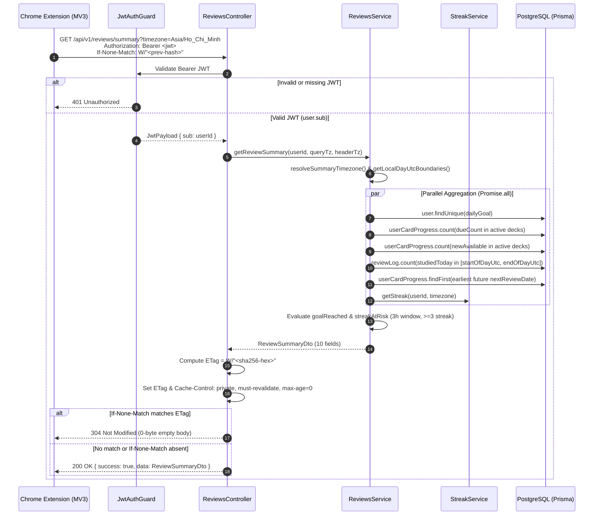

# Implementation Plan: Review Summary API for Extension (`US-REM-01`)

**Branch**: `feat/review-summary-api` | **Date**: 2026-10-12 | **Spec**: [`spec.md`](file:///Users/vutuanhau/Documents/PROJECT/WordStreak/.specify/features/review-summary-api/spec.md)  
**Domain Baseline**: [`baseline.md`](file:///Users/vutuanhau/Documents/PROJECT/WordStreak/.specify/features/review-summary-api/baseline.md) (`SIGNED-OFF v1.0`)

---

## 1. Summary

This plan defines the technical architecture and TDD implementation strategy for **US-REM-01 (`GET /api/v1/reviews/summary`)**. The feature adds a shared `ReviewSummaryDto` contract to `@wordstreak/shared-types`, implements a timezone-aware, parallelized summary aggregation method in `ReviewsService`, and exposes `GET /api/v1/reviews/summary` in `ReviewsController` with deterministic Weak `ETag` (`W/"<sha256-hex>"`) and `304 Not Modified` conditional caching. Zero database schema migrations are required.

---

## 2. Technical Context

- **Language/Version**: TypeScript 5.7+ (Node.js LTS, `strict` mode enabled)
- **Primary Dependencies**:
  - Backend: NestJS 11 (`@nestjs/common`), Prisma ORM (`PrismaService`), Node.js built-in `node:crypto` (`createHash`) & `Intl.DateTimeFormat`
  - Shared Contracts: `@wordstreak/shared-types`
- **Storage**: PostgreSQL 16 via existing Prisma models (`User`, `Deck`, `Card`, `UserCardProgress`, `ReviewLog`, `UserStreak`) — **0 migrations**
- **Testing**: Jest (`@nestjs/testing`) unit & controller tests in `apps/api/src/modules/reviews/`
- **Target Platform**: Node.js backend serving Chrome Extension MV3 background worker (`chrome.alarms`) and Web App
- **Project Type**: Fullstack Monorepo (`pnpm` workspaces)
- **Performance Goals**:
  - P95 API latency `< 80ms` via single-pass `Promise.all` parallel queries (`SC-001`)
  - Serialized JSON response `< 500 bytes` on `200 OK`; `0 bytes` body on `304 Not Modified` (`SC-002`)
- **Constraints**:
  - Zero changes to `apps/api/prisma/schema.prisma` (`CON-REM-001`)
  - Reuse existing `StreakService.getStreak(userId, timezone)` (`CON-REM-002`)
  - Export `ReviewSummaryDto` from `@wordstreak/shared-types` (`CON-REM-003`)
  - Never throw `400 Bad Request` on malformed timezone strings; fallback safely (`?timezone=` → `X-Timezone` → `'UTC'`) (`BR-REM-001`)

---

## 3. Constitution Check

*GATE: Evaluation against [`.specify/memory/constitution.md`](file:///Users/vutuanhau/Documents/PROJECT/WordStreak/.specify/memory/constitution.md) (v1.0.0)*

| Principle | Status | Compliance Verification |
| :--- | :--- | :--- |
| **I. Code Quality First** | ✅ PASS | Strict TypeScript (`no-explicit-any`), shared `ReviewSummaryDto` in `packages/shared-types`, thin controller + domain logic in `ReviewsService`, zero lint warnings. |
| **II. Testing Standards** | ✅ PASS | TDD workflow (`test-plan.md` → failing Jest tests → implementation). Unit tests in `reviews.service.spec.ts` and `reviews.controller.spec.ts` cover 100% of branches across all 8 Gherkin scenarios. |
| **III. UX Consistency** | ✅ PASS | Backend-only Bounded Task providing consistent `ApiResponse<ReviewSummaryDto>` envelope and deterministic `streakAtRisk` / `goalReached` indicators for Extension badge & notifications. |
| **IV. Performance Requirements** | ✅ PASS | Concurrent `Promise.all` execution with selective `count`/`select` queries using existing composite indexes (`decks[userId, isArchived]`, `review_logs[userId, reviewedAt]`), achieving `< 80ms` P95 (well under the 200ms constitution ceiling). |
| **Technology Constraints** | ✅ PASS | Uses NestJS, Prisma ORM, `JwtAuthGuard`, `@wordstreak/shared-types`, and `pnpm` workspace protocol. |

*Gate Result: ALL GATES PASSED.*

---

## 4. Project Structure & File Layout

### Documentation (`.specify/features/review-summary-api/`)

```text
.specify/features/review-summary-api/
├── 00-intake.md                          # Stage 1: Bounded Task classification
├── 01-elicitation.md                     # Stage 2: Customer interview decisions & ASM-REM-001..008
├── 03-domain-model.md                    # Stage 4: RBAC, state machine, BR-REM-001..008, ERD
├── 04-risk-assessment.md                 # Stage 5: Contradiction scan, RISK-REM-001..005, MoSCoW
├── 06-validation-report.md               # Stage 7: IEEE 29148 validation report
├── baseline.md                           # Stage 8: Signed-off Domain Baseline v1.0
├── CHANGELOG.md                          # Version log
├── spec/
│   └── user-stories.md                   # Stage 6: REQ-REM-001..006 & US-REM-01 Gherkin scenarios
├── checklists/
│   └── requirements.md                   # Phase 2: Spec quality checklist
├── spec.md                               # Phase 2: Formal technical specification
├── data-model.md                         # Phase 3: Prisma access patterns & DTO model
├── contracts/
│   └── review-summary-api.md             # Phase 3: OpenAPI 3.1 & HTTP caching contract
├── plan.md                               # Phase 3: Technical implementation plan (this file)
├── tasks.md                              # Phase 4: Dependency-ordered TDD tasks
└── test-plan.md                          # Phase 5 (T001): Gherkin test cases mapped to US-REM-01
```

### Source Code (Repository Root)

```text
packages/shared-types/
└── src/
    ├── reviews.ts                        # [MODIFY] Add ReviewSummaryDto interface
    └── index.ts                          # [EXISTING] Re-exports * from "./reviews.js"

apps/api/
└── src/
    └── modules/
        └── reviews/
            ├── reviews.controller.ts      # [MODIFY] Add @Get('summary') with ETag & 304 handling
            ├── reviews.controller.spec.ts # [MODIFY] Add unit tests for @Get('summary') & ETag/304
            ├── reviews.service.ts         # [MODIFY] Add timezone helpers & getReviewSummary()
            └── reviews.service.spec.ts    # [MODIFY] Add unit tests for getReviewSummary() & edge cases
```

---

## 5. Detailed Technical Design

### 5.1. Slice 1: Shared Contract (`packages/shared-types/src/reviews.ts`)

Add `ReviewSummaryDto` to [`packages/shared-types/src/reviews.ts`](file:///Users/vutuanhau/Documents/PROJECT/WordStreak/packages/shared-types/src/reviews.ts) (which is already barrel-exported via `export * from "./reviews.js"` in [`packages/shared-types/src/index.ts`](file:///Users/vutuanhau/Documents/PROJECT/WordStreak/packages/shared-types/src/index.ts)):

```typescript
export interface ReviewSummaryDto {
  dueCount: number;
  newAvailable: number;
  studiedToday: number;
  dailyGoal: number;
  goalReached: boolean;
  currentStreak: number;
  streakAtRisk: boolean;
  timezone: string;
  endOfDayAt: string;
  nextDueAt: string | null;
}
```

### 5.2. Slice 2: Timezone Resolution & DST-Safe Local Day Boundaries (`reviews.service.ts`)

To mitigate `RISK-REM-002` (DST transitions and half-hour/45-minute offset zones like `Asia/Kolkata` `UTC+5:30` or `Asia/Kathmandu` `UTC+5:45`) and satisfy `BR-REM-001`:

1. **Timezone Resolution Helper (`resolveSummaryTimezone`)**:
   - Reuse `isValidTimezone` from [`streak.service.ts`](file:///Users/vutuanhau/Documents/PROJECT/WordStreak/apps/api/src/modules/streaks/streak.service.ts#L11-L18).
   - Priority order:
     1. If `queryTimezone` is a non-empty string and `isValidTimezone(queryTimezone.trim())` is `true` → return `queryTimezone.trim()`.
     2. Else if `headerTimezone` is a non-empty string and `isValidTimezone(headerTimezone.trim())` is `true` → return `headerTimezone.trim()`.
     3. Else → return `'UTC'`.

2. **Local Day UTC Boundary Calculation (`getLocalDayUtcBoundaries(now: Date, timezone: string)`)**:
   - Extract the local calendar date `(year, month, day)` of `now` in `timezone` using `Intl.DateTimeFormat('en-US', { timeZone: timezone, year: 'numeric', month: '2-digit', day: '2-digit' }).formatToParts(now)`.
   - Convert local wall-clock `(year, month, day, 0, 0, 0, 0)` and `(year, month, day, 23, 59, 59, 999)` in `timezone` to exact UTC `Date` instances using a deterministic 2-pass `Intl.DateTimeFormat.prototype.formatToParts` offset resolver:
     ```typescript
     function localWallClockToUtc(
       year: number,
       month: number,
       day: number,
       hour: number,
       minute: number,
       second: number,
       ms: number,
       timeZone: string,
     ): Date {
       const formatter = new Intl.DateTimeFormat('en-US', {
         timeZone,
         year: 'numeric',
         month: '2-digit',
         day: '2-digit',
         hour: '2-digit',
         minute: '2-digit',
         second: '2-digit',
         hourCycle: 'h23',
       });

       const getOffsetMs = (utcMs: number): number => {
         const parts = formatter.formatToParts(new Date(utcMs));
         const map: Record<string, number> = {};
         for (const part of parts) {
           if (part.type !== 'literal') {
             map[part.type] = Number(part.value);
           }
         }
         const asUtc = Date.UTC(
           map.year,
           map.month - 1,
           map.day,
           map.hour,
           map.minute,
           map.second,
           ms,
         );
         return asUtc - utcMs;
       };

       const targetAsUtc = Date.UTC(year, month - 1, day, hour, minute, second, ms);
       const firstPassUtc = targetAsUtc - getOffsetMs(targetAsUtc);
       const secondPassUtc = targetAsUtc - getOffsetMs(firstPassUtc);
       return new Date(secondPassUtc);
     }
     ```
   - This guarantees exact UTC timestamps for `startOfDayUtc` (`00:00:00.000` local) and `endOfDayUtc` (`23:59:59.999` local) across all standard, half-hour, 45-minute, and DST-transitioning IANA timezones, and keeps `endOfDayAt = endOfDayUtc.toISOString()` constant throughout the user's local calendar day (`RISK-REM-001`).

### 5.3. Slice 3: Parallel Summary Aggregation (`ReviewsService.getReviewSummary`)

In [`apps/api/src/modules/reviews/reviews.service.ts`](file:///Users/vutuanhau/Documents/PROJECT/WordStreak/apps/api/src/modules/reviews/reviews.service.ts):

```typescript
export const STREAK_RISK_MIN_DAYS = 3;
export const STREAK_RISK_WINDOW_MS = 3 * 60 * 60 * 1000; // 10,800,000 ms (3 hours)
```

Method signature:
```typescript
async getReviewSummary(
  userId: string,
  queryTimezone?: string,
  headerTimezone?: string,
): Promise<ReviewSummaryDto>
```

Execution steps:
1. Capture `const now = new Date()`.
2. Resolve `const timezone = resolveSummaryTimezone(queryTimezone, headerTimezone)`.
3. Compute `const { startOfDayUtc, endOfDayUtc } = getLocalDayUtcBoundaries(now, timezone)`.
4. Define `const activeDeckCardFilter = { deck: { userId, isArchived: false } }`.
5. Run 6 read operations concurrently via `Promise.all`:
   - `prisma.user.findUnique({ where: { id: userId }, select: { dailyGoal: true } })`
   - `prisma.userCardProgress.count({ where: { userId, status: { not: 'NEW' }, nextReviewDate: { lte: now }, card: activeDeckCardFilter } })`
   - `prisma.userCardProgress.count({ where: { userId, status: 'NEW', card: activeDeckCardFilter } })`
   - `prisma.reviewLog.count({ where: { userId, reviewedAt: { gte: startOfDayUtc, lte: endOfDayUtc } } })`
   - `prisma.userCardProgress.findFirst({ where: { userId, status: { not: 'NEW' }, nextReviewDate: { gt: now }, card: activeDeckCardFilter }, orderBy: { nextReviewDate: 'asc' }, select: { nextReviewDate: true } })`
   - `streakService.getStreak(userId, timezone)`
6. Derive summary fields:
   - `dailyGoal = user?.dailyGoal ?? 10`
   - `goalReached = studiedToday >= dailyGoal`
   - `currentStreak = streak.currentStreak`
   - `msUntilEndOfDay = endOfDayUtc.getTime() - now.getTime()`
   - `streakAtRisk = currentStreak >= STREAK_RISK_MIN_DAYS && studiedToday === 0 && !streak.isActiveToday && msUntilEndOfDay > 0 && msUntilEndOfDay <= STREAK_RISK_WINDOW_MS`
   - `endOfDayAt = endOfDayUtc.toISOString()`
   - `nextDueAt = nextDueRecord ? nextDueRecord.nextReviewDate.toISOString() : null`
7. Return `ReviewSummaryDto` with keys in canonical order.

### 5.4. Slice 4: Controller Route, Weak ETag & `304 Not Modified` (`ReviewsController.getReviewSummary`)

In [`apps/api/src/modules/reviews/reviews.controller.ts`](file:///Users/vutuanhau/Documents/PROJECT/WordStreak/apps/api/src/modules/reviews/reviews.controller.ts):

1. **Helper Functions**:
   - `computeReviewSummaryEtag(summary: ReviewSummaryDto): string`:
     Serializes the 10 fields in fixed canonical order and returns `` `W/"${createHash('sha256').update(canonicalJson).digest('hex')}"` ``.
   - `isEtagMatch(ifNoneMatchHeader: string | undefined, currentEtag: string): boolean`:
     Handles `undefined` (`false`), `'*'` (`true`), and comma-separated ETag tokens with weak-prefix normalization (`W/"<hash>"` matches `W/"<hash>"` or `"<hash>"`).

2. **Controller Handler (`@Get('summary')`)**:
   ```typescript
   @Get('summary')
   async getReviewSummary(
     @CurrentUser() user: JwtPayload,
     @Query('timezone') queryTimezone?: string,
     @Headers('x-timezone') headerTimezone?: string,
     @Headers('if-none-match') ifNoneMatch?: string,
     @Res({ passthrough: true }) res?: Response,
   ): Promise<ApiResponse<ReviewSummaryDto> | void> {
     const summary = await this.reviewsService.getReviewSummary(
       user.sub,
       queryTimezone,
       headerTimezone,
     );
     const etag = computeReviewSummaryEtag(summary);

     res?.setHeader('ETag', etag);
     res?.setHeader('Cache-Control', 'private, must-revalidate, max-age=0');

     if (isEtagMatch(ifNoneMatch, etag)) {
       res?.status(HttpStatus.NOT_MODIFIED);
       return;
     }

     return {
       success: true,
       data: summary,
     };
   }
   ```
   - Using `@Res({ passthrough: true })` preserves NestJS's standard interceptor/exception pipeline while allowing header injection and `304 Not Modified` empty-body termination (`RISK-REM-004`).

---

## 6. Sequence Diagram



---

## 7. Unit Testing Strategy

All unit tests use Jest fake timers (`jest.useFakeTimers()` / `jest.setSystemTime(...)`) to deterministically verify timezone boundaries and the 3-hour `streakAtRisk` countdown:

1. **`apps/api/src/modules/reviews/reviews.service.spec.ts`**:
   - **Happy Path (Scenario 1)**: Returns complete 10-field `ReviewSummaryDto` (`dueCount: 12`, `newAvailable: 35`, `studiedToday: 4`, `dailyGoal: 10`, `goalReached: false`, `currentStreak: 5`, `streakAtRisk: false`, `timezone: 'Asia/Ho_Chi_Minh'`, `endOfDayAt: '2026-10-12T16:59:59.999Z'`, `nextDueAt: '2026-10-12T15:30:00.000Z'`).
   - **Daily Goal Reached (Scenario 2)**: Returns `goalReached: true` and `streakAtRisk: false` when `studiedToday >= dailyGoal`.
   - **Streak At Risk — Inside 3h Window & Exact 3h Boundary with Freezes (Scenario 3 & EC-REM-01, EC-REM-03)**: Returns `streakAtRisk: true` when `currentStreak = 3`, `studiedToday = 0`, `isActiveToday = false`, `streakFreezes = 2`, and `msUntilEndOfDay = 10,800,000` (exact 3h) or `< 10,800,000`.
   - **Streak Safe — `currentStreak < 3` or `msUntilEndOfDay > 3h` or Already Studied (Scenario 4 & EC-REM-01, EC-REM-02)**: Returns `streakAtRisk: false` when `currentStreak = 2` (1h before midnight), or `currentStreak = 10` (`10,800,001 ms` before midnight), or `studiedToday > 0` / `isActiveToday = true`.
   - **Archived Deck Exclusion (Scenario 5 & EC-REM-04)**: Verifies Prisma `where` clauses for `dueCount`, `newAvailable`, and `nextDueAt` strictly enforce `card: { deck: { userId, isArchived: false } }` and return `0` / `null` when no active deck cards exist.
   - **Timezone Priority & Fallback (Scenario 6 & EC-REM-05, EC-REM-07)**: Verifies `?timezone=` overrides `X-Timezone`, valid `X-Timezone` is used when `?timezone=` is absent/invalid, invalid inputs fall back to `'UTC'` without throwing, and half-hour offsets (`Asia/Kolkata`) compute accurate UTC boundaries.

2. **`apps/api/src/modules/reviews/reviews.controller.spec.ts`**:
   - **`200 OK` + Headers (Scenario 1)**: Verifies `getReviewSummary` sets `ETag: W/"<64-hex>"` and `Cache-Control: private, must-revalidate, max-age=0` and returns `{ success: true, data: summary }`.
   - **`304 Not Modified` on Matching `If-None-Match` (Scenario 7 & EC-REM-08)**: Verifies exact `W/"<hash>"` match, comma-separated list match, and `'*'` wildcard set HTTP status `304` and return `undefined` (empty body).
   - **`200 OK` on Non-Matching `If-None-Match`**: Verifies stale ETag returns `200 OK` with the fresh `ApiResponse<ReviewSummaryDto>` body and updated `ETag` header.

---

## 8. Rollback & Compatibility Plan

- **Zero DB Migration Risk**: Since `schema.prisma` is untouched, rollback requires zero database actions.
- **Additive API & Shared Type**: `GET /api/v1/reviews/summary` and `ReviewSummaryDto` are purely additive; existing endpoints (`/reviews/due`, `/reviews/submit`, `/reviews/sync-batch`, `/reviews/stats`) are unaffected.
