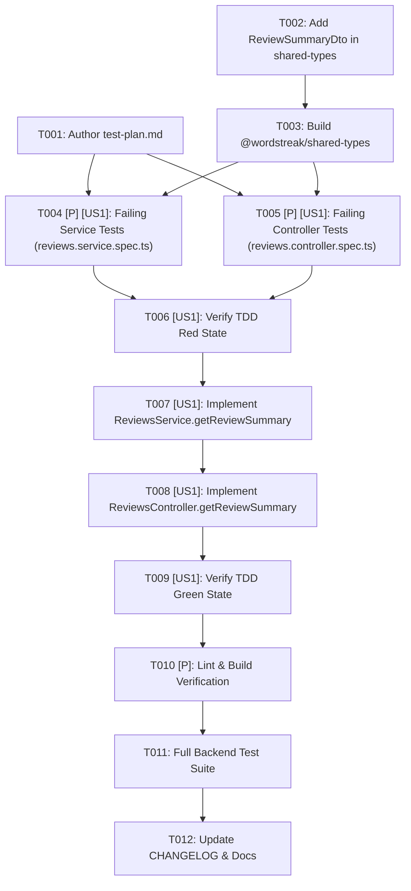

# Tasks: Review Summary API for Extension (`US-REM-01`)

**Input**: Design documents from `/Users/vutuanhau/Documents/PROJECT/WordStreak/.specify/features/review-summary-api/`  
**Prerequisites**: [`baseline.md`](./baseline.md) (`SIGNED-OFF v1.0`), [`spec.md`](./spec.md), [`plan.md`](./plan.md), [`data-model.md`](./data-model.md), [`contracts/review-summary-api.md`](./contracts/review-summary-api.md)  
**Tests**: **MANDATORY (TDD Red → Green → Refactor)** per WordStreak Constitution Principle II and `wordstreak-workflow`.  
**Organization**: Tasks are structured around `US-REM-01` (`[US1]`) with a strict TDD-first execution order.

## Format: `[ID] [P?] [Story?] Description`

- **[P]**: Can run in parallel (different files, no dependencies on incomplete tasks)
- **[Story]**: `[US1]` maps to `US-REM-01: API tóm tắt trạng thái học cho Extension (GET /api/v1/reviews/summary)`
- Exact repository file paths are included in every task description.

---

## Phase 1: Setup & Shared Contracts (Blocking Prerequisites)

**Purpose**: Author the Gherkin TDD test plan (`test-plan.md`) and publish the shared `ReviewSummaryDto` TypeScript contract in `@wordstreak/shared-types` so backend tests and implementation can compile against it.

- [X] T001 Create Gherkin test plan mapping all 8 scenarios of `US-REM-01` and edge cases (`EC-REM-01`..`EC-REM-08`) to numbered test cases (`TC-REM-001`..`TC-REM-012`) in `.specify/features/review-summary-api/test-plan.md`
- [X] T002 Define and export the 10-field `ReviewSummaryDto` interface (`dueCount`, `newAvailable`, `studiedToday`, `dailyGoal`, `goalReached`, `currentStreak`, `streakAtRisk`, `timezone`, `endOfDayAt`, `nextDueAt`) in `packages/shared-types/src/reviews.ts` (re-exported via `packages/shared-types/src/index.ts`)
- [X] T003 Build `@wordstreak/shared-types` via `pnpm --filter @wordstreak/shared-types build` and verify zero TypeScript errors

**Checkpoint**: `test-plan.md` is complete and `ReviewSummaryDto` is available for import from `@wordstreak/shared-types`.

---

## Phase 2: User Story 1 — TDD Red Phase (Failing Unit Tests) 🎯 MVP

**Goal**: Write comprehensive, failing unit tests in `reviews.service.spec.ts` and `reviews.controller.spec.ts` covering every requirement (`REQ-REM-001`..`REQ-REM-006`) and Gherkin scenario (`Scenario 1`..`Scenario 8`) before writing implementation code.

**Independent Test**: Run `pnpm --filter api test -- reviews.service.spec.ts reviews.controller.spec.ts` and confirm the new `getReviewSummary` test suites fail (Red phase) because the service and controller methods are not yet implemented.

- [X] T004 [P] [US1] Write failing unit tests for `ReviewsService.getReviewSummary` and timezone helpers in `apps/api/src/modules/reviews/reviews.service.spec.ts` covering:
  - `TC-REM-001` (Scenario 1): Complete 10-field summary calculation in `Asia/Ho_Chi_Minh` (`dueCount`, `newAvailable`, `studiedToday`, `dailyGoal`, `goalReached: false`, `currentStreak`, `streakAtRisk: false`, `timezone`, `endOfDayAt`, `nextDueAt`)
  - `TC-REM-002` (Scenario 2): `goalReached: true` and `streakAtRisk: false` when `studiedToday >= dailyGoal`
  - `TC-REM-003` (Scenario 3, `EC-REM-01`, `EC-REM-03`): `streakAtRisk: true` when `currentStreak >= 3`, `studiedToday === 0`, `!isActiveToday`, and `msUntilEndOfDay <= 10,800,000` (including exact 3-hour boundary and when `streakFreezes > 0`)
  - `TC-REM-004` (Scenario 4, `EC-REM-01`, `EC-REM-02`): `streakAtRisk: false` when `currentStreak < 3` (0, 1, 2), or `msUntilEndOfDay > 10,800,000` (`10,800,001 ms`), or `studiedToday > 0`, or `isActiveToday === true`
  - `TC-REM-005` (Scenario 5, `EC-REM-04`): Active deck filter `card: { deck: { userId, isArchived: false } }` applied to `dueCount`, `newAvailable`, and `nextDueAt` (returns `0` / `null` when all decks are archived)
  - `TC-REM-006` (Scenario 6, `EC-REM-05`, `EC-REM-07`): Timezone resolution priority (`?timezone=` → `X-Timezone` → `'UTC'` fallback without throwing `400`) and half-hour offset boundary accuracy (`Asia/Kolkata`)
  - `TC-REM-007` (`EC-REM-06`): Brand-new user fallback (`dailyGoal: 10`, `nextDueAt: null`, all counts `0`)
- [X] T005 [P] [US1] Write failing unit tests for `ReviewsController.getReviewSummary` in `apps/api/src/modules/reviews/reviews.controller.spec.ts` covering:
  - `TC-REM-008` (Scenario 1): Returns `200 OK` with `ApiResponse<ReviewSummaryDto>`, sets `ETag: W/"<64-char-sha256>"` and `Cache-Control: private, must-revalidate, max-age=0`, and forwards `user.sub`, `queryTimezone`, and `headerTimezone` to `ReviewsService.getReviewSummary`
  - `TC-REM-009` (Scenario 7): Returns `304 Not Modified` with `undefined` (empty) body when `If-None-Match` matches the computed Weak ETag `W/"<sha256-hex>"`
  - `TC-REM-010` (`EC-REM-08`): Returns `304 Not Modified` when `If-None-Match` contains a comma-separated list including the current ETag or `'*'`
  - `TC-REM-011` (Scenario 7): Returns `200 OK` with full `ApiResponse<ReviewSummaryDto>` body when `If-None-Match` contains a stale/non-matching ETag
  - `TC-REM-012` (Scenario 8): Verifies `JwtAuthGuard` metadata is applied on `ReviewsController` / `getReviewSummary`
- [X] T006 [US1] Run `pnpm --filter api test -- reviews.service.spec.ts reviews.controller.spec.ts` to verify the newly added tests fail as expected (Red state)

**Checkpoint**: All `TC-REM-001`..`TC-REM-012` unit tests exist and fail cleanly in Red state.

---

## Phase 3: User Story 1 — TDD Green Phase (Service & Controller Implementation) 🎯 MVP

**Goal**: Implement `ReviewsService.getReviewSummary` and `ReviewsController.getReviewSummary` (`GET /api/v1/reviews/summary`) to make all unit tests pass.

**Independent Test**: Run `pnpm --filter api test -- reviews.service.spec.ts reviews.controller.spec.ts` and confirm 100% of test suites pass (Green state).

- [X] T007 [US1] Implement `resolveSummaryTimezone`, `getLocalDayUtcBoundaries`, and `ReviewsService.getReviewSummary(userId, queryTimezone?, headerTimezone?)` using `Promise.all` and `StreakService.getStreak` in `apps/api/src/modules/reviews/reviews.service.ts`
- [X] T008 [US1] Implement `computeReviewSummaryEtag`, `isEtagMatch`, and `@Get('summary') getReviewSummary` in `apps/api/src/modules/reviews/reviews.controller.ts` with `ETag`, `Cache-Control: private, must-revalidate, max-age=0`, and `304 Not Modified` handling
- [X] T009 [US1] Run `pnpm --filter api test -- reviews.service.spec.ts reviews.controller.spec.ts` and verify 100% of unit tests pass (Green state)

**Checkpoint**: `GET /api/v1/reviews/summary` is fully implemented and all 12 unit test cases in `reviews.service.spec.ts` and `reviews.controller.spec.ts` pass.

---

## Phase 4: Refactor, Quality Gates & Documentation

**Purpose**: Ensure strict TypeScript compliance, zero lint warnings, zero regressions across the monorepo, and up-to-date feature documentation.

- [X] T010 [P] Run linter and TypeScript compiler checks across touched packages (`pnpm --filter @wordstreak/shared-types lint && pnpm --filter api lint && pnpm --filter api build`)
- [X] T011 Run the full backend Jest test suite (`pnpm --filter api test`) to verify zero regressions across all existing modules
- [X] T012 Update `.specify/features/review-summary-api/CHANGELOG.md` and `docs/features/` technical documentation upon completion

---

## Dependencies & Execution Order

### Parallel Opportunities

- **Phase 2 (Red Tests)**: `T004` (`apps/api/src/modules/reviews/reviews.service.spec.ts`) and `T005` (`apps/api/src/modules/reviews/reviews.controller.spec.ts`) touch separate spec files and can be written in parallel once `T003` completes.

### Implementation Strategy

1. **Contract-First**: Complete `T001`–`T003` so both test files and implementation share the exact `ReviewSummaryDto` type from `@wordstreak/shared-types`.
2. **Strict TDD (Red → Green → Refactor)**: Write failing tests (`T004`–`T006`), implement service & controller (`T007`–`T009`), then verify lint/build/full suite (`T010`–`T012`).
