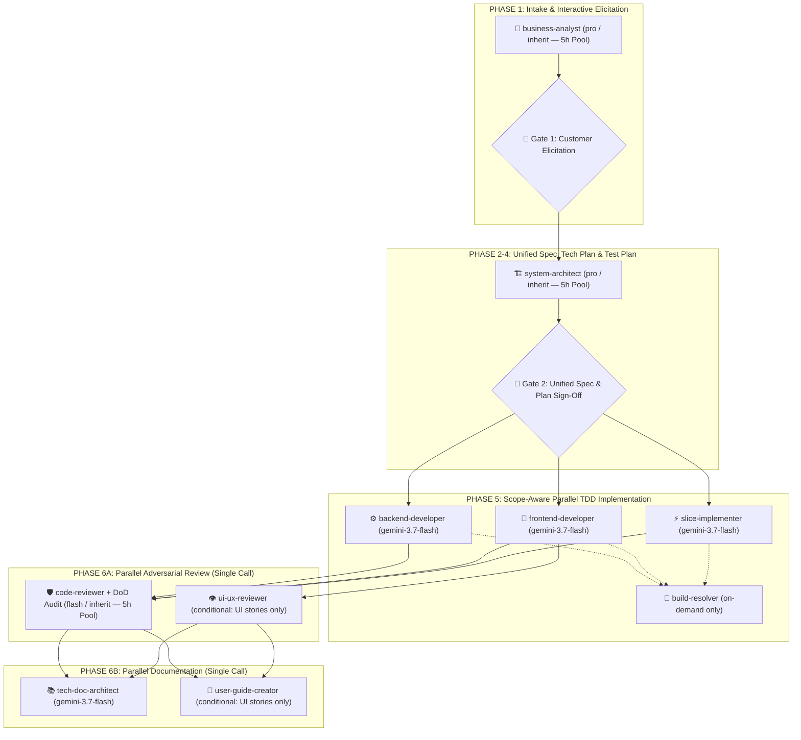

# GEMINI.md

Behavioral guidelines to reduce common LLM coding mistakes. Merge with project-specific instructions as needed.

**Tradeoff:** These guidelines bias toward caution over speed. For trivial tasks, use judgment.

## 1. Think Before Coding

**Don't assume. Don't hide confusion. Surface tradeoffs.**

Before implementing:

- **Zero Speculation & Zero Hallucination**: NEVER invent, fabricate, or silently assume business rules, formulas, error handling, default parameters, or edge cases. If something is unknown, ambiguous, or underspecified, STOP and ask the customer directly.
- State your assumptions explicitly. If uncertain, ask.
- If multiple interpretations exist, present them - don't pick silently.
- If a simpler approach exists, say so. Push back when warranted.
- If something is unclear, stop. Name what's confusing. Ask.

## 2. Simplicity First

**Minimum code that solves the problem. Nothing speculative.**

- No features beyond what was asked.
- No abstractions for single-use code.
- No "flexibility" or "configurability" that wasn't requested.
- No error handling for impossible scenarios.
- If you write 200 lines and it could be 50, rewrite it.

Ask yourself: "Would a senior engineer say this is overcomplicated?" If yes, simplify.

## 3. Surgical Changes

**Touch only what you must. Clean up only your own mess.**

When editing existing code:

- Don't "improve" adjacent code, comments, or formatting.
- Don't refactor things that aren't broken.
- Match existing style, even if you'd do it differently.
- If you notice unrelated dead code, mention it - don't delete it.

When your changes create orphans:

- Remove imports/variables/functions that YOUR changes made unused.
- Don't remove pre-existing dead code unless asked.

The test: Every changed line should trace directly to the user's request.

## 4. Goal-Driven Execution

**Define success criteria. Loop until verified.**

Transform tasks into verifiable goals:

- "Add validation" → "Write tests for invalid inputs, then make them pass"
- "Fix the bug" → "Write a test that reproduces it, then make it pass"
- "Refactor X" → "Ensure tests pass before and after"

For multi-step tasks, state a brief plan:

```
1. [Step] → verify: [check]
2. [Step] → verify: [check]
3. [Step] → verify: [check]
```

Strong success criteria let you loop independently. Weak criteria ("make it work") require constant clarification.

## 5. Strict Design System & Anti-AI-Slop Governance (WordStreak UI)

**MANDATORY FOR ANY FRONTEND / UI WORK (`apps/web/`):**
Before touching any `.tsx`, `.jsx`, `.css`, or UI mockup, the AI MUST read:

- [apps/web/DESIGN.md](file:///Users/vutuanhau/Documents/PROJECT/WordStreak/apps/web/DESIGN.md) (Design tokens, palette, typography, pill geometry)
- [apps/web/MEMORY.md](file:///Users/vutuanhau/Documents/PROJECT/WordStreak/apps/web/MEMORY.md) (Product core: 100% Free SM-2, Purple Flame mascot, hover flicker anchor rules, radial card tilt physics)

**Strict Anti-AI-Slop Rules:**

- **Zero Generic AI Slop**: Absolutely NO unrequested multi-color gradients (e.g. `bg-gradient-to-r from-purple-500 to-indigo-600`), NO heavy dark-mode glassmorphism, NO floating blurred neon orbs, NO fake pricing tiers or mocked CLI commands.
- **Minimal Canvas & Palette**: Pure white canvas (`#ffffff`), 1px hairline borders (`#e5e5e5`/`#d4d4d4`), Obsidian pure black pills (`#000000`, `rounded-full`) for CTAs.
- **Typography Tokens**: Display headings = `Nunito` (500/600/700), body copy = `Inter`, code/tags = `JetBrains Mono`.
- **Stable Outer Anchor for Hover**: Never attach hover handlers directly to elements translating on Y-axis. Always use a stable outer anchor to eliminate 60Hz hover jitter.

## 6. Subagent Transparency & Model Notification

**MANDATORY NOTIFICATION ON SUBAGENT EXECUTION:**
Whenever a subagent is dispatched (e.g. for adversarial UI review, technical documentation, slice implementation, or browser automation):

- The agent MUST explicitly display a notification card in chat.
- It MUST indicate the **Subagent Name**, the **Active Model Name** (e.g. `Gemini 3.7 Flash`), the **Goal**, and the **Final Artifact/Report Link**.

## 7. Mandatory Automatic Subagent Delegation Protocol (Fast-Accurate Unified Pipeline)

**AUTOMATIC MULTI-AGENT LIFECYCLE (MANDATORY & NON-NEGOTIABLE):**
The primary orchestrator agent MUST strictly follow the Fast-Accurate Multi-Agent Pipeline without waiting for manual user prompting, delegating specialized tasks via `invoke_subagent`:



### Strict Orchestrator Invariants & Hard Coding Ban (NON-NEGOTIABLE):

- **Zero Direct Feature Coding by Orchestrator**: The primary orchestrator agent is **STRICTLY PROHIBITED** from calling `write_to_file` or `replace_file_content` directly for any feature code, specifications, database schemas, or unit/E2E test files.
- **Mandatory Delegation via `invoke_subagent`**: All domain elicitation, architecture planning, backend/frontend implementation, code review, and user guide generation MUST be delegated to dedicated subagents spawned via `invoke_subagent`.
- **Lean 6-File Canonical Artifact Set (Zero Duplication)**:
  In `.specify/features/<slug>/`, produce ONLY `baseline.md`, `spec.md`, `plan.md`, `test-plan.md`, `review-report.md`, and `CHANGELOG.md` (do NOT generate duplicate `spec/srs.md`, `spec/user-stories.md`, `00-intake.md`, `01-elicitation.md`, `03-domain-model.md`, `04-risk-scope.md`, `data-model.md`, `tasks.md`, or `08-dod-scorecard.md` for Bounded Tasks).
- **Model Allocation Matrix**:
  - **5-Hour Rolling Pool Priority (Default)**: Always prioritize Gemini models (`flash`, `pro`, `flash_lite`, or `inherit` when the main chat is on Gemini) so 100% of orchestration and subagents consume the 5-hour rolling quota pool instead of external weekly caps.
  - `Model: "pro" / "inherit"` (Deep Domain Elicitation & Unified Architecture — 5h Pool): `business-analyst`, `system-architect`.
  - `Model: "flash" / "inherit"` (Fast TDD Execution, Adversarial Review, UI Review & Docs — 5h Pool): `backend-developer`, `frontend-developer`, `slice-implementer`, `build-resolver` (on-demand), `code-reviewer`, `ui-ux-reviewer` (conditional on UI changes), `tech-doc-architect`, `user-guide-creator` (conditional on UI changes).
- **Pre-execution Catalog Definition**: Before running any phase, the orchestrator MUST ensure subagents are defined via `define_subagent` with specialized system prompts.

### Protocol Execution Chain:

1. **Phase 1 (Single-Pass Intake & Interactive Elicitation)**:
   - **Intake + Elicitation Prep**: Auto-dispatch `business-analyst` (`pro` / `inherit`) to classify complexity, inspect existing code/types, and formulate **2–3 targeted Elicitation Questions** with `(Recommended)` defaults.
   - **🛑 GATE 1 — INTERACTIVE ELICITATION INTERVIEW (MANDATORY CUSTOMER GATE)**:
     - The AI **MUST PAUSE** and present the 2–3 clarification questions to the User via `ask_question` or direct chat turns.
     - **Strict No-Hallucination Policy**: AI is STRICTLY FORBIDDEN from inventing business rules, error behaviors, default parameters, or edge cases. Silent auto-generation of unconfirmed `ASM-` assumptions without user interaction is strictly prohibited.
2. **Phases 2–4 (Unified Spec, Tech Plan & Test Plan — with `ponytail` Architecture Ladder)**:
   - Once the user answers Gate 1, auto-dispatch `system-architect` (`pro` / `inherit`) to compile `baseline.md` (`ASM-`, `BR-`, State Machine, `RISK-`, MoSCoW), `spec.md` (`REQ-`, `US-` Given-When-Then, Traceability Matrix), `plan.md` (Architecture, Data Model, Contracts, Tasks — applying the `ponytail` 7-rung ladder to reuse existing code, prefer stdlib/native APIs, and avoid single-use abstractions), and `test-plan.md` (`TC-###`).
   - **🛑 GATE 2 — Unified Spec & Technical Plan Sign-Off**: Present the unified summary to the User for approval. Upon approval, mark `baseline.md` as `SIGNED-OFF v1.0`.
3. **Phase 5 (Scope-Aware Parallel TDD Implementation — with Scoped `ponytail`)**:
   - **Scoped `ponytail` Rule**: Apply `ponytail` simplicity to **production code** (fewest files, shortest working diff, stdlib/native first, zero speculative abstractions), while keeping `ponytail` **OFF for test coverage** (100% of `TC-###` tests in `test-plan.md` and 100% of approved `REQ-`/`BR-` rules are mandatory).
   - **Single-App Story** (`apps/extension`, `apps/api`, or `apps/web` only): Dispatch **1 scoped implementer subagent** (`slice-implementer`, `backend-developer`, or `frontend-developer`) to complete the full TDD cycle (`Red` tests → `Green` minimal `ponytail` code → `Refactor` → `pnpm test && pnpm build`) in a single turn.
   - **Fullstack Story (`apps/api` + `apps/web`)**: Update `packages/shared-types` first, then dispatch **`backend-developer` & `frontend-developer` concurrently in a single parallel `invoke_subagent` call**.
   - **On-Demand `build-resolver`**: Only invoke if a build/lint error remains unresolved.
4. **Phase 6A (Parallel Adversarial Review — Single `invoke_subagent` Call)**:
   - Auto-dispatch `code-reviewer` (`flash` / `inherit`) in a fresh context for adversarial code quality, security, `BR-`/`REQ-`, DoD scorecard, and **`ponytail-review` over-engineering audit** (`delete:`, `stdlib:`, `native:`, `yagni:`, `shrink:`) into `review-report.md`.
   - Conditionally include `ui-ux-reviewer` (`gemini-3.7-flash`) in the **same parallel call** **only if** UI files were modified.
5. **Phase 6B (Parallel Documentation — Single `invoke_subagent` Call — `ponytail` OFF)**:
   - Auto-dispatch `tech-doc-architect` (`gemini-3.7-flash`) (`docs/features/<slug>/README.md` + `docs/features/README.md` index).
   - Conditionally include `user-guide-creator` (`gemini-3.7-flash`) (`docs/user-guides/<slug>.md`) in the **same parallel call** if user-facing UI changed.

## 8. 5-Hour Quota Pool Monitoring & Early Warning Protocol

WordStreak utilizes the Gemini 5-hour rolling quota window to maintain continuous autonomous execution. The PreInvocation hook at `.agents/scripts/hooks/session-context-init.js` automatically tracks rolling turns and token consumption across all recent transcripts within the active 5-hour window, injecting real-time quota telemetry into `### [WordStreak Project Context]`.

**MANDATORY EARLY WARNING GATE:**
Whenever the hook injects a `🟡 WARNING (≥ 75%)` or `🔴 CRITICAL (≥ 90%)` alert, the AI MUST display a prominent notice at the top of its response in Vietnamese:

- **Thông tin hạn mức 5h**: Tỷ lệ sử dụng hiện tại (`%`), số turns (`turns/150`), tokens đã dùng (`activeTokens`, `cachedTokens`) và thời điểm reset chính xác theo giờ địa phương (`HH:MM`).
- **Khuyến nghị hành động**:
  - Ưu tiên ủy thác công việc nặng cho các subagent `flash` / `flash_lite`.
  - Giữ câu trả lời ngắn gọn, tập trung vào trọng tâm.
  - Sử dụng công cụ `schedule` để lập lịch tiếp tục công việc ngay sau mốc reset 5h nếu hạn mức chạm ngưỡng tới hạn.

---

**These guidelines are working if:** fewer unnecessary changes in diffs, fewer rewrites due to overcomplication, zero generic AI slop in UI, total subagent transparency, automatic subagent delegation for all phases, and clarifying questions come before implementation rather than after mistakes.
