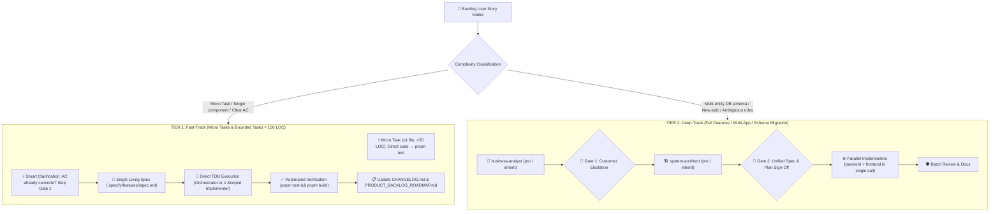

# GEMINI.md

Behavioral guidelines to reduce common LLM coding mistakes. Merge with project-specific instructions as needed.

**Tradeoff:** These guidelines bias toward caution over speed. For trivial tasks, use judgment.

## 1. Think Before Coding

**Don't assume. Don't hide confusion. Surface tradeoffs.**

Before implementing:

- **Zero Speculation & Zero Hallucination**: NEVER invent, fabricate, or silently assume business rules, formulas, error handling, default parameters, or edge cases. If something is unknown, ambiguous, or underspecified, STOP and ask the customer directly.
- State your assumptions explicitly. If uncertain, ask.
- If multiple interpretations exist, present them - don't pick silently.
- If a simpler approach exists, say so. Push back when warranted.
- If something is unclear, stop. Name what's confusing. Ask.

## 2. Simplicity First

**Minimum code that solves the problem. Nothing speculative.**

- No features beyond what was asked.
- No abstractions for single-use code.
- No "flexibility" or "configurability" that wasn't requested.
- No error handling for impossible scenarios.
- If you write 200 lines and it could be 50, rewrite it.

Ask yourself: "Would a senior engineer say this is overcomplicated?" If yes, simplify.

## 3. Surgical Changes

**Touch only what you must. Clean up only your own mess.**

When editing existing code:

- Don't "improve" adjacent code, comments, or formatting.
- Don't refactor things that aren't broken.
- Match existing style, even if you'd do it differently.
- If you notice unrelated dead code, mention it - don't delete it.

When your changes create orphans:

- Remove imports/variables/functions that YOUR changes made unused.
- Don't remove pre-existing dead code unless asked.

The test: Every changed line should trace directly to the user's request.

## 4. Goal-Driven Execution

**Define success criteria. Loop until verified.**

Transform tasks into verifiable goals:

- "Add validation" → "Write tests for invalid inputs, then make them pass"
- "Fix the bug" → "Write a test that reproduces it, then make it pass"
- "Refactor X" → "Ensure tests pass before and after"

For multi-step tasks, state a brief plan:

```
1. [Step] → verify: [check]
2. [Step] → verify: [check]
3. [Step] → verify: [check]
```

Strong success criteria let you loop independently. Weak criteria ("make it work") require constant clarification.

## 5. Strict Design System & Anti-AI-Slop Governance (WordStreak UI)

**MANDATORY FOR ANY FRONTEND / UI WORK (`apps/web/`):**
Before touching any `.tsx`, `.jsx`, `.css`, or UI mockup, the AI MUST read:

- [apps/web/DESIGN.md](file:///Users/vutuanhau/Documents/PROJECT/WordStreak/apps/web/DESIGN.md) (Design tokens, palette, typography, pill geometry)
- [apps/web/MEMORY.md](file:///Users/vutuanhau/Documents/PROJECT/WordStreak/apps/web/MEMORY.md) (Product core: 100% Free SM-2, Purple Flame mascot, hover flicker anchor rules, radial card tilt physics)

**Strict Anti-AI-Slop Rules:**

- **Zero Generic AI Slop**: Absolutely NO unrequested multi-color gradients (e.g. `bg-gradient-to-r from-purple-500 to-indigo-600`), NO heavy dark-mode glassmorphism, NO floating blurred neon orbs, NO fake pricing tiers or mocked CLI commands.
- **Minimal Canvas & Palette**: Pure white canvas (`#ffffff`), 1px hairline borders (`#e5e5e5`/`#d4d4d4`), Obsidian pure black pills (`#000000`, `rounded-full`) for CTAs.
- **Typography Tokens**: Display headings = `Nunito` (500/600/700), body copy = `Inter`, code/tags = `JetBrains Mono`.
- **Stable Outer Anchor for Hover**: Never attach hover handlers directly to elements translating on Y-axis. Always use a stable outer anchor to eliminate 60Hz hover jitter.

## 6. Subagent Transparency & Model Notification

**MANDATORY NOTIFICATION ON SUBAGENT EXECUTION:**
Whenever a subagent is dispatched (e.g. for adversarial UI review, technical documentation, slice implementation, or browser automation):

- The agent MUST explicitly display a notification card in chat.
- It MUST indicate the **Subagent Name**, the **Active Model Name** (e.g. `Gemini 3.7 Flash`), the **Goal**, and the **Final Artifact/Report Link**.

## 7. Adaptive 2-Tier Execution Pipeline (Fast-Accurate Governance)

To prevent severe token inflation and cold-start latency while maintaining 100% test and architectural rigor, development follows the **Adaptive 2-Tier Pipeline**. The single entry-point orchestrator skill is **`wordstreak-ba-skills`** (`wordstreak-workflow` and `implementation-orchestrator` are archived in `_archived/`).



### Protocol Tiers Breakdown:

#### ⚡ TIER 1: Fast-Track Execution (Default for standard Backlog Stories)
1. **Scope Eligibility**:
   - **Micro Tasks** ($\le 1$ file, $< 50$ lines, no new DB/API): Implement directly in the primary context $\rightarrow$ `pnpm test`. No spec folder needed.
   - **Bounded Tasks** (single-app changes in `apps/api`, `apps/web`, or `apps/extension`, bug fixes, or clear AC $\le 150$ LOC).
2. **Direct Execution Authorization**: The orchestrator is **AUTHORIZED** to execute directly in the primary context (or dispatch a single scoped `slice-implementer` subagent) without cold-starting 5–7 separate subagents.
3. **Smart Clarification (Zero Redundant Questions)**: If the Backlog AC is clear, do NOT pause for artificial Gate 1 questions. Automatically treat confirmed AC as `ASM-` and proceed immediately.
4. **Single Living Spec (Zero Duplication)**: Maintain only `.specify/features/<slug>/spec.md` (combining Requirements, Technical Design, and `TC-###` Test Cases) and `CHANGELOG.md`. Do NOT generate separate duplicate `baseline.md`, `plan.md`, `test-plan.md`, or `review-report.md`.
5. **Direct TDD Loop**: Write failing tests (`Red`) $\rightarrow$ Implement minimal code (`Green` with `ponytail` simplicity) $\rightarrow$ Refactor $\rightarrow$ Verify passing with `pnpm test` and `pnpm build`.
6. **Milestone-Level Docs**: Deep adversarial review reports and user guide screenshots with Playwright are batched at the Epic/Release milestone level rather than executed for every micro-story.

#### 🏗️ TIER 2: Deep-Track Execution (For complex, cross-cutting Epics)
1. **Scope Eligibility**: Net-new Epics, cross-cutting fullstack features modifying database schema and multiple apps, or features with genuinely ambiguous business rules.
2. **Phase 1 (Intake & Elicitation)**: Dispatch `business-analyst` (`pro` / `inherit`) to inspect domain models and ask 2–3 targeted questions at **Gate 1**.
3. **Phases 2–4 (Unified Spec & Plan)**: Dispatch `system-architect` (`pro` / `inherit`) to produce a comprehensive spec & technical plan, presenting a summary for **Gate 2 Sign-Off**.
4. **Phase 5 (Parallel Implementation)**: If modifying both API and Web, dispatch `backend-developer` and `frontend-developer` concurrently in a **single parallel `invoke_subagent` call**.
5. **Phase 6 (Batch Review & Documentation)**: Dispatch `code-reviewer` + `ui-ux-reviewer` in batch 1 (strictly enforcing the 4 Review Stopping Rules below), and `tech-doc-architect` + `user-guide-creator` in batch 2.

### 4 Strict Review Stopping Rules (Enforced across all reviews):
1. **Max 3 Iterations**: The review-fix cycle is hard-capped at 3 rounds; on Round 3, only blocking `CRITICAL` issues can halt execution; remaining nits are accepted.
2. **Incremental Diff Only**: In Rounds 2 & 3, review **ONLY the latest git diff** (`git diff HEAD~1`).
3. **Categorized Findings**: Consolidate findings into Security, Logic, Performance, and Cleanliness.
4. **No Regurgitation**: Never re-report resolved or accepted issues.

### Model Allocation Matrix:
- **Gemini 5-Hour Pool Priority**: Use `flash` or `inherit` for standard TDD, reviews, and documentation to protect rolling quota. Reserve `pro` solely for Tier 2 complex domain elicitation and system architecture.

## 8. 5-Hour Quota Pool Monitoring & Early Warning Protocol

WordStreak utilizes the Gemini 5-hour rolling quota window to maintain continuous autonomous execution. The PreInvocation hook at `.agents/scripts/hooks/session-context-init.js` automatically tracks rolling turns and token consumption across all recent transcripts within the active 5-hour window, injecting real-time quota telemetry into `### [WordStreak Project Context]`.

**MANDATORY EARLY WARNING GATE:**
Whenever the hook injects a `🟡 WARNING (≥ 75%)` or `🔴 CRITICAL (≥ 90%)` alert, the AI MUST display a prominent notice at the top of its response in Vietnamese:

- **Thông tin hạn mức 5h**: Tỷ lệ sử dụng hiện tại (`%`), số turns (`turns/150`), tokens đã dùng (`activeTokens`, `cachedTokens`) và thời điểm reset chính xác theo giờ địa phương (`HH:MM`).
- **Khuyến nghị hành động**:
  - Ưu tiên ủy thác công việc nặng cho các subagent `flash` / `flash_lite`.
  - Giữ câu trả lời ngắn gọn, tập trung vào trọng tâm.
  - Sử dụng công cụ `schedule` để lập lịch tiếp tục công việc ngay sau mốc reset 5h nếu hạn mức chạm ngưỡng tới hạn.

## 9. Ponytail Protocol (Senior Simplicity & Over-Engineering Safeguards)

**Core Mantra: The best code is the code never written. Default level: `full`.**

Whenever implementing, refactoring, or reviewing code, the AI MUST climb **The Ladder**:

1. **Does this need to exist at all?** Speculative need = skip it. (YAGNI)
2. **Already in this codebase?** Look before you write. Reuse existing utilities (`guestStorage`, `srs.service`, `safeGetLocale`).
3. **Stdlib does it?** Use `Map`, `Set`, `Intl.DateTimeFormat`, `crypto.randomUUID()`, `URLSearchParams` instead of adding external dependencies (`moment`, `dayjs`, `uuid`, `lodash`).
4. **Native platform covers it?** Use HTML5 `<audio>`, native `<input>`, CSS Flexbox/Grid, and PostgreSQL constraints (`@unique`, `onDelete: Cascade`) over application-level wrappers.
5. **Already-installed dependency solves it?** Never add a new library for what 5 lines can do.
6. **Can it be one line?** One line.
7. **Only then:** The absolute minimum code that works.

**Hard Safeguards:**
- **File limit:** $< 800$ lines. **Function limit:** $< 50$ lines.
- **Zero speculative flexibility:** No interfaces with single implementations, no 1-1 delegate service wrappers, no factories for a single product.
- **Zero test compromise:** Laziness applies to production code, NEVER to test rigor. Every non-trivial branch must leave an automated test behind (`TC-###`).
- **Debt visibility:** Mark deliberate shortcuts with a comment: `// ponytail: [known ceiling, upgrade path when N exceeds threshold]`.

---

**These guidelines are working if:** fewer unnecessary changes in diffs, fewer rewrites due to overcomplication, zero generic AI slop in UI, total subagent transparency, automatic subagent delegation for all phases, and clarifying questions come before implementation rather than after mistakes.
