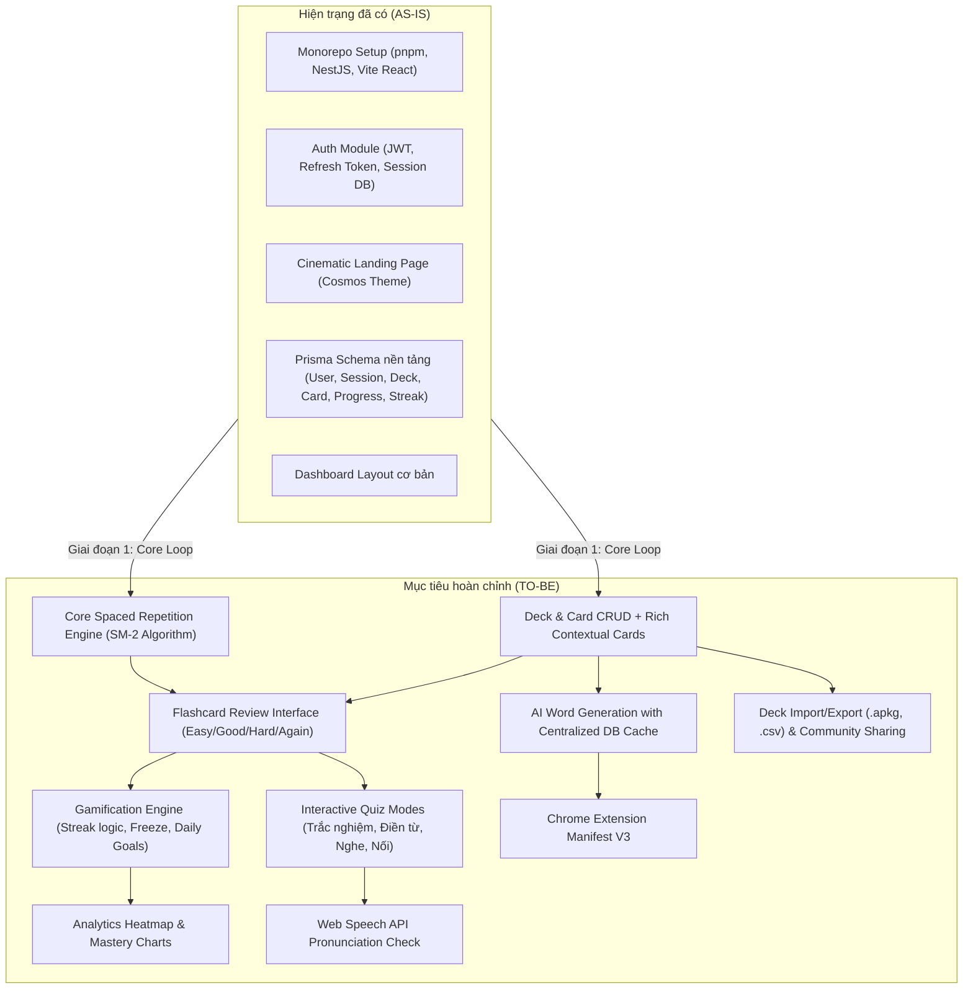

# 📋 WordStreak — Product Backlog, Business Requirements & Execution Roadmap

> **Phiên bản:** 1.0.0  
> **Vai trò:** Senior Business Analyst (BA) & Product Owner (PO)  
> **Trạng thái tài liệu:** Tài liệu sống (Living Document) — Sử dụng để theo dõi tiến độ và đánh dấu hoàn thành  
> **Ký hiệu trạng thái:**
>
> - `[x]` **Hoàn thành (Done)** — Đã hoàn thiện code, test và hoạt động ổn định.
> - `[/]` **Đang triển khai (In Progress)** — Đang phát triển hoặc đang trong giai đoạn thiết kế/spec.
> - `[ ]` **Chưa triển khai (To Do / Backlog)** — Đã có đặc tả nghiệp vụ, sẵn sàng lên kế hoạch sprint.
> - `[!]` **Bị chặn / Cần làm rõ (Blocked / Review Needed)** — Phụ thuộc module khác hoặc cần quyết định kiến trúc/nghiệp vụ.
> - `[~]` **Dự kiến dài hạn (Deferred / Future Phase)** — Nghiệp vụ giai đoạn sau (Phase 3 & 4).

---

## 📑 Mục lục

1. [Tầm nhìn sản phẩm & Đối tượng người dùng (Product Vision & Personas)](#1-tầm-nhìn-sản-phẩm--đối-tượng-người-dùng)
2. [Phân tích hiện trạng AS-IS vs TO-BE (Gap Analysis)](#2-phân-tích-hiện-trạng-as-is-vs-to-be)
3. [Bảng ma trận ưu tiên MoSCoW & RICE](#3-bảng-ma-trận-ưu-tiên-moscow--rice)
4. [Phân rã nghiệp vụ chi tiết & Checklist công việc (Epics & Backlog Tracking)](#4-phân-rã-nghiệp-vụ-chi-tiết--checklist-công-việc)
   - [Epic 1: Authentication & User Profile](#epic-01-authentication--user-profile-xác-thực--quản-lý-người-dùng)
   - [Epic 2: Deck & Vocabulary Card Management](#epic-02-deck--vocabulary-card-management-quản-lý-bộ-từ--thẻ-từ-vựng)
   - [Epic 3: Spaced Repetition System (SRS Engine - SM-2)](#epic-03-spaced-repetition-system-srs-engine---sm-2)
   - [Epic 4: Multi-format Practice & Quiz Modes](#epic-04-multi-format-practice--quiz-modes-đa-dạng-chế-độ-ôn-luyện)
   - [Epic 5: Gamification, Streaks & Daily Habits](#epic-05-gamification-streaks--daily-habits-game-hóa--thói-quen)
   - [Epic 6: Learning Analytics & Retention Dashboard](#epic-06-learning-analytics--retention-dashboard-thống-kê--báo-cáo)
   - [Epic 7: AI-Assisted Vocabulary Generator & Caching](#epic-07-ai-assisted-vocabulary-generator--caching-tự-động-hóa-ai)
   - [Epic 8: Speech Recognition & Pronunciation Assessment](#epic-08-speech-recognition--pronunciation-luyện-phát-âm-ai)
   - [Epic 9: Import/Export, Community & Ecosystem](#epic-09-importexport-community--ecosystem-hệ-sinh-thái)
   - [Epic 10: Multi-language & Internationalization (i18n)](#epic-10-multi-language--internationalization-i18n-đa-ngôn-ngữ-anhviệt)
   - [Epic 11: Starter Decks & Onboarding](#epic-11-starter-decks--onboarding-bộ-từ-có-sẵn--hướng-dẫn-đầu-tiên)
   - [Epic 12: UX Improvements & Growth](#epic-12-ux-improvements--growth-cải-tiến-ux--tăng-trưởng) <!-- Epic 12: Notification & Reminder System -->
   - [Epic 13: Vocabulary Starter Library & Content Strategy (TSL/NGSL)](#epic-13-vocabulary-starter-library--content-strategy-tslngsl)
5. [Lộ trình phát hành theo Giai đoạn & Sprint (Release Roadmap)](#5-lộ-trình-phát-hành-theo-giai-đoạn--sprint)
   - [Sprint 9: Activation & Retention](#5-lộ-trình-phát-hành-theo-giai-đoạn--sprint)
   - [Sprint 10: Learning Quality & Growth](#5-lộ-trình-phát-hành-theo-giai-đoạn--sprint)
   - [Sprint 11: Academic & IELTS Expansion (NAWL)](#5-lộ-trình-phát-hành-theo-giai-đoạn--sprint)
   - [Sprint 12: Business & Spoken Expansion (BSL & NGSL-S)](#5-lộ-trình-phát-hành-theo-giai-đoạn--sprint)
6. [Quy chuẩn định nghĩa hoàn thành (Definition of Done - DoD)](#6-quy-chuẩn-định-nghĩa-hoàn-thành-definition-of-done)
7. [Phân tích & Kế hoạch Phát hành Production (Go-Live Plan)](#7-phân-tích--kế-hoạch-phát-hành-production-go-live-plan)
   - [7.1 Quyết định ưu tiên: Epic 10 vs Deploy](#71-quyết-định-ưu-tiên-hoàn-thiện-epic-10-trước-hay-deploy-trước)
   - [7.2 Kiến trúc Hosting miễn phí — No Sleep](#72-kiến-trúc-hosting-miễn-phí--no-sleep-stable-speed)
   - [7.3 Tương thích Chrome Extension & PWA](#73-phân-tích-tương-thích-với-chrome-extension--pwa-sprint-7)
   - [7.4 Pre-Deploy Checklist](#74-pre-deploy-checklist-phải-làm-trước-khi-go-live)
   - [7.5 Biến môi trường Production](#75-biến-môi-trường-production-template)
   - [7.6 Sprint 8 — Go-Live Tracking](#76-sprint-8--production-hardening--go-live-tracking)

---

## 1. Tầm nhìn sản phẩm & Đối tượng người dùng

### 1.1. Tầm nhìn (Product Vision)

**WordStreak** là nền tảng học và củng cố từ vựng tiếng Anh cá nhân hóa thế hệ mới. Ứng dụng giải quyết triệt để vấn đề "học trước quên sau" bằng sự kết hợp giữa:

1. **Thuật toán Spaced Repetition (SM-2 / FSRS)** mô phỏng đường cong quên tự nhiên của não bộ.
2. **Contextual Flashcards** (Từ vựng giàu ngữ cảnh: IPA audio, ví dụ thực tế, collocations, hình ảnh, mẹo ghi nhớ).
3. **AI Automation** giúp tạo dữ liệu từ vựng tự động chỉ với 1 cú click (kèm cơ chế caching tối ưu chi phí).
4. **Gamification & Habit Building** (Streak, Streak Freeze, Heatmap, Daily Goals) tạo động lực học tập mỗi ngày.

### 1.2. Chân dung người dùng mục tiêu (User Personas)

- **Persona A - Alex (Luyện thi chứng chỉ IELTS/TOEIC/TOEFL):** Cần học 10-30 từ học thuật mỗi ngày theo chủ đề, cần nhớ chuẩn nghĩa trong ngữ cảnh và collocations đi kèm.
- **Persona B - Minh (Người đi làm bận rộn):** Có ít thời gian (10-15 phút/ngày), cần app nhắc nhở ôn tập đúng lúc, có cơ chế bảo vệ chuỗi học (Streak Freeze) khi tăng ca.
- **Persona C - Linh (Người đọc báo/xem video tiếng Anh thường xuyên):** Thấy từ mới khi lướt web và muốn lưu ngay vào bộ từ cá nhân thông qua Extension mà không phải mở app thủ công.
- **Persona D - Nam (Người mất gốc / Khởi đầu lại từ đầu):** Đã bỏ tiếng Anh lâu năm, mất phương hướng và dễ nản lòng khi thấy danh sách từ quá dài hoặc câu ví dụ quá khó. Cần lộ trình chia nhỏ (5 từ/ngày), giải thích bằng tiếng Việt, bài học ngữ pháp nền tảng $\le 2$ phút, âm thanh rõ ràng và mẹo phát âm âm cuối đặc thù cho người Việt.

---

## 2. Phân tích hiện trạng AS-IS vs TO-BE



---

## 3. Bảng ma trận ưu tiên MoSCoW & RICE

| Mã Epic     | Nghiệp vụ / Tính năng                             |  Phân loại MoSCoW   | RICE Score |      Mức ưu tiên      |   Sprint khuyến nghị    |
| :---------- | :------------------------------------------------ | :-----------------: | :--------: | :-------------------: | :---------------------: |
| **EPIC-01** | Authentication, Sessions & Profile                |    **Must Have**    |    9.0     |   **P0 (Critical)**   | Sprint 1 _(Hoàn thành)_ |
| **EPIC-02** | Deck & Card Management (CRUD + Context)           |    **Must Have**    |    9.5     |   **P0 (Critical)**   |        Sprint 2         |
| **EPIC-03** | SRS Engine (SM-2) & Flashcard Review Flow         |    **Must Have**    |    10.0    |   **P0 (Core USP)**   |        Sprint 2         |
| **EPIC-04** | Quiz Modes: Trắc nghiệm & Điền vào chỗ trống      |    **Must Have**    |    8.5     |     **P0 (High)**     |        Sprint 3         |
| **EPIC-05** | Streak Tracking, Daily Goal & Streak Freeze       |    **Must Have**    |    8.8     |  **P0 (Retention)**   |        Sprint 3         |
| **EPIC-06** | Learning Analytics & GitHub-style Heatmap         |   **Should Have**   |    7.8     |     **P1 (High)**     |        Sprint 4         |
| **EPIC-07** | AI Flashcard Auto-fill & Shared DB Cache          |   **Should Have**   |    8.2     |     **P1 (High)**     |        Sprint 4         |
| **EPIC-04** | Quiz Modes: Luyện nghe (Audio) & Nối từ           |   **Should Have**   |    7.0     |    **P1 (Medium)**    |        Sprint 5         |
| **EPIC-08** | Luyện phát âm (Voice Recognition via Web Speech)  |   **Could Have**    |    6.2     |    **P2 (Medium)**    |        Sprint 5         |
| **EPIC-09** | Import/Export Anki (.apkg) & CSV                  |   **Could Have**    |    6.5     |    **P2 (Medium)**    |        Sprint 6         |
| **EPIC-09** | Community Deck Sharing (Public/Clone Deck)        |   **Could Have**    |    6.0     |    **P2 (Medium)**    |        Sprint 6         |
| **EPIC-10** | Multi-language & i18n (Tiếng Anh & Tiếng Việt)    |   **Should Have**   |    8.0     |     **P1 (High)**     |        Sprint 6         |
| **EPIC-09** | Chrome Extension (Highlight to Save Deck)         | **Won't Have (v1)** |    5.5     |   **P3 (Phase 4)**    |        Sprint 7         |
| **EPIC-09** | PWA & Offline Study Mode                          | **Won't Have (v1)** |    5.0     |   **P3 (Phase 4)**    |        Sprint 7         |
| **EPIC-09** | Extension: Badge, Notification, Micro-review      |    **Must Have**    |    8.5     |  **P0 (Retention)**   |        Sprint 9         |
| **EPIC-11** | Starter Decks + Onboarding 60s                    |    **Must Have**    |    9.0     |  **P0 (Activation)**  |        Sprint 9         |
| **EPIC-12** | "Học hôm nay" Button + SRS Auto-grade             |   **Should Have**   |    8.0     |      **P1 (UX)**      |        Sprint 9         |
| **EPIC-13** | US-LIB-01: Pipeline nạp & làm giàu nội dung       |    **Must Have**    |    9.2     |   **P0 (Critical)**   |        Sprint 9         |
| **EPIC-13** | US-LIB-02: Mô hình dữ liệu Official & Enrollment  |    **Must Have**    |    9.0     | **P0 (Architecture)** |        Sprint 9         |
| **EPIC-13** | US-LIB-03: Trang Thư viện & Chi tiết Deck         |    **Must Have**    |    8.8     |  **P0 (Activation)**  |        Sprint 9         |
| **EPIC-13** | US-LIB-04: Onboarding theo mục tiêu (TOEIC)       |    **Must Have**    |    9.0     |  **P0 (Activation)**  |        Sprint 9         |
| **EPIC-13** | US-LIB-08: Ghi nguồn dữ liệu & CC BY-SA 4.0       |    **Must Have**    |    7.5     |    **P0 (Legal)**     |        Sprint 9         |
| **EPIC-13** | US-LIB-11: Lối vào mất gốc & Test thích ứng       |    **Must Have**    |    8.8     | **P0 (Inclusivity)**  |        Sprint 9         |
| **EPIC-13** | US-LIB-12: Chặng Khởi động (NGSL Top 300 Decks)   |    **Must Have**    |    9.0     |  **P0 (Activation)**  |        Sprint 9         |
| **EPIC-13** | US-LIB-13: Ví dụ kiểm soát từ vựng (NGSL+TSL)     |   **Should Have**   |    8.2     |   **P1 (Quality)**    |        Sprint 9         |
| **EPIC-13** | US-LIB-05: Lọc từ đã biết (Known-word Triage)     |   **Should Have**   |    8.2     |      **P1 (UX)**      |        Sprint 10        |
| **EPIC-13** | US-LIB-06: Lộ trình TOEIC & Thanh độ phủ ước tính |   **Should Have**   |    8.5     |   **P1 (Core USP)**   |        Sprint 10        |
| **EPIC-13** | US-LIB-07: Quiz kiểu TOEIC (Mini Part 5)          |   **Should Have**   |    8.0     |   **P1 (Learning)**   |        Sprint 10        |
| **EPIC-13** | US-LIB-09: Báo lỗi thẻ & Content Versioning       |   **Should Have**   |    7.2     |   **P1 (Quality)**    |        Sprint 10        |
| **EPIC-13** | US-LIB-10: Analytics cho thư viện từ vựng         |   **Could Have**    |    6.8     |    **P2 (Growth)**    |        Sprint 10        |
| **EPIC-13** | US-LIB-14: Audio-first & Mẹo âm cuối tiếng Việt   |   **Should Have**   |    8.0     |   **P1 (Learning)**   |        Sprint 10        |
| **EPIC-13** | US-LIB-15: Intra-session Learning Steps & Check   |   **Should Have**   |    7.8     |     **P1 (SRS)**      |        Sprint 10        |
| **EPIC-13** | US-LIB-16: Cột mốc, Phiên 5p & Welcome Back       |   **Could Have**    |    7.2     |  **P2 (Retention)**   |        Sprint 10        |
| **EPIC-12** | AI: Đoạn văn ngắn + Leech detection               |   **Could Have**    |    7.0     |   **P2 (Learning)**   |        Sprint 10        |
| **EPIC-11** | SEO Word Pages + Analytics                        |   **Could Have**    |    6.5     |    **P2 (Growth)**    |        Sprint 10        |
| **EPIC-09** | Web Push & Email (mobile)                         | **Won't Have (v2)** |    6.0     |   **P3 (Phase 5)**    |        Sprint 10        |
| **EPIC-13** | US-LIB-17: Cụm từ cố định & Deck ảnh Part 1       | **Won't Have (v2)** |    6.0     |   **P3 (Phase 6)**    |        Sprint 11        |

---

## 4. Phân rã nghiệp vụ chi tiết & Checklist công việc

### EPIC 01: Authentication & User Profile (Xác thực & Quản lý người dùng)

_Mục tiêu: Đảm bảo bảo mật tài khoản người dùng, phiên đăng nhập đa thiết bị và lưu trữ cấu hình cá nhân hóa._

- [x] **US-AUTH-01: Đăng ký tài khoản mới (Sign Up)**
  - **AC:** Người dùng cung cấp `username`, `email`, `password`. Mật khẩu được hash an toàn (Argon2/Bcrypt). Không trùng email/username.
  - **Tasks:**
    - [x] Backend: Endpoint `POST /api/v1/auth/register` + validation DTO.
    - [x] Frontend: Form đăng ký với validation client-side và feedback lỗi trực quan.
- [x] **US-AUTH-02: Đăng nhập & Quản lý phiên (Sign In & Session Management)**
  - **AC:** Cấp phát Access Token (JWT) ngắn hạn và Refresh Token dài hạn lưu trong bảng `Session`. Tự động gia hạn khi Access Token hết hạn.
  - **Tasks:**
    - [x] Backend: Endpoint `POST /api/v1/auth/login`, `POST /api/v1/auth/refresh`, `POST /api/v1/auth/logout`.
    - [x] Frontend: Lưu token bảo mật, Axios/Fetch Interceptor tự động refresh token, Zustand `useAuthStore`.
- [x] **US-AUTH-03: Bảo vệ tuyến đường & Điều hướng (Route Protection & Guards)**
  - **AC:** Chỉ user đã xác thực mới được vào Dashboard/Study; nếu chưa đăng nhập điều hướng về `/login`.
  - **Tasks:**
    - [x] Backend: `JwtAuthGuard` bảo vệ các private endpoint.
    - [x] Frontend: Component `ProtectedRoute` bọc các route `/dashboard`, `/decks`, `/review`.
- [x] **US-AUTH-04: Cài đặt hồ sơ & Mục tiêu học tập hàng ngày (Profile & Daily Goal)**
  - **AC:** Người dùng có thể cập nhật `dailyGoal` (mặc định 10 từ, tùy chọn 5/10/20/30/50 từ), đổi avatar (Cosmos presets & URL), đổi mật khẩu (kèm tự động đăng xuất các thiết bị khác).
  - **Tasks:**
    - [x] Backend: `GET /api/v1/users/profile`, `PATCH /api/v1/users/profile` (update dailyGoal, avatarUrl), `POST /api/v1/users/change-password`.
    - [x] Frontend: Trang Profile Modal/Settings (`SettingsModal`) 3 tabs cho phép chỉnh sửa mục tiêu học tập, chọn Cosmos Avatar, và đổi mật khẩu an toàn.

---

### EPIC 02: Deck & Vocabulary Card Management (Quản lý Bộ từ & Thẻ từ vựng)

_Mục tiêu: Cho phép người dùng tự tạo, phân loại theo chủ đề và quản lý thẻ từ vựng với đầy đủ ngữ cảnh phong phú._

- [x] **US-DECK-01: Tạo và quản lý Bộ từ vựng (Deck CRUD)**
  - **AC:** Người dùng có thể tạo Deck mới (Title, Description, Color/Icon tag, IsPublic). Xem danh sách deck cá nhân, sửa thông tin, lưu trữ/khôi phục, xóa deck (kèm cảnh báo xóa cascade cards).
  - **Tasks:**
    - [x] Backend: Module `decks` (Controller, Service, Repository) — `GET /api/v1/decks`, `POST /api/v1/decks`, `GET /api/v1/decks/:id`, `PATCH /api/v1/decks/:id`, `PATCH /api/v1/decks/:id/archive`, `PATCH /api/v1/decks/:id/restore`, `DELETE /api/v1/decks/:id`.
    - [x] Frontend: Trang `DecksListPage` (`/decks`, danh sách deck dạng lưới, số lượng từ, thanh tiến độ, bộ lọc active/archived), `CreateDeckModal`, `EditDeckModal`, `DeleteDeckConfirmModal`.
- [x] **US-CARD-01: Tạo thẻ từ vựng giàu ngữ cảnh (Contextual Card Creation)**
  - **AC:** Thẻ gồm các trường: Word, Meaning (Tiếng Việt/Tiếng Anh), Phonetic (IPA), Audio URL, Example Sentence (kèm dịch nghĩa), Collocations, Mnemonic (ghi chú mẹo nhớ), Image URL.
  - **Tasks:**
    - [x] Backend: Module `cards` — `POST /api/v1/decks/:deckId/cards`, `GET /api/v1/decks/:deckId/cards`, `PATCH /api/v1/cards/:id`, `DELETE /api/v1/cards/:id`. Tự động khởi tạo bản ghi `UserCardProgress` (trạng thái `NEW`).
    - [x] Frontend: `AddCardModal` / `CardEditorForm` với rich fields (gợi ý từ loại, phát âm thử audio, xem trước flashcard 3D, lưu và thêm từ tiếp).
- [x] **US-CARD-02: Quản lý danh sách thẻ trong Bộ từ (Card Table & Search/Filter)**
  - **AC:** Tìm kiếm từ theo từ khóa, lọc theo trạng thái (New / Learning / Mastered), phân trang (Pagination/Infinite Scroll), hành động hàng loạt (Bulk Delete/Move).
  - **Tasks:**
    - [x] Backend: Query tối ưu với index trên `deckId` và `word`, hỗ trợ pagination `page`, `limit`, `search`, `status`, endpoint bulk action.
    - [x] Frontend: `DeckDetailPage` chứa danh sách từ dạng Table/Card List (Dual View Mode), tìm kiếm nhanh, lọc trạng thái, thanh công cụ bulk actions.

---

### EPIC 03: Spaced Repetition System (SRS Engine - SM-2)

_Mục tiêu: Xây dựng trái tim của ứng dụng — tính toán lịch ôn tập tối ưu để chuyển hóa từ vựng từ trí nhớ ngắn hạn sang dài hạn._

- [x] **US-SRS-01: Thuật toán tính toán chu kỳ lặp SuperMemo-2 (SM-2 Engine)**
  - **AC:** Xử lý 4 mức đánh giá:
    - Rating 1 (`Again` / Quên): `Repetitions = 0`, `Interval = 1 ngày`, giảm Ease Factor ($EF$).
    - Rating 2 (`Hard` / Khó): `Repetitions = 0`, `Interval = 1 ngày`, giảm mạnh $EF$.
    - Rating 3 (`Good` / Nhớ tốt): `Repetitions += 1`, $I(1)=1d, I(2)=6d, I(n)=I(n-1) \times EF'$.
    - Rating 4 (`Easy` / Quá dễ): `Repetitions += 1`, tăng Ease Factor ($EF$), tính khoảng cách nhảy vọt.
    - Đảm bảo $EF \ge 1.3$. Cập nhật `nextReviewDate = now + Interval`.
  - **Tasks:**
    - [x] Đặc tả thuật toán và mã giả TS tại `docs/algorithms/supermemo-2.md`.
    - [x] Backend: `SrsService` độc lập với 100% unit test coverage cho tất cả các nhánh rating.
- [x] **US-SRS-02: Truy vấn danh sách thẻ đến hạn ôn tập (Due Review Queue)**
  - **AC:** Lấy danh sách thẻ có `nextReviewDate <= CURRENT_TIMESTAMP` và các thẻ `NEW` theo giới hạn `dailyGoal` của user. Sắp xếp ưu tiên: Thẻ đến hạn quá lâu -> Thẻ đến hạn hôm nay -> Thẻ mới.
  - **Tasks:**
    - [x] Backend: Endpoint `GET /api/v1/reviews/due?deckId=...` (hỗ trợ ôn theo deck hoặc toàn bộ deck).
    - [x] Backend: Endpoint `POST /api/v1/reviews/submit` nhận `{ cardId, rating }` -> tính SM-2 -> cập nhật DB -> cập nhật streak.
- [x] **US-SRS-03: Giao diện lật thẻ ôn tập thông minh (Flashcard Review UI)**
  - **AC:** Giao diện 3D lật mặt trước (Word + IPA + Audio button) và mặt sau (Meaning, Example Sentence, Collocations, Mnemonic). Phím tắt bàn phím: Space (lật thẻ), 1 (Again), 2 (Hard), 3 (Good), 4 (Easy).
  - **Tasks:**
    - [x] Frontend: `ReviewSessionPage` với animation lật thẻ mượt mà (Framer Motion / CSS 3D flip).
    - [x] Frontend: Tự động phát âm thanh khi lật thẻ (tùy chọn trong cài đặt). Hiển thị thanh tiến độ ôn tập (Remaining / Due / Finished).

---

### EPIC 04: Multi-format Practice & Quiz Modes (Đa dạng chế độ ôn luyện)

_Mục tiêu: Đa dạng hóa hình thức kiểm tra để não bộ kích hoạt liên kết ngôn ngữ ở nhiều góc độ (đọc hiểu, ngữ cảnh, phản xạ nghe, nối nghĩa)._

- [x] **US-QUIZ-01: Chế độ Trắc nghiệm 4 đáp án (Multiple Choice Quiz)**
  - **AC:** Hệ thống sinh câu hỏi ngẫu nhiên: Cho từ vựng -> Chọn 1 trong 4 nghĩa đúng (3 nghĩa sai lấy ngẫu nhiên từ các thẻ khác cùng Deck); hoặc cho nghĩa -> chọn từ.
  - **Tasks:**
    - [x] Backend: Endpoint `GET /api/v1/practice/multiple-choice?deckId=...` sinh bộ câu hỏi và đáp án nhiễu (distractors).
    - [x] Frontend: Giao diện trắc nghiệm với âm thanh/hiệu ứng đúng/sai, đếm thời gian (timer).
- [x] **US-QUIZ-02: Chế độ Điền từ vào câu ví dụ (Fill-in-the-blank Quiz)**
  - **AC:** Trích xuất câu ví dụ từ Card, ẩn đi từ vựng mục tiêu (thay bằng dấu `_____`). Người dùng gõ từ đúng hoặc chọn từ các ký tự xáo trộn (anagram).
  - **Tasks:**
    - [x] Backend: Thuật toán làm mờ từ mục tiêu trong câu ví dụ (hỗ trợ cả các biến thể thì số ít/số nhiều/past tense).
    - [x] Frontend: Input gõ từ với cơ chế tự động kiểm tra, gợi ý chữ cái đầu (hint).

- [x] **US-QUIZ-03: Chế độ Luyện nghe gõ từ (Listening & Typing Practice)**
  - **AC:** Phát âm thanh đọc từ, không hiển thị chữ -> Người dùng nghe và gõ lại chính xác từ vựng. Hỗ trợ tốc độ chậm 0.75x, Web Speech API fallback, thang gợi ý 3 cấp độ, so khớp lỗi chính tả (LCS Diff) và điểm thưởng tốc độ.
  - **Tasks:**
    - [x] Backend: Endpoint `GET /api/v1/practice/listening`, validate query DTO và xử lý shuffle/filter.
    - [x] Backend: Tích hợp logic tính điểm thưởng tốc độ XP (+15 XP) và chống bot trong `PracticeService.submitQuiz`.
    - [x] Frontend: Trình phát audio `useAudioPlayer` với nút nghe lại chậm (0.75x speed), Web Speech failover, dynamic character input slots (`ListeningTypingInput`), visual diff badge và thang gợi ý (`ProgressiveHintBox`).
    - [x] Frontend: Tích hợp tab Luyện nghe trong `QuizSetupModal` và trang làm bài `ListeningQuizPage`.
- [x] **US-QUIZ-04: Chế độ Nối từ vựng (Word Matching Game)**
  - **AC:** Hiển thị 2 cột (5 từ tiếng Anh bên trái, 5 nghĩa tiếng Việt bên phải đã xáo trộn). Người dùng click chọn cặp tương ứng. Đúng thì biến mất, sai thì rung đỏ. Hỗ trợ chọn 2 chiều, phím tắt (1-5, Q-T), đếm combo, thưởng tốc độ, âm thanh Web Audio không phụ thuộc asset ngoài và chống bot.
  - **Tasks:**
    - [x] Backend: Endpoint `GET /api/v1/practice/matching` & `MatchingGeneratorService` sinh bàn cờ 2 cột 5 cặp từ được xáo trộn độc lập (Fisher-Yates).
    - [x] Backend: Endpoint `POST /api/v1/practice/matching/submit` tính điểm XP (+2/pair), combo multiplier (lên đến 2.0x), speed bonus (+10 XP), perfect bonus (+5 XP), trần 500 XP/ngày và phát hiện bot tốc độ.
    - [x] Frontend: Game engine `useMatchingGameEngine` & `useWebAudioSynthesizer` hỗ trợ chọn 2 chiều, phím tắt (`1-5`, `Q-T`), âm thanh Web Audio không phụ thuộc asset ngoài.
    - [x] Frontend: Giao diện bàn cờ 2 cột `MatchingGameBoard`, `MatchingTile`, thanh tiến độ `MatchingProgressBar`, tích hợp `QuizSetupModal` và trang làm bài `WordMatchingPage`.

---

### EPIC 05: Gamification, Streaks & Daily Habits (Game hóa & Thói quen)

_Mục tiêu: Duy trì động lực học tập liên tục hàng ngày, biến việc học từ vựng thành thói quen không thể bỏ._

- [x] **US-GAME-01: Hệ thống đếm chuỗi ngày học (Daily Streak Engine)**
  - **AC:**
    - Khi user hoàn thành phiên học/ôn tập trong ngày thỏa mãn điều kiện (`số thẻ học >= dailyGoal` hoặc hoàn thành tối thiểu 1 review session):
      - Nếu `lastActiveDate == Yesterday`: `currentStreak += 1`, cập nhật `bestStreak = max(currentStreak, bestStreak)`.
      - Nếu `lastActiveDate == Today`: Giữ nguyên streak.
      - Nếu `lastActiveDate < Yesterday`: Reset `currentStreak = 1` (trừ khi có Streak Freeze).
  - **Tasks:**
    - [x] Backend: `StreakService` tính toán ngày theo múi giờ địa phương (User Timezone).
    - [x] Frontend: Widget Ngọn lửa Streak rực sáng với animation và thông báo chúc mừng khi tăng chuỗi.
- [x] **US-GAME-02: Cơ chế Bảo vệ chuỗi (Streak Freeze)**
  - **AC:** Người dùng được trang bị tối đa 2 Streak Freeze (mặc định tặng 1 khi tạo tài khoản, thưởng mốc 7/30 ngày và refill hàng tháng). Nếu bỏ lỡ 1 ngày, hệ thống tự động tiêu thụ 1 Freeze để giữ nguyên chuỗi ngày học thay vì reset về 0.
  - **Tasks:**
    - [x] Database: Thêm trường `streakFreezes Int @default(1)`, `lastFreezeDate DateTime?`, `totalFreezesUsed Int @default(0)` vào bảng `UserStreak`.
    - [x] Backend: Lazy evaluation tính toán khoảng cách ngày theo múi giờ IANA, tự động trừ khiên và giữ nguyên `currentStreak`, trao thưởng khiên tại mốc 7/30 ngày.
    - [x] Frontend: Huy hiệu khiên băng tuyết (Streak Freeze) hiển thị `1/2 🧊` trên Dashboard, modal thông báo cứu chuỗi `StreakSavedModal` và hiệu ứng vinh danh `StreakCelebrationModal`.
- [x] **US-GAME-03: Hệ thống Điểm kinh nghiệm (XP) & Cấp độ người học (Levels)**
  - **AC:** Mỗi từ ôn đúng +10 XP, hoàn thành Daily Goal +50 XP, duy trì Streak 7 ngày +100 XP. Cấp bậc: Bronze -> Silver -> Gold -> Diamond -> Master.
  - **Tasks:**
    - [x] Backend: Logic cộng XP và log bảng `UserActivityLog`.
    - [x] Frontend: Thanh tiến độ Level và Popup thăng hạng với hiệu ứng confetti.

---

### EPIC 06: Learning Analytics & Retention Dashboard (Thống kê & Báo cáo)

_Mục tiêu: Trực quan hóa toàn bộ quá trình tiến bộ của người học, tạo cảm giác thành tựu và kiểm soát lộ trình._

- [x] **US-STAT-01: Biểu đồ phân bổ trạng thái từ vựng (Word Mastery Breakdown)**
  - **AC:** Thống kê tổng số từ theo 3 nhóm:
    - **Mastered (Thành thạo):** $Interval \ge 21$ ngày ($Repetitions \ge 4$).
    - **Learning (Đang học):** $1 \le Interval < 21$ ngày.
    - **New (Từ mới):** Chưa qua phiên ôn tập nào.
  - **Tasks:**
    - [x] Backend: `GET /api/v1/analytics/mastery-summary` tính toán theo toàn bộ deck hoặc deck cụ thể.
    - [x] Frontend: Biểu đồ Donut Chart / Progress Bars với màu sắc hiện đại.
- [x] **US-STAT-02: Bản đồ nhiệt độ hoạt động (GitHub-style Activity Heatmap)**
  - **AC:** Lưới 365 ô vuông thể hiện tần suất học tập của từng ngày trong năm (52 tuần trượt theo user timezone, 5 cấp độ màu).
  - **Tasks:**
    - [x] Backend: `GET /api/v1/analytics/activity-heatmap` trả về 365 ngày trượt với số lượt ôn tập và level.
    - [x] Frontend: Heatmap component 52 tuần với tooltip hiển thị số thẻ ôn tập mỗi ngày.
- [x] **US-STAT-03: Dự báo ngày hoàn thành Bộ từ vựng (Deck Completion Forecast)**
  - **AC:** Dựa trên tốc độ học trung bình 7 ngày qua và số từ chưa Mastered, dự đoán ngày hoàn thành 100% bộ từ.
  - **Tasks:**
    - [x] Backend: `GET /api/v1/analytics/deck-forecast/:deckId` & `GET /api/v1/analytics/decks-progress`.
    - [x] Frontend: Bảng tiến độ và badge dự báo trực quan trên trang `/analytics` và `/dashboard`.

---

### EPIC 07: AI-Assisted Vocabulary Generator & Caching (Tự động hóa AI)

_Mục tiêu: Tiết kiệm 90% thời gian tạo thẻ cho người dùng, tối ưu 95% chi phí API AI nhờ cơ chế lưu bộ nhớ đệm dùng chung._

- [x] **US-AI-01: Tự động điền dữ liệu từ vựng bằng AI/Từ điển (Auto-fill Card Data)**
  - **AC:** Người dùng chỉ cần nhập từ tiếng Anh (ví dụ: `serendipity`), nhấn "Tự động điền AI" -> Hệ thống tự động điền:
    - Nghĩa tiếng Việt chuẩn ngữ cảnh.
    - Phiên âm IPA chuẩn quốc tế.
    - Câu ví dụ tiếng Anh kèm dịch nghĩa tiếng Việt.
    - Danh sách Collocations thông dụng.
    - Mẹo nhớ từ (Mnemonic) sinh động.
  - **Tasks:**
    - [x] Backend: Service tích hợp Gemini API / Free Dictionary API với structured JSON prompt.
    - [x] Backend: Thêm Rate Limiting (30/ngày quota, 5 req/phút burst).
    - [x] Frontend: Nút "Tự động điền AI" với hiệu ứng loading sparkle, cho phép người dùng xem lại và chỉnh sửa trước khi lưu.
- [x] **US-AI-02: Cơ sở dữ liệu Caching từ vựng toàn hệ thống (Shared Word Dictionary Cache)**
  - **AC:** Khi 1 người dùng đã yêu cầu AI tạo từ `ubiquitous`, kết quả được lưu vào bảng `GlobalDictionaryCache`. Người dùng thứ 2 thêm từ này sẽ được trả kết quả từ DB ngay lập tức (< 50ms, chi phí API = 0$).
  - **Tasks:**
    - [x] Database: Tạo bảng `global_dictionary_cache` (`word`, `meaningVi`, `phonetic`, `collocations`, `mnemonic`, `source`, `hitCount`, `timestamps`).
    - [x] Backend: Logic Check Cache trước khi gọi LLM API và tăng hitCount tự động.

---

### EPIC 08: Speech Recognition & Pronunciation (Luyện phát âm AI)

_Mục tiêu: Giúp người dùng không chỉ nhớ mặt chữ mà còn tự tin phát âm chuẩn xác._

- [x] **US-VOICE-01: Nhận diện giọng nói & Kiểm tra phát âm (Web Speech Recognition)**
  - **AC:** Người dùng nhấn giữ icon Microphone hoặc bấm phím Space và đọc to từ vựng hiển thị trên màn hình. Trình duyệt nhận diện âm thanh qua Web Speech API và so sánh chuỗi ký tự nhận diện với từ mục tiêu bằng thuật toán Levenshtein & LCS character diff. Chấm điểm 3 phân hạng: Exact (100%), Close (80-99%), Retry (<80%). Thưởng +10 XP cho kết quả >= 80%, ghi nhận streak, cooldown 1500ms và trần 500 XP/ngày.
  - **Tasks:**
    - [x] Backend: Endpoint `POST /api/v1/practice/voice/submit`, anti-abuse cooldown (1500ms), trần 500 XP/ngày, server-side Levenshtein/LCS scoring, và ghi nhận Daily Streak.
    - [x] Frontend: Hook `useSpeechRecognition` (interim streaming, silence/max watchdog), `useAudioVisualizer` (AnalyserNode FFT 60 FPS), `AcousticSoundwave`, `PronunciationScoreBadge`, `MicPermissionBanner`, và `PronunciationPracticeModal`.
- [x] **US-VOICE-02: Phát âm mẫu chất lượng cao & Hướng dẫn phát âm (Native Audio & IPA Syllable Guide)**
  - **AC:** Phát âm thanh giọng đọc chuẩn Anh-Mỹ (US) và Anh-Anh (UK). Tốc độ đọc chậm 0.75x với bảo toàn cao độ (`preservesPitch = true`). Tự động fallback sang Web Speech Synthesis khi audio URL lỗi. Phân tách IPA thành các chip âm tiết tương tác với trọng âm chính (`ˈ`) và trọng âm phụ (`ˌ`). Hỗ trợ phím tắt (`Space`, `R`, `S`, `Escape`) và `aria-live` a11y.
  - **Tasks:**
    - [x] Frontend: `AccentAudioSelector` (US/UK switch, 0.75x slow toggle with pitch preservation), hook `useAudioSynthesizer` (Web Speech Synthesis failover).
    - [x] Frontend: Bộ phân tích `ipaSyllableParser` và giao diện `PhoneticWordBreakdown` với chip âm tiết tương tác bấm nghe riêng lẻ.
    - [x] Integration & A11y: Gắn trigger button vào Flashcard Review (`ReviewSessionPage`), Deck Detail (`DeckDetailPage`), Card Table (`CardDataTable`), Card Item (`CardItemCard`) và `QuizSetupModal`. Hỗ trợ phím tắt và `aria-live="polite"`.

---

### EPIC 09: Import/Export, Community & Ecosystem (Hệ sinh thái)

_Mục tiêu: Giúp người dùng dễ dàng chuyển đổi dữ liệu và mở rộng việc học ra toàn bộ môi trường duyệt web._

- [x] **US-ECO-01: Nhập và xuất dữ liệu Bộ từ (Import/Export CSV & Anki .apkg)**
  - **AC:** Hỗ trợ nhập danh sách từ từ file Excel/CSV mẫu; tự do ánh xạ cột (Flexible Column Mapping) với màn hình xem trước dữ liệu (Preview); xử lý trùng lặp (Skip / Overwrite / Keep Both); xuất deck ra file CSV (UTF-8 BOM, CWE-1236 defense) hoặc tương thích Anki (.apkg) theo bộ lọc trạng thái (All / Mastered / Learning).
  - **Tasks:**
    - [x] Backend: Bulk import endpoint `POST /api/v1/decks/:deckId/cards/bulk` với Prisma `$transaction` nguyên tử, xử lý trùng lặp và khởi tạo trạng thái `NEW` SM-2.
    - [x] Backend: Export endpoint `GET /api/v1/decks/:deckId/export` xuất CSV (UTF-8 BOM kèm chống formula injection) và Anki package (.apkg) theo bộ lọc trạng thái.
    - [x] Frontend: Bộ parser `csvParser`, `xlsxParser`, `ankiParser` (WASM/JSZip) và `columnMapper` tự động nhận diện header song ngữ.
    - [x] Frontend: 4-Step Import Wizard `DeckImportModal`, bảng xem trước dữ liệu `ImportPreviewTable`, và `DeckExportModal` tích hợp vào `DeckDetailPage` & `DecksListPage`.
- [x] **US-ECO-02: Chia sẻ Bộ từ vựng cộng đồng (Community Decks Marketplace)**
  - **AC:** Người dùng có thể bật `isPublic = true` để chia sẻ deck. Người khác có thể xem, đánh giá sao (Rating) và bấm "Clone to My Decks" (Deep Copy 100% độc lập, khởi tạo SM-2 NEW).
  - **Tasks:**
    - [x] Backend: `GET /api/v1/community/decks` với filter theo chủ đề (IELTS, Business, Daily, v.v.), sắp xếp và phân trang; `POST /api/v1/community/decks/:id/clone` sao chép nguyên tử; `POST /api/v1/community/decks/:id/rate` đánh giá 1-5 sao có chống gian lận.
    - [x] Frontend: Trang Khám phá Bộ từ (`/community` - `CommunityDecksPage`), `CategoryFilterBar`, `CommunityDeckCard`, `CommunityDeckPreviewModal` và `RateDeckModal`.
- [x] **US-ECO-03: Tiện ích mở rộng trình duyệt (Chrome Extension Manifest V3)**
  - **AC:** Khi bôi đen từ trên bất kỳ trang web nào, hiển thị popup tra nhanh nghĩa và nút "Thêm vào WordStreak". Tự động đồng bộ với Deck đã chọn.
  - **Tasks:**
    - [x] Chrome Extension: Xây dựng folder `apps/extension` với Manifest V3, Content Script, Popup UI, Shadow DOM isolation và Web SSO Auth Sync.
    - [x] Backend: Endpoint `POST /api/v1/cards/quick-capture` với AI auto-enrichment và duplicate detection.

- [x] **US-ECO-04: Progressive Web App (PWA) & Chế độ học Offline (PWA & Offline Study Mode)**
  - **AC:** Cài đặt ứng dụng lên màn hình chính điện thoại/máy tính (Web App Manifest + Service Worker Workbox), tải trước bộ thẻ và âm thanh vào IndexedDB (`wordstreak_offline_db`), ôn tập offline không gián đoạn với thuật toán SuperMemo-2 cục bộ (`ClientSm2Engine`), phát âm dự phòng qua Web Speech Synthesis API, tự động đồng bộ hàng loạt (`POST /api/v1/reviews/sync-batch`) khi có mạng với cơ chế Exponential Backoff, hòa giải chuỗi ngày học trong 48h, giới hạn trần chống lạm dụng 500 XP/batch, và cảnh báo bảo mật khi đăng xuất với hàng đợi chưa đồng bộ.
  - **Tasks:**
    - [x] Backend: Endpoint `POST /api/v1/reviews/sync-batch` và `ReviewsSyncService` xử lý giao dịch Prisma `$transaction` nguyên tử, kiểm soát trôi đồng hồ (Clock drift <= 5 min), hòa giải chuỗi ngày 48h và giải quyết xung đột thẻ bị xóa (`DELETED_CARD_DROPPED` + 10 Effort XP).
    - [x] Shared: Data contracts `SyncReviewBatchDto`, `SyncReviewResponseDto`, `ReviewQueueEntity`, `CachedMediaEntity` trong `packages/shared-types`.
    - [x] Frontend: Cấu hình `vite-plugin-pwa` với chiến lược CacheFirst Google Fonts, Workbox precaching, và manifest chuẩn PWA.
    - [x] Frontend: Module IndexedDB `offlineDatabase.ts` với 5 object stores (`offline_decks`, `offline_cards`, `review_queue`, `cached_media`, `pwa_preferences`) và cơ chế dọn dẹp LRU 45MB.
    - [x] Frontend: Động cơ SRS offline `ClientSm2Engine.ts` chuẩn SM-2 khớp 100% backend.
    - [x] Frontend: Động cơ tự động đồng bộ `reconnectionSyncEngine.ts` với Exponential Backoff (5s - 60s) và lắng nghe sự kiện mạng `online`/`offline`.
    - [x] Frontend: Bộ components Obsidian UI (`OfflineSyncPill`, `DeckOfflineToggle`, `PwaInstallBanner`, `LogoutWarningModal`, `TtsAudioPlayer`) tích hợp vào `DashboardNavbar`, `DeckDetailPage`, và `ReviewSessionPage`.

- [x] **US-REM-01: API tóm tắt trạng thái học cho Extension (Backend)**
  - **AC:** Endpoint nhẹ `GET /api/v1/reviews/summary` (JwtAuthGuard) trả `dueCount`, `newAvailable`, `studiedToday`, `dailyGoal`, `goalReached`, `currentStreak`, `streakAtRisk`, `timezone`, `endOfDayAt`, `nextDueAt`. Hỗ trợ `ETag`/`304`.
  - **Tasks:**
    - [x] Backend: `GET /api/v1/reviews/summary` tái dùng `StreakService` tính ngày theo múi giờ người dùng.
    - [x] Backend: Unit test cho các nhánh `goalReached` / `streakAtRisk`.
    - [x] Shared: `ReviewSummaryDto` vào `packages/shared-types`.

- [x] **US-ECO-05: Badge số thẻ đến hạn trên icon Extension**
  - **AC:** Icon hiển thị số thẻ đến hạn; tự cập nhật khi mở trình duyệt, khi mở popup, và theo chu kỳ alarm. Ẩn khi `dueCount = 0`.
  - **Tasks:**
    - [x] Extension: thêm `alarms` vào `manifest.json`; alarm làm mới badge (30–60 phút).
    - [x] Extension: `chrome.runtime.onStartup` + `onInstalled` làm mới badge ngay.
    - [x] Extension: dùng `nextDueAt` để đặt alarm đúng lúc thay vì poll liên tục.
    - [x] Extension: khi người dùng ôn xong trên web app, extension làm mới badge qua Web SSO Auth Sync.

- [x] **US-ECO-06: Thông báo nhắc học theo luật điều kiện**
  - **AC:** Thông báo hệ thống có nút **Học ngay** / **Để sau**; bấm "Học ngay" mở `/review` ở tab mới. Tuân thủ giờ yên tĩnh, trần 3 thông báo/ngày và logic giảm tần suất (bỏ qua 3 lần liên tiếp → tối đa 1/ngày).
  - **Tasks:**
    - [x] Extension: thêm `notifications` vào `manifest.json`.
    - [x] Extension: module `reminderRules.ts` (hàm thuần, dễ unit test) nhận `summary + settings + state` → quyết định có nhắc không.
    - [x] Extension: alarm `daily-reminder` đặt theo giờ người dùng chọn.
    - [x] Extension: xử lý `onClicked` / `onButtonClicked`, snooze bằng alarm một lần.
    - [x] Extension: lưu trạng thái nhắc vào `chrome.storage.local`.
    - [x] i18n: chuỗi thông báo EN/VI theo `preferredLanguage`.

- [x] **US-ECO-07: Cài đặt nhắc học (Options Page)**
  - **AC:** Bật/tắt nhắc, chọn giờ nhắc, giờ yên tĩnh (bắt đầu–kết thúc), bật/tắt "nhắc khi streak sắp mất", bật/tắt badge.
  - **Tasks:**
    - [x] Extension: trang options/popup tab cài đặt, lưu bằng `chrome.storage.sync`.
    - [~] Giai đoạn sau: đồng bộ cài đặt lên profile người dùng để web app và PWA dùng chung.

- [x] **US-ECO-08: Ôn nhanh trong Popup (Micro-review)**
  - **AC:** Từ popup, người dùng ôn tối đa 5 thẻ với 4 nút Again/Hard/Good/Easy, kết quả gửi qua `POST /api/v1/reviews/submit`. Cuối phiên hiển thị tiến độ và nút "Mở app để học tiếp".
  - **Tasks:**
    - [x] Extension: UI thẻ mini (lật thẻ, phát âm), tái dùng logic có sẵn.
    - [x] Extension: gọi `GET /api/v1/reviews/due?limit=5`.
    - [x] Extension: sau khi ôn xong làm mới badge.

- [x] **US-ECO-09: Web Push & Email nhắc học (mobile / PWA)**
  - **AC:** Người dùng mobile nhận nhắc qua Web Push từ PWA; có email dự phòng khi streak sắp mất.
  - **Tasks:**
    - [x] Backend: Module `NotificationsModule`, `POST /api/v1/notifications/push-subscribe`, `POST /api/v1/notifications/test-push` tôn trọng khung giờ yên tĩnh (Quiet Hours: 22:00 - 07:00).
    - [x] Backend: Unit tests kiểm thử đăng ký, khung giờ yên tĩnh và gửi thông báo kiểm tra (100% test coverage).
    - [x] Frontend: Component `WebPushNotificationPrompt` xin quyền thông báo trên PWA/Web App, lưu trữ tùy chọn người dùng.
    - [x] Frontend: Tích hợp tab `NotificationSettingsTab` vào `SettingsModal` với công tắc bật/tắt Web Push, chọn giờ nhắc và test push.

---

### EPIC 10: Multi-language & Internationalization (i18n - Đa ngôn ngữ Anh/Việt)

_Mục tiêu: Xóa bỏ rào cản ngôn ngữ, hỗ trợ song ngữ toàn diện (Tiếng Anh ⇄ Tiếng Việt) giúp cả người mới bắt đầu lẫn người học nâng cao tối ưu hóa trải nghiệm học tập._

- [x] **US-I18N-01: Hạ tầng i18n Core & Nút chuyển đổi ngôn ngữ tức thì (Instant Language Switcher)**
  - **AC:** Cài đặt bộ thư viện chuẩn `i18next` + `react-i18next` + `i18next-browser-languagedetector`. Chuyển đổi ngôn ngữ tức thì giữa Tiếng Việt (`vi`) và Tiếng Anh (`en`) mà không tải lại trang. Tự động nhận diện ngôn ngữ trình duyệt cho khách vãng lai và lưu vào `localStorage`. Phân tách file dịch theo Namespaces chuyên biệt (`common`, `auth`, `dashboard`, `decks`, `study`, `practice`, `community`, `analytics`, `settings`). Nút chuyển ngữ Obsidian Pill tối giản hiển thị cờ/mã ngôn ngữ trên Header, DashboardNavbar và LandingPage.
  - **Tasks:**
    - [x] Frontend: Khởi tạo module `apps/web/src/locales/` với cấu hình `i18n.ts` và hệ thống namespace type-safe.
    - [x] Frontend: Xây dựng các file dịch cơ bản `common.json`, `auth.json`, `dashboard.json`, `settings.json` cho cả 2 locale `en` và `vi`.
    - [x] Frontend: Component `LanguageSwitcher` (Obsidian Pill geometry, click/dropdown toggle, không giật hover) gắn trên Header, Navbar và Landing Page.
- [x] **US-I18N-02: Bản địa hóa toàn bộ màn hình & Thông báo lỗi (Complete UI Localization & Error Mapping)**
  - **AC:** Thay thế 100% hardcoded strings trên tất cả các màn hình (Landing, Auth, Dashboard, Decks, Flashcard Review, 4 Quiz Modes, Community Marketplace, Analytics, Settings Modals) sang `t('key')`. Hỗ trợ interpolation (truyền biến `{{count}} words`, `{{streak}} days`) và pluralization (số ít/số nhiều tiếng Anh). Ánh xạ các mã lỗi API backend (ví dụ `ERR_DECK_NOT_FOUND`, `ERR_UNAUTHORIZED`) thành câu thông báo toast chuẩn theo ngôn ngữ hiện hành. Giữ nguyên nội dung thẻ từ vựng của người dùng (không can thiệp dịch nội dung thẻ).
  - **Tasks:**
    - [x] Frontend: Bản địa hóa màn hình Auth & Landing (`LoginPage`, `RegisterPage`, `LandingPage`).
    - [x] Frontend: Bản địa hóa màn hình Core Deck & Study (`DecksListPage`, `DeckDetailPage`, `ReviewSessionPage`, `CardEditorForm`).
    - [x] Frontend: Bản địa hóa 4 chế độ Quiz & Luyện âm (`MultipleChoiceQuizPage`, `FillInTheBlankQuizPage`, `ListeningQuizPage`, `WordMatchingPage`, `PronunciationPracticeModal`).
    - [x] Frontend: Bản địa hóa màn hình Community, Analytics & Modals (`CommunityDecksPage`, `AnalyticsPage`, `SettingsModal`, `StreakSavedModal`, `XpHistoryDrawer`).
- [x] **US-I18N-03: Cài đặt tùy chọn ngôn ngữ & Đồng bộ hồ sơ người dùng (User Language Preferences Sync)**
  - **AC:** Bổ sung mục "Tùy chọn ngôn ngữ" (Language Preferences) trong `SettingsModal`. Khi người dùng đã đăng nhập đổi ngôn ngữ, hệ thống tự động lưu vào database (`User.preferredLanguage`) để duy trì đồng bộ trên mọi thiết bị và phiên đăng nhập tiếp theo.
  - **Tasks:**
    - [x] Database: Thêm trường `preferredLanguage String @default("vi")` vào model `User` trong Prisma schema và migration.
    - [x] Backend: Cập nhật `PATCH /api/v1/users/profile` hỗ trợ cập nhật `preferredLanguage` và trả về trường `preferredLanguage` trong Profile response.
    - [x] Frontend: Tích hợp chọn ngôn ngữ vào `SettingsModal` (Tab Profile/Preferences) và đồng bộ vào `useAuthStore` khi khởi tạo ứng dụng.

---

### EPIC 11: Starter Decks & Onboarding (Bộ từ có sẵn & Hướng dẫn đầu tiên)

_Mục tiêu: Xóa bỏ "app trống" khi người dùng mới đăng ký — tăng tỉ lệ hoàn thành phiên học đầu tiên từ 0 → 60+%._

- [x] **US-START-01: Official Starter Decks (Bộ từ chính thức)**
  - **AC:** Ít nhất 5 deck Official (IELTS Core, TOEIC Office, Giao tiếp hằng ngày, Business English, Academic) mỗi deck 20–50 từ, huy hiệu "Official", `isPublic = true`, người dùng clone 1 chạm (deep copy + khởi tạo SM-2 NEW). Nội dung thẻ đã qua AI-fill và kiểm duyệt mẫu. (Đã hoàn thiện qua US-LIB-01, US-LIB-02, US-LIB-03 & US-LIB-12).
  - **Tasks:**
    - [x] Backend/Script: Script một lần sinh nội dung thẻ qua AI, lưu vào `GlobalDictionaryCache`.
    - [x] Backend: Seed script tạo deck Official với tài khoản system admin.
    - [x] Frontend: Huy hiệu "Official" trên `CommunityDeckCard`; sắp xếp deck Official lên đầu trang `/community`.

- [x] **US-START-02: Onboarding 60 giây (Personalized First-Run)**
  - **AC:** Sau đăng ký lần đầu, hiển thị wizard 3 bước: (1) Mục tiêu học (IELTS/TOEIC/Giao tiếp/Công việc), (2) Mini test 8–10 câu để xác định trình độ, (3) Tự động gán deck phù hợp và cài `dailyGoal`. Người dùng có thể bỏ qua (Skip) nhưng deck vẫn được gợi ý. (Đã hoàn thiện qua US-LIB-04 & US-LIB-11).
  - **Tasks:**
    - [x] Frontend: `OnboardingWizard` modal 3 bước, i18n EN/VI.
    - [x] Backend: Logic ánh xạ (mục tiêu + trình độ) → deck ID gợi ý, `PATCH /api/v1/users/onboarding`.

- [x] **US-START-03: Học thử trước khi đăng ký (Guest Preview)**
  - **AC:** Landing page cho học ~5 từ mẫu không cần đăng ký (local state). Khi đăng ký xong, dữ liệu tạm được nhắc lại hoặc hiển thị thống kê "5 từ bạn vừa học."
  - **Tasks:**
    - [x] Frontend: `GuestFlashcardPreview` widget trên Landing Page, lưu tạm localStorage.
    - [x] Frontend: Chuyển trạng thái guest → user sau đăng ký (banner thông báo `GuestTransferBanner` trên Dashboard).

---

### EPIC 12: UX Improvements & Growth (Cải tiến UX & Tăng trưởng)

_Mục tiêu: Giảm ma sát, tăng tỉ lệ quay lại ngày 1/ngày 7, và đưa app đến tay nhiều người dùng hơn._

- [x] **US-UX-01: Nút "Học hôm nay" — Phiên học gộp**
  - **AC:** Một nút duy nhất trên Dashboard gộp ôn đến hạn + từ mới + quiz thành một phiên liền mạch. Người mới không phải chọn giữa 4 chế độ.
  - **Tasks:**
    - [x] Frontend: `StudyTodayButton` nổi bật trên Dashboard, điều hướng vào `ReviewSessionPage` với chế độ auto-mix.
    - [x] Backend: `GET /api/v1/reviews/today-session` trả về danh sách ưu tiên (due → new theo dailyGoal).

- [x] **US-UX-02: Quiz tự chấm vào SRS (Auto-grade Quiz Results)**
  - **AC:** Kết quả đúng/sai + thời gian trả lời của 4 quiz modes tự động quy ra SM-2 rating để cập nhật lịch ôn — không cần người dùng bấm Again/Hard/Good/Easy thủ công.
  - **Tasks:**
    - [x] Kiểm tra: kết quả các quiz hiện tại đã cập nhật `UserCardProgress` chưa? (Đã đối soát và xác nhận thiếu tích hợp ở `submitQuiz` và `submitMatchingQuiz`).
    - [x] Backend: Logic ánh xạ (quiz result + response time) → SM-2 rating trong `PracticeService`.
    - [x] Frontend: Hiển thị thông báo tự động cập nhật SM-2 trên `QuizResultsView`.

- [x] **US-UX-03: Chống ngợp Backlog (Backlog Guard)**
  - **AC:** Khi số thẻ tồn đọng vượt ngưỡng (ví dụ > 3× dailyGoal), tạm ngưng thêm thẻ mới; có banner "Quay lại sau vài ngày nghỉ" với chế độ giải backlog dần.
  - **Tasks:**
    - [x] Backend: Logic kiểm tra backlog trong `ReviewsService`; trả về `backlogWarning` trong summary.
    - [x] Frontend: Banner cảnh báo trên `ReviewSessionPage` và `DashboardPage`.

- [x] **US-GROW-01: Trang từ vựng công khai (SEO Word Pages)**
  - **AC:** Trang `/word/:word` sinh từ `GlobalDictionaryCache` với metadata SEO đầy đủ; nút "Thêm vào WordStreak" cho khách chưa đăng nhập.
  - **Tasks:**
    - [x] Backend: Endpoint công khai `GET /api/v1/ai/public/word/:word` không yêu cầu JWT, ưu tiên tra cứu từ cache và fallback Free Dictionary API.
    - [x] Frontend: Trang `PublicWordPage` (`/word/:word`) chuẩn thiết kế Obsidian Pill, hỗ trợ audio pronunciation, nghĩa, câu ví dụ, collocations, mnemonics.
    - [x] Frontend: Action bar phân nhánh khách vãng lai (lưu tạm `guestStorage`, CTA đăng ký) và người dùng đăng nhập (lưu vào bộ từ cá nhân).
    - [x] Frontend: Tự động cập nhật `document.title` và thẻ `<meta name="description">` phục vụ SEO.

- [x] **US-GROW-02: Chrome Web Store Submission**
  - **AC:** Extension được nộp và duyệt thành công trên Chrome Web Store với mô tả rõ mục đích xin quyền `notifications` và `alarms`.
  - **Tasks:**
    - [x] Extension: Hoàn thiện `store-assets/` (icon 128px, screenshots, promo banner).
    - [x] Extension: Điền đầy đủ Privacy Policy URL và Permissions Justification khi nộp.

- [x] **US-GROW-03: Analytics & Đo lường (Product Analytics)**
  - **AC:** Gắn PostHog free tier để theo dõi: tỉ lệ hoàn thành phiên học đầu tiên, Day-1/Day-7 retention, funnel đăng ký → học thử → ôn lại.
  - **Tasks:**
    - [x] Frontend: Tích hợp PostHog SDK; track events `study_session_completed`, `onboarding_completed`, `deck_cloned`.
    - [x] Tuân thủ GDPR: hiển thị cookie notice, không track khi người dùng opt-out.

---

### EPIC 13: Vocabulary Starter Library & Content Strategy (TSL/NGSL)

_Mục tiêu: Xóa bỏ hoàn toàn rào cản "ứng dụng trống" bằng cách cung cấp kho từ vựng học thuật chuẩn hóa khoa học (NGSL 1.2 + TSL 1.2), lộ trình TOEIC hẹp-mà-sâu với độ phủ ~98.5%, thẻ ngữ cảnh chất lượng cao cho người Việt, và Chặng Khởi động chuyên biệt cho người mất gốc._

- [x] **US-LIB-01: Pipeline nạp và làm giàu nội dung (Content Enrichment Pipeline)**
  - **AC:** Pipeline tự động hóa gồm 7 giai đoạn (`Import` → `Normalize` → `Enrich` → `Validate` → `Review` → `Build Decks` → `Publish`). Chạy độc lập từng giai đoạn qua file checkpoint JSON tại `scripts/seed/data/stages/`. Cơ chế gọi AI theo batch 10 từ/lô kèm retry và rate-limit. Đảm bảo tính idempotent qua khóa `(listCode, headword, pos)`. Xuất báo cáo validation và file CSV duyệt thủ công.
  - **Tasks:**
    - [x] Script: Tải và xác thực tệp gốc từ newgeneralservicelist.com (TSL 1.2 stats, definitions; NGSL 1.2 stats, definitions). Lưu vào `scripts/seed/data/raw/`.
    - [x] Script: Viết `01-import.ts` đọc file Excel/CSV, trích xuất `freqRank`, `freqValue`, `entryCount`, ghi nhận `WordList.version = "1.2"`.
    - [x] Script: Viết `02-normalize.ts` chuẩn hóa chữ thường, dedupe chéo NGSL ↔ TSL, phân cấp `level` (T1: 1–400, T2: 401–800, T3: 801–1.200).
    - [x] Script: Viết `03-enrich.ts` tích hợp Gemini LLM theo batch 10 từ, cấu hình `temperature = 0.2`, lưu checkpoint lũy tiến; ghi nhận `promptVersion` và `modelName`.
    - [x] Script: Viết `04-validate.ts` kiểm tra luật tự động (đầy đủ trường bắt buộc, regex IPA `/.../`, câu ví dụ chứa lemma, độ phủ từ vựng).
    - [x] Script: Viết `05-review-export.ts` xuất CSV (OK/Sửa/Loại) và nạp lại kết quả duyệt, chuyển `status: DRAFT → REVIEWED → PUBLISHED`.
    - [x] Script: Viết `06-build-decks.ts` phân 10 chủ đề, cắt deck 25 từ, sinh slug và tiêu đề song ngữ chuẩn SEO.
    - [x] Script: Viết `07-publish.ts` upsert nguyên tử vào database production.

- [x] **US-LIB-02: Mô hình dữ liệu Official & Enrollment (Data Architecture)**
  - **AC:** Chuyển đổi từ mô hình Deep Copy sang mô hình Thẻ Official dùng chung (`OfficialCard`, `OfficialDeck`) và tiến độ cá nhân lazy-loaded (`UserOfficialCardProgress`). Bản ghi tiến độ chỉ được tạo khi thẻ thực sự vào phiên học/ôn. Hàng đợi ôn tập `GET /api/v1/reviews/due` hợp nhất thẻ tự tạo và thẻ Official qua `UNION ALL`. Hỗ trợ tính năng "Sao chép thành thẻ của tôi" khi muốn sửa đổi sâu.
  - **Tasks:**
    - [x] Database: Tạo Prisma migration cho 7 bảng: `WordList`, `WordListEntry`, `OfficialCard`, `OfficialDeck`, `OfficialDeckCard`, `UserDeckEnrollment`, `UserOfficialCardProgress`, `OfficialCardFeedback`.
    - [x] Backend: Cập nhật `ReviewsService` gộp hàng đợi ôn tập từ cả 2 nguồn thẻ (Custom Cards và Official Cards).
    - [x] Backend: Đồng bộ logic tính Daily Streak, XP, và Dashboard Stats cho cả thẻ Official.
    - [x] Backend: Endpoint `POST /api/v1/library/cards/:id/fork` sao chép thẻ Official thành thẻ cá nhân độc lập (`Card`).
    - [x] Performance: Viết load test xác nhận truy vấn phản hồi < 100ms với 1.200 thẻ Official × 10.000 users ảo.

- [x] **US-LIB-03: Trang Thư viện và Chi tiết Deck (Library Discovery UI)**
  - **AC:** Trang Thư viện (`/library`) hiển thị danh mục theo Lộ trình: TOEIC (TSL), Nền tảng (NGSL), IELTS (NAWL), Giao tiếp (NGSL-S). Bộ lọc theo Cấp độ và Chủ đề. Thẻ Deck hiển thị: Tên, số từ (25 từ), thời gian ước tính, thanh tiến độ cá nhân, huy hiệu bản quyền "NGSL Project Official · CC BY-SA 4.0". Nút "Học ngay" hoặc "Thêm vào thư viện" một chạm. Trang Chi tiết Deck (`/library/decks/:slug`) cho xem trước toàn bộ danh sách từ.
  - **Tasks:**
    - [x] Frontend: Xây dựng `LibraryPage` (`/library`) với tab bar Lộ trình và lưới `OfficialDeckCardItem`.
    - [x] Frontend: Xây dựng `OfficialDeckDetailPage` (`/library/decks/:slug`) với danh sách xem trước thẻ từ vựng và bảng âm thanh phát âm mẫu.
    - [x] Backend: Endpoint `GET /api/v1/library/decks` hỗ trợ filter `pathCode`, `level`, `topic`, phân trang và kèm tiến độ của user hiện tại.
    - [x] Backend: Endpoint `POST /api/v1/library/decks/:id/enroll` ghi nhận `UserDeckEnrollment`.

- [x] **US-LIB-04: Onboarding theo mục tiêu (TOEIC Personalized Onboarding)**
  - **AC:** Wizard 60 giây xuất hiện ngay sau khi đăng ký: (1) Chọn mục tiêu học (TOEIC, IELTS, Giao tiếp, Đi làm), (2) Xác định xuất phát điểm, (3) Đặt mục tiêu ngày (5/10/20 từ), (4) Tự động gán deck đầu tiên phù hợp vào Dashboard. Hỗ trợ chế độ Guest Preview cho phép học thử 5 thẻ ngay trên Landing Page mà không bắt buộc tạo tài khoản trước.
  - **Tasks:**
    - [x] Frontend: Xây dựng `OnboardingWizard` modal 3 bước mượt mà, hỗ trợ i18n EN/VI.
    - [x] Backend: Endpoint `PATCH /api/v1/users/onboarding` lưu `learningGoal`, `startingLevel`, `dailyGoal`, và tự động enroll deck khởi đầu.
    - [x] Guest Preview: `GuestFlashcardPreview` và chuyển 5 từ học thử của khách vãng lai (US-START-03 đã hoàn tất).

- [x] **US-LIB-05: Lọc từ đã biết trước khi học (Known-Word Triage Flow)**
  - **AC:** Trước khi bắt đầu một deck 25 từ, cung cấp màn hình Triage vuốt/bấm phím tắt (`Biết` [K/Mũi tên phải] vs `Chưa biết` [U/Mũi tên trái]) trong ~60 giây. Từ đánh dấu "Đã biết" gán trạng thái `KNOWN_SKIPPED`, tính vào điểm độ phủ từ vựng nhưng không đưa vào hàng đợi lặp lại SM-2. Có thể hoàn tác trong phiên.
  - **Tasks:**
    - [x] Frontend: Giao diện `KnownWordTriageModal` tối giản, hỗ trợ swipe gestures trên mobile và phím tắt desktop.
    - [x] Frontend: Modal xác nhận nhanh (Quick popover quiz) khi người học ở Beginner Mode bấm "Biết" để chống ngộ nhận "quen mắt".
    - [x] Backend: Endpoint `POST /api/v1/library/decks/:id/triage` ghi nhận trạng thái hàng loạt cho `UserOfficialCardProgress`.

- [x] **US-LIB-06: Lộ trình TOEIC & Thanh độ phủ ước tính (TSL Path & Coverage Bar)**
  - **AC:** Màn hình Lộ trình TOEIC chuyên biệt (`/paths/toeic`) hiển thị 3 cấp độ TSL (48 decks), tiến độ hoàn thành từng deck, ngày hoàn thành dự kiến theo `dailyGoal`, và thanh tiến độ thời gian thực: "Độ phủ từ vựng TOEIC ước tính: X% (tối đa 98.5%)". Công thức phân tách trọng số: NGSL chiếm tối đa 94%, TSL bổ sung tối đa 4.5%. Kèm dòng giải thích minh bạch về nghiên cứu corpus của NGSL Project.
  - **Tasks:**
    - [x] Backend: Service tính toán độ phủ TOEIC dựa trên tổng `freqValue` các từ đã Mastered hoặc Known trong NGSL và TSL.
    - [x] Backend: Endpoint `GET /api/v1/library/paths/toeic/progress` trả về % độ phủ, số deck hoàn thành, số ngày dự kiến về đích.
    - [x] Frontend: Giao diện `ToeicPathPage` với bản đồ tiến trình phân nhánh, thanh `ToeicCoverageProgressBar` và biểu đồ trực quan.

- [x] **US-LIB-07: Quiz kiểu đề thi TOEIC (Mini Part 5 & Word Family Quiz)**
  - **AC:** Tạo 4 dạng bài tập chuyên sâu từ thẻ TSL: (1) Mini Part 5 điền từ vào câu (4 lựa chọn, đáp án nhiễu trích xuất từ `confusables`), (2) Chọn dạng từ đúng (dựa trên `word_family`), (3) Paraphrase (tìm từ đồng nghĩa trong ngữ cảnh công sở), (4) Nghe và gõ từ. Kết quả đúng/sai và thời gian trả lời tự động quy đổi sang điểm rating SM-2 (1: Again, 2: Hard, 3: Good, 4: Easy).
  - **Tasks:**
    - [x] DTO & Schema: Data contracts `ToeicQuizQuestionDto`, `ToeicQuizType`, `SubmitToeicQuizDto` trong `packages/shared-types`.
    - [x] Backend: `ToeicQuizGeneratorService` sinh 4 dạng câu hỏi với ưu tiên đáp án nhiễu từ `confusables` và peer cards.
    - [x] Backend: `PracticeService.submitToeicQuiz` tự động quy đổi thời gian và tính đúng/sai sang SM-2 rating (1/2/3/4) và cập nhật `UserOfficialCardProgress`.
    - [x] Frontend: Component `MiniPart5QuizCard` chuẩn thiết kế Obsidian Pill, tương tác mượt mà và tự động giải thích.

- [x] **US-LIB-08: Ghi nhận nguồn dữ liệu & Bản quyền (Attribution & Licensing)**
  - **AC:** Trang tĩnh `/sources` công bố đầy đủ thông tin: Danh mục từ vựng dựa trên NGSL 1.2 và TSL 1.2 của Browne, Culligan, và Phillips theo giấy phép Creative Commons Attribution-ShareAlike 4.0 International (CC BY-SA 4.0). Tuyên bố miễn trừ trách nhiệm pháp lý rõ ràng: WordStreak không liên kết hay được chứng thực bởi Viện Khảo thí Giáo dục Hoa Kỳ (ETS); TOEIC là nhãn hiệu đã đăng ký của ETS. Mọi deck thuộc thư viện đều có nhãn bản quyền nguồn.
  - **Tasks:**
    - [x] Frontend: Xây dựng trang tĩnh `DataSourcesPage` (`/sources`) song ngữ EN/VI.
    - [x] Frontend: Gắn nhãn bản quyền `SourceAttributionBadge` trên từng thẻ deck và chân trang thư viện.
    - [x] Legal: Rà soát câu chữ khước từ trách nhiệm và tuân thủ giấy phép CC BY-SA 4.0.

- [x] **US-LIB-09: Báo lỗi nội dung thẻ & Quản lý phiên bản (Card Feedback & Versioning)**
  - **AC:** Nút "Báo lỗi thẻ" một chạm trên mọi màn hình hiển thị thẻ Official (Nghĩa chưa chuẩn, Lỗi chính tả, Âm thanh lỗi, Ví dụ thiếu tự nhiên). Admin có giao diện xem hàng đợi báo lỗi. Khi sửa nội dung thẻ, tăng `contentVersion` của `OfficialCard` để toàn bộ người dùng nhận bản cập nhật mới nhất ngay lập tức mà không làm mất ghi chú cá nhân (`personalNote`).
  - **Tasks:**
    - [x] Frontend: Component `ReportCardFeedbackModal` tích hợp vào Flashcard Review và Deck Detail.
    - [x] Backend: Endpoint `POST /api/v1/library/cards/:id/feedback`, model `OfficialCardFeedback`.
    - [x] Backend: Endpoint Admin cập nhật nội dung thẻ, tự động tăng `contentVersion` và thông báo toast nhẹ cho user khi thẻ được sửa.

- [x] **US-LIB-10: Hệ thống đo lường Thư viện (Library & Learning Analytics)**
  - **AC:** Thu thập và tổng hợp các chỉ số quan trọng: Tỷ lệ thêm deck trong phiên đầu (Activation), Tỷ lệ hoàn thành 10 thẻ đầu (First Value), Day-1/Day-7 Retention theo từng Deck/Lộ trình, Tỷ lệ từ đánh dấu "Đã biết" ở bước Triage, và Tỷ lệ báo lỗi nội dung theo từng deck.
  - **Tasks:**
    - [x] Analytics: Định nghĩa taxonomy sự kiện (`library_deck_viewed`, `library_deck_enrolled`, `triage_completed`, `first_10_cards_mastered`, `card_feedback_submitted`).
    - [x] Backend: Aggregation service tổng hợp số liệu retention và hoàn thành theo từng mã `pathCode` và `slug`.
    - [x] Dashboard: Tích hợp widget theo dõi hiệu quả nội dung vào trang quản trị.

- [x] **US-LIB-11: Lối vào Người mất gốc & Mini-test thích ứng (Beginner Adaptive Entry)**
  - **AC:** Onboarding phân loại rõ 3 nhóm: "Mất gốc hoàn toàn", "Biết cơ bản", "Đã khá". Lựa chọn "Mất gốc hoàn toàn" đưa thẳng vào Chặng Khởi động (Foundation Stage) mà không bắt buộc làm bài kiểm tra để tránh gây nản lòng. Lựa chọn "Biết cơ bản" kích hoạt mini-test thích ứng bắt đầu từ các từ rất dễ trong NGSL Top 300 và dừng sớm nếu sai liên tiếp 3 câu. Thông điệp kết quả mang tính khích lệ, thực tế.
  - **Tasks:**
    - [x] Frontend: Thiết kế giao diện chọn trình độ trực quan, thân thiện cho người mất gốc (`OnboardingWizard.tsx`, `AdaptiveMiniTest.tsx`).
    - [x] Backend: Thuật toán chọn từ mini-test phân tầng theo `freqRank`, lưu `startingLevel = "ZERO"` vào profile và tự động enroll Foundation deck.
    - [x] Content: Bộ thông điệp định hướng tâm lý sau test giúp người học giải tỏa tự ti.

- [x] **US-LIB-12: Chặng Khởi động cho người mất gốc (Foundation Stage Decks)**
  - **AC:** Trích xuất NGSL Top 300 đóng gói thành 15 deck đặc biệt (20 từ/deck), ưu tiên nhóm từ vựng sinh tồn (đại từ, số đếm, ngày tháng, động từ cơ bản). Xen kẽ 4 bài học ngắn (Mini-lessons) thời lượng $\le 2$ phút (1 màn hình) về: Từ loại (N/V/Adj/Adv), Trật tự từ trong câu (S+V+O), Dạng động từ (-ed, -ing), và Số ít/Số nhiều (-s/-es). Nội dung tự biên soạn, duyệt tay 100%, gán mã `pathCode = "FOUNDATION"`.
  - **Tasks:**
    - [x] Content: Soạn thảo 4 bài học ngữ pháp nền tảng cực ngắn bằng tiếng Việt kèm ví dụ minh họa trực quan (`foundationLessons.ts`).
    - [x] Script: Đóng gói 15 deck Foundation từ NGSL Top 300, tích hợp liên kết bài học ngắn trước khi học từ vựng (`foundationDecks.ts`).
    - [x] Frontend: Giao diện `FoundationPathView` với lộ trình hình bậc thang thân thiện cho người mới bắt đầu (`FoundationPathView.tsx`, `MiniLessonModal.tsx`).

- [x] **US-LIB-13: Động cơ kiểm soát độ phủ từ vựng trong ví dụ (Vocabulary Control Engine)**
  - **AC:** Luật tự động kiểm tra nghiêm ngặt độ phủ từ vựng câu ví dụ: Trường `example_easy_en` (dành riêng cho Beginner Mode) chỉ dài 5–8 từ, 100% từ bổ trợ phải nằm trong NGSL Top 500. Trường `example_en` (chuẩn TOEIC) phải có $\ge 95\%$ số từ thuộc NGSL + TSL. Báo cáo validate liệt kê chi tiết các thẻ có ví dụ quá khó để AI sinh lại tự động.
  - **Tasks:**
    - [x] Script/Core: Xây dựng bảng từ vựng Lemma chuẩn cho NGSL Top 500 và NGSL + TSL (`vocabulary-control.ts`).
    - [x] Script: Viết hàm `checkSentenceVocabularyCoverage(sentence, allowedWordSet)` và `validateSentenceDifficulty()` trong `validation-rules.ts`.
    - [x] Script: Tích hợp vào quy trình kiểm duyệt `validateEnrichedWord()` để gắn cờ vi phạm độ phủ cho báo cáo Stage 4.

- [x] **US-LIB-14: Chế độ Nghe trước (Audio-First) & Mẹo phát âm người Việt**
  - **AC:** Ở Beginner Mode, kích hoạt chế độ Audio-first: phát âm thanh mẫu trước, yêu cầu nhận diện nghĩa hoặc gõ từ, sau đó mới hiển thị mặt chữ. Thẻ từ vựng hiển thị rõ vị trí trọng âm nhấn mạnh (`stress_syllable`). Trường `ending_sound_tip_vi` cung cấp mẹo khắc phục lỗi nuốt âm cuối đặc trưng của người Việt (âm /s/, /z/, /t/, /d/, /k/, -ed, -s/-es).
  - **Tasks:**
    - [x] Frontend: Chế độ học Audio-first trong `ReviewSessionPage` (mặt trước chỉ hiện nút nghe và chọn nghĩa, mặt sau hiện chữ và ví dụ).
    - [x] Frontend: Hiển thị chip âm tiết tương tác với gạch chân trọng âm chính từ trường `stress_syllable`.
    - [x] Content/UI: Hiển thị badge mẹo phát âm âm cuối tiếng Việt `ending_sound_tip_vi` trên mặt sau của thẻ.

- [x] **US-LIB-15: Bước học trong phiên & Xác nhận từ đã biết (Learning Steps & Verification)**
  - **AC:** Đối với người dùng ở Beginner Mode, thẻ mới phải trải qua các bước học trong phiên (Intra-session learning steps: lặp lại sau 1 phút và 5 phút) trước khi chính thức chuyển sang chu kỳ ngày tiếp theo của SM-2. Ở bước lọc từ đã biết, khi người mới bấm "Biết", hiển thị câu kiểm tra trắc nghiệm nhanh 3 giây để xác thực; nếu trả lời sai, tự động đưa từ vào hàng đợi học. Tốc độ học mặc định cho người mới là 5 từ/ngày.
  - **Tasks:**
    - [x] Backend: Mở rộng `SrsService` hỗ trợ trạng thái `LEARNING_STEP` với khoảng cách tính bằng phút.
    - [x] Frontend: Quản lý hàng đợi thẻ lặp lại ngắn hạn trong phiên học `ReviewSessionPage`.
    - [x] Frontend: Popover quiz kiểm tra nhanh khi bấm "Biết" ở chế độ sàng lọc.

- [x] **US-LIB-16: Cột mốc nhỏ, Phiên 5 phút & Khôi phục sau khi nghỉ (Habit Milestones)**
  - **AC:** Thiết lập các cột mốc động lực thực tế: 50 từ, 100 từ, 300 từ, 500 từ kèm thông điệp giải thích ý nghĩa bằng ngôn ngữ đời thường (ví dụ: "Bạn đã nắm 100 từ xuất hiện nhiều nhất trong mọi bài thi TOEIC"). Hỗ trợ chế độ "Phiên học 5 phút" cho những ngày bận rộn (chỉ ôn 5–7 thẻ quan trọng nhất). Khi người học quay lại sau nhiều ngày nghỉ, hệ thống kích hoạt logic "Welcome Back" chỉ hiển thị 5–10 thẻ ôn tập đầu tiên kèm bảo vệ streak freeze, tránh phơi bày hàng trăm thẻ dồn ứ gây nản lòng.
  - **Tasks:**
    - [x] Frontend: Modal chúc mừng khi chạm các cột mốc 50/100/300/500 từ.
    - [x] Frontend: Chế độ "Phiên học 5 phút" trên DashboardNavbar và StudyToday button.
    - [x] Backend: Logic phân phối lại thẻ backlog quá hạn trong `ReviewsService` khi phát hiện user không hoạt động > 7 ngày.

- [x] **US-LIB-17: Thẻ cụm từ cố định, Mẹo đoán từ loại & Deck tranh Part 1 (Advanced Content)**
  - **AC:** Xây dựng các deck nâng cao bổ trợ cho kỳ thi TOEIC: (1) Deck các cụm từ cố định và giới từ hay gặp (`be responsible for`, `look forward to + V-ing`), (2) Mini-lesson hướng dẫn mẹo đoán từ loại dựa trên vị trí đứng trong câu Part 5, (3) Deck từ vựng mô tả tranh Part 1 kèm hình ảnh minh họa bản quyền mở.
  - **Tasks:**
    - [x] Content: Tuyển chọn 100 cụm từ cố định kinh điển trong đề thi TOEIC chia làm 4 bộ thẻ chuyên đề (`collocationsDecks.ts`).
    - [x] Content: Thu thập 50 cụm từ vựng miêu tả tranh Part 1 chia làm 2 bộ thẻ chuyên đề (`photoDecksPart1.ts`).
    - [x] Content: Xây dựng mini-lesson tương tác 2 phút về chiến thuật loại trừ dạng từ Part 5 kèm quiz phản xạ 15s (`part5TipsLesson.ts`).
    - [x] Frontend: Giao diện `ToeicAdvancedSection` tích hợp vào Lộ trình TOEIC (`/paths/toeic`) và Thư viện (`/library`).

---

## 5. Lộ trình phát hành theo Giai đoạn & Sprint

```
┌───────────────────────────────────────────────────────────────────────────────────┐
│                               WORDSTREAK ROADMAP                                  │
└───────────────────────────────────────────────────────────────────────────────────┘

[ Sprint 1 - Foundation & Auth ]  ──► [ COMPLETED ✅ ]
  ├── Monorepo setup (pnpm + NestJS + React Vite)
  ├── Auth System (JWT, Refresh Token, Session DB)
  ├── Cinematic Cosmos Landing Page & Auth Screens
  └── Database Schema & Migrations

[ Sprint 2 - Core Learning Loop MVP ]  ──► [ COMPLETED ✅ ]
  ├── EPIC-02: Decks & Cards CRUD Management
  ├── EPIC-03: SuperMemo-2 (SM-2) Spaced Repetition Engine
  └── EPIC-03: 3D Flashcard Review UI with Keyboard Shortcuts

[ Sprint 3 - Quiz & Habit Retention ]  ──► [ COMPLETED ✅ ]
  ├── EPIC-04: Multiple Choice & Fill-in-the-blank Quizzes
  ├── EPIC-05: Daily Streak Engine & Timezone Logic
  └── EPIC-05: Daily Goal Settings & Progress Widget

[ Sprint 4 - AI Automation & Deep Analytics ]  ──► [ COMPLETED ✅ ]
  ├── EPIC-07: AI Auto-fill Flashcard Data (OpenAI/Gemini)
  ├── EPIC-07: Centralized Global Dictionary Cache
  ├── EPIC-06: Word Mastery Breakdown & GitHub Heatmap
  └── EPIC-05: Streak Freeze Protection Mechanic

[ Sprint 5 - Advanced Practice & Voice ]  ──► [ COMPLETED ✅ ]
  ├── EPIC-04: Listening & Word Matching Games
  └── EPIC-08: Web Speech API Pronunciation Check & Soundwaves

[ Sprint 6 - Community, Portability & i18n ]  ──► [ COMPLETED ✅ ]
  ├── EPIC-09: Import / Export (.apkg, CSV, Excel)         ✅
  ├── EPIC-09: Community Decks Discovery & 1-Click Clone   ✅
  ├── EPIC-10: i18n Core & Language Switcher               ✅
  ├── EPIC-10: Full UI Localization (EN/VI)                ✅
  └── EPIC-10: User Language Preference Sync (DB)          ✅

[ Sprint 8 - Production Hardening & Go-Live ]  ──► [ COMPLETED ✅ ]
  ├── US-DEPLOY-01: Hoàn thiện US-I18N-03 (language sync to DB) ✅
  ├── US-DEPLOY-02: Security hardening (secrets, CORS, JWT)     ✅
  ├── US-DEPLOY-03: Neon DB setup & prisma migrate deploy       ✅
  ├── US-DEPLOY-04: Render API deployment (Web Service)        ✅
  ├── US-DEPLOY-05: Vercel frontend deployment                  ✅
  ├── US-DEPLOY-06: Nginx SPA routing fix                      ✅
  └── US-DEPLOY-07: E2E smoke test on production URL           ✅

[ Sprint 7 - Ecosystem & Platform Expansion ]  ──► [ COMPLETED ✅ ]
  ├── EPIC-09: Chrome Extension (Manifest V3)           ✅
  └── EPIC-09: PWA & Offline Caching (Service Workers)   ✅

[ Sprint 9 - Activation & Starter Library Soft Launch ] ──► [ COMPLETED ✅ ]
  ├── EPIC-13: US-LIB-01 (Content Enrichment Pipeline: TSL Top 200 & NGSL Top 300)   ✅
  ├── EPIC-13: US-LIB-02 (Shared Official Cards & Lazy Progress Model)              ✅
  ├── EPIC-13: US-LIB-03 (Library Discovery Page & Deck Details)                     ✅
  ├── EPIC-13: US-LIB-04 (60s Goal Onboarding & Starter Deck Auto-enroll)           ✅
  ├── EPIC-13: US-LIB-11 (Adaptive Beginner Entry & Mini-test)                       ✅
  ├── EPIC-13: US-LIB-12 (Foundation Stage: 15 Decks NGSL Top 300 + 4 Mini-lessons)  ✅
  ├── EPIC-13: US-LIB-13 (Vocabulary Control Engine for Examples)                     ✅
  ├── EPIC-13: US-LIB-08 (Data Attribution & CC BY-SA 4.0 Compliance Page)           ✅
  ├── EPIC-09: US-REM-01 (Review Summary API)            ✅
  ├── EPIC-09: US-ECO-05 (Extension Badge)                 ✅
  ├── EPIC-09: US-ECO-06 (Reminder Notifications)          ✅
  ├── EPIC-09: US-ECO-07 (Notification Settings)           ✅
  └── EPIC-12: US-UX-01 ("Học hôm nay" Button)                                       ✅

[ Sprint 10 - TSL Expansion, Retention & Learning Quality ] ──► [ COMPLETED ✅ ]
  ├── EPIC-13: US-LIB-05 (Known-word Triage Flow with Verification Quiz)  ✅
  ├── EPIC-13: US-LIB-06 (Full TSL Path 1.200 words & Real-time Coverage Bar) ✅
  ├── EPIC-13: US-LIB-07 (TOEIC Quizzes: Mini Part 5 & Word Family)        ✅
  ├── EPIC-13: US-LIB-14 (Audio-First Mode & Vietnamese Ending Sound Tips) ✅
  ├── EPIC-13: US-LIB-15 (Intra-session Learning Steps & 5 words/day default) ✅
  ├── EPIC-13: US-LIB-16 (Habit Milestones & 5-minute Express Session)       ✅
  ├── EPIC-13: US-LIB-09 (Card Feedback Modal & Content Versioning) ✅
  ├── EPIC-13: US-LIB-10 (Library & Path Retention Analytics) ✅
  ├── EPIC-09: US-ECO-08 (Micro-review in Popup)          ✅
  ├── EPIC-12: US-UX-02 (Quiz auto-grade → SRS) ✅
  ├── EPIC-12: US-UX-03 (Backlog Guard) ✅
  ├── EPIC-12: US-GROW-02 (Chrome Web Store Submission) ✅
  ├── EPIC-12: US-GROW-03 (Product Analytics) ✅
  ├── EPIC-12: US-GROW-01 (Public SEO Word Pages `/word/:word`) ✅
  ├── EPIC-13: US-LIB-17 (Fixed Collocations & Part 1 Photo Decks) ✅
  └── EPIC-09: US-ECO-09 (Web Push & Notification Settings) ✅

[ Sprint 11 - Academic & IELTS Expansion ] ──► [ COMPLETED ✅ ]
  ├── EPIC-13: NAWL 1.2 Import & Enrichment (960 Academic Words) ✅
  └── EPIC-13: IELTS Academic Path (32 Decks × 30 words)          ✅

[ Sprint 12 - Business & Spoken Expansion ] ──► [ COMPLETED ✅ ]
  ├── EPIC-13: BSL Import & Enrichment (1.700 Business Service Words)  ✅
  ├── EPIC-13: NGSL-S Import & Enrichment (721 Spoken Words & Dialogues) ✅
  ├── EPIC-13: Business English & Workplace Communications Path         ✅
  └── Continuous Content Operations (Weekly card correction releases)   ✅
```

---

## 6. Quy chuẩn định nghĩa hoàn thành (Definition of Done - DoD)

Một User Story / Task chỉ được chuyển trạng thái từ `[/]` sang `[x]` khi đáp ứng đủ các tiêu chí:

1. **Nghiệp vụ (Business Acceptance):** Đạt 100% các điều kiện trong Tiêu chí chấp nhận (Acceptance Criteria - AC).
2. **Kiểm thử (Automated Tests):**
   - Backend: Có Unit Test cho Service / Controller (Jest).
   - Frontend: Component render chuẩn, không có lỗi console.
3. **Chất lượng mã nguồn (Code Quality):**
   - Tuân thủ quy tắc kiến trúc (`File < 800 dòng, Function < 50 dòng, Immutable data patterns`).
   - Đã kiểm tra các tech skills bắt buộc (`nestjs-patterns`, `frontend-patterns`, `prisma-patterns`, v.v.).
4. **Không có lỗi nghiêm trọng:** Đạt Bug Severity Gate (Zero Critical / Blocker bugs).
5. **Tài liệu hóa:** Cập nhật tài liệu kỹ thuật tại `docs/features/<feature-slug>/README.md`.

---

## 7. Phân tích & Kế hoạch Phát hành Production (Go-Live Plan)

> **Phiên bản phân tích:** 1.0.0 — 2026-08-22  
> **Mục tiêu:** Deploy miễn phí 100%, không sleep, tốc độ ổn định, hỗ trợ mở rộng sang Chrome Extension & PWA trong tương lai.

---

### 7.1. Quyết định ưu tiên: Hoàn thiện Epic 10 trước hay Deploy trước?

**Kết luận: Hoàn thiện US-I18N-03 TRƯỚC, sau đó deploy một lần.**

| Tiêu chí                | Hoàn thiện US-I18N-03 trước       | Deploy trước rồi patch                       |
| ----------------------- | --------------------------------- | -------------------------------------------- |
| **Tính nhất quán UX**   | ✅ Language sync hoạt động ngay   | ❌ User đổi ngôn ngữ mất khi đăng nhập lại   |
| **Migration DB rủi ro** | ✅ Chạy 1 lần duy nhất lúc deploy | ❌ Cần `ALTER TABLE` sau khi prod đã có data |
| **Thời gian thực tế**   | US-I18N-03 ~ 2–3 giờ              | Tốn thêm 1 migration cycle sau               |
| **Chi phí downtime**    | ✅ Zero downtime (deploy 1 lần)   | ❌ Cần maintenance window để migrate         |
| **Phù hợp dự án nhỏ**   | ✅ Rất phù hợp                    | Không tối ưu                                 |

**Lý do cốt lõi:** US-I18N-03 yêu cầu thêm cột `language` vào bảng `User`. Nếu deploy lên production trước khi có migration này, muốn thêm sau bắt buộc phải chạy `prisma migrate deploy` trên live DB — rủi ro không cần thiết. Dự án đang ở cuối US cuối cùng, chỉ cần 2–3 giờ để hoàn thiện.

```
Thứ tự thực hiện đề xuất:
  ① Hoàn thiện US-I18N-03 (2–3h)  →  Sprint 6 ĐẦY ĐỦ 100% ✅
  ② Chạy pre-deploy checklist       →  Fix security & env vars (1–2h)
  ③ Deploy lên Neon → Render → Vercel →  Go-Live 🚀
```

---

### 7.2. Kiến trúc Hosting miễn phí — No Sleep, Stable Speed

```
                        ┌──────────────────────────────────────────────┐
                        │              WordStreak Production              │
                        └──────────────────────────────────────────────┘

  User (Browser/Chrome Extension)
         │
         ├──► [VERCEL] — Frontend Web App  ──────────────────────────────────┐
         │      • apps/web (React 19 + Vite static build)                    │
         │      • Global CDN, ~10ms TTFB globally                            │
         │      • Free tier: Unlimited bandwidth, 100GB/tháng                │
         │      • Deploy: Push to main → auto build → live trong 30 giây     │
         │      • Env var: VITE_API_URL → URL của Render                      │
         │                                                                    │
         └──► [RENDER] — Backend API  ──────────────────────────────────────┐ │
                • apps/api (NestJS Docker container)                       │ │
                • Always-on: KHÔNG sleep, 0.1 vCPU / 512MB RAM            │ │
                • Free tier: 1 web service, run từ Dockerfile.api          │ │
                • CORS whitelist: domain Vercel + domain Extension         │ │
                • Env vars: DATABASE_URL, JWT_SECRET, GEMINI_API_KEY, ...  │ │
                        │                                                  │ │
                        ▼                                                  │ │
               [NEON] — Serverless PostgreSQL ─────────────────────────┘ │
                • Free: 0.5GB storage, auto-scale compute                  │
                • Cold start DB connection: ~300ms (chấp nhận được)        │
                • Connection pooling built-in (không cần PgBouncer)        │
                • Prisma migrate deploy chạy 1 lần khi setup               │
                                                                           │
         Chrome Extension (tương lai) ─────────────────────────────────┘
                • Gọi trực tiếp vào Render API (cùng endpoint /api/v1/...)
                • CORS: Thêm chrome-extension://<id> vào whitelist
                • Auth: Dùng lại JWT flow hiện tại (không cần thêm gì)
```

**Bảng so sánh nền tảng:**

| Platform          | Đánh giá & Trạng thái sử dụng                                                         |
| ----------------- | ------------------------------------------------------------------------------------- |
| **Render (free)** | **ĐÃ CHỌN**: Web Service chạy NestJS. Dùng UptimeRobot ping định kỳ để chống sleep.  |
| **Koyeb (free)**  | Phương án dự phòng (1 web service không sleep).                                       |
| **Railway**       | Chỉ $5 credit/tháng rồi tính tiền. Không thực sự miễn phí                             |
| **Fly.io**        | Tốt nhưng cấu hình phức tạp hơn.                                                      |
| **Supabase**      | Tự động pause DB sau 1 tuần không hoạt động (free tier)                               |
| **Heroku**        | Đã bỏ free tier hoàn toàn                                                             |

---

### 7.3. Phân tích tương thích với Chrome Extension & PWA (Sprint 7)

#### Chrome Extension (Manifest V3)

- **API**: Extension gọi thẳng `https://<render-domain>.onrender.com/api/v1/...` — **không cần thay đổi gì ở backend**.
- **CORS**: Cần thêm `chrome-extension://<extension-id>` vào `CORS_ORIGINS` env var trên Render.
- **Auth**: Dùng lại JWT + Refresh Token flow hiện tại. Extension lưu token trong `chrome.storage.local` (secure, không phải `localStorage`).
- **Kết luận**: Kiến trúc Render API hoàn toàn tương thích. Khi làm Extension chỉ cần update 1 env var.

#### PWA & Offline Mode

- **Frontend trên Vercel**: Vercel hỗ trợ Service Worker hoàn toàn (file `sw.js` trong `/public`).
- **Offline caching**: Service Worker cache các thẻ từ đã tải → ôn tập offline hoạt động bình thường.
- **Background sync**: Khi có mạng lại, sync kết quả ôn tập lên Render API.
- **Kết luận**: Kiến trúc Vercel + Render hoàn toàn tương thích với PWA.

---

### 7.4. Pre-Deploy Checklist (PHẢI LÀM TRƯỚC KHI GO-LIVE)

#### 🔴 Critical — Blockers tuyệt đối

- [x] **SEC-01**: Xóa hardcoded credentials trong `docker-compose.yml` (POSTGRES_PASSWORD, DATABASE_URL). Chuyển sang biến môi trường.
- [x] **SEC-02**: Generate `JWT_SECRET` mạnh: `openssl rand -hex 64` (≥ 64 ký tự, không phải placeholder).
- [x] **SEC-03**: Generate `JWT_REFRESH_SECRET` mạnh tương tự.
- [x] **SEC-04**: `GEMINI_API_KEY` thực tế (không phải placeholder) — tính năng AI auto-fill phụ thuộc vào đây.
- [x] **SEC-05**: `CORS_ORIGINS` chỉ cho phép domain Vercel thực tế (không dùng `*`).

#### 🟡 Important — Cần làm trước ngày launch

- [x] **DB-01**: Tạo project trên [neon.tech](https://neon.tech) → lấy `DATABASE_URL` production.
- [x] **DB-02**: Chạy `pnpm --filter api prisma migrate deploy` (KHÔNG dùng `migrate dev` trên production).
- [x] **DB-03**: Verify Prisma schema có migration `US-I18N-03` (thêm cột `preferredLanguage` vào `User`).
- [x] **API-01**: Deploy `apps/api` lên Render — verify health endpoint trả về 200.
- [x] **WEB-01**: Deploy `apps/web` lên Vercel — set `VITE_API_URL=https://<render-domain>.onrender.com`.
- [x] **WEB-02**: Verify `Dockerfile.web` có Nginx config hỗ trợ SPA routing (fallback `index.html` cho client-side routes).
- [x] **TEST-01**: Smoke test toàn bộ happy path: Đăng ký → Tạo deck → Thêm từ → Ôn tập → Kiểm tra Streak.

#### 🟢 Nice-to-have — Sau khi go-live

- [ ] **OBS-01**: Thêm Sentry (free tier) vào frontend và backend để capture lỗi production.
- [ ] **OBS-02**: Thêm Uptime Robot (free) monitor URL Render → cảnh báo email khi down và ping chống sleep.
- [ ] **PERF-01**: Bật Prisma connection pool mode `pgbouncer` trong Neon connection string.

---

### 7.5. Biến môi trường Production (Template)

```bash
# ── Render (apps/api) ──────────────────────────────────────────
NODE_ENV=production
PORT=3000
DATABASE_URL="postgresql://<user>:<pass>@<neon-host>/<db>?sslmode=require&pgbouncer=true"
JWT_SECRET="<openssl rand -hex 64>"
JWT_EXPIRES_IN="15m"
JWT_REFRESH_SECRET="<openssl rand -hex 64>"
JWT_REFRESH_EXPIRES_IN="7d"
CLIENT_URL="https://<vercel-domain>.vercel.app"
CORS_ORIGINS="https://<vercel-domain>.vercel.app"
GEMINI_API_KEY="<real-key>"

# ── Vercel (apps/web) ──────────────────────────────────────────
VITE_API_URL="https://<render-service>.onrender.com"
```

> ⚠️ **Không bao giờ commit** các file `.env` production lên git. Quản lý secrets qua dashboard của Render và Vercel.

---

### 7.6. Sprint 8 — Production Hardening & Go-Live Tracking

_Mục tiêu: Đưa WordStreak lên production ổn định, sẵn sàng tiếp nhận người dùng thực tế._

- [x] **US-DEPLOY-01: Hoàn thiện US-I18N-03 (Language Preference Sync)**
  - **AC:** Thêm cột `preferredLanguage` vào DB, sync qua API, tích hợp vào `SettingsModal`.
  - **Ưu tiên:** P0 — hoàn tất 100% trước khi triển khai production.

- [x] **US-DEPLOY-02: Security Hardening (Pre-Deploy)**
  - **AC:** Toàn bộ checklist SEC-01 đến SEC-05 ở mục 7.4 được đánh dấu hoàn thành.

- [x] **US-DEPLOY-03: Neon Database Setup & Migration**
  - **AC:** DB production trên Neon khởi tạo thành công, `prisma migrate deploy` chạy sạch không có lỗi, verify schema với `prisma db pull`.

- [x] **US-DEPLOY-04: Render API Deployment**
  - **AC:** `apps/api` chạy trên Render (Web Service), health check endpoint `GET /api/v1/health` trả về `{ status: "ok" }`, tất cả env vars production được set đúng.

- [x] **US-DEPLOY-05: Vercel Frontend Deployment**
  - **AC:** `apps/web` build thành công trên Vercel, SPA routing hoạt động (refresh `/decks/123` không trả về 404), kết nối được với Render API.

- [x] **US-DEPLOY-06: Nginx SPA Routing Fix (Dockerfile.web)**
  - **AC:** Thêm `nginx.conf` tùy chỉnh vào `Dockerfile.web` để fallback về `index.html` cho tất cả routes — ngăn lỗi 404 khi refresh trang React Router.

- [x] **US-DEPLOY-07: End-to-End Smoke Test Production**
  - **AC:** Chạy Playwright smoke test trên URL production: Đăng ký tài khoản mới → Tạo deck → AI auto-fill → Review session → Kiểm tra Streak widget. Zero Critical bugs.

```
[ Sprint 8 - Production Hardening & Go-Live ]  ──► [ COMPLETED ✅ ]
  ├── US-DEPLOY-01: Hoàn thiện US-I18N-03 (language sync to DB) ✅
  ├── US-DEPLOY-02: Security hardening (secrets, CORS, JWT)     ✅
  ├── US-DEPLOY-03: Neon DB setup & prisma migrate deploy       ✅
  ├── US-DEPLOY-04: Render API deployment (Web Service)        ✅
  ├── US-DEPLOY-05: Vercel frontend deployment                  ✅
  ├── US-DEPLOY-06: Nginx SPA routing fix                      ✅
  └── US-DEPLOY-07: E2E smoke test on production URL           ✅
```

> **Sau Sprint 8:** Tiếp tục với Sprint 9 (Activation & Retention) và Sprint 10 (Learning Quality & Growth) theo roadmap mục 5.
