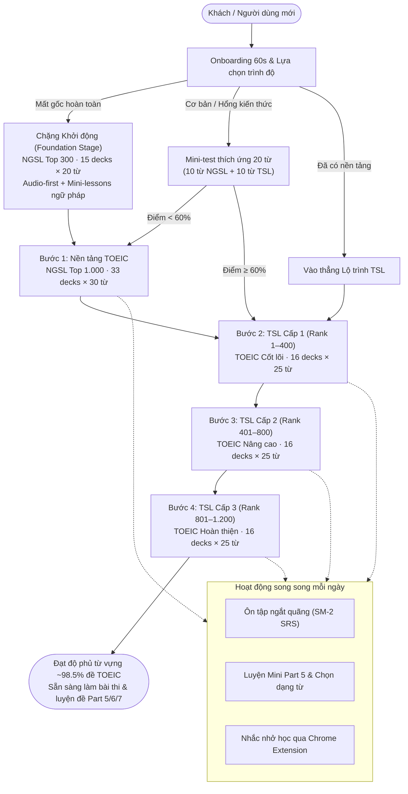
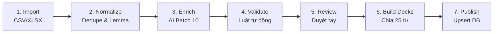
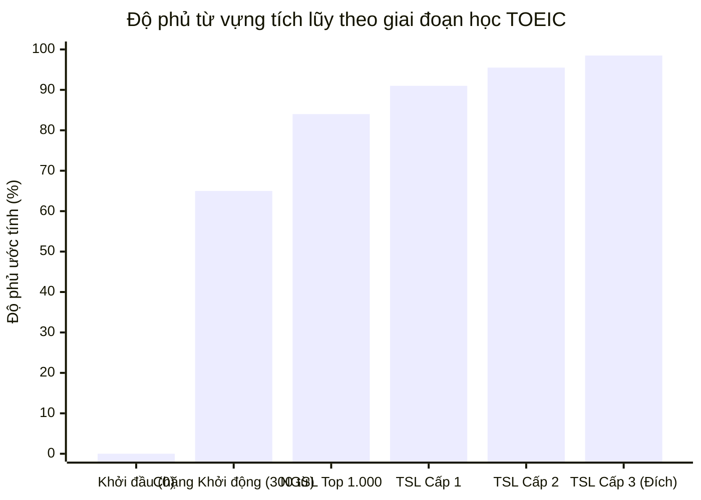

# 📚 WordStreak — Vocabulary Starter Library & Content Strategy Roadmap

> **Phiên bản:** 1.0.0  
> **Trạng thái:** Kế hoạch Kỹ thuật & Chiến lược Nội dung (Living Technical & Content Spec)  
> **Tài liệu nền tảng:** Bổ sung chi tiết cho [PRODUCT_BACKLOG_ROADMAP.md](file:///Users/vutuanhau/Documents/PROJECT/WordStreak/docs/PRODUCT_BACKLOG_ROADMAP.md) (EPIC 13) và kế thừa phân tích từ `WORDSTREAK_STARTER_LIBRARY_TSL.md`.  
> **Ký hiệu trạng thái:** `[ ]` Chưa làm · `[/]` Đang làm · `[x]` Hoàn thành · `[!]` Cần quyết định/kiểm tra · `[~]` Dự kiến dài hạn.

---

## 📑 Mục lục

1. [Tổng quan chiến lược](#1-tổng-quan-chiến-lược)
2. [Nguồn dữ liệu & Giấy phép bản quyền](#2-nguồn-dữ-liệu--giấy-phép-bản-quyền)
3. [Thiết kế Lộ trình học (Learning Paths)](#3-thiết-kế-lộ-trình-học-learning-paths)
4. [Thiết kế Thẻ từ vựng & Tiêu chuẩn chất lượng](#4-thiết-kế-thẻ-từ-vựng--tiêu-chuẩn-chất-lượng)
5. [Pipeline sản xuất nội dung (7 giai đoạn)](#5-pipeline-sản-xuất-nội-dung-7-giai-đoạn)
6. [Mô hình dữ liệu Prisma (Official Data Architecture)](#6-mô-hình-dữ-liệu-prisma-official-data-architecture)
7. [Thiết kế Trải nghiệm người dùng (UX Library & Onboarding)](#7-thiết-kế-trải-nghiệm-người-dùng-ux-library--onboarding)
8. [Chế độ cho người mất gốc (Beginner Mode & Foundation Stage)](#8-chế-độ-cho-người-mất-gốc-beginner-mode--foundation-stage)
9. [Hệ thống bài tập & Quiz kiểu TOEIC](#9-hệ-thống-bài-tập--quiz-kiểu-toeic)
10. [Công thức tính Độ phủ TOEIC ước tính](#10-công-thức-tính-độ-phủ-toeic-ước-tính)
11. [Kế hoạch phát hành nội dung theo Sprint](#11-kế-hoạch-phát-hành-nội-dung-theo-sprint)
12. [Hệ thống chỉ số đo lường hiệu quả (Product Metrics)](#12-hệ-thống-chỉ-số-đo-lường-hiệu-quả-product-metrics)
13. [Các quyết định kỹ thuật & nghiệp vụ cần chốt](#13-các-quyết-định-kỹ-thuật--nghiệp-vụ-cần-chốt)
14. [Tuân thủ bản quyền & Khước từ trách nhiệm (Attribution & Disclaimer)](#14-tuân-thủ-bản-quyền--khước-từ-trách-nhiệm-attribution--disclaimer)

---

## 1. Tổng quan chiến lược

### 1.1. Bối cảnh & Vấn đề thực tế (The "Cold Start" Dilemma)

Sau khi hoàn thiện Phase 1–3, WordStreak đã sở hữu một nền tảng kỹ thuật vững chắc: thuật toán Spaced Repetition (SM-2), 4 quiz formats, Gamification (Streak/XP), Web Speech Pronunciation, PWA Offline, và Chrome Extension. Tuy nhiên, người dùng mới đăng ký hiện đang đối mặt với một **"ứng dụng trống" (Empty State)**: họ phải tự nhập từ, tự gõ nghĩa, hoặc tìm cách import file Anki/CSV.

- **Rào cản gia nhập quá lớn:** Việc tự tạo flashcard tiêu tốn 3–5 phút cho mỗi từ. Người bận rộn hoặc mất gốc sẽ rời bỏ app ngay trong phiên đầu tiên.
- **Nội dung có sẵn là "cửa vào" (The Hook):** Người học tìm đến ứng dụng vì họ muốn học từ vựng phục vụ mục tiêu cụ thể (luyện thi TOEIC, IELTS, giao tiếp). Chỉ khi họ có ngay nội dung chất lượng để bắt đầu học trong 30 giây đầu tiên, các cơ chế giữ chân như SRS, Streak, và Extension mới phát huy tác dụng.

### 1.2. Chiến lược "Hẹp mà sâu" — Trọng tâm TOEIC

Thay vì dàn trải hàng chục ngàn từ không có ngữ cảnh, WordStreak áp dụng chiến lược nội dung: **Hẹp mà sâu (Narrow & Deep)**, tập trung đột phá vào thị trường **luyện thi TOEIC tại Việt Nam**:

1. **Lộ trình chuẩn hóa khoa học:** Kết hợp **NGSL 1.2** (New General Service List - 2.809 từ nền tảng) và **TSL 1.2** (TOEIC Service List - ~1.200 từ chuyên biệt cho TOEIC).
2. **Quy mô vừa vặn, mục tiêu rõ ràng:** ~1.200 từ TSL là mục tiêu khả thi, không gây choáng ngợp.
3. **Mở rộng theo bậc thang:** Sau khi chiếm lĩnh phân khúc TOEIC, nền tảng sẽ mở rộng sang **NAWL** (IELTS/Academic), **BSL** (Business English), và **NGSL-S** (Spoken English).

### 1.3. Lợi thế cạnh tranh vượt trội so với Quizlet, Memrise & Anki

Flashcard TSL/NGSL dạng danh sách từ thô đã xuất hiện trên Quizlet hoặc AnkiWeb, nhưng chất lượng rất sơ sài (chỉ có từ và nghĩa tiếng Anh dịch máy, thiếu ngữ cảnh). Điểm khác biệt sống còn của WordStreak nằm ở:

- **Ngữ cảnh công sở chuẩn đề thi:** Ví dụ thực tế lấy từ email, memo, notice, ad với tên doanh nghiệp giả định, văn phong chuẩn Part 5/6/7 TOEIC.
- **Phục vụ chuyên biệt cho người Việt:** Nghĩa tiếng Việt tự nhiên, mẹo phát âm âm cuối (`ending_sound_tip_vi` cho -s/-es, -ed, phụ âm bật), chỉ rõ trọng âm (`stress_syllable`), và cảnh báo từ dễ gây nhầm lẫn (`confusables`).
- **Quiz sát format đề thi:** Dạng bài Mini Part 5 với 4 lựa chọn lấy từ cùng `word_family`, câu hỏi phân biệt từ loại và paraphrase.
- **Độ phủ TOEIC ước tính:** Thanh tiến độ thời gian thực cho thấy người học đã làm chủ bao nhiêu % từ vựng thường gặp trong bài thi TOEIC.
- **Hệ sinh thái đồng bộ:** Nhắc học qua Extension badge, ôn nhanh popup, và chế độ offline PWA.

---

## 2. Nguồn dữ liệu & Giấy phép bản quyền

Nguồn dữ liệu duy nhất được sử dụng là dự án học thuật chính thức của **Dr. Charles Browne, Dr. Brent Culligan, và Joseph Phillips**:  
🌐 Cổng chính thức: **https://www.newgeneralservicelist.com** (Word Lists Portal: `https://www.newgeneralservicelist.com/word-lists`).

| Danh sách                                 |  Quy mô   |                   Độ phủ văn bản                    | Mục tiêu ứng dụng trong WordStreak               |    Mức ưu tiên     |
| :---------------------------------------- | :-------: | :-------------------------------------------------: | :----------------------------------------------- | :----------------: |
| **TSL 1.2** _(TOEIC Service List)_        | ~1.200 từ |  **~98.5%** đề TOEIC mới nhất _(khi kết hợp NGSL)_  | Lộ trình TOEIC chính thức (3 cấp độ)             | **P0 (Cao nhất)**  |
| **NGSL 1.2** _(New General Service List)_ | 2.809 từ  | **~92%** tiếng Anh tổng quát; **~94%** đề TOEIC mới | Nền tảng chung cho mọi lộ trình; Chặng Khởi động | **P0 (Cao nhất)**  |
| **NAWL** _(New Academic Word List)_       |  960 từ   |   **~92%** văn bản học thuật _(khi kết hợp NGSL)_   | Lộ trình Luyện thi IELTS / Du học                | **P1 (Sprint 11)** |
| **BSL** _(Business Service List)_         | 1.700 từ  |  **~97%** văn bản kinh doanh _(khi kết hợp NGSL)_   | Lộ trình Tiếng Anh Thương mại / Đi làm           | **P2 (Sprint 12)** |
| **NGSL-S** _(Spoken English List)_        |  721 từ   |          **~90%** hội thoại giao tiếp nói           | Lộ trình Giao tiếp & Luyện âm                    | **P2 (Sprint 12)** |
| **NGSL-GR**                               | ~5.000 từ |                  Mở rộng nâng cao                   | Deck nâng cao dành cho học viên trình độ C1/C2   |   `[~]` Dài hạn    |

### Chi tiết các tệp dữ liệu cần nạp cho TSL 1.2:

Từ trang `https://newgeneralservicelist.com/toeic-service-list`, tải 3 tệp chính thức:

1. `TSL 1.2 with basic statistics`: Chứa **thứ hạng tần suất (`freqRank`)** và giá trị tần suất (`freqValue`). Đây là tệp duy nhất có dữ liệu tần suất để phân chia Cấp độ (T1, T2, T3).
2. `TSL 1.2 list with definitions in easy English`: Chứa định nghĩa tiếng Anh cơ bản, dùng làm tham chiếu kiểm tra chéo cho `definition_en`.
3. `TSL 1.2 alphabetized and lemmatized for teaching`: Chứa dạng từ gốc (lemma), dùng để dedupe và map `word_family`.

### Chi tiết dữ liệu cho NGSL 1.2:

- Tải bản `NGSL 1.2 with basic statistics` và bản có định nghĩa tiếng Anh dễ hiểu.
- **Xử lý 52 từ bổ sung:** NGSL 1.2 có 52 từ chức năng cơ bản không có số rank (thứ trong tuần, tháng, số đếm). Những từ này được đóng gói riêng thành deck khởi động đặc biệt: `NGSL 0 · Từ vựng cơ bản sinh tồn (Basics)`.

> [!IMPORTANT]
> Số lượng từ thực tế có thể chênh lệch nhẹ giữa bản headword và bản lemmatized. Sau khi tải, script import tự động tính toán lại và ghi lại chính xác vào `WordList.entryCount` và `WordList.version = "1.2"`.

---

## 3. Thiết kế Lộ trình học (Learning Paths)

### 3.1. Lộ trình TOEIC (TSL Mastery Path)



### 3.2. Cấu trúc chia Deck TSL khoa học

Mỗi cấp độ TSL bao gồm 400 từ, được chia nhỏ thành 16 deck (mỗi deck chính xác 25 từ) để đảm bảo người học hoàn thành trong một phiên học ngắn 10–15 phút:

1. **Phân cấp theo tần suất xuất hiện:**
   - **TSL Cấp 1 (T1 — Rank 1–400):** 16 decks × 25 từ. Những từ tần suất cao nhất, xuất hiện ở hầu hết các đề thi TOEIC.
   - **TSL Cấp 2 (T2 — Rank 401–800):** 16 decks × 25 từ. Các từ trung cấp trong môi trường kinh doanh và thông báo công ty.
   - **TSL Cấp 3 (T3 — Rank 801–1.200):** 16 decks × 25 từ. Các từ nâng cao, mang tính quyết định để bứt phá band 750–900+ TOEIC.
2. **Gom nhóm theo 10 chủ đề công sở:**
   Trong mỗi cấp độ, các từ được phân loại vào 10 chủ đề ngữ cảnh TOEIC:
   - `Office & Operations`: Văn phòng, quy trình công việc, trang thiết bị
   - `Contracts, Legal & Policy`: Hợp đồng, quy định công ty, điều khoản pháp lý
   - `HR: Hiring, Training, Benefits`: Tuyển dụng, phỏng vấn, đào tạo, chế độ đãi ngộ
   - `Finance, Banking & Accounting`: Tài chính, thanh toán, hóa đơn, báo cáo ngân sách
   - `Marketing, Sales & Customer Service`: Tiếp thị, bán hàng, chăm sóc khách hàng
   - `Manufacturing, Inventory & Shipping`: Sản xuất, nhà máy, kho bãi, giao nhận
   - `Travel, Hotels & Dining`: Đi công tác, khách sạn, ẩm thực đối tác
   - `Meetings, Events & Announcements`: Cuộc họp, hội nghị, thông cáo nội bộ
   - `Technology & Equipment`: Công nghệ thông tin, phần mềm, bảo trì kỹ thuật
   - `General / Mixed`: Thuật ngữ đa năng thường gặp khác
3. **Quy tắc đặt tên Deck chuẩn hóa:**
   `TSL {Cấp}{Mã} · {Tên chủ đề tiếng Việt} ({Số từ} từ)`  
   _Ví dụ:_ `TSL 1A · Văn phòng & Vận hành (25 từ)`, `TSL 1B · Hợp đồng & Pháp lý (25 từ)`.

---

## 4. Thiết kế Thẻ từ vựng & Tiêu chuẩn chất lượng

### 4.1. JSON Schema chính thức cho OfficialCard Content

Mỗi thẻ từ vựng OfficialCard lưu trữ trường `content` dưới định dạng JSON với cấu trúc nghiêm ngặt:

```json
{
  "word": "string (headword chuẩn viết thường)",
  "pos": "noun | verb | adjective | adverb",
  "ipa_us": "string (định dạng /.../ chuẩn Mỹ)",
  "meaning_vi": "string (nghĩa tiếng Việt ngắn gọn, ngữ cảnh công sở, tối đa 8 từ)",
  "definition_en": "string (định nghĩa tiếng Anh đơn giản, 8-15 từ)",
  "example_en": "string (ví dụ ngữ cảnh TOEIC 8–22 từ, chứa từ mục tiêu hoặc biến cách)",
  "example_vi": "string (dịch nghĩa tiếng Việt tự nhiên)",
  "context_type": "email | notice | ad | memo | conversation | announcement",
  "collocations": ["string (2-3 cụm từ thông dụng đi kèm)"],
  "word_family": [
    "string (các biến thể họ từ: danh từ, động từ, tính từ, trạng từ)"
  ],
  "confusables": [
    {
      "word": "string (từ hay nhầm lẫn)",
      "note_vi": "string (phân biệt ngắn gọn trong 1 câu)"
    }
  ],
  "topic": "string (1 trong 10 chủ đề TOEIC)",
  "level": "T1 | T2 | T3",
  "freqRank": "number (thứ hạng tần suất trong danh sách)",
  "tip_vi": "string | null (mẹo ghi nhớ hoặc lỗi dịch thuật người Việt hay mắc)",
  "example_easy_en": "string | null (ví dụ đơn giản 5-8 từ cho Beginner Mode, chỉ dùng từ NGSL Top 500)",
  "example_easy_vi": "string | null (dịch nghĩa ví dụ đơn giản)",
  "stress_syllable": "number | null (vị trí âm tiết mang trọng âm chính, tính từ 1)",
  "ending_sound_tip_vi": "string | null (hướng dẫn phát âm âm cuối quan trọng: -s/-es, -ed, phụ âm cuối)"
}
```

### 4.2. Thẻ TSL mẫu hoàn chỉnh

```json
{
  "word": "reimburse",
  "pos": "verb",
  "ipa_us": "/ˌriːɪmˈbɜːrs/",
  "meaning_vi": "hoàn trả, thanh toán lại (chi phí)",
  "definition_en": "to pay back money that someone has spent for official purposes",
  "example_en": "The accounting department will reimburse all approved travel expenses within two business weeks.",
  "example_vi": "Phòng kế toán sẽ thanh toán lại toàn bộ chi phí đi lại đã được duyệt trong vòng hai tuần làm việc.",
  "context_type": "memo",
  "collocations": [
    "reimburse travel expenses",
    "reimburse fully",
    "seek reimbursement"
  ],
  "word_family": ["reimbursement", "reimbursable"],
  "confusables": [
    {
      "word": "refund",
      "note_vi": "Refund là hoàn tiền lại cho khách hàng mua hàng; Reimburse là công ty trả lại tiền cho nhân viên đã ứng trước."
    }
  ],
  "topic": "Finance, Banking & Accounting",
  "level": "T1",
  "freqRank": 142,
  "tip_vi": "Thường xuyên xuất hiện trong phần nghe Part 3/4 và đọc Part 7 về chính sách công tác.",
  "example_easy_en": "We will reimburse your money today.",
  "example_easy_vi": "Chúng tôi sẽ hoàn lại tiền cho bạn hôm nay.",
  "stress_syllable": 3,
  "ending_sound_tip_vi": "Kết thúc bằng âm vô thanh /s/, cần bật gió rõ âm cuối để không bị nhầm với âm /z/."
}
```

### 4.3. Bộ quy tắc thẩm định chất lượng thẻ (Quality Assurance Rules)

1. **Một nghĩa trọng tâm duy nhất:** Thẻ từ vựng chỉ tập trung vào một nghĩa kinh doanh/công sở phổ biến nhất trong bài thi TOEIC. Không nhồi nhét 5–6 nghĩa phụ gây quá tải nhận thức.
2. **Kiểm soát độ phủ từ vựng trong ví dụ (Vocabulary Control):**
   - Với `example_en` (chuẩn TOEIC): Tối thiểu **95% số từ** trong câu ví dụ (ngoại trừ tên riêng và số) phải nằm trong danh mục NGSL + TSL. Tuyệt đối không dùng câu văn có quá nhiều từ khó xa lạ làm lu mờ từ khóa chính.
   - Với `example_easy_en` (Beginner Mode): Độ dài nghiêm ngặt 5–8 từ, **100% số từ bổ trợ** phải thuộc danh mục NGSL Top 500 từ cơ bản.
3. **Bản quyền ví dụ 100% nguyên bản:** Tất cả tên người và tên công ty trong câu ví dụ phải là hư cấu (`Nexus Corp`, `Greenline Logistics`, `Ms. Vance`), không trích xuất nguyên văn từ bất kỳ đề thi ETS hoặc giáo trình có bản quyền.

---

## 5. Pipeline sản xuất nội dung (7 giai đoạn)



### 5.1. Cấu trúc mã nguồn Scripts

Toàn bộ mã nguồn quản lý việc nạp và xử trị dữ liệu được đặt tại thư mục `scripts/seed/`:

```
scripts/seed/
  ├── data/
  │   ├── raw/                  # Tệp gốc tải từ newgeneralservicelist.com (Read-only)
  │   │   ├── TSL_1.2_stats.xlsx
  │   │   ├── TSL_1.2_definitions.xlsx
  │   │   ├── NGSL_1.2_stats.xlsx
  │   │   └── NGSL_1.2_definitions.xlsx
  │   ├── stages/               # Tệp checkpoint lưu trữ trạng thái trung gian (JSON)
  │   │   ├── 01_imported_tsl.json
  │   │   ├── 02_normalized_tsl.json
  │   │   ├── 03_enriched_tsl.json
  │   │   ├── 04_validated_tsl.json
  │   │   ├── 05_reviewed_tsl.json
  │   │   └── 06_decks_tsl.json
  │   └── reports/              # Báo cáo validation & danh sách thẻ bị gắn cờ
  │       └── validation_errors_tsl.log
  ├── prompts/
  │   ├── enrich.v1.md          # System prompt AI làm giàu thẻ chuẩn
  │   └── quiz_gen.v1.md        # Prompt tạo câu hỏi Mini Part 5
  ├── 01-import.ts              # Đọc XLSX/CSV, trích xuất headwords & statistics
  ├── 02-normalize.ts           # Chuẩn hóa Lemma, lọc trùng NGSL ↔ TSL, gán level T1-T3
  ├── 03-enrich.ts              # Gọi Gemini LLM theo batch 10 từ, lưu checkpoint lũy tiến
  ├── 04-validate.ts            # Kiểm tra tự động 100% luật schema & độ phủ từ vựng
  ├── 05-review-export.ts       # Xuất CSV đánh giá thủ công & nạp lại sau khi duyệt
  ├── 06-build-decks.ts         # Phân bổ chủ đề, đóng gói 25 từ/deck, sinh slug & title
  └── 07-publish.ts             # Upsert dữ liệu nguyên tử vào database production
```

### 5.2. Đặc tả 7 giai đoạn triển khai

1. **Giai đoạn 1 — Import:** Đọc các file Excel tải về từ New General Service List. Kiểm tra tính toàn vẹn dữ liệu, ghi nhận `version = "1.2"`, `entryCount`, ánh xạ `freqRank` và `freqValue`.
2. **Giai đoạn 2 — Normalize:** Chuẩn hóa viết thường, loại bỏ khoảng trắng, dedupe chéo giữa NGSL và TSL. Gán nhãn cấp độ theo thứ hạng: Cấp T1 (rank 1–400), Cấp T2 (rank 401–800), Cấp T3 (rank 801–1.200).
3. **Giai đoạn 3 — Enrich (AI Batch Processing):**
   - Gọi mô hình AI theo từng lô (Batch) **10 từ/lần**, nhiệt độ cố định `temperature = 0.2` để đảm bảo tính nhất quán cấu trúc.
   - Lưu trữ checkpoint sau mỗi lô xử lý để có thể resume tức thì nếu gián đoạn mạng.
   - Ghi nhận `promptVersion` và `modelName` vào dữ liệu thẻ phục vụ truy vết.
4. **Giai đoạn 4 — Validate (Luật tự động):**
   - Đảm bảo 100% trường bắt buộc không rỗng.
   - Regex kiểm tra định dạng IPA `/.../`.
   - Kiểm tra `example_en` bắt buộc chứa từ mục tiêu hoặc biến cách lemma của từ đó.
   - Kiểm tra thuật toán độ phủ: `example_en` phải có $\ge 95\%$ từ thuộc NGSL + TSL; `example_easy_en` phải có $100\%$ từ thuộc NGSL Top 500.
   - Loại bỏ trùng lặp câu ví dụ trên toàn bộ hệ thống.
5. **Giai đoạn 5 — Review (Duyệt chuyên gia):**
   - **Duyệt tay 100%:** Bắt buộc với Top 200 từ TSL và Top 300 từ NGSL (Chặng Khởi động) — vì đây là trải nghiệm đầu tiên quyết định giữ chân người dùng.
   - **Duyệt mẫu 15–20%:** Đối với các từ còn lại, kết hợp duyệt toàn bộ các thẻ bị validator cảnh báo lỗi tiềm ẩn.
6. **Giai đoạn 6 — Build Decks:**
   - Phân loại từ theo 10 chủ đề, chia nhỏ thành các deck 25 từ. Đặt mã slug chuẩn SEO (ví dụ: `tsl-1a-office-operations`).
7. **Giai đoạn 7 — Publish:**
   - Thực thi upsert nguyên tử (Prisma transaction) vào DB: tạo `WordList`, `WordListEntry`, `OfficialCard`, `OfficialDeck`, và bảng liên kết `OfficialDeckCard`.

---

## 6. Mô hình dữ liệu Prisma (Official Data Architecture)

### 6.1. Vấn đề của cơ chế Deep Copy truyền thống

Trong phiên bản MVP ban đầu, khi clone một deck từ Community, hệ thống thực hiện sao chép sâu (Deep Copy) toàn bộ các bản ghi `Card` sang tài khoản của user đó. Với một thư viện chính thức có ~4.000 từ (NGSL + TSL) và 10.000 người dùng, cách làm này sẽ tạo ra 40 triệu bản ghi thẻ, làm cạn kiệt bộ nhớ và dung lượng lưu trữ trên PostgreSQL (Neon Free Tier).

### 6.2. Giải pháp: Thẻ dùng chung & Tiến độ Lazy-loaded

Hệ thống chuyển sang kiến trúc **Shared Official Cards & Lazy Progress Tracking**:

- Dữ liệu thẻ và deck Official là duy nhất trong toàn hệ thống.
- Khi người dùng bấm "Thêm vào thư viện" (Enroll deck), hệ thống chỉ ghi nhận 1 bản ghi `UserDeckEnrollment`.
- Bản ghi tiến độ cá nhân `UserOfficialCardProgress` **chỉ được tạo khi thẻ đó thực sự được đưa vào phiên học hoặc phiên review đầu tiên** (Lazy Creation).

```prisma
// ==========================================
// 1. DANH MỤC DANH SÁCH TỪ CHUẨN (WORD LISTS)
// ==========================================
model WordList {
  id          String          @id @default(cuid())
  code        String          @unique // "TSL", "NGSL", "NAWL", "BSL"
  name        String                  // "TOEIC Service List"
  version     String                  // "1.2"
  license     String                  // "CC BY-SA 4.0"
  sourceUrl   String
  attribution String
  entryCount  Int
  createdAt   DateTime        @default(now())
  updatedAt   DateTime        @updatedAt
  entries     WordListEntry[]

  @@map("word_lists")
}

model WordListEntry {
  id        String    @id @default(cuid())
  listId    String    @map("list_id")
  headword  String
  freqRank  Int?      @map("freq_rank")
  freqValue Float?    @map("freq_value")
  level     String?   // "T1", "T2", "T3"
  topic     String?
  cardId    String?   @map("card_id")

  wordList  WordList  @relation(fields: [listId], references: [id], onDelete: Cascade)
  card      OfficialCard? @relation(fields: [cardId], references: [id], onDelete: SetNull)

  @@unique([listId, headword])
  @@index([headword])
  @@map("word_list_entries")
}

// ==========================================
// 2. THẺ VÀ DECK CHÍNH THỨC DÙNG CHUNG
// ==========================================
model OfficialCard {
  id             String   @id @default(cuid())
  headword       String
  pos            String
  content        Json     // Tuân thủ JSON Schema tại mục 4.1
  status         String   @default("DRAFT") // "DRAFT" | "REVIEWED" | "PUBLISHED"
  contentVersion Int      @default(1) @map("content_version")
  promptVersion  String?  @map("prompt_version")
  createdAt      DateTime @default(now())
  updatedAt      DateTime @updatedAt

  deckCards      OfficialDeckCard[]
  listEntries    WordListEntry[]
  userProgress   UserOfficialCardProgress[]
  feedbackReports OfficialCardFeedback[]

  @@index([headword])
  @@index([status])
  @@map("official_cards")
}

model OfficialDeck {
  id          String   @id @default(cuid())
  slug        String   @unique // "tsl-1a-office-operations"
  title       String
  titleVi     String   @map("title_vi")
  description String?
  pathCode    String   @map("path_code") // "TOEIC" | "CORE" | "FOUNDATION" | "ACADEMIC"
  level       String?  // "T1", "T2", "T3"
  order       Int      @default(0)
  listCode    String   @map("list_code") // "TSL", "NGSL"
  cardCount   Int      @default(25) @map("card_count")
  createdAt   DateTime @default(now())
  updatedAt   DateTime @updatedAt

  cards       OfficialDeckCard[]
  enrollments UserDeckEnrollment[]

  @@index([pathCode, order])
  @@map("official_decks")
}

model OfficialDeckCard {
  deckId String @map("deck_id")
  cardId String @map("card_id")
  order  Int    @default(0)

  deck   OfficialDeck @relation(fields: [deckId], references: [id], onDelete: Cascade)
  card   OfficialCard @relation(fields: [cardId], references: [id], onDelete: Cascade)

  @@id([deckId, cardId])
  @@map("official_deck_cards")
}

// ==========================================
// 3. TIẾN ĐỘ NGƯỜI DÙNG & TIẾP NHẬN
// ==========================================
model UserDeckEnrollment {
  id        String   @id @default(cuid())
  userId    String   @map("user_id")
  deckId    String   @map("deck_id")
  startedAt DateTime @default(now()) @map("started_at")
  lastStudiedAt DateTime? @map("last_studied_at")

  deck      OfficialDeck @relation(fields: [deckId], references: [id], onDelete: Cascade)

  @@unique([userId, deckId])
  @@index([userId])
  @@map("user_deck_enrollments")
}

model UserOfficialCardProgress {
  id             String    @id @default(cuid())
  userId         String    @map("user_id")
  cardId         String    @map("card_id")

  // Trạng thái Spaced Repetition (SM-2)
  repetitions    Int       @default(0)
  interval       Int       @default(0)     // Số ngày đến lần ôn tiếp theo
  easeFactor     Float     @default(2.5)   @map("ease_factor")
  nextReviewDate DateTime? @map("next_review_date")
  lastReviewedAt DateTime? @map("last_reviewed_at")
  status         String    @default("NEW") // "NEW" | "LEARNING" | "MASTERED" | "KNOWN_SKIPPED"

  personalNote   String?   @map("personal_note")
  createdAt      DateTime  @default(now()) @map("created_at")
  updatedAt      DateTime  @updatedAt @map("updated_at")

  card           OfficialCard @relation(fields: [cardId], references: [id], onDelete: Cascade)

  @@unique([userId, cardId])
  @@index([userId, nextReviewDate])
  @@index([userId, status])
  @@map("user_official_card_progress")
}

model OfficialCardFeedback {
  id         String   @id @default(cuid())
  userId     String   @map("user_id")
  cardId     String   @map("card_id")
  reason     String   // "WRONG_MEANING" | "TYPO" | "AUDIO_ERROR" | "EXAMPLE_UNNATURAL" | "OTHER"
  comment    String?
  status     String   @default("OPEN") // "OPEN" | "RESOLVED" | "REJECTED"
  createdAt  DateTime @default(now()) @map("created_at")

  card       OfficialCard @relation(fields: [cardId], references: [id], onDelete: Cascade)

  @@index([status])
  @@map("official_card_feedback")
}
```

### 6.3. Xử lý hàng đợi Ôn tập Hợp nhất (Unified Review Queue)

Để đảm bảo tính liền mạch, API `GET /api/v1/reviews/due` thực hiện truy vấn hợp nhất qua toán tử SQL `UNION ALL` giữa hai nguồn:

1. Thẻ do người dùng tự tạo (`UserCardProgress` liên kết `Card`).
2. Thẻ thuộc Thư viện chính thức (`UserOfficialCardProgress` liên kết `OfficialCard`).
   Toàn bộ logic tính streak, thời gian hoàn thành mục tiêu ngày, và XP được chia sẻ thống nhất. Khi người dùng muốn chỉnh sửa cá nhân hóa sâu một thẻ Official, hệ thống cung cấp tính năng **"Sao chép thành thẻ của tôi" (Clone to Custom Card)** — lúc này mới khởi tạo một bản ghi `Card` độc lập.

---

## 7. Thiết kế Trải nghiệm người dùng (UX Library & Onboarding)

### 7.1. Giao diện Khám phá Thư viện (Library Discovery)

- **Tổ chức theo Lộ trình (Path Navigation):** Tab bar phân cấp rõ ràng: `TOEIC (TSL)` · `Nền tảng (NGSL)` · `IELTS (NAWL)` · `Giao tiếp (NGSL-S)`.
- **Thẻ thông tin Deck trực quan:** Mỗi thẻ deck hiển thị:
  - Tên deck và mã định danh (`TSL 1A · Văn phòng & Vận hành`).
  - Số lượng từ (`25 từ`), thời gian hoàn thành ước tính (`~12 phút`).
  - Thanh tiến độ cá nhân (`Đã thuộc 18/25 từ · 72%`).
  - Huy hiệu nguồn uy tín: `NGSL Project Official · CC BY-SA 4.0`.
  - Nút hành động một chạm: `Học ngay` hoặc `Thêm vào thư viện`.

### 7.2. Luồng Onboarding 60 giây cá nhân hóa

1. **Bước 1 — Chọn Mục tiêu:** `Luyện thi TOEIC` | `Luyện thi IELTS` | `Giao tiếp hàng ngày` | `Đi làm công sở`.
2. **Bước 2 — Xác định xuất phát điểm:**
   - _Lựa chọn 1: Mất gốc hoàn toàn_ $\rightarrow$ Tự động đưa vào Chặng Khởi động (Foundation Stage), bỏ qua kiểm tra đầu vào để không gây áp lực.
   - _Lựa chọn 2: Đã biết cơ bản_ $\rightarrow$ Kích hoạt Mini-test thích ứng 20 từ (10 từ NGSL + 10 từ TSL). Hệ thống tự động dừng bài test nếu sai 3 câu liên tiếp.
   - _Lựa chọn 3: Đã có nền tảng vững_ $\rightarrow$ Mở khóa vào thẳng TSL Cấp 1.
3. **Bước 3 — Thiết lập Mục tiêu ngày:** Đề xuất mặc định `5 từ/ngày` cho người mới bắt đầu hoặc `10 từ / 20 từ/ngày` cho người ôn thi cấp tốc.
4. **Bước 4 — Bắt đầu ngay không cần đăng ký (Guest Mode):** Cho phép học thử ngay 5 thẻ đầu tiên trên local state trước khi yêu cầu tạo tài khoản để đồng bộ tiến độ.

### 7.3. Luồng Sàng lọc từ đã biết (Known-Word Triage Flow)

Một trong những nguyên nhân khiến người học chán nản khi dùng app từ vựng là phải học lại những từ quá quen thuộc. Trước khi bắt đầu một deck 25 từ, WordStreak cung cấp chế độ **Sàng lọc nhanh (Triage Mode)**:

- Người dùng lướt nhanh danh sách 25 từ trong 60 giây qua 2 nút: `Đã biết` hoặc `Cần học`.
- **Cơ chế xác thực cho người mới:** Với tài khoản chọn trình độ Người mất gốc / Cơ bản, khi bấm `Đã biết`, hệ thống sẽ hiển thị một câu hỏi popover kiểm tra nhanh 3 giây (chọn nghĩa tiếng Việt đúng). Nếu trả lời sai, từ đó vẫn được giữ lại trong danh sách cần học để tránh ngộ nhận "quen mặt chữ là đã biết".
- Những từ được xác nhận `Đã biết` sẽ được gán trạng thái `status = KNOWN_SKIPPED` và tính vào điểm độ phủ từ vựng, nhưng **không xuất hiện trong hàng đợi ôn tập SM-2 hàng ngày**.

---

## 8. Chế độ cho người mất gốc (Beginner Mode & Foundation Stage)

### 8.1. Triết lý Thiết kế dành cho Người mất gốc

Người mất gốc tiếng Anh tại Việt Nam đối mặt với 4 rào cản nhận thức lớn:

1. **Ví dụ quá nhiều từ lạ:** Đọc một câu ví dụ tiếng Anh có 10 từ thì gặp tới 7 từ mới khác, dẫn đến quá tải nhận thức.
2. **Không phân biệt được từ loại:** Không hiểu vì sao một từ vừa là danh từ vừa là động từ, không nắm được trật tự từ cơ bản.
3. **Điếc phát âm & nuốt âm cuối:** Không nghe được từ trong câu do thói quen đọc tiếng Anh không bật âm cuối (-s, -ed, /t/, /k/).
4. **Lịch ôn quá thưa:** Thuật toán SM-2 chuẩn hẹn ngày đầu tiên sau 24h là quá dài đối với người mất gốc; họ quên từ chỉ sau 10–15 phút.

### 8.2. Chặng Khởi động (Foundation Stage — 15 Decks)

WordStreak trích xuất **300 từ cốt lõi đầu tiên của NGSL 1.2** để đóng gói lại thành 15 deck đặc biệt (mỗi deck 20 từ):

- **Ưu tiên từ sinh tồn (Survival Words):** Các đại từ nhân xưng, số đếm, ngày tháng, động từ chỉ hành động cơ bản (`be`, `have`, `do`, `go`, `make`), và từ để hỏi (`who`, `where`, `what`).
- **Bài học ngắn xen kẽ (Bite-sized Mini-lessons):** Cứ sau 3 deck, hệ thống chèn một bài học ngắn $\le 2$ phút (1 màn hình duy nhất, giải thích bằng tiếng Việt trực quan):
  - _Mini-lesson 1:_ Phân biệt Danh từ (N), Động từ (V), Tính từ (Adj), Trạng từ (Adv).
  - _Mini-lesson 2:_ Cấu trúc câu cơ bản tiếng Anh: Ai? Làm gì? Ở đâu? (S + V + O).
  - _Mini-lesson 3:_ Dạng động từ: Hiện tại, Quá khứ (-ed) và Đang xảy ra (-ing).
  - _Mini-lesson 4:_ Số ít và số nhiều (Quy tắc thêm -s/-es và cách phát âm).

### 8.3. Thẻ từ vựng ở chế độ Beginner Mode

- **Hiển thị tối giản:** Mặc định ẩn `definition_en` phức tạp; nghĩa tiếng Việt là trung tâm tiếp nhận thông tin.
- **Ví dụ kiểm soát nghiêm ngặt:** Chỉ hiển thị `example_easy_en` (5–8 từ, 100% từ bổ trợ nằm trong NGSL Top 500).
- **Âm thanh đi đầu (Audio-first):** Khi mở thẻ, âm thanh đọc mẫu tự động phát trước khi hiển thị chữ để luyện phản xạ nghe.
- **Trọng âm & Âm cuối:** Hiển thị vị trí gạch chân âm tiết nhấn mạnh (`stress_syllable`) và hộp ghi chú `ending_sound_tip_vi` hướng dẫn người Việt cách uốn lưỡi, bật hơi các âm cuối khó.

### 8.4. Cơ chế Bước học trong phiên (Intra-session Learning Steps)

Đối với người dùng ở Beginner Mode, thuật toán SM-2 được bổ sung **Learning Steps**:

- Một thẻ mới học không lập tức được hẹn ngày hôm sau.
- Trong cùng một phiên học, thẻ đó bắt buộc phải được lặp lại sau **1 phút** và **5 phút**. Chỉ khi người học trả lời đúng ở bước 5 phút, thẻ mới chính thức chuyển trạng thái sang chu kỳ ngày tiếp theo của SM-2 ($I = 1\text{ ngày}$).

---

## 9. Hệ thống bài tập & Quiz kiểu TOEIC

Nhằm biến kiến thức từ vựng thành phản xạ làm bài thi thực tế, WordStreak xây dựng 4 dạng bài tập chuyên biệt dựa trên dữ liệu phong phú của thẻ TSL:

### 9.1. Dạng 1: Mini Part 5 (Điền từ vào câu)

Hệ thống AI tự động sinh các câu văn phong công sở với 4 đáp án trắc nghiệm. Các đáp án nhiễu (distractors) được trích xuất trực tiếp từ trường `confusables` hoặc các từ cùng cấp độ trong cùng chủ đề.

- _Ví dụ:_
  > All staff members must submit their travel receipts to receive ______ for their trip.  
  > (A) reimbursement  
  > (B) refund  
  > (C) reward  
  > (D) replacement  
  > **Đáp án:** (A). _Giải thích:_ Trong ngữ cảnh công tác, thanh toán lại tiền chi phí công vụ sử dụng "reimbursement".

### 9.2. Dạng 2: Chọn dạng từ đúng (Word Family Identification)

Dạng câu hỏi kinh điển chiếm tỷ trọng lớn trong Part 5 bài thi TOEIC. Dựa trên trường `word_family`, hệ thống tạo chỗ trống yêu cầu người học phân tích ngữ pháp để chọn đúng Danh từ, Động từ, Tính từ, hay Trạng từ.

- _Ví dụ:_
  > Ms. Watson gave a very ______ presentation at the regional sales conference.  
  > (A) persuade  
  > (B) persuasion  
  > (C) persuasive  
  > (D) persuasively  
  > **Đáp án:** (C). _Giải thích:_ Chỗ trống đứng trước danh từ "presentation" và sau trạng từ "very" nên cần một tính từ bổ nghĩa.

### 9.3. Dạng 3: Nhận biết Paraphrase (Từ đồng nghĩa trong ngữ cảnh)

Rèn luyện kỹ năng đọc hiểu phục vụ Part 7 TOEIC:

- Hiển thị một câu hoàn chỉnh có gạch chân một từ vựng TSL.
- Người học chọn 1 trong 4 từ có khả năng thay thế gần nghĩa nhất mà không làm đổi nghĩa của câu.

### 9.4. Dạng 4: Nghe hiểu và gõ từ (Audio Dictation)

Tận dụng công nghệ Speech Synthesis chuẩn hóa để phát một câu hoàn chỉnh, trong đó từ khóa TSL bị khuyết trên màn hình. Người học phải nghe chuẩn phát âm và gõ lại đúng chính tả của từ.

> [!TIP]
> **Tự động quy đổi kết quả Quiz sang Đánh giá SM-2:** Kết quả làm bài quiz (đúng/sai cùng với thời gian phản hồi) được tự động quy đổi thành điểm đánh giá SM-2 (1: Again, 2: Hard, 3: Good, 4: Easy), cập nhật trực tiếp vào tiến độ ôn tập của người dùng mà không cần thực hiện thêm bước chấm thủ công.

---

## 10. Công thức tính Độ phủ TOEIC ước tính

Để tạo động lực học tập bền vững mà vẫn đảm bảo tính trung thực khoa học (tránh cam kết sai lệch về điểm thi thực tế), WordStreak cung cấp chỉ số: **Độ phủ từ vựng TOEIC ước tính (Estimated TOEIC Vocabulary Coverage)**.

### 10.1. Cơ sở khoa học

Theo công bố nghiên cứu của Browne, Culligan và Phillips:

- Danh mục **NGSL 1.2** (2.809 từ) chiếm tỷ trọng bao phủ khoảng **94%** tổng số từ xuất hiện trong corpus các đề thi TOEIC mới.
- Danh mục **TSL 1.2** (~1.200 từ) bổ sung thêm khoảng **4.5%** độ phủ từ vựng chuyên biệt.
- Khi làm chủ hoàn toàn cả hai danh mục, người học đạt độ phủ lý thuyết lên tới **~98.5%**.

### 10.2. Thuật toán tính toán

Điểm độ phủ được tính toán theo giá trị tần suất (`freqValue`) của từng từ mà người dùng đã làm chủ:

$$\text{Coverage}_{\text{NGSL}} = 94\% \times \left( \frac{\sum_{w \in \text{Mastered}_{\text{NGSL}}} \text{freqValue}(w)}{\sum_{w \in \text{All}_{\text{NGSL}}} \text{freqValue}(w)} \right)$$

$$\text{Coverage}_{\text{TSL}} = 4.5\% \times \left( \frac{\sum_{w \in \text{Mastered}_{\text{TSL}}} \text{freqValue}(w)}{\sum_{w \in \text{All}_{\text{TSL}}} \text{freqValue}(w)} \right)$$

$$\text{Độ phủ TOEIC Tổng hợp} = \text{Coverage}_{\text{NGSL}} + \text{Coverage}_{\text{TSL}} \quad (\text{Tối đa } 98.5\%)$$

_Quy ước về trạng thái "Đã làm chủ" (Mastered):_

- Thẻ từ vựng được tính là "Đã thuộc" khi số lần lặp lại `repetitions \ge 2` hoặc khoảng cách ôn tập `interval \ge 7\text{ ngày}`.
- Các từ được người học xác nhận qua bước Sàng lọc từ đã biết (`status = KNOWN_SKIPPED`) cũng được tính vào tổng điểm tích lũy.



> [!NOTE]
> Giao diện luôn hiển thị kèm thông điệp minh bạch: _"Độ phủ từ vựng được ước tính dựa trên nghiên cứu corpus của NGSL Project. Để đạt điểm cao trong bài thi TOEIC thực tế, bạn cần kết hợp thêm kỹ năng nghe hiểu, ngữ pháp và phương pháp làm bài."_

---

## 11. Kế hoạch phát hành nội dung theo Sprint

| Giai đoạn / Sprint                                               | Mục tiêu nội dung                                          | Phạm vi dữ liệu & Tác vụ kỹ thuật                                                                                                                                                                                      | Tiêu chí hoàn thành (Exit Criteria)                                                                                                       |
| :--------------------------------------------------------------- | :--------------------------------------------------------- | :--------------------------------------------------------------------------------------------------------------------------------------------------------------------------------------------------------------------- | :---------------------------------------------------------------------------------------------------------------------------------------- |
| **Giai đoạn 0 (Sprint 8)**<br/>_Chuẩn bị hạ tầng_                | Hạ tầng dữ liệu & Chuẩn hóa schema                         | - Tải và xác thực 3 file TSL 1.2 & 2 file NGSL 1.2.<br/>- Viết Prisma migration tạo 7 bảng Official (mục 6).<br/>- Xây dựng skeleton cho `scripts/seed/`.                                                              | - Schema Prisma được migrate trên DB staging.<br/>- Dữ liệu thô được kiểm đếm không lệch dòng.                                            |
| **Giai đoạn 1 (Sprint 9)**<br/>_Soft Launch Thư viện_            | **TSL Top 200** + **NGSL Top 300**<br/>_(Chặng Khởi động)_ | - Chạy pipeline nạp TSL Top 200 & NGSL Top 300.<br/>- Duyệt tay 100% chất lượng nghĩa và câu ví dụ.<br/>- Triển khai Onboarding 60s & Lối vào Người mất gốc.<br/>- Ra mắt trang Thư viện (`/library`) & Chi tiết Deck. | - 8–10 người dùng thử hoàn thành phiên học đầu.<br/>- 0 lỗi vi phạm schema JSON.<br/>- Khách truy cập học thử được 5 thẻ không cần login. |
| **Giai đoạn 2 (Sprint 10)**<br/>_Mở rộng toàn bộ TSL_            | **Toàn bộ 1.200 từ TSL**<br/>+ NGSL lên 1.000 từ           | - Hoàn tất 48 deck TSL (Cấp 1, 2, 3) & 33 deck NGSL.<br/>- Kích hoạt Luồng Sàng lọc từ đã biết (Triage Mode).<br/>- Ra mắt Quiz Mini Part 5 & Chọn dạng từ.<br/>- Hiển thị thanh Độ phủ TOEIC ước tính thời gian thực. | - 100% 1.200 từ TSL được publish.<br/>- Thanh độ phủ tính toán chính xác theo công thức.<br/>- Tỷ lệ hoàn thành deck đạt $\ge 60\%$.      |
| **Giai đoạn 3 (Sprint 11)**<br/>_Mở rộng Lộ trình Học thuật_     | **960 từ NAWL**<br/>_(Lộ trình IELTS)_                     | - Xây dựng Lộ trình Academic cho thí sinh luyện thi IELTS.<br/>- Bổ sung deck từ vựng theo chủ đề IELTS Writing/Speaking.                                                                                              | - 960 từ NAWL được enrich và đóng gói thành 32 decks.                                                                                     |
| **Giai đoạn 4 (Sprint 12)**<br/>_Mở rộng Đa lộ trình & Vận hành_ | **1.700 từ BSL** + **721 từ NGSL-S**                       | - Ra mắt Lộ trình Tiếng Anh Đi làm (BSL) và Giao tiếp (NGSL-S).<br/>- Vận hành quy trình phản hồi và sửa lỗi thẻ qua `contentVersion`.                                                                                 | - Thư viện đạt quy mô $> 6.000$ từ vựng chuẩn hóa.<br/>- Hàng đợi báo lỗi được xử lý hàng tuần.                                           |

---

## 12. Hệ thống chỉ số đo lường hiệu quả (Product Metrics)

| Chỉ số (KPI)                                      |               Mục tiêu kỳ vọng               | Câu hỏi đo lường / Ý nghĩa sản phẩm                                                             |
| :------------------------------------------------ | :------------------------------------------: | :---------------------------------------------------------------------------------------------- |
| **% User thêm deck trong phiên đầu (Activation)** |                  $\ge 65\%$                  | Thư viện có đủ hấp dẫn để giải quyết vấn đề "ứng dụng trống" ngay khi người dùng đăng ký không? |
| **% Hoàn thành 10 thẻ đầu tiên (First Value)**    |                  $\ge 75\%$                  | Trải nghiệm học thẻ đầu tiên có mượt mà, dễ hiểu và không gây nản chí không?                    |
| **Day-1 & Day-7 Retention theo từng Deck**        |       D1 $\ge 40\%$<br/>D7 $\ge 25\%$        | Bộ từ vựng nào giữ chân người học tốt nhất? Lộ trình TOEIC hay Chặng Khởi động?                 |
| **Tỷ lệ báo lỗi thẻ (`error_report_rate`)**       |                 $\le 1.5\%$                  | Chất lượng biên soạn và dịch thuật của AI có đáp ứng được kỳ vọng thực tế không?                |
| **Tỷ lệ từ đánh dấu "Đã biết" ở bước Triage**     |                $15\% - 30\%$                 | Cấp độ deck có phân loại đúng độ khó không? Người dùng có tiết kiệm được thời gian không?       |
| **Tỷ lệ bật Nhắc học sau khi học deck đầu**       |                  $\ge 50\%$                  | Người dùng có chuyển hóa từ trạng thái "tò mò khám phá" sang "xây dựng thói quen" không?        |
| **Chỉ số riêng nhóm Beginner (Chặng Khởi động)**  | Hoàn thành $\ge 70\%$<br/>Đúng ôn $\ge 80\%$ | Chế độ mất gốc có thực sự giải tỏa áp lực và giúp người mất gốc tự tin học tiếp không?          |

---

## 13. Các quyết định kỹ thuật & nghiệp vụ cần chốt

- [!] **Biên tập nghĩa tiếng Việt:** AI sinh nghĩa ngữ cảnh công sở, sau đó tự duyệt hay thuê thêm cộng tác viên tiếng Anh duyệt chéo? _(Khuyến nghị: Tự duyệt + nhờ 1 người thứ hai đọc thẩm định 100% Top 200 từ TSL và Top 300 từ NGSL)._
- [!] **Độ ràng buộc của Lộ trình học:** Nên mở khóa tự do cho phép nhảy cóc vào bất kỳ deck nào, hay khóa tuần tự buộc học xong Cấp 1 mới mở Cấp 2? _(Khuyến nghị: Mở tự do nhưng hiển thị huy hiệu "Khuyên dùng" và cảnh báo mềm nếu người học chưa có nền tảng)._
- [!] **Xử lý âm thanh đa giọng đọc (Multi-accent Audio):** Bài thi TOEIC chuẩn có cả giọng Anh-Anh, Anh-Mỹ, Anh-Úc, Anh-Canada. Web Speech API của trình duyệt phụ thuộc vào thiết bị người dùng. Cần đánh giá xem có nên tích hợp thêm dịch vụ TTS chất lượng cao (như Google Cloud TTS hoặc ElevenLabs) cho các từ hay gặp không.
- [!] **Cách sử dụng nhãn hiệu "TOEIC" trong sản phẩm:** Tránh vi phạm quyền sở hữu trí tuệ của ETS. Luôn sử dụng cụm từ diễn đạt: _"Bộ từ vựng tương thích cấu trúc bài thi TOEIC"_ hoặc _"Dựa trên nghiên cứu TOEIC Service List"_ kèm theo câu từ chối trách nhiệm pháp lý rõ ràng.

---

## 14. Tuân thủ bản quyền & Khước từ trách nhiệm (Attribution & Disclaimer)

### 14.1. Giấy phép Creative Commons CC BY-SA 4.0

Các danh mục từ vựng NGSL, TSL, NAWL, BSL, NGSL-S thuộc bản quyền của **Dr. Charles Browne, Dr. Brent Culligan, and Joseph Phillips**, được phân phối theo giấy phép **Creative Commons Attribution-ShareAlike 4.0 International (CC BY-SA 4.0)**.
WordStreak tuân thủ nghiêm ngặt các quy định:

1. **Ghi nhận tác giả đầy đủ (Attribution):** Hiển thị rõ ràng tên tác giả, phiên bản danh sách, đường dẫn đến nguồn gốc `https://www.newgeneralservicelist.com` trên trang Thư viện và trang Giới thiệu nguồn dữ liệu của ứng dụng.
2. **Chia sẻ tương tự (ShareAlike):** Toàn bộ danh mục từ vựng gốc được chia sẻ công khai không độc quyền. Các nội dung giải thích bổ trợ do WordStreak tự sáng tạo thuộc bản quyền nội dung của WordStreak.

### 14.2. Bản tuyên bố khước từ trách nhiệm pháp lý (Legal Disclaimer)

Tại chân trang Thư viện (`/library`) và trang Thông tin nguồn dữ liệu (`/sources`), WordStreak hiển thị thông báo bản quyền:

> _"WordStreak Vocabulary Library được phát triển dựa trên danh mục từ vựng nghiên cứu khoa học New General Service List (NGSL 1.2) và TOEIC Service List (TSL 1.2) của Browne, Culligan, và Phillips theo giấy phép CC BY-SA 4.0. Toàn bộ câu ví dụ, ngữ cảnh công sở, bài tập trắc nghiệm và mẹo ghi nhớ do đội ngũ WordStreak tự biên soạn. WordStreak là một ứng dụng học tập độc lập, không liên kết, không được tài trợ và không được ủy quyền hoặc chứng thực bởi Viện Khảo thí Giáo dục Hoa Kỳ (ETS). TOEIC® là nhãn hiệu đã đăng ký của ETS tại Hoa Kỳ và các quốc gia khác."_
