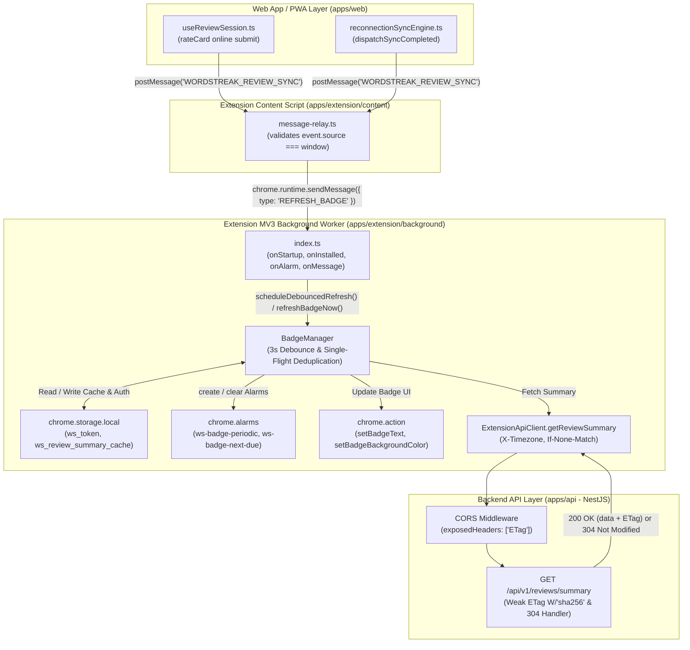
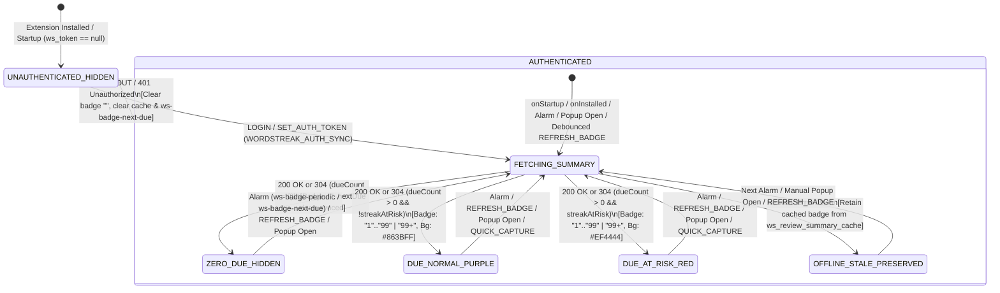
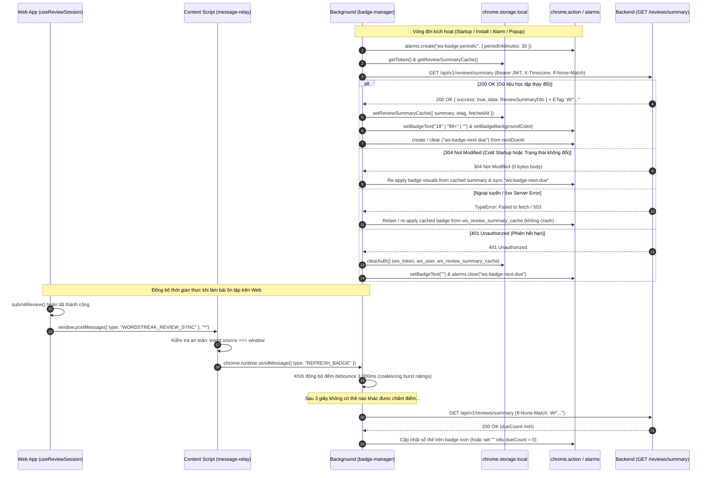

# Feature: Badge số thẻ đến hạn trên icon Extension (US-ECO-05)

**Slug**: `extension-due-badge`  
**Version**: 1.0  
**Ship date**: 2026-10-12  
**Spec**: [.specify/features/extension-due-badge/](file:///Users/vutuanhau/Documents/PROJECT/WordStreak/.specify/features/extension-due-badge/)  
**Baseline**: [SIGNED-OFF v1.0](file:///Users/vutuanhau/Documents/PROJECT/WordStreak/.specify/features/extension-due-badge/baseline.md)  
**Contract**: [extension-badge-sync.contract.md](file:///Users/vutuanhau/Documents/PROJECT/WordStreak/.specify/features/extension-due-badge/contracts/extension-badge-sync.contract.md)  
**User Story**: `US-ECO-05` (EPIC 06: Browser Extension & Ecosystem — Smart Reminders & Toolbar Badge)

---

## 1. Mô tả ngắn (Overview & Business Value)

Tính năng **Extension Due Cards Toolbar Badge & Dual-Alarm Synchronization Engine** (`US-ECO-05`) cung cấp một huy hiệu trực quan thông minh (ambient numeric badge) trên biểu tượng tiện ích mở rộng trình duyệt **WordStreak Chrome Extension (Manifest V3)**. Tính năng giải quyết vấn đề cốt lõi của người học ngoại ngữ: người dùng cài đặt extension nhưng thường xuyên quên ôn tập đúng hạn do không nhận biết được số lượng từ vựng đến hạn (spaced repetition due cards) nếu không chủ động mở trang Web App.

Tận dụng endpoint tối ưu `GET /api/v1/reviews/summary` ([`review-summary-api`](file:///Users/vutuanhau/Documents/PROJECT/WordStreak/docs/features/review-summary-api/README.md)), tiện ích mở rộng đạt được:
- **Hiển thị số lượng thẻ tức thời**: Hiển thị chính xác số thẻ cần ôn tập (`"1"` đến `"99"`), tự động rút gọn an toàn thành `"99+"` khi vượt quá giới hạn 3 ký tự, và ẩn hoàn toàn (`""`) khi không có thẻ đến hạn hoặc khi người dùng chưa đăng nhập.
- **Cảnh báo nguy cơ đứt chuỗi (Streak Urgency Shift)**: Đổi màu nền huy hiệu từ tím thương hiệu (`#863BFF`) sang đỏ cảnh báo (`#EF4444`) khi chuỗi học tập gặp nguy cơ đứt (`streakAtRisk: true` trong 3 giờ trước nửa đêm địa phương).
- **Bộ nhớ đệm có điều kiện chuẩn RFC 9110 (Weak ETag & 304 Not Modified)**: Lưu trữ `{ summary, etag, fetchedAt }` trong `chrome.storage.local`, gửi kèm `If-None-Match`, nhận phản hồi `304 Not Modified` với dung lượng tải `0 bytes`, giúp tiết kiệm tối đa CPU và băng thông.
- **Điều phối báo thức kép (Dual-Alarm Engine)**: Kết hợp báo thức chu kỳ 30 phút (`"ws-badge-periodic"`) và báo thức định thời chính xác một lần (`"ws-badge-next-due"`) theo mốc `nextDueAt`, tuân thủ sàn tối thiểu 60 giây của Chrome MV3.
- **Đồng bộ thời gian thực Web App → Extension**: Khi người học hoàn thành ôn tập trên Web App hoặc đồng bộ ngoại tuyến, sự kiện `WORDSTREAK_REVIEW_SYNC` được bắn qua `window.postMessage`, content script chuyển tiếp tới background worker với bộ lọc khử rung đuôi 3,000ms (trailing debounce) và khóa chống trùng lặp song song (single-flight deduplication).

---

## 2. Phạm vi (MoSCoW Scope)

### 2.1. Phạm vi đã hoàn thành (Must-Have Delivered)

- [x] **Quyền hệ thống & Hằng số MV3**: Khai báo quyền `"alarms"` trong [`manifest.json`](file:///Users/vutuanhau/Documents/PROJECT/WordStreak/apps/extension/manifest.json#L24) và cấu hình bảng màu `BADGE_COLORS`, tên báo thức `ALARM_NAMES`, giới hạn hiển thị `BADGE_LIMITS` tại [`constants.ts`](file:///Users/vutuanhau/Documents/PROJECT/WordStreak/apps/extension/src/shared/constants.ts#L43-L65).
- [x] **Hợp đồng kiểu dữ liệu dùng chung (`@wordstreak/shared-types`)**: Định nghĩa [`ReviewSummaryCacheState`](file:///Users/vutuanhau/Documents/PROJECT/WordStreak/packages/shared-types/src/extension.ts#L79-L83) và mở rộng [`ExtensionMessage`](file:///Users/vutuanhau/Documents/PROJECT/WordStreak/packages/shared-types/src/extension.ts#L91-L97) với thông điệp `{ type: "REFRESH_BADGE" }`.
- [x] **Phơi bày Header CORS Backend**: Bổ sung `exposedHeaders: ['ETag']` trong cấu hình CORS NestJS tại [`apps/api/src/main.ts`](file:///Users/vutuanhau/Documents/PROJECT/WordStreak/apps/api/src/main.ts#L46) để Extension fetch có thể đọc header ETag cross-origin.
- [x] **Lưu trữ bộ đệm bền vững (`storage.ts`)**: Triển khai [`getReviewSummaryCache`](file:///Users/vutuanhau/Documents/PROJECT/WordStreak/apps/extension/src/shared/storage.ts#L84-L87) và [`setReviewSummaryCache`](file:///Users/vutuanhau/Documents/PROJECT/WordStreak/apps/extension/src/shared/storage.ts#L89-L97) lưu trữ `ws_review_summary_cache` trong `chrome.storage.local`.
- [x] **API Client có điều kiện ETag (`api-client.ts`)**: Triển khai [`getReviewSummary`](file:///Users/vutuanhau/Documents/PROJECT/WordStreak/apps/extension/src/background/api-client.ts#L249-L297) hỗ trợ gửi `Authorization`, `X-Timezone`, `If-None-Match`, phân giải `304 Not Modified` không đọc body, và dọn dẹp phiên khi gặp `401 Unauthorized`.
- [x] **Lớp quản lý Badge & Dual-Alarm (`badge-manager.ts`)**:
  - Hàm thuần túy: [`formatBadgeText`](file:///Users/vutuanhau/Documents/PROJECT/WordStreak/apps/extension/src/background/badge-manager.ts#L6-L17), [`resolveBadgeColor`](file:///Users/vutuanhau/Documents/PROJECT/WordStreak/apps/extension/src/background/badge-manager.ts#L19-L21), [`computeNextDueAlarmTime`](file:///Users/vutuanhau/Documents/PROJECT/WordStreak/apps/extension/src/background/badge-manager.ts#L23-L39).
  - Lớp điều phối [`BadgeManager`](file:///Users/vutuanhau/Documents/PROJECT/WordStreak/apps/extension/src/background/badge-manager.ts#L41-L198): Áp dụng đồ họa badge, đăng ký báo thức kép, dọn dẹp khi đăng xuất, phục hồi trạng thái khi cold restart gặp 304, duy trì cache khi mất mạng/5xx, và gom cụm yêu cầu bằng debounce 3,000ms.
- [x] **Vòng đời Background Service Worker (`background/index.ts`)**: Kết nối gọi badge refresh trên `onInstalled`, `onStartup`, `alarms.onAlarm`, `LOGIN`, `SET_AUTH_TOKEN`, `LOGOUT`, `GET_AUTH_STATUS` (Popup mở), `QUICK_CAPTURE`, và `REFRESH_BADGE`.
- [x] **Cầu nối đồng bộ Web App (`WORDSTREAK_REVIEW_SYNC`)**:
  - Gửi sự kiện trên Web App sau khi chấm điểm thẻ trực tuyến tại [`useReviewSession.ts`](file:///Users/vutuanhau/Documents/PROJECT/WordStreak/apps/web/src/features/reviews/hooks/useReviewSession.ts#L247-L249) và sau khi hoàn tất đồng bộ theo lô ngoại tuyến tại [`reconnectionSyncEngine.ts`](file:///Users/vutuanhau/Documents/PROJECT/WordStreak/apps/web/src/services/offline/reconnectionSyncEngine.ts#L166-L168).
  - Xác thực an toàn `event.source === window` trong Content Script [`message-relay.ts`](file:///Users/vutuanhau/Documents/PROJECT/WordStreak/apps/extension/src/content/message-relay.ts#L1-L19) và chuyển tiếp `{ type: "REFRESH_BADGE" }`.
- [x] **Kiểm thử toàn diện**: Đạt 100% test coverage trên 14 test cases BDD (`TC-EDB-001` đến `TC-EDB-014`) và 3 test cases tích hợp (`TC-EDB-INT-001` đến `TC-EDB-INT-003`).

### 2.2. Ngoài phạm vi (Won't-Have Trong Giai đoạn này)

- Hệ thống quy tắc nhắc nhở & thông báo đẩy OS Desktop Notifications (`US-ECO-06`).
- Giao diện tùy chỉnh thông báo/bật tắt badge trong Extension Options Page (`US-ECO-07`).
- Phiên ôn tập nhanh 5 thẻ trực tiếp trong Popup Extension (`US-ECO-08`).
- Bất kỳ sửa đổi cơ sở dữ liệu hoặc Prisma schema nào (`0` DB migrations).

---

## 3. Kiến trúc Kỹ thuật & Luồng Dữ liệu (Architecture & Data Flow)

### 3.1. Kiến trúc Thành phần (Component Architecture)



### 3.2. Sơ đồ Trạng thái Huy hiệu & Vòng đời Báo thức (State Diagram)



### 3.3. Sơ đồ tuần tự End-to-End Polling & Real-Time Sync (Sequence Diagram)



---

## 4. Quy tắc Nghiệp vụ Chi tiết (`BR-EDB-001` .. `BR-EDB-009`)

| Mã quy tắc | Tên quy tắc | Nội dung chi tiết |
| :--- | :--- | :--- |
| **`BR-EDB-001`** | **Định dạng ký tự Badge & Giới hạn 4 ký tự** | - Huy hiệu được điều khiển hoàn toàn bởi `dueCount`:<br/>&nbsp;&nbsp;• `dueCount <= 0` hoặc chưa đăng nhập (`ws_token === null`): Hiển thị `""` (chuỗi rỗng, ẩn icon badge).<br/>&nbsp;&nbsp;• `1 <= dueCount <= 99`: Hiển thị chuỗi số thực tế (`"1"` .. `"99"`).<br/>&nbsp;&nbsp;• `dueCount > 99`: Hiển thị `"99+"` (tối đa 3 ký tự, không bao giờ bị cắt cụt trong khung 4 ký tự của Chrome). |
| **`BR-EDB-002`** | **Ý nghĩa màu sắc & Cảnh báo đứt chuỗi** | - Khi `dueCount > 0` và `streakAtRisk === false`: Màu nền là Brand Purple `#863BFF`, chữ trắng `#FFFFFF`.<br/>- Khi `dueCount > 0` và `streakAtRisk === true`: Chuyển màu nền sang Danger Red `#EF4444`, chữ trắng `#FFFFFF`.<br/>- Gọi `chrome.action.setBadgeTextColor` trong khối `try/catch` để tương thích các trình duyệt Chromium không hỗ trợ API này. |
| **`BR-EDB-003`** | **Dọn dẹp khi hết phiên & Logout** | - Khi `ws_token` không tồn tại, khi nhận message `LOGOUT`, hoặc khi API trả về `401 Unauthorized`: Ngay lập tức xóa `ws_token`, `ws_user`, `ws_review_summary_cache`, hủy báo thức `"ws-badge-next-due"`, hủy timer debounce, và đặt badge về `""`. |
| **`BR-EDB-004`** | **Khả năng chịu lỗi khi mất mạng & 5xx** | - Khi gọi API thất bại do lỗi mạng (`TypeError: Failed to fetch`) hoặc mã lỗi `5xx` trong khi token vẫn hợp lệ: Giữ nguyên `ws_review_summary_cache`, tiếp tục hiển thị huy hiệu từ bộ đệm gần nhất, ghi nhận `console.warn` và không quăng lỗi chưa bắt (unhandled rejection). |
| **`BR-EDB-005`** | **Báo thức chu kỳ định kỳ 30 phút** | - Khai báo quyền `"alarms"` trong `manifest.json`.<br/>- Trên `chrome.runtime.onInstalled` và `chrome.runtime.onStartup`, luôn đảm bảo báo thức lặp lại `"ws-badge-periodic"` được tạo với chu kỳ `periodInMinutes: 30`. |
| **`BR-EDB-006`** | **Báo thức linh hoạt một lần theo `nextDueAt`** | - Sau mỗi lần đánh giá summary (`200 OK` hoặc `304 Not Modified`), kiểm tra `nextDueAt`:<br/>&nbsp;&nbsp;• Nếu `nextDueAt` hợp lệ, nằm trong tương lai và đến hạn trước 30 phút (`0 < nextDueMs - now < 30 * 60 * 1000`): Tạo báo thức một lần `"ws-badge-next-due"` với `when: Math.max(now + 60_000, nextDueMs)` (ép sàn tối thiểu 60 giây của Chrome MV3).<br/>&nbsp;&nbsp;• Ngược lại (`nextDueAt === null`, quá khứ, hoặc $\ge 30$ phút): Xóa báo thức `"ws-badge-next-due"`. |
| **`BR-EDB-007`** | **Bộ đệm ETag có điều kiện & Header múi giờ** | - Lưu trạng thái `{ summary, etag, fetchedAt }` trong `chrome.storage.local` dưới khóa `ws_review_summary_cache`.<br/>- Gửi header `X-Timezone: Intl.DateTimeFormat().resolvedOptions().timeZone || "UTC"` và `If-None-Match: <etag>`.<br/>- Backend cấu hình `exposedHeaders: ['ETag']` trong NestJS CORS.<br/>- Khi nhận `304 Not Modified`: Tái sử dụng `summary` trong cache để vẽ lại badge (cần thiết cho cold restart) và lên lịch lại `"ws-badge-next-due"`. |
| **`BR-EDB-008`** | **Cầu nối đồng bộ Web App & Khử rung 3 giây** | - Web App bắn `window.postMessage({ type: "WORDSTREAK_REVIEW_SYNC" }, "*")` sau khi chấm điểm thẻ trực tuyến hoặc đồng bộ ngoại tuyến hoàn tất.<br/>- Content script xác thực `event.source === window` và chuyển tiếp `{ type: "REFRESH_BADGE" }`.<br/>- Background worker áp dụng **3,000ms trailing debounce timer** và khóa đơn luồng (single-flight deduplication) để gộp các đợt chấm điểm liên tục, giới hạn tối đa 1 cuộc gọi API mỗi 3 giây. |
| **`BR-EDB-009`** | **Các điểm kích hoạt làm mới tức thời** | - Không áp dụng debounce (làm mới ngay lập tức) trên các sự kiện:<br/>&nbsp;&nbsp;1. `chrome.runtime.onInstalled` và `chrome.runtime.onStartup`<br/>&nbsp;&nbsp;2. Báo thức `chrome.alarms.onAlarm` (`ws-badge-periodic` và `ws-badge-next-due`)<br/>&nbsp;&nbsp;3. Thông điệp `LOGIN` và `SET_AUTH_TOKEN`<br/>&nbsp;&nbsp;4. Khi mở Popup Extension (`GET_AUTH_STATUS`)<br/>&nbsp;&nbsp;5. Lưu từ vựng nhanh thành công (`QUICK_CAPTURE`) |

---

## 5. Ma trận Xử lý Biên & Tình huống Ngoại lệ (Boundary Matrix)

| Mã ngoại lệ | Điều kiện kích hoạt | Hành vi hệ thống mong đợi | Quy tắc truy vết |
| :--- | :--- | :--- | :--- |
| **`EC-EDB-01`** | **Chuyển ngưỡng hiển thị `dueCount = 99` sang `100`** | `dueCount === 99` hiển thị `"99"`; `dueCount >= 100` hiển thị `"99+"`, đảm bảo không bao giờ tràn khung 4 ký tự. | `BR-EDB-001` |
| **`EC-EDB-02`** | **Không có thẻ đến hạn nhưng `streakAtRisk === true` hoặc `newAvailable > 0`** | Badge text đặt về `""` (ẩn). Không bao giờ cộng `newAvailable` vào badge, và màu đỏ chỉ xuất hiện khi `dueCount > 0`. | `BR-EDB-001`, `BR-EDB-002` |
| **`EC-EDB-03`** | **`nextDueAt` cách hiện tại dưới 60 giây (`< 60s`)** | Báo thức `"ws-badge-next-due"` được tự động nâng mốc thời gian lên `when: Date.now() + 60_000` để thỏa mãn giới hạn của Chrome MV3. | `BR-EDB-006`, `RISK-EDB-001` |
| **`EC-EDB-04`** | **`nextDueAt` rơi vào quá khứ, bằng `null`, hoặc cách xa $\ge 30$ phút** | Xóa báo thức `"ws-badge-next-due"` qua `chrome.alarms.clear` để nhường quyền cho báo thức định kỳ `"ws-badge-periodic"`. | `BR-EDB-005`, `BR-EDB-006` |
| **`EC-EDB-05`** | **Khởi động lại trình duyệt (Cold Startup) nhận phản hồi `304`** | Trình duyệt Chrome xóa bộ nhớ đồ họa tạm của badge khi tắt ứng dụng. Khi nhận `304`, Extension đọc `summary` từ storage cache và vẽ lại badge visual ngay lập tức. | `BR-EDB-007`, `RISK-EDB-004` |
| **`EC-EDB-06`** | **Chuỗi thao tác nhanh trên Web xen kẽ mở Popup** | 5 sự kiện `REFRESH_BADGE` đến trong 2s, sau đó người dùng mở Popup (`GET_AUTH_STATUS`). Thao tác mở Popup hủy timer debounce 3s và kích hoạt truy vấn ngay lập tức. | `BR-EDB-008`, `BR-EDB-009` |
| **`EC-EDB-07`** | **Trình duyệt Chromium không hỗ trợ `setBadgeTextColor`** | Khối lệnh được bọc trong `try/catch` phòng thủ, đảm bảo `setBadgeText` và `setBadgeBackgroundColor` luôn thực thi hoàn tất. | `BR-EDB-002`, `RISK-EDB-005` |
| **`EC-EDB-08`** | **Thư rác `postMessage` từ iframe bên thứ ba** | Content script kiểm tra `event.source === window`, loại bỏ hoàn toàn các thông điệp từ nguồn không tin cậy. Dữ liệu từ postMessage không bao giờ được dùng trực tiếp làm số thẻ. | `BR-EDB-008`, `RISK-EDB-002` |

---

## 6. Chi tiết Hợp đồng Giao tiếp & Dữ liệu (Contracts)

### 6.1. Hợp đồng Backend CORS (`apps/api/src/main.ts`)

```typescript
app.enableCors({
  origin: (origin: string | undefined, callback: (err: Error | null, allow?: boolean) => void) => {
    if (isOriginAllowed(origin, allowedOrigins)) {
      callback(null, true);
    } else {
      callback(new Error(`Origin ${origin} not allowed by CORS`));
    }
  },
  credentials: true,
  exposedHeaders: ['ETag'], // Cho phép fetch trong Extension đọc response ETag
});
```

### 6.2. Hợp đồng HTTP Client `ExtensionApiClient.getReviewSummary`

- **Endpoint**: `GET /api/v1/reviews/summary`
- **Headers yêu cầu**:
  - `Authorization: Bearer <ws_token>`
  - `Accept: application/json`
  - `X-Timezone: <IANA Timezone || "UTC">`
  - `If-None-Match: <cached_etag>` *(khi có etag trong cache)*
- **Kết quả trả về (`GetReviewSummaryResult`)**:
  ```typescript
  export type GetReviewSummaryResult =
    | {
        status: 200;
        summary: ReviewSummaryDto;
        etag: string | null;
      }
    | {
        status: 304;
        etag: string | null;
      };
  ```

### 6.3. Cấu trúc Bộ đệm Storage (`ReviewSummaryCacheState`)

Lưu trữ trong `chrome.storage.local` dưới khóa `ws_review_summary_cache`:

```typescript
export interface ReviewSummaryCacheState {
  summary: ReviewSummaryDto; // Payload 10 chỉ số từ review-summary-api
  etag: string | null;       // Weak ETag W/"<sha256>"
  fetchedAt: string;         // ISO 8601 UTC timestamp
}
```

### 6.4. Hợp đồng Cầu nối Web App `window.postMessage`

- **Sự kiện phát**: `window.postMessage({ type: "WORDSTREAK_REVIEW_SYNC" }, "*")`
- **Nơi phát trên Web App**:
  1. [`useReviewSession.ts`](file:///Users/vutuanhau/Documents/PROJECT/WordStreak/apps/web/src/features/reviews/hooks/useReviewSession.ts#L247-L249): Ngay sau khi `submitReview` trực tuyến thành công.
  2. [`reconnectionSyncEngine.ts`](file:///Users/vutuanhau/Documents/PROJECT/WordStreak/apps/web/src/services/offline/reconnectionSyncEngine.ts#L166-L168): Sau khi hoàn tất đẩy lô thẻ ngoại tuyến (`syncReviewBatch`).
- **Nơi nhận trong Extension**:
  - [`message-relay.ts`](file:///Users/vutuanhau/Documents/PROJECT/WordStreak/apps/extension/src/content/message-relay.ts#L16-L18): Xác thực `event.source === window` và chuyển tiếp thông điệp nội bộ `{ type: "REFRESH_BADGE" }`.

### 6.5. Hợp đồng Thông điệp Extension Runtime (`chrome.runtime.sendMessage`)

```typescript
export type ExtensionMessage =
  | { type: "LOGIN"; payload: LoginDto }
  | { type: "LOGOUT" }
  | { type: "SET_AUTH_TOKEN"; payload: { token: string } }
  | { type: "GET_AUTH_STATUS" }
  | { type: "QUICK_CAPTURE"; payload: QuickCaptureCardDto }
  | { type: "REFRESH_BADGE"; payload?: { immediate?: boolean } };
```

---

## 7. Các Thay đổi Kỹ thuật Chính (Technical Changes)

### 7.1. Shared Types (`packages/shared-types`)

- **File**: [`packages/shared-types/src/extension.ts`](file:///Users/vutuanhau/Documents/PROJECT/WordStreak/packages/shared-types/src/extension.ts#L79-L97)
- **Nội dung**: Xuất `ReviewSummaryCacheState`, thêm trường `reviewSummaryCache` vào `ExtensionStorageState`, và mở rộng union `ExtensionMessage` với `{ type: "REFRESH_BADGE"; payload?: { immediate?: boolean } }`.

### 7.2. Backend API (`apps/api`)

- **File**: [`apps/api/src/main.ts`](file:///Users/vutuanhau/Documents/PROJECT/WordStreak/apps/api/src/main.ts#L46)
- **Nội dung**: Bổ sung `exposedHeaders: ['ETag']` trong NestJS CORS configuration.

### 7.3. Chrome Extension (`apps/extension`)

- **Manifest**: [`apps/extension/manifest.json`](file:///Users/vutuanhau/Documents/PROJECT/WordStreak/apps/extension/manifest.json#L24) — Thêm `"alarms"` vào danh sách permissions.
- **Hằng số**: [`apps/extension/src/shared/constants.ts`](file:///Users/vutuanhau/Documents/PROJECT/WordStreak/apps/extension/src/shared/constants.ts#L43-L65) — Khai báo `BADGE_COLORS`, `ALARM_NAMES`, `BADGE_LIMITS`, và khóa `STORAGE_KEYS.REVIEW_SUMMARY_CACHE`.
- **Storage**: [`apps/extension/src/shared/storage.ts`](file:///Users/vutuanhau/Documents/PROJECT/WordStreak/apps/extension/src/shared/storage.ts#L84-L97) — Bổ sung `getReviewSummaryCache()` và `setReviewSummaryCache()`.
- **API Client**: [`apps/extension/src/background/api-client.ts`](file:///Users/vutuanhau/Documents/PROJECT/WordStreak/apps/extension/src/background/api-client.ts#L249-L297) — Triển khai `getReviewSummary()` với `304` handler và `401` auto-cleanup.
- **Badge Manager**: [`apps/extension/src/background/badge-manager.ts`](file:///Users/vutuanhau/Documents/PROJECT/WordStreak/apps/extension/src/background/badge-manager.ts) — Đóng gói logic formatting, màu sắc, báo thức kép, debounce 3s và single-flight request.
- **Background Orchestrator**: [`apps/extension/src/background/index.ts`](file:///Users/vutuanhau/Documents/PROJECT/WordStreak/apps/extension/src/background/index.ts) — Đăng ký vòng đời `onInstalled`, `onStartup`, `onAlarm`, context menu, và message handlers.
- **Content Script Relay**: [`apps/extension/src/content/message-relay.ts`](file:///Users/vutuanhau/Documents/PROJECT/WordStreak/apps/extension/src/content/message-relay.ts#L1-L20) — Xác thực `event.source === window` và chuyển tiếp sự kiện đồng bộ.

### 7.4. Web App (`apps/web`)

- **Online Review Hook**: [`apps/web/src/features/reviews/hooks/useReviewSession.ts`](file:///Users/vutuanhau/Documents/PROJECT/WordStreak/apps/web/src/features/reviews/hooks/useReviewSession.ts#L247-L249) — Phát `WORDSTREAK_REVIEW_SYNC` sau `submitReview`.
- **Offline Sync Engine**: [`apps/web/src/services/offline/reconnectionSyncEngine.ts`](file:///Users/vutuanhau/Documents/PROJECT/WordStreak/apps/web/src/services/offline/reconnectionSyncEngine.ts#L166-L168) — Phát `WORDSTREAK_REVIEW_SYNC` trong `dispatchSyncCompleted`.

---

## 8. Hướng dẫn Xác minh & Kiểm thử (Testing & Verification)

### 8.1. Các Lệnh Thực thi Kiểm thử Tự động

```bash
# 1. Chạy toàn bộ test suites của Extension (Storage, ApiClient, BadgeManager, Relay)
pnpm --filter @wordstreak/extension test

# 2. Chạy test phát sự kiện đồng bộ trên Web App (Online Hook & Offline Engine)
pnpm --filter web test src/features/reviews/hooks/useReviewSession.spec.ts src/services/offline/__tests__/reconnectionSyncEngine.spec.ts

# 3. Chạy test xác nhận cấu hình CORS Backend phơi bày ETag
pnpm --filter api test -- main.spec.ts reviews
```

### 8.2. Bảng Ma trận Kiểm thử (Test Traceability Matrix)

| Mã kiểm thử | Mô tả kiểm thử & Hành vi xác nhận | Tập tin thực thi | Kết quả |
| :--- | :--- | :--- | :---: |
| **`TC-EDB-001`** | Đọc/ghi bền vững `ws_review_summary_cache` trong `chrome.storage.local` và fallback | [`storage.spec.ts`](file:///Users/vutuanhau/Documents/PROJECT/WordStreak/apps/extension/src/shared/storage.spec.ts) | ✅ PASS |
| **`TC-EDB-002`** | `apiClient.getReviewSummary` gửi đủ header `Authorization`, `X-Timezone`, `If-None-Match` và xử lý `200 OK` | [`api-client.spec.ts`](file:///Users/vutuanhau/Documents/PROJECT/WordStreak/apps/extension/src/background/api-client.spec.ts) | ✅ PASS |
| **`TC-EDB-003`** | `getReviewSummary` xử lý phản hồi `304 Not Modified` mà không gọi `response.json()` | [`api-client.spec.ts`](file:///Users/vutuanhau/Documents/PROJECT/WordStreak/apps/extension/src/background/api-client.spec.ts) | ✅ PASS |
| **`TC-EDB-004`** | `getReviewSummary` tự động xóa token, user, cache và quăng lỗi khi nhận `401 Unauthorized` | [`api-client.spec.ts`](file:///Users/vutuanhau/Documents/PROJECT/WordStreak/apps/extension/src/background/api-client.spec.ts) | ✅ PASS |
| **`TC-EDB-005`** | Hàm `formatBadgeText` hiển thị `""` khi auth=false/due=0, `"18"` cho thẻ 1..99, và `"99+"` khi $\ge 100$ | [`badge-manager.spec.ts`](file:///Users/vutuanhau/Documents/PROJECT/WordStreak/apps/extension/src/background/badge-manager.spec.ts) | ✅ PASS |
| **`TC-EDB-006`** | Chuyển màu nền tím `#863BFF` (bình thường) sang đỏ `#EF4444` (`streakAtRisk`) và bọc an toàn text color | [`badge-manager.spec.ts`](file:///Users/vutuanhau/Documents/PROJECT/WordStreak/apps/extension/src/background/badge-manager.spec.ts) | ✅ PASS |
| **`TC-EDB-007`** | Đăng ký báo thức định kỳ 30 phút `"ws-badge-periodic"` trên vòng đời service worker | [`badge-manager.spec.ts`](file:///Users/vutuanhau/Documents/PROJECT/WordStreak/apps/extension/src/background/badge-manager.spec.ts) | ✅ PASS |
| **`TC-EDB-008`** | Lên lịch báo thức một lần `"ws-badge-next-due"`, ép sàn tối thiểu 60s và hủy khi quá 30m / null | [`badge-manager.spec.ts`](file:///Users/vutuanhau/Documents/PROJECT/WordStreak/apps/extension/src/background/badge-manager.spec.ts) | ✅ PASS |
| **`TC-EDB-009`** | Phục hồi đồ họa badge từ cache khi cold restart nhận `304 Not Modified` | [`badge-manager.spec.ts`](file:///Users/vutuanhau/Documents/PROJECT/WordStreak/apps/extension/src/background/badge-manager.spec.ts) | ✅ PASS |
| **`TC-EDB-010`** | Gom cụm yêu cầu với trailing debounce 3,000ms và hủy timer khi có trigger tức thời | [`badge-manager.spec.ts`](file:///Users/vutuanhau/Documents/PROJECT/WordStreak/apps/extension/src/background/badge-manager.spec.ts) | ✅ PASS |
| **`TC-EDB-011`** | Reset sạch bộ đệm, hủy báo thức next-due và đặt badge về `""` khi logout hoặc mất token | [`badge-manager.spec.ts`](file:///Users/vutuanhau/Documents/PROJECT/WordStreak/apps/extension/src/background/badge-manager.spec.ts) | ✅ PASS |
| **`TC-EDB-012`** | Giữ nguyên badge từ cache khi gặp lỗi mạng `TypeError` hoặc `503 Server Error`, không crash worker | [`badge-manager.spec.ts`](file:///Users/vutuanhau/Documents/PROJECT/WordStreak/apps/extension/src/background/badge-manager.spec.ts) | ✅ PASS |
| **`TC-EDB-013`** | Web App phát `WORDSTREAK_REVIEW_SYNC` sau khi `submitReview` trực tuyến thành công | [`useReviewSession.spec.ts`](file:///Users/vutuanhau/Documents/PROJECT/WordStreak/apps/web/src/features/reviews/hooks/useReviewSession.spec.ts) | ✅ PASS |
| **`TC-EDB-014`** | Web App phát `WORDSTREAK_REVIEW_SYNC` sau khi hoàn tất đẩy lô ngoại tuyến trong sync engine | [`reconnectionSyncEngine.spec.ts`](file:///Users/vutuanhau/Documents/PROJECT/WordStreak/apps/web/src/services/offline/__tests__/reconnectionSyncEngine.spec.ts) | ✅ PASS |
| **`TC-EDB-INT-001`** | Cấu hình CORS Backend chứa `exposedHeaders: ['ETag']` | [`main.spec.ts`](file:///Users/vutuanhau/Documents/PROJECT/WordStreak/apps/api/src/main.spec.ts) | ✅ PASS |
| **`TC-EDB-INT-002`** | Content script chỉ chuyển tiếp khi `event.source === window`, chặn iframe thứ ba | [`content-relay.spec.ts`](file:///Users/vutuanhau/Documents/PROJECT/WordStreak/apps/extension/src/content/content-relay.spec.ts) | ✅ PASS |
| **`TC-EDB-INT-003`** | Background worker tiếp nhận `REFRESH_BADGE` và định tuyến đúng tức thời / debounced | [`badge-manager.spec.ts`](file:///Users/vutuanhau/Documents/PROJECT/WordStreak/apps/extension/src/background/badge-manager.spec.ts) | ✅ PASS |

### 8.3. Hướng dẫn Kiểm tra Thủ công trên Trình duyệt

1. **Kiểm tra Cài đặt & Hiển thị Badge**:
   - Build extension: `pnpm --filter @wordstreak/extension build`.
   - Mở `chrome://extensions`, bật **Developer mode**, chọn **Load unpacked** và trỏ đến thư mục `apps/extension/dist`.
   - Đăng nhập tài khoản WordStreak trên Web App hoặc trên Extension Popup. Biểu tượng Extension hiển thị ngay số lượng thẻ đến hạn (ví dụ `"12"`) với nền màu tím `#863BFF`.
2. **Kiểm tra Đồng bộ Ôn tập Thời gian thực**:
   - Mở tab Web App tại `/review` và hoàn thành 1 thẻ flashcard.
   - Quan sát biểu tượng Extension trên thanh công cụ: Sau khoảng 3 giây kể từ khi bấm chấm điểm, số trên huy hiệu tự động giảm đi 1 đơn vị mà không cần mở lại Extension.
3. **Kiểm tra Trạng thái Nguy cơ Đứt chuỗi (`streakAtRisk`)**:
   - Sử dụng tài khoản có `currentStreak >= 3`, chưa học hôm nay, và điều chỉnh đồng hồ máy tính còn dưới 3 tiếng trước nửa đêm.
   - Biểu tượng Extension chuyển sang màu đỏ rực `#EF4444`.
4. **Kiểm tra Đăng xuất**:
   - Đăng xuất trên Web App hoặc bấm Logout trong Popup Extension.
   - Biểu tượng Extension lập tức xóa số trên huy hiệu về trạng thái trắng sạch (`""`).

---

## 9. Rủi ro Chấp nhận & Biện pháp Giảm thiểu (Known Risks & Mitigations)

- **Sàn tối thiểu 60 giây của Chrome Alarms MV3 (`RISK-EDB-001`)**: Chrome không cho phép báo thức định thời dưới 1 phút trong môi trường production, có thể gây lỗi hoặc không kích hoạt nếu `nextDueAt` chỉ còn 10-30 giây.
  - *Giải pháp*: Hàm `computeNextDueAlarmTime` tự động áp dụng `Math.max(Date.now() + 60_000, nextDueMs)` để đảm bảo báo thức luôn hợp lệ.
- **Tấn công giả mạo nguồn phát `postMessage` (`RISK-EDB-002`)**: Iframe quảng cáo hoặc trang độc hại có thể phát thư rác `WORDSTREAK_REVIEW_SYNC` gây quá tải API.
  - *Giải pháp*: Content script kiểm tra nghiêm ngặt `event.source === window`. Hơn nữa, thông điệp này chỉ là tín hiệu xóa cache phía client và bị khóa bởi bộ đệm debounce 3 giây cùng cơ chế chống trùng lặp song song (single-flight deduplication), hoàn toàn không thể làm biến đổi dữ liệu người dùng hay nhận thưởng gian lận.
- **Tiêu đề ETag bị chặn đọc bởi trình duyệt do CORS (`RISK-EDB-003`)**: Fetch client không thể đọc `response.headers.get('etag')` nếu header không được khai báo công khai.
  - *Giải pháp*: Khai báo rõ ràng `exposedHeaders: ['ETag']` trong cấu hình CORS NestJS.
- **Mất huy hiệu khi khởi động lại trình duyệt do bộ nhớ đồ họa tạm (`RISK-EDB-004`)**: Trình duyệt Chrome có thể xóa volatile badge khi tắt trình duyệt, nhưng khi khởi động lại, API trả về `304 Not Modified` nên nếu client không xử lý sẽ để lại badge rỗng.
  - *Giải pháp*: Nhánh xử lý `304 Not Modified` trong `BadgeManager` luôn chủ động lấy dữ liệu từ `ws_review_summary_cache.summary` để gọi `applyBadgeVisuals()`.
- **Thiếu API `setBadgeTextColor` trên các bản phân phối Chromium (`RISK-EDB-005`)**: Một số nhân trình duyệt không hỗ trợ đặt màu chữ cho badge.
  - *Giải pháp*: Bọc lệnh gọi `chrome.action.setBadgeTextColor` trong khối `try/catch` phòng thủ.

---

## 10. Tác giả & Trạng thái

- **Feature**: `extension-due-badge` (`US-ECO-05`)
- **Implemented by**: AI Pair Programmer (Antigravity)
- **Technical Documentation Architect**: `tech-doc-architect`
- **Reviewed by**: Senior Engineering Team & Core Architect
- **Trạng thái**: Hoàn thành (`Delivered`) & Sẵn sàng phát hành (Production-Ready)
