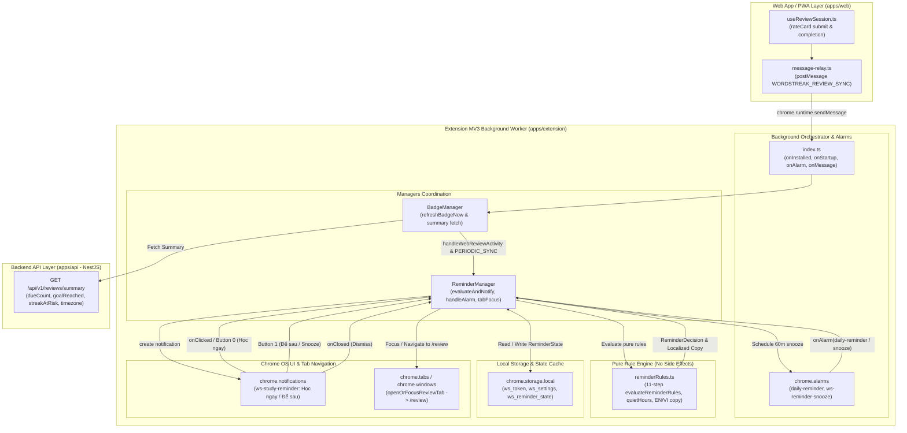
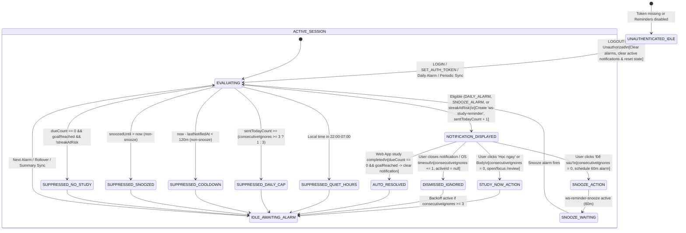
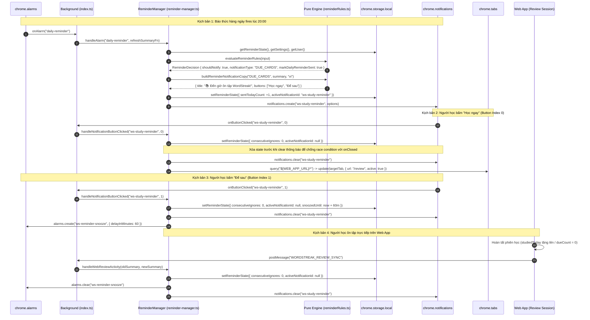

# Feature: Thông báo nhắc học theo luật điều kiện (US-ECO-06)

**Slug**: `extension-reminder-notifications`  
**Version**: 1.0  
**Ship date**: 2026-10-13  
**Spec**: [.specify/features/extension-reminder-notifications/](file:///Users/vutuanhau/Documents/PROJECT/WordStreak/.specify/features/extension-reminder-notifications/)  
**Baseline**: [SIGNED-OFF v1.0](file:///Users/vutuanhau/Documents/PROJECT/WordStreak/.specify/features/extension-reminder-notifications/baseline.md)  
**Contract**: [extension-reminder-contracts.md](file:///Users/vutuanhau/Documents/PROJECT/WordStreak/.specify/features/extension-reminder-notifications/contracts/extension-reminder-contracts.md)  
**User Story**: `US-ECO-06` (EPIC 06: Browser Extension & Ecosystem — Conditional Study Reminder Notifications)

---

## 1. Mô tả ngắn (Overview & Business Value)

Tính năng **Conditional Study Reminder Notifications & Anti-Spam Decision Engine** (`US-ECO-06`) cung cấp cơ chế thông báo hệ thống thông minh (proactive desktop OS notifications) trên tiện ích mở rộng trình duyệt **WordStreak Chrome Extension (Manifest V3)**. Tính năng đóng vai trò người đồng hành chủ động bên cạnh huy hiệu tĩnh trên thanh công cụ ([`extension-due-badge`](file:///Users/vutuanhau/Documents/PROJECT/WordStreak/docs/features/extension-due-badge/README.md) — `US-ECO-05`).

Trong thực tế học tập, học viên thường thu gọn icon extension vào thanh overflow của Chrome hoặc mải mê duyệt web mà không chú ý đến số huy hiệu nhỏ. Nếu không có lời nhắc kịp thời, chuỗi ngày học (`currentStreak`) sẽ bị đứt hoặc thẻ đến hạn (`dueCount`) bị dồn ứ. Tuy nhiên, nếu gửi thông báo dày đặc hoặc phát chuông vào ban đêm, người dùng sẽ cảm thấy bị làm phiền và gỡ cài đặt tiện ích (`extension uninstall`).

Tận dụng endpoint tối ưu `GET /api/v1/reviews/summary` ([`review-summary-api`](file:///Users/vutuanhau/Documents/PROJECT/WordStreak/docs/features/review-summary-api/README.md)), tiện ích mở rộng đạt được:
- **Động cơ quyết định thuần túy không tác dụng phụ (Pure Rule Engine `< 5ms`)**: Mô-đun [`reminderRules.ts`](file:///Users/vutuanhau/Documents/PROJECT/WordStreak/apps/extension/src/background/reminderRules.ts) đánh giá 11 bước nghiêm ngặt dựa trên dữ liệu học tập, cài đặt cá nhân và trạng thái lịch sử mà không phụ thuộc vào Chrome runtime APIs.
- **Hành lang bảo vệ chống quấy rầy (Anti-Spam Guardrails)**:
  - Khung giờ yên tĩnh (**Quiet Hours** `22:00–07:00` mặc định), hỗ trợ hoàn hảo cả khung giờ vắt qua nửa đêm (overnight wrap-around) lẫn cùng ngày.
  - Trần thông báo tối đa **3 thông báo/ngày** (`sentTodayCount < 3`).
  - Khoảng giãn cách an toàn **120 phút cooldown** giữa các lần thông báo tự động trong ngày.
  - Cơ chế tự giảm tần suất thông minh (**Frequency Backoff**): Khi người học liên tiếp phớt lờ 3 thông báo (`consecutiveIgnores >= 3`), trần thông báo tự động giảm xuống tối đa **1 thông báo/ngày** để tránh gây ức chế.
- **Tương tác trực quan 2 nút bấm OS (Actionable Buttons)**:
  - **"Học ngay" ("Study Now")**: Lập tức kích hoạt điều hướng thông minh mở hoặc chuyển hướng tab Web App đến `/review`.
  - **"Để sau" ("Snooze")**: Hoãn thông báo 60 phút và lên lịch báo thức một lần `"ws-reminder-snooze"`.
- **Tự động khôi phục & Đồng bộ học tập Web App**: Khi người học hoàn thành bài học trên Web App hoặc bấm bất kỳ nút tương tác nào, hệ thống lập tức đặt lại `consecutiveIgnores = 0` và thu hồi thông báo đang hiển thị nếu mục tiêu học tập đã hoàn thành.
- **Bản địa hóa song ngữ EN/VI chuẩn xác**: Hỗ trợ đầy đủ tiếng Việt và tiếng Anh dựa trên ưu tiên ngôn ngữ người dùng (`preferredLanguage`).

---

## 2. Phạm vi (MoSCoW Scope)

### 2.1. Phạm vi đã hoàn thành (Must-Have Delivered)

- [x] **Quyền hệ thống & Hằng số MV3**: Khai báo quyền `"notifications"` trong [`manifest.json`](file:///Users/vutuanhau/Documents/PROJECT/WordStreak/apps/extension/manifest.json#L24); cấu hình `ALARM_NAMES.DAILY_REMINDER`, `ALARM_NAMES.REMINDER_SNOOZE`, `REMINDER_NOTIFICATION_ID`, `REMINDER_LIMITS`, `DEFAULT_REMINDER_STATE`, và giá trị mặc định cho cài đặt nhắc nhở trong [`constants.ts`](file:///Users/vutuanhau/Documents/PROJECT/WordStreak/apps/extension/src/shared/constants.ts).
- [x] **Hợp đồng kiểu dữ liệu dùng chung (`@wordstreak/shared-types`)**: Bổ sung `preferredLanguage` trong [`ExtensionUserSummary`](file:///Users/vutuanhau/Documents/PROJECT/WordStreak/packages/shared-types/src/extension.ts#L87-L93), các trường cấu hình nhắc nhở trong [`ReminderSettings`](file:///Users/vutuanhau/Documents/PROJECT/WordStreak/packages/shared-types/src/extension.ts#L95-L102), trạng thái bền vững [`ReminderState`](file:///Users/vutuanhau/Documents/PROJECT/WordStreak/packages/shared-types/src/extension.ts#L111-L128), cùng các kiểu ngữ cảnh [`ReminderEvaluationInput`](file:///Users/vutuanhau/Documents/PROJECT/WordStreak/packages/shared-types/src/extension.ts#L159-L167) và kết quả quyết định [`ReminderDecision`](file:///Users/vutuanhau/Documents/PROJECT/WordStreak/packages/shared-types/src/extension.ts#L171-L178).
- [x] **Lưu trữ trạng thái bền vững (`storage.ts`)**: Triển khai [`getReminderState()`](file:///Users/vutuanhau/Documents/PROJECT/WordStreak/apps/extension/src/shared/storage.ts#L99-L103), [`setReminderState()`](file:///Users/vutuanhau/Documents/PROJECT/WordStreak/apps/extension/src/shared/storage.ts#L105-L113), [`resetReminderState()`](file:///Users/vutuanhau/Documents/PROJECT/WordStreak/apps/extension/src/shared/storage.ts#L115-L121) lưu trữ `ws_reminder_state` trong `chrome.storage.local`.
- [x] **Động cơ luật thuần túy 11 bước ([`reminderRules.ts`](file:///Users/vutuanhau/Documents/PROJECT/WordStreak/apps/extension/src/background/reminderRules.ts))**:
  - [`parseTimeToMinutes`](file:///Users/vutuanhau/Documents/PROJECT/WordStreak/apps/extension/src/background/reminderRules.ts#L19-L33) & [`getLocalDateAndMinutes`](file:///Users/vutuanhau/Documents/PROJECT/WordStreak/apps/extension/src/background/reminderRules.ts#L38-L84): Xử lý an toàn múi giờ địa phương `YYYY-MM-DD` và chuyển đổi phút trong ngày (`0..1439`).
  - [`isWithinQuietHours`](file:///Users/vutuanhau/Documents/PROJECT/WordStreak/apps/extension/src/background/reminderRules.ts#L89-L109): Kiểm tra khung giờ yên tĩnh (cùng ngày & vắt qua nửa đêm `22:00–07:00`).
  - [`normalizeReminderStateForDate`](file:///Users/vutuanhau/Documents/PROJECT/WordStreak/apps/extension/src/background/reminderRules.ts#L114-L145): Đặt lại `sentTodayCount = 0`, `dailyReminderSentToday = false` khi qua nửa đêm địa phương, tính toán thông báo bị phớt lờ nếu chưa đóng.
  - [`computeNextDailyReminderTime`](file:///Users/vutuanhau/Documents/PROJECT/WordStreak/apps/extension/src/background/reminderRules.ts#L150-L169): Tính mốc báo thức hàng ngày, ép sàn tối thiểu 60s của Chrome MV3.
  - [`evaluateReminderRules`](file:///Users/vutuanhau/Documents/PROJECT/WordStreak/apps/extension/src/background/reminderRules.ts#L287-L328): Thực thi ma trận 11 bước xác định `shouldNotify`, `reason`, `notificationType` theo thứ tự ưu tiên: `"STREAK_AT_RISK"` > `"DUE_CARDS"` > `"DAILY_GOAL"`.
  - [`buildReminderNotificationCopy`](file:///Users/vutuanhau/Documents/PROJECT/WordStreak/apps/extension/src/background/reminderRules.ts#L426-L442) & [`resolveReminderLanguage`](file:///Users/vutuanhau/Documents/PROJECT/WordStreak/apps/extension/src/background/reminderRules.ts#L333-L354): Sinh tiêu đề, nội dung và 2 nút hành động tiếng Việt / tiếng Anh.
- [x] **Lớp điều phối Reminder Background ([`reminder-manager.ts`](file:///Users/vutuanhau/Documents/PROJECT/WordStreak/apps/extension/src/background/reminder-manager.ts))**:
  - Đăng ký báo thức lặp lại 24 giờ `"daily-reminder"` (`periodInMinutes: 1440`).
  - Tạo thông báo OS với định danh `"ws-study-reminder"`, priority 2/1.
  - Bắt sự kiện `onClicked`, `onButtonClicked` (nút 0 "Học ngay", nút 1 "Để sau"), và `onClosed`.
  - Triển khai cơ chế chống tranh chấp bất đối xứng (Race Condition Mitigation): ghi đè `activeNotificationId: null` vào storage *trước* khi gọi `chrome.notifications.clear` để `onClosed` không tính nhầm là bỏ qua.
  - Điều hướng tab thông minh: tìm kiếm tab `${WEB_APP_URL}/*` sẵn có, kích hoạt cửa sổ và điều hướng đến `${WEB_APP_URL}/review`, hoặc mở tab mới.
  - Nhận biết tiến độ học trên Web App: đặt lại `consecutiveIgnores = 0` và hủy thông báo đang treo khi số thẻ học tăng hoặc hoàn thành mục tiêu.
- [x] **Tích hợp Vòng đời Background Service Worker ([`index.ts`](file:///Users/vutuanhau/Documents/PROJECT/WordStreak/apps/extension/src/background/index.ts) & [`badge-manager.ts`](file:///Users/vutuanhau/Documents/PROJECT/WordStreak/apps/extension/src/background/badge-manager.ts))**:
  - Kết nối `ensureDailyReminderAlarm` trên `onInstalled`, `onStartup`, `LOGIN`, `SET_AUTH_TOKEN`, `UPDATE_SETTINGS`.
  - Xử lý báo thức trong `alarms.onAlarm`.
  - Đăng ký bộ lắng nghe `chrome.notifications.onClicked`, `onButtonClicked`, `onClosed`.
  - Phối hợp giữa `BadgeManager` và `ReminderManager` khi làm mới summary và dọn dẹp khi đăng xuất (`LOGOUT` / `401`).
- [x] **Kiểm thử tự động toàn diện**: 100% test cases xanh trên 16 unit test cases (`TC-REMD-001` .. `TC-REMD-016`) và integration test (`TC-REMD-INT-001`), với tổng cộng 119 unit tests toàn bộ extension đạt chuẩn.

### 2.2. Ngoài phạm vi (Won't-Have Trong Giai đoạn này)

- Giao diện tùy chỉnh thông báo/bật tắt trong Extension Options Page (`US-ECO-07`).
- Phiên ôn tập nhanh 5 thẻ trực tiếp trong Popup Extension (`US-ECO-08`).
- Web Push & Email notifications nhắc học trên nền tảng Mobile / PWA (`US-ECO-09`).
- Bất kỳ thay đổi Prisma schema hoặc bảng cơ sở dữ liệu nào (`0` DB migrations).

---

## 3. Kiến trúc Kỹ thuật & Luồng Dữ liệu (Architecture & Data Flow)

### 3.1. Kiến trúc Thành phần (Component Architecture)



### 3.2. Sơ đồ Trạng thái Nhắc nhở & Vòng đời Thông báo (State Diagram)



### 3.3. Sơ đồ Tuần tự Kích hoạt, Báo thức, Snooze & Đồng bộ Học tập (Sequence Diagram)



---

## 4. Quy tắc Nghiệp vụ Chi tiết (`BR-REMD-001` .. `BR-REMD-010`)

| Mã quy tắc | Tên quy tắc | Nội dung chi tiết |
| :--- | :--- | :--- |
| **`BR-REMD-001`** | **Quyền Hệ thống & Cấu hình Mặc định** | Khai báo `"notifications"` trong `manifest.json`. Thiết lập giá trị mặc định trong `DEFAULT_SETTINGS`: `remindersEnabled: true`, `dailyReminderTime: "20:00"`, `quietHoursStart: "22:00"`, `quietHoursEnd: "07:00"`, `streakAtRiskReminderEnabled: true`. |
| **`BR-REMD-002`** | **Chu kỳ Ngày Địa phương & Đặt lại Bộ đếm** | Lưu trạng thái trong `ws_reminder_state`. Khi ngày theo múi giờ địa phương (`YYYY-MM-DD` từ `summary.timezone` hoặc trình duyệt) chuyển sang ngày mới, `normalizeReminderStateForDate` đặt lại `sentTodayCount = 0` và `dailyReminderSentToday = false`. Nếu có thông báo cũ chưa bấm qua nửa đêm, cộng dồn `consecutiveIgnores += 1` trước khi xóa `activeNotificationId`. |
| **`BR-REMD-003`** | **Chặn Khung giờ Yên tĩnh (Quiet Hours)** | Chặn tuyệt đối mọi thông báo (`reason: "QUIET_HOURS"`) khi giờ địa phương hiện tại rơi vào `[quietHoursStart, quietHoursEnd)`. Hỗ trợ cả khung giờ cùng ngày (`13:00–15:00`), khung giờ vắt qua nửa đêm (`22:00–07:00`), và tắt khi hai mốc bằng nhau (`start === end`). |
| **`BR-REMD-004`** | **Trần Số lượng Ngày & Tự Giảm Tần suất (Backoff)** | Áp dụng trần tối đa **3 thông báo/ngày** khi người dùng tương tác bình thường (`consecutiveIgnores < 3`). Khi người học liên tiếp phớt lờ 3 thông báo (`consecutiveIgnores >= 3`), trần tự động siết xuống còn **1 thông báo/ngày** (`effectiveDailyCap = 1`). |
| **`BR-REMD-005`** | **Giãn cách 120 Phút Cooldown & Chặn Khi Snooze** | Đối với các tác nhân không phải báo thức hoãn (`triggerSource !== "SNOOZE_ALARM"`), chặn thông báo nếu `now - lastNotifiedAt < 120 phút` (`COOLDOWN_ACTIVE`) hoặc nếu đang trong thời gian hoãn `snoozedUntil > now` (`SNOOZED_ACTIVE`). |
| **`BR-REMD-006`** | **Động cơ Đánh giá Điều kiện 11 Bước** | Thực thi tuần tự 11 bước kiểm tra thuần túy trong [`evaluateReminderRules`](file:///Users/vutuanhau/Documents/PROJECT/WordStreak/apps/extension/src/background/reminderRules.ts#L287-L328). Chọn loại thông báo theo thứ tự ưu tiên tuyệt đối: `"STREAK_AT_RISK"` > `"DUE_CARDS"` > `"DAILY_GOAL"`. |
| **`BR-REMD-007`** | **Quản lý Báo thức Báo giờ & Snooze** | Duy trì báo thức lặp lại 24 giờ `"daily-reminder"` (`periodInMinutes: 1440`) căn theo `dailyReminderTime` (ép sàn $\ge 60$s). Khi người học bấm "Để sau", lên lịch báo thức một lần `"ws-reminder-snooze"` (`delayInMinutes: 60`). |
| **`BR-REMD-008`** | **Ghi nhận Phớt lờ & Phục hồi Khi Tương tác/Học tập** | Tăng `consecutiveIgnores += 1` khi thông báo bị đóng (`onClosed`) hoặc bị thay thế mà không bấm. Lập tức đặt lại `consecutiveIgnores = 0` khi người học bấm "Học ngay", bấm "Để sau", hoặc có tiến độ học tập trên Web App (`studiedToday` tăng hoặc `dueCount = 0 && goalReached`). |
| **`BR-REMD-009`** | **Điều hướng Tab `/review` Thông minh** | Khi người học bấm "Học ngay" hoặc bấm vào thân thông báo: Tìm kiếm tab Web App `${WEB_APP_URL}/*` sẵn có. Nếu tìm thấy, focus cửa sổ và điều hướng tab đó đến `${WEB_APP_URL}/review`; nếu không, tạo tab mới tại `${WEB_APP_URL}/review`. |
| **`BR-REMD-010`** | **Bản địa hóa Song ngữ Anh / Việt** | Tự động phân giải ngôn ngữ theo chuỗi ưu tiên: `user?.preferredLanguage ?? settings?.preferredLanguage ?? browserUiLang ?? "vi"`. Định dạng tiêu đề, nội dung và 2 nút bấm chuẩn xác theo từng loại thông báo. |

---

## 5. Ma trận Quyết định Động cơ Luật Thuần túy (`reminderRules.ts` 11-Step Engine)

Mô-đun [`reminderRules.ts`](file:///Users/vutuanhau/Documents/PROJECT/WordStreak/apps/extension/src/background/reminderRules.ts) được thiết kế **100% pure function**, cam kết thời gian chạy `< 5ms`, không thực hiện bất kỳ lệnh gọi Chrome I/O nào và tuân thủ thứ tự ưu tiên 11 bước:

| Bước | Điều kiện kiểm tra logic | `shouldNotify` | `reason` (`ReminderReason`) | `notificationType` | Ghi chú & Tác vụ kèm theo |
| :---: | :--- | :---: | :--- | :--- | :--- |
| **1** | `!isAuthenticated \|\| !summary` | `false` | `"UNAUTHENTICATED"` | `undefined` | Chưa đăng nhập hoặc chưa có dữ liệu summary. |
| **2** | `!settings.remindersEnabled` | `false` | `"REMINDERS_DISABLED"` | `undefined` | Người dùng đã tắt tính năng nhắc nhở trong cài đặt. |
| **3** | `isWithinQuietHours(...) === true` | `false` | `"QUIET_HOURS"` | `undefined` | Đang trong khung giờ yên tĩnh (mặc định `22:00–07:00`). |
| **4** | `sentTodayCount >= effectiveDailyCap` | `false` | `"DAILY_CAP_REACHED"` | `undefined` | Đạt trần thông báo (`1` nếu `ignores >= 3`, ngược lại `3`). |
| **5** | `triggerSource !== "SNOOZE_ALARM"` && `snoozedUntil > nowMs` | `false` | `"SNOOZED_ACTIVE"` | `undefined` | Đang trong thời gian hoãn thông báo 60 phút. |
| **6** | `triggerSource !== "SNOOZE_ALARM"` && `nowMs - lastMs < 120m` | `false` | `"COOLDOWN_ACTIVE"` | `undefined` | Đang trong thời gian giãn cách 120 phút cùng ngày. |
| **7** | `!streakAtRiskEligible && dueCount <= 0 && goalReached` | `false` | `"NO_STUDY_NEEDED"` | `undefined` | Không có thẻ cần ôn và mục tiêu ngày đã đạt. |
| **8** | `triggerSource === "SNOOZE_ALARM"` | `true` | `"SNOOZE_REMINDER"` | `STREAK_AT_RISK` > `DUE_CARDS` > `DAILY_GOAL` | Báo thức hoãn 60 phút kích hoạt (miễn cooldown/snooze). |
| **9** | `triggerSource === "DAILY_ALARM"` HOẶC (`PERIODIC_SYNC` && `!dailyReminderSentToday` && `currentMinutes >= dailyMinutes`) | `true` | `"DAILY_SCHEDULED"` | `STREAK_AT_RISK` > `DUE_CARDS` > `DAILY_GOAL` | Đến giờ hẹn hàng ngày hoặc bù giờ khi máy vừa mở lại (`markDailyReminderSent: true`). |
| **10** | `triggerSource === "PERIODIC_SYNC"` && `streakAtRiskEligible` | `true` | `"STREAK_AT_RISK"` | `"STREAK_AT_RISK"` | Đồng bộ định kỳ phát hiện chuỗi có nguy cơ bị đứt. |
| **11** | Mọi trường hợp còn lại (vd: `PERIODIC_SYNC` trước giờ hẹn và chuỗi an toàn) | `false` | `"NOT_YET_SCHEDULED_TIME"` | `undefined` | Chưa đến thời điểm kích hoạt thông báo. |

---

## 6. Ma trận Xử lý Biên & Tình huống Ngoại lệ (Boundary Matrix)

| Mã ngoại lệ | Tình huống kích hoạt | Hành vi hệ thống mong đợi | Quy tắc áp dụng |
| :--- | :--- | :--- | :--- |
| **`EC-REMD-01`** | **Mở máy tính muộn sau giờ hẹn (`20:00`)**: Máy mở lúc `20:45` vs. `22:30` | Lúc `20:45` (ngoài quiet hours, `dailyReminderSentToday === false`), Bước 9 kích hoạt thông báo bù và đánh dấu đã gửi. Lúc `22:30` (rơi vào quiet hours `22:00–07:00`), Bước 3 chặn lại an toàn. | `BR-REMD-003`, `BR-REMD-006` |
| **`EC-REMD-02`** | **Báo thức Snooze reo trong khung giờ yên tĩnh**: Bấm "Để sau" lúc `21:15`, reo lúc `22:15` | Bước 3 (`QUIET_HOURS`) được thẩm định trước Bước 8 (`SNOOZE_ALARM`), hệ thống chặn thông báo và dọn sạch `snoozedUntil`. | `BR-REMD-003`, `BR-REMD-005` |
| **`EC-REMD-03`** | **Chống xung đột Race Condition giữa Nút bấm và `onClosed`**: Gọi `clear()` sau click sẽ kích hoạt `onClosed` | `onClicked` và `onButtonClicked` cập nhật `activeNotificationId: null` và `consecutiveIgnores: 0` vào storage **trước khi** gọi `chrome.notifications.clear`. Khi `onClosed` reo, thấy `activeNotificationId !== id` nên không tăng biến đếm bỏ qua. | `BR-REMD-008`, `RISK-REMD-001` |
| **`EC-REMD-04`** | **Thông báo cũ bị thay thế hoặc treo qua nửa đêm**: Thông báo đang mở thì ngày mới bắt đầu hoặc có trigger mới | `normalizeReminderStateForDate` hoặc `ReminderManager` chủ động cộng `consecutiveIgnores += 1` và gán `activeNotificationId = null` trước khi tạo thông báo thay thế. | `BR-REMD-002`, `BR-REMD-008` |
| **`EC-REMD-05`** | **Người học tự vào Web App học mà không bấm thông báo**: `studiedToday` tăng hoặc hết thẻ đến hạn | Tự động phát hiện qua `WORDSTREAK_REVIEW_SYNC`, đặt lại `consecutiveIgnores = 0`. Nếu đã xong mục tiêu (`dueCount = 0 && goalReached`), lập tức xóa thông báo đang hiển thị và hủy báo thức snooze. | `BR-REMD-008`, `RISK-REMD-005` |
| **`EC-REMD-06`** | **Đăng xuất hoặc lỗi `401 Unauthorized` khi đang có thông báo/báo thức snooze** | Thu hồi ngay thông báo OS qua `notifications.clear`, hủy toàn bộ báo thức `"daily-reminder"` và `"ws-reminder-snooze"`, xóa sạch trạng thái trong storage. | `BR-REMD-007`, `BR-REMD-008` |
| **`EC-REMD-07`** | **Khung giờ yên tĩnh cùng ngày vs. Cấu hình tắt**: `01:00–06:00` vs. `00:00–00:00` | Khung giờ `01:00–06:00` chặn khi $start \le current < end$; cấu hình $start = end$ xem như tắt tính năng quiet hours (`isWithinQuietHours === false`). | `BR-REMD-003` |
| **`EC-REMD-08`** | **Lệch múi giờ người dùng (`Asia/Ho_Chi_Minh` vs. UTC)**: Nửa đêm ICT tương đương `17:00` UTC ngày hôm trước | Chuẩn hóa `YYYY-MM-DD` theo múi giờ `summary.timezone` hoặc múi giờ hệ thống, đảm bảo đặt lại bộ đếm đúng nửa đêm địa phương của người học. | `BR-REMD-002`, `RISK-REMD-004` |

---

## 7. Hợp đồng Lưu trữ, Báo thức, Thông báo & Điều hướng Tab

### 7.1. Cấu trúc Trạng thái Bộ đệm Storage (`ws_reminder_state`)

Lưu trữ trong `chrome.storage.local` dưới khóa `ws_reminder_state` ([`packages/shared-types/src/extension.ts`](file:///Users/vutuanhau/Documents/PROJECT/WordStreak/packages/shared-types/src/extension.ts#L111-L128)):

```typescript
export interface ReminderState {
  /** Ngày địa phương YYYY-MM-DD khi bộ đếm được đặt lại gần nhất */
  lastResetDate: string;
  /** Số lượng thông báo đã gửi trong ngày địa phương hiện tại (0..3) */
  sentTodayCount: number;
  /** Đã gửi thông báo nhắc nhở hẹn giờ trong ngày hay chưa */
  dailyReminderSentToday: boolean;
  /** Số thông báo bị đóng/phớt lờ liên tiếp (>= 3 giảm trần còn 1 thông báo/ngày) */
  consecutiveIgnores: number;
  /** Dấu thời gian ISO 8601 UTC của lần gửi thông báo gần nhất */
  lastNotifiedAt: string | null;
  /** Dấu thời gian ISO 8601 UTC kết thúc thời gian hoãn thông báo (snooze) */
  snoozedUntil: string | null;
  /** ID của thông báo đang hiển thị trên màn hình OS (nullable) */
  activeNotificationId: string | null;
  /** Số thẻ đã học gần nhất để phát hiện hành động học tập trên Web App */
  lastStudiedToday: number;
}
```

### 7.2. Hợp đồng Báo thức Trình duyệt (`chrome.alarms`)

| Tên Báo thức Constant | Chu kỳ / Thời gian | Điều kiện Kích hoạt & Lên lịch |
| :--- | :--- | :--- |
| `ALARM_NAMES.DAILY_REMINDER`<br/>(`"daily-reminder"`) | Chu kỳ 24h (`periodInMinutes: 1440`) | Lên lịch khi `token !== null` và `remindersEnabled === true`, căn mốc theo `dailyReminderTime` (ép sàn $\ge 60$s). Bị hủy khi logout hoặc tắt nhắc nhở. |
| `ALARM_NAMES.REMINDER_SNOOZE`<br/>(`"ws-reminder-snooze"`) | Báo thức một lần 60 phút (`delayInMinutes: 60`) | Lên lịch khi người học bấm nút **"Để sau" / "Snooze"**. Bị hủy khi người học bấm "Học ngay", hoàn thành mục tiêu học, hoặc logout. |

### 7.3. Hợp đồng Điều hướng Tab Thông minh (`openOrFocusReviewTab`)

Khi người học tương tác với thông báo:
1. Truy vấn các tab đang mở khớp với mẫu `${WEB_APP_URL}/*` (`chrome.tabs.query`).
2. Ưu tiên tìm tab đang có URL chứa `/review`, nếu không lấy tab WordStreak đầu tiên.
3. Nếu tìm thấy tab: Gọi `chrome.windows.update(tab.windowId, { focused: true })` và `chrome.tabs.update(tab.id, { active: true, url: "${WEB_APP_URL}/review" })`.
4. Nếu không tìm thấy: Tạo tab mới `chrome.tabs.create({ url: "${WEB_APP_URL}/review", active: true })`.

### 7.4. Hợp đồng Bản địa hóa Đa ngôn ngữ EN/VI (`buildReminderNotificationCopy`)

| Loại thông báo | Ngôn ngữ | Tiêu đề (`title`) | Nội dung (`message`) | Nút bấm (`buttons`) | Priority |
| :--- | :---: | :--- | :--- | :--- | :---: |
| `"STREAK_AT_RISK"` | `"vi"` | `🔥 Chuỗi ${currentStreak} ngày sắp mất!` | Có thẻ đến hạn: `"Bạn còn ${dueCount} thẻ đến hạn. Ôn ngay để giữ chuỗi ngày học!"`<br/>Hết thẻ: `"Hoàn thành phiên ôn tập hôm nay trước nửa đêm để bảo vệ chuỗi ngày học!"` | `["Học ngay", "Để sau"]` | `2` |
| `"STREAK_AT_RISK"` | `"en"` | `🔥 Your ${currentStreak}-day streak is at risk!` | With due cards: `"You have ${dueCount} due cards waiting. Review now to keep your streak alive!"`<br/>Zero due: `"Complete a quick review before midnight to protect your study streak!"` | `["Study Now", "Snooze"]` | `2` |
| `"DUE_CARDS"` | `"vi"` | `📚 Đến giờ ôn tập WordStreak!` | `"Bạn có ${dueCount} thẻ từ vựng đến hạn cần ôn tập hôm nay."` | `["Học ngay", "Để sau"]` | `1` |
| `"DUE_CARDS"` | `"en"` | `📚 Time for your WordStreak review!` | `"You have ${dueCount} vocabulary cards due for review today."` | `["Study Now", "Snooze"]` | `1` |
| `"DAILY_GOAL"` | `"vi"` | `🎯 Hoàn thành mục tiêu từ vựng hôm nay!` | `"Bạn đã học ${studiedToday}/${dailyGoal} thẻ hôm nay. Chỉ còn ${remaining} thẻ nữa để đạt mục tiêu!"` | `["Học ngay", "Để sau"]` | `1` |
| `"DAILY_GOAL"` | `"en"` | `🎯 Reach your daily vocabulary goal!` | `"You've studied ${studiedToday}/${dailyGoal} cards today. Just ${remaining} more to hit your daily goal!"` | `["Study Now", "Snooze"]` | `1` |

---

## 8. Các Thay đổi Kỹ thuật Chính (Technical Changes)

### 8.1. Shared Types (`packages/shared-types`)

- **File**: [`packages/shared-types/src/extension.ts`](file:///Users/vutuanhau/Documents/PROJECT/WordStreak/packages/shared-types/src/extension.ts)
- **Nội dung**: Thêm `preferredLanguage?: AppLanguage` trong `ExtensionUserSummary`, định nghĩa `ReminderSettings`, `ReminderState`, `ReminderTriggerSource`, `ReminderNotificationType`, `ReminderReason`, `ReminderEvaluationInput`, `ReminderDecision`, `ReminderNotificationCopy`, và mở rộng `ExtensionStorageState`.

### 8.2. Chrome Extension Manifest & Constants (`apps/extension`)

- **File**: [`apps/extension/manifest.json`](file:///Users/vutuanhau/Documents/PROJECT/WordStreak/apps/extension/manifest.json#L24)
- **Nội dung**: Thêm `"notifications"` vào mảng quyền `"permissions"`.
- **File**: [`apps/extension/src/shared/constants.ts`](file:///Users/vutuanhau/Documents/PROJECT/WordStreak/apps/extension/src/shared/constants.ts)
- **Nội dung**: Bổ sung `ALARM_NAMES.DAILY_REMINDER`, `ALARM_NAMES.REMINDER_SNOOZE`, `STORAGE_KEYS.REMINDER_STATE`, `REMINDER_NOTIFICATION_ID`, `REMINDER_LIMITS`, `DEFAULT_REMINDER_STATE`, và giá trị mặc định cho cài đặt nhắc nhở trong `DEFAULT_SETTINGS`.

### 8.3. Storage Engine (`apps/extension/src/shared/storage.ts`)

- **File**: [`apps/extension/src/shared/storage.ts`](file:///Users/vutuanhau/Documents/PROJECT/WordStreak/apps/extension/src/shared/storage.ts#L99-L135)
- **Nội dung**: Bổ sung `getReminderState()`, `setReminderState()`, `resetReminderState()`, `clearReminderState()`, và cập nhật `getAll()`, `clearAuth()`.

### 8.4. Pure Rule Decision Engine (`apps/extension/src/background/reminderRules.ts`)

- **File**: [`apps/extension/src/background/reminderRules.ts`](file:///Users/vutuanhau/Documents/PROJECT/WordStreak/apps/extension/src/background/reminderRules.ts)
- **Nội dung**: Đóng gói 100% logic thuần túy: chuyển đổi thời gian, kiểm tra giờ yên tĩnh, chuẩn hóa ngày địa phương, tính toán mốc báo thức, ma trận quyết định 11 bước và sinh bản sao chép thông báo EN/VI.

### 8.5. Reminder Background Manager (`apps/extension/src/background/reminder-manager.ts`)

- **File**: [`apps/extension/src/background/reminder-manager.ts`](file:///Users/vutuanhau/Documents/PROJECT/WordStreak/apps/extension/src/background/reminder-manager.ts)
- **Nội dung**: Điều phối vòng đời báo thức `"daily-reminder"` và `"ws-reminder-snooze"`, hiển thị thông báo OS, xử lý `onClicked`, `onButtonClicked`, `onClosed`, chuyển hướng tab thông minh `/review` và đồng bộ tiến độ học tập từ Web App.

### 8.6. Background Wiring (`index.ts` & `badge-manager.ts`)

- **File**: [`apps/extension/src/background/index.ts`](file:///Users/vutuanhau/Documents/PROJECT/WordStreak/apps/extension/src/background/index.ts) & [`badge-manager.ts`](file:///Users/vutuanhau/Documents/PROJECT/WordStreak/apps/extension/src/background/badge-manager.ts)
- **Nội dung**: Đăng ký sự kiện khởi động trình duyệt, lắng nghe báo thức, bắt sự kiện click thông báo, tích hợp kiểm tra nhắc nhở sau mỗi chu kỳ cập nhật huy hiệu thẻ và dọn dẹp sạch khi đăng xuất.

---

## 9. Hướng dẫn Xác minh & Kiểm thử (Testing & Verification)

### 9.1. Các Lệnh Thực thi Kiểm thử Tự động

```bash
# 1. Kiểm tra biên dịch kiểu dữ liệu dùng chung (@wordstreak/shared-types)
pnpm --filter @wordstreak/shared-types build

# 2. Chạy toàn bộ test suites của mô-đun luật thuần túy (Pure Rules)
pnpm --filter @wordstreak/extension test src/background/reminderRules.spec.ts

# 3. Chạy test suites của bộ điều phối nhắc nhở (Reminder Manager)
pnpm --filter @wordstreak/extension test src/background/reminder-manager.spec.ts

# 4. Chạy test kiểm tra lưu trữ và ngôn ngữ API client
pnpm --filter @wordstreak/extension test src/shared/storage.spec.ts src/background/api-client.spec.ts

# 5. Chạy toàn bộ kiểm thử của tiện ích mở rộng (119 unit tests)
pnpm --filter @wordstreak/extension test

# 6. Build gói tiện ích mở rộng sẵn sàng chạy trên Chrome
pnpm --filter @wordstreak/extension build
```

### 9.2. Bảng Ma trận Kiểm thử (Test Traceability Matrix)

| Mã kiểm thử | Mô tả hành vi xác nhận | Tập tin thực thi | Kết quả |
| :--- | :--- | :--- | :---: |
| **`TC-REMD-001`** | Lưu trữ bền vững `ws_reminder_state` trong `chrome.storage.local`, hợp nhất cài đặt mặc định | [`storage.spec.ts`](file:///Users/vutuanhau/Documents/PROJECT/WordStreak/apps/extension/src/shared/storage.spec.ts) | ✅ PASS |
| **`TC-REMD-002`** | API Client bảo toàn trường `preferredLanguage` trong phản hồi `getMe()` và `login()` | [`api-client.spec.ts`](file:///Users/vutuanhau/Documents/PROJECT/WordStreak/apps/extension/src/background/api-client.spec.ts) | ✅ PASS |
| **`TC-REMD-003`** | Động cơ luật thuần túy: Phân giải thời gian & Chặn chính xác khung giờ yên tĩnh `22:00–07:00` | [`reminderRules.spec.ts`](file:///Users/vutuanhau/Documents/PROJECT/WordStreak/apps/extension/src/background/reminderRules.spec.ts) | ✅ PASS |
| **`TC-REMD-004`** | Động cơ luật thuần túy: Chuyển ngày địa phương, reset bộ đếm và tính phớt lờ thông báo cũ | [`reminderRules.spec.ts`](file:///Users/vutuanhau/Documents/PROJECT/WordStreak/apps/extension/src/background/reminderRules.spec.ts) | ✅ PASS |
| **`TC-REMD-005`** | Động cơ luật thuần túy: Tính mốc báo thức hàng ngày và ép sàn tối thiểu 60 giây của Chrome MV3 | [`reminderRules.spec.ts`](file:///Users/vutuanhau/Documents/PROJECT/WordStreak/apps/extension/src/background/reminderRules.spec.ts) | ✅ PASS |
| **`TC-REMD-006`** | Động cơ luật thuần túy: Thực thi trần 3 thông báo/ngày và tự giảm còn 1/ngày khi bỏ qua $\ge 3$ lần | [`reminderRules.spec.ts`](file:///Users/vutuanhau/Documents/PROJECT/WordStreak/apps/extension/src/background/reminderRules.spec.ts) | ✅ PASS |
| **`TC-REMD-007`** | Động cơ luật thuần túy: Giãn cách 120 phút cooldown, chặn khi hoãn, ưu tiên quiet hours | [`reminderRules.spec.ts`](file:///Users/vutuanhau/Documents/PROJECT/WordStreak/apps/extension/src/background/reminderRules.spec.ts) | ✅ PASS |
| **`TC-REMD-008`** | Động cơ luật thuần túy: Bù giờ sau khi mở máy, đánh giá điều kiện và thứ tự ưu tiên 11 bước | [`reminderRules.spec.ts`](file:///Users/vutuanhau/Documents/PROJECT/WordStreak/apps/extension/src/background/reminderRules.spec.ts) | ✅ PASS |
| **`TC-REMD-009`** | Động cơ luật thuần túy: Phân giải ngôn ngữ ưu tiên và sinh mẫu thông báo chuẩn xác EN/VI | [`reminderRules.spec.ts`](file:///Users/vutuanhau/Documents/PROJECT/WordStreak/apps/extension/src/background/reminderRules.spec.ts) | ✅ PASS |
| **`TC-REMD-010`** | Reminder Manager: Lên lịch báo thức hàng ngày 24h và hủy báo thức khi logout/tắt | [`reminder-manager.spec.ts`](file:///Users/vutuanhau/Documents/PROJECT/WordStreak/apps/extension/src/background/reminder-manager.spec.ts) | ✅ PASS |
| **`TC-REMD-011`** | Reminder Manager: Tạo thông báo OS với định danh `"ws-study-reminder"` và cập nhật storage | [`reminder-manager.spec.ts`](file:///Users/vutuanhau/Documents/PROJECT/WordStreak/apps/extension/src/background/reminder-manager.spec.ts) | ✅ PASS |
| **`TC-REMD-012`** | Reminder Manager: Bấm "Học ngay" hoặc thân thông báo -> focus/mở tab `/review`, reset ignores = 0 | [`reminder-manager.spec.ts`](file:///Users/vutuanhau/Documents/PROJECT/WordStreak/apps/extension/src/background/reminder-manager.spec.ts) | ✅ PASS |
| **`TC-REMD-013`** | Reminder Manager: Bấm "Để sau" -> lên lịch báo thức hoãn 60m, dọn state trước khi clear | [`reminder-manager.spec.ts`](file:///Users/vutuanhau/Documents/PROJECT/WordStreak/apps/extension/src/background/reminder-manager.spec.ts) | ✅ PASS |
| **`TC-REMD-014`** | Reminder Manager: Xử lý đóng thông báo (`onClosed`), tăng ignores khi bỏ qua, bỏ qua ID khác | [`reminder-manager.spec.ts`](file:///Users/vutuanhau/Documents/PROJECT/WordStreak/apps/extension/src/background/reminder-manager.spec.ts) | ✅ PASS |
| **`TC-REMD-015`** | Reminder Manager: Nhận biết tiến độ học Web App, reset ignores = 0 và thu hồi thông báo khi xong | [`reminder-manager.spec.ts`](file:///Users/vutuanhau/Documents/PROJECT/WordStreak/apps/extension/src/background/reminder-manager.spec.ts) | ✅ PASS |
| **`TC-REMD-016`** | Reminder Manager: Dọn sạch thông báo, báo thức hàng ngày và snooze khi đăng xuất / 401 | [`reminder-manager.spec.ts`](file:///Users/vutuanhau/Documents/PROJECT/WordStreak/apps/extension/src/background/reminder-manager.spec.ts) | ✅ PASS |
| **`TC-REMD-INT-001`** | BadgeManager & ReminderManager: Phối hợp đánh giá nhắc nhở và dọn dẹp khi đăng xuất | [`badge-manager.spec.ts`](file:///Users/vutuanhau/Documents/PROJECT/WordStreak/apps/extension/src/background/badge-manager.spec.ts) | ✅ PASS |

### 9.3. Hướng dẫn Kiểm tra Thủ công trên Trình duyệt

1. **Kiểm tra Cài đặt & Quyền Thông báo**:
   - Biên dịch tiện ích: `pnpm --filter @wordstreak/extension build`.
   - Mở Chrome, truy cập `chrome://extensions`, bật **Developer mode**, chọn **Load unpacked** và trỏ đến thư mục `apps/extension/dist`.
   - Xác nhận quyền `"notifications"` hiển thị trong chi tiết extension.
2. **Kiểm tra Thông báo Hàng ngày & Nút bấm**:
   - Đăng nhập tài khoản WordStreak có thẻ đến hạn trên Extension Popup.
   - Khi báo thức reo hoặc kích hoạt thông báo: một thông báo hệ thống xuất hiện ở góc màn hình mang tiêu đề *"📚 Đến giờ ôn tập WordStreak!"* kèm 2 nút bấm: **"Học ngay"** và **"Để sau"**.
   - Bấm **"Học ngay"**: Chrome lập tức đưa người dùng đến tab `/review` và đóng thông báo.
3. **Kiểm tra Tính năng Bấm "Để sau" (Snooze)**:
   - Khi thông báo xuất hiện, bấm **"Để sau"**. Thông báo biến mất ngay lập tức và báo thức hoãn 60 phút được lên lịch trong `chrome.alarms`.
4. **Kiểm tra Tự động Đóng khi Học trên Web**:
   - Khi thông báo đang hiển thị, mở tab Web App và hoàn thành toàn bộ thẻ cần học hôm nay.
   - Thông báo hệ thống của extension tự động biến mất mà người dùng không cần phải đóng thủ công.

---

## 10. Rủi ro Chấp nhận & Biện pháp Giảm thiểu (Known Risks & Mitigations)

- **Xung đột Race Condition giữa Nút bấm và Sự kiện `onClosed` (`RISK-REMD-001`)**: Khi bấm nút, hàm `chrome.notifications.clear` được gọi, dẫn đến việc Chrome phát sinh sự kiện `onClosed` và có nguy cơ tính nhầm là người dùng đã "phớt lờ" thông báo.
  - *Giải pháp*: Trong các hàm `handleNotificationClicked` và `handleNotificationButtonClicked`, hệ thống luôn cập nhật `activeNotificationId: null` và `consecutiveIgnores: 0` vào storage *trước* khi gọi lệnh xóa thông báo. Khi sự kiện `onClosed` kích hoạt sau đó, hệ thống nhận thấy ID không còn khớp và bỏ qua không tăng biến đếm.
- **Trình duyệt đóng hoặc máy tính ngủ vào thời điểm hẹn giờ 20:00 (`RISK-REMD-002`)**: Báo thức `chrome.alarms` có thể bị hoãn hoặc bị bỏ lỡ nếu thiết bị ở trạng thái sleep.
  - *Giải pháp*: Tại Bước 9 của động cơ luật thuần túy, cơ chế "bù giờ" (catch-up) kiểm tra nếu `dailyReminderSentToday === false` và thời gian hiện tại đã vượt qua `dailyReminderTime` (nhưng vẫn nằm ngoài khung giờ yên tĩnh), hệ thống sẽ lập tức phát thông báo trong lần đồng bộ đầu tiên sau khi bật máy.
- **Hiện tượng Spammed Notifications khi Người học Bận rộn (`RISK-REMD-003`)**: Thông báo gửi liên tục sẽ khiến người học khó chịu và gỡ cài đặt tiện ích.
  - *Giải pháp*: Thiết lập đồng thời 4 tầng bảo vệ: khung giờ yên tĩnh `22:00–07:00`, thời gian chờ 120 phút giữa 2 thông báo cùng ngày, trần cứng tối đa 3 thông báo/ngày, và cơ chế tự giảm tần suất xuống còn 1 thông báo/ngày nếu bị phớt lờ 3 lần liên tiếp.
- **Chênh lệch Múi giờ khi Đặt lại Bộ đếm Ngày (`RISK-REMD-004`)**: Sử dụng mốc UTC có thể khiến bộ đếm đặt lại vào giữa buổi chiều ở các quốc gia Châu Á.
  - *Giải pháp*: Hàm `getLocalDateAndMinutes` sử dụng `Intl.DateTimeFormat` chuẩn hóa ngày địa phương `YYYY-MM-DD` theo múi giờ `summary.timezone` của người học.
- **Mất dấu Thông báo Bị Bỏ qua Khi Máy Tính Khởi động lại (`RISK-REMD-005`)**: Nếu thông báo hiển thị nhưng người dùng tắt máy, thông báo có thể biến mất mà không được tính vào lịch sử phớt lờ.
  - *Giải pháp*: Hàm `normalizeReminderStateForDate` khi phát hiện bước chuyển ngày sẽ kiểm tra nếu `activeNotificationId !== null`, tự động cộng dồn `consecutiveIgnores += 1` trước khi thiết lập lại trạng thái ngày mới.

---

## 11. Tác giả & Trạng thái

- **Feature**: `extension-reminder-notifications` (`US-ECO-06`)
- **Implemented by**: AI Pair Programmer (Antigravity)
- **Technical Documentation Architect**: `tech-doc-architect`
- **Reviewed by**: Senior Engineering Team & Core Architect
- **Trạng thái**: Hoàn thành (`Delivered`) & Sẵn sàng phát hành (Production-Ready)
