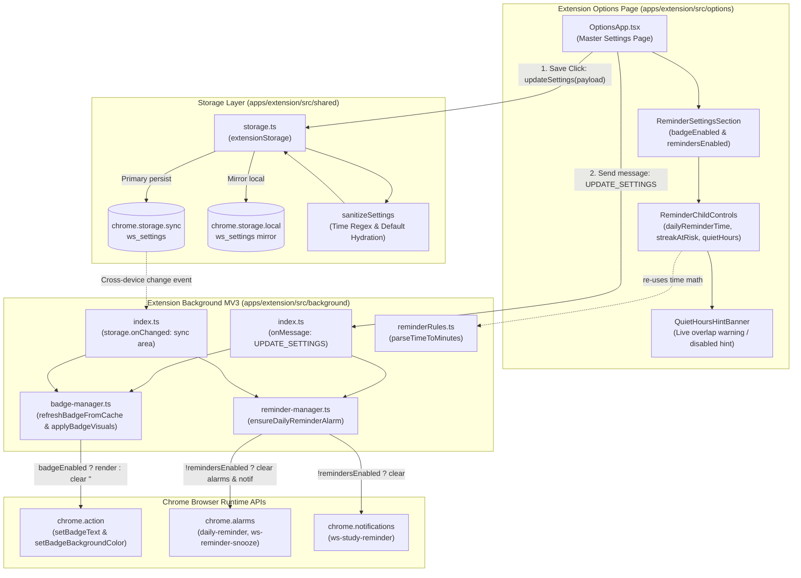
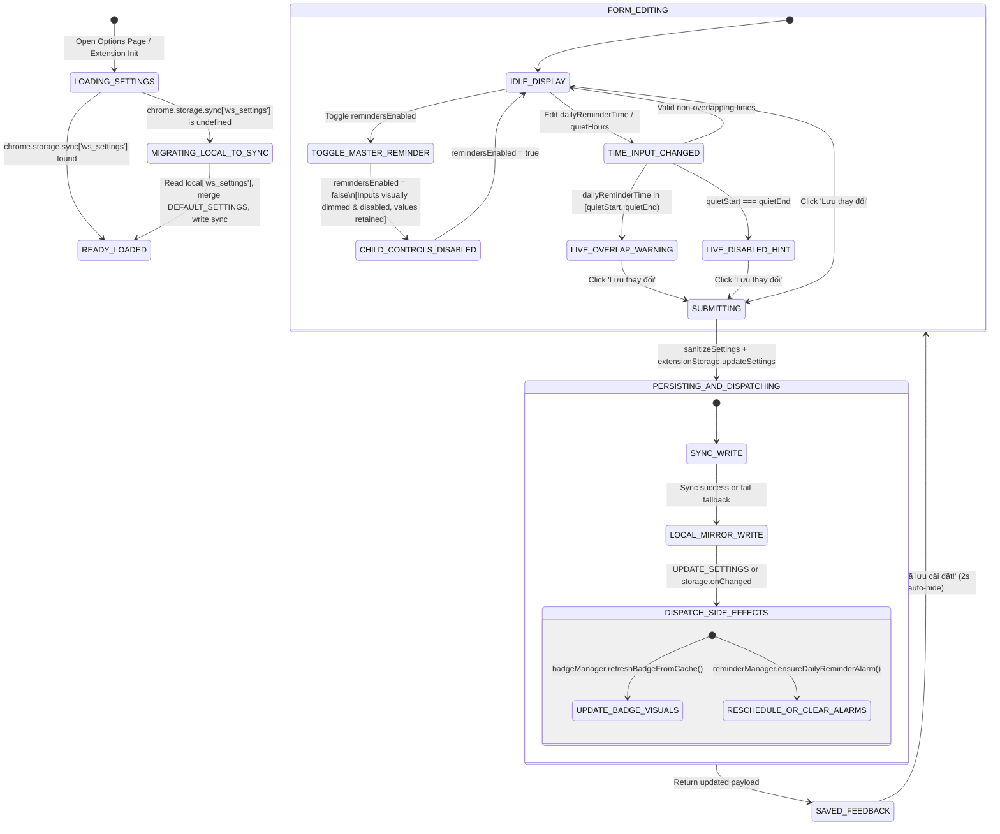

# Feature: Cài đặt nhắc học & Huy hiệu tiện ích — Options Page (US-ECO-07)

**Slug**: `extension-reminder-settings`  
**Version**: 1.0  
**Ship date**: 2026-10-13  
**Spec**: [.specify/features/extension-reminder-settings/](file:///Users/vutuanhau/Documents/PROJECT/WordStreak/.specify/features/extension-reminder-settings/)  
**Baseline**: [SIGNED-OFF v1.0](file:///Users/vutuanhau/Documents/PROJECT/WordStreak/.specify/features/extension-reminder-settings/baseline.md)  
**Plan**: [plan.md](file:///Users/vutuanhau/Documents/PROJECT/WordStreak/.specify/features/extension-reminder-settings/plan.md)  
**Review Report**: [review-report.md](file:///Users/vutuanhau/Documents/PROJECT/WordStreak/.specify/features/extension-reminder-settings/review-report.md)  
**User Story**: `US-ECO-07` (EPIC 06: Browser Extension & Ecosystem — Cài đặt nhắc học Options Page)

---

## 1. Mô tả ngắn (Overview & Business Value)

Tính năng **Extension Study Reminder & Badge Settings (Options Page)** (`US-ECO-07`) cung cấp trung tâm tùy biến trải nghiệm học tập và thông báo trên trình duyệt cho tiện ích mở rộng **WordStreak Chrome Extension (Manifest V3)**. Tính năng hoàn thiện bức tranh hệ sinh thái nhắc nhở học tập thông minh gồm 3 mảnh ghép:
1. Huy hiệu đếm số thẻ đến hạn trên thanh công cụ ([`extension-due-badge`](file:///Users/vutuanhau/Documents/PROJECT/WordStreak/docs/features/extension-due-badge/README.md) — `US-ECO-05`).
2. Động cơ thông báo desktop OS có điều kiện chống quấy rầy ([`extension-reminder-notifications`](file:///Users/vutuanhau/Documents/PROJECT/WordStreak/docs/features/extension-reminder-notifications/README.md) — `US-ECO-06`).
3. Giao diện quản lý cài đặt cá nhân hóa trên trang Options ([`extension-reminder-settings`](file:///Users/vutuanhau/Documents/PROJECT/WordStreak/docs/features/extension-reminder-settings/README.md) — `US-ECO-07`).

Trước khi có tính năng này, các thông số nhắc nhở (giờ hẹn nhắc hàng ngày `20:00`, khung giờ yên tĩnh `22:00–07:00`, hiển thị huy hiệu) bị cố định cứng theo giá trị mặc định hệ thống. Học viên có lịch sinh hoạt đặc thù (người đi làm về muộn, người học ca đêm, hoặc người muốn tập trung cao độ không bị phân tâm bởi số đếm trên thanh công cụ) không có cách nào điều chỉnh theo nhu cầu cá nhân.

Với `US-ECO-07`, người học đạt được:
- **Tùy biến toàn diện thời gian biểu học tập**: Linh hoạt cài đặt giờ nhắc cố định hàng ngày (`dailyReminderTime`), khung giờ yên tĩnh không làm phiền (`quietHoursStart`, `quietHoursEnd`), công tắc cảnh báo nguy cơ mất chuỗi (`streakAtRiskReminderEnabled`), và công tắc hiển thị huy hiệu (`badgeEnabled`).
- **Đồng bộ đa thiết bị tức thì (`chrome.storage.sync`)**: Toàn bộ tùy chọn `ws_settings` được lưu trữ trên bộ nhớ đồng bộ của tài khoản Google Chrome, giúp giữ nguyên cài đặt khi người học sử dụng nhiều máy tính cá nhân hoặc máy tính văn phòng, kèm cơ chế tự động chuyển đổi dữ liệu một lần (one-time read-through migration) từ `chrome.storage.local`.
- **Phản hồi tức thì không cần tải lại trình duyệt (Immediate Side-Effects)**: Thao tác lưu cài đặt lập tức cập nhật huy hiệu thanh công cụ và lên lịch lại hoặc hủy báo thức `chrome.alarms` thông qua thông điệp nội bộ `UPDATE_SETTINGS` và bộ lắng nghe sự kiện `chrome.storage.onChanged`.
- **Tách bạch an toàn giữa hiển thị huy hiệu và đồng bộ ngầm (Decoupled Background Polling)**: Khi tắt huy hiệu (`badgeEnabled = false`), chữ trên icon được xóa sạch (`""`), nhưng tiến trình kiểm tra số thẻ ngầm (`ReviewSummaryDto`) vẫn duy trì định kỳ 30 phút để phục vụ các cảnh báo nguy cơ đứt chuỗi của `US-ECO-06`.
- **Hỗ trợ thông minh tránh xung đột giờ giấc (Live Quiet Hours Conflict Guidance)**: Phân tích thời gian thực và hiển thị cảnh báo trực quan không chặn (non-blocking banner) khi giờ nhắc học vô tình rơi vào khung giờ yên tĩnh hoặc khi khung giờ yên tĩnh bị tắt do trùng mốc thời gian.

---

## 2. Phạm vi (MoSCoW Scope)

### 2.1. Phạm vi đã hoàn thành (Must-Have Delivered)

- [x] **Mở rộng hợp đồng kiểu dữ liệu dùng chung (`@wordstreak/shared-types`)**: Bổ sung `badgeEnabled: boolean` vào [`ReminderSettings`](file:///Users/vutuanhau/Documents/PROJECT/WordStreak/packages/shared-types/src/extension.ts#L31-L39) và [`ExtensionSettingsPayload`](file:///Users/vutuanhau/Documents/PROJECT/WordStreak/packages/shared-types/src/extension.ts#L41-L47).
- [x] **Hằng số mặc định hệ thống (`constants.ts`)**: Cấu hình `badgeEnabled: true` trong `DEFAULT_SETTINGS` tại [`apps/extension/src/shared/constants.ts`](file:///Users/vutuanhau/Documents/PROJECT/WordStreak/apps/extension/src/shared/constants.ts#L48-L60).
- [x] **Hạ tầng lưu trữ `chrome.storage.sync` & Tự động chuyển đổi (`storage.ts`)**:
  - Triển khai hàm chuẩn hóa dữ liệu thuần túy [`sanitizeSettings`](file:///Users/vutuanhau/Documents/PROJECT/WordStreak/apps/extension/src/shared/storage.ts#L24-L52) với kiểm tra định dạng giờ `HH:mm` nghiêm ngặt và bù trừ giá trị mặc định.
  - Triển khai đọc ưu tiên từ `chrome.storage.sync`, tự động di chuyển một lần (read-through migration) từ `chrome.storage.local['ws_settings']` khi vùng `sync` chưa có dữ liệu.
  - Cơ chế ghi kép (dual-write / mirror) xuống `chrome.storage.local` và hỗ trợ chuyển đổi mềm (graceful fallback) khi `chrome.storage.sync` bị lỗi hạn mức hoặc không khả dụng.
- [x] **Tách bạch hiển thị huy hiệu trên icon ([`badge-manager.ts`](file:///Users/vutuanhau/Documents/PROJECT/WordStreak/apps/extension/src/background/badge-manager.ts))**:
  - Bổ sung tham số `badgeEnabled` vào [`applyBadgeVisuals`](file:///Users/vutuanhau/Documents/PROJECT/WordStreak/apps/extension/src/background/badge-manager.ts#L47-L71). Khi `badgeEnabled === false`, lập tức xóa huy hiệu (`chrome.action.setBadgeText({ text: "" })`).
  - Cung cấp phương thức [`refreshBadgeFromCache`](file:///Users/vutuanhau/Documents/PROJECT/WordStreak/apps/extension/src/background/badge-manager.ts#L73-L82) giúp khôi phục số thẻ và màu sắc trên huy hiệu từ cache ngay lập tức khi người dùng bật lại mà không cần gọi API qua mạng.
  - Tiếp tục duy trì fetch dữ liệu `ReviewSummaryDto` ngầm định kỳ 30 phút kể cả khi huy hiệu tắt.
- [x] **Tác dụng phụ tức thì trên hệ thống báo thức ([`reminder-manager.ts`](file:///Users/vutuanhau/Documents/PROJECT/WordStreak/apps/extension/src/background/reminder-manager.ts))**:
  - Khi `remindersEnabled === false`: [`ensureDailyReminderAlarm`](file:///Users/vutuanhau/Documents/PROJECT/WordStreak/apps/extension/src/background/reminder-manager.ts#L28-L50) lập tức hủy báo thức hàng ngày `"daily-reminder"`, báo thức hoãn `"ws-reminder-snooze"`, và xóa thông báo đang treo `"ws-study-reminder"`.
  - Khi `remindersEnabled === true`: Lập tức tính toán và đặt lại mốc báo thức chính xác theo `dailyReminderTime` mới lưu.
- [x] **Điều phối Service Worker ngầm ([`index.ts`](file:///Users/vutuanhau/Documents/PROJECT/WordStreak/apps/extension/src/background/index.ts))**:
  - Mở rộng hàm xử lý [`handleSettingsUpdated`](file:///Users/vutuanhau/Documents/PROJECT/WordStreak/apps/extension/src/background/index.ts#L280-L287) cho thông điệp `UPDATE_SETTINGS`, đồng thời kích hoạt `badgeManager.refreshBadgeFromCache()` và `reminderManager.ensureDailyReminderAlarm()`.
  - Đăng ký bộ lắng nghe sự kiện đa thiết bị [`chrome.storage.onChanged`](file:///Users/vutuanhau/Documents/PROJECT/WordStreak/apps/extension/src/background/index.ts#L290-L297) để đồng bộ thay đổi từ các máy tính khác của người dùng.
- [x] **Giao diện người dùng Options Page ([`OptionsApp.tsx`](file:///Users/vutuanhau/Documents/PROJECT/WordStreak/apps/extension/src/options/OptionsApp.tsx))**:
  - Thiết kế khu vực chuyên biệt **"Nhắc học & Huy hiệu"** tuân thủ nguyên tắc thiết kế tối giản WordStreak (nền trắng `#ffffff`, viền mảnh `#e5e5e5`, màu nhấn tím `#863bff`, nút bấm đen bo tròn `#000000`).
  - Hỗ trợ công tắc độc lập cho huy hiệu icon (`badgeEnabled`) và công tắc tổng thông báo (`remindersEnabled`).
  - Tự động làm mờ (`opacity: 0.55`) và vô hiệu hóa (`disabled`) các trường con khi tắt công tắc tổng nhưng vẫn lưu giữ nguyên vẹn giá trị đã nhập trong state.
  - Hàm thuần túy [`getQuietHoursHint`](file:///Users/vutuanhau/Documents/PROJECT/WordStreak/apps/extension/src/options/OptionsApp.tsx#L7-L42) phát hiện tức thời:
    - Trùng mốc bắt đầu và kết thúc (`start === end`): Hiển thị thông báo giờ yên tĩnh đang tắt.
    - Giờ nhắc rơi vào khung giờ yên tĩnh nửa mở `[start, end)` (hỗ trợ cả cùng ngày và vắt qua nửa đêm): Hiển thị cảnh báo màu vàng kèm icon cảnh báo mà không chặn lưu form.
- [x] **Kiểm thử tự động toàn diện**: Đạt 100% test coverage trên 16 test cases BDD (`TC-ERS-001` .. `TC-ERS-016`), nâng tổng số unit tests của toàn bộ tiện ích mở rộng lên **135/135 tests xanh**.

### 2.2. Ngoài phạm vi (Won't-Have Trong Giai đoạn này)

- **Đồng bộ tùy chọn lên cơ sở dữ liệu backend (`/api/v1/users/preferences`)**: Theo lộ trình roadmap `[~]`, cài đặt của extension được đồng bộ giữa các máy tính qua dịch vụ `chrome.storage.sync` của tài khoản Google Chrome, không tạo bảng hoặc migration trong Prisma (`0` DB migrations).
- **Đưa form cài đặt nhắc nhở vào cửa sổ Popup (`PopupApp.tsx`)**: Popup Extension được giữ tinh gọn, dành riêng cho tính năng Tra từ/Lưu từ nhanh (Quick Capture) và phiên ôn tập 5 thẻ Micro-Review sắp tới (`US-ECO-08`).
- **Giao diện đa ngôn ngữ i18n động trong Options Page**: Giữ cấu trúc tĩnh tiếng Việt tối giản, đồng bộ với nội dung thông báo hệ thống của tiện ích.

---

## 3. Kiến trúc Kỹ thuật & Luồng Dữ liệu (Architecture & Data Flow)

### 3.1. Kiến trúc Thành phần (Component Architecture)



### 3.2. Sơ đồ Trạng thái Cài đặt & Vòng đời Đồng bộ (State Machine)



### 3.3. Sơ đồ Tuần tự Lưu Cài đặt & Phản hồi Tức thì (Sequence Diagram)

```mermaid
sequenceDiagram
    autonumber
    participant User as Người dùng (Options Page)
    participant Opt as OptionsApp.tsx
    participant Store as extensionStorage (storage.ts)
    participant Sync as chrome.storage.sync
    participant Local as chrome.storage.local
    participant Worker as Background (index.ts)
    participant BM as BadgeManager
    participant RM as ReminderManager
    participant Chrome as chrome.action / alarms / notifications

    User->>Opt: Mở trang Options
    Opt->>Store: getSettings()
    Store->>Sync: get("ws_settings")
    alt Dữ liệu Sync trống (Lần đầu nâng cấp)
        Sync-->>Store: undefined
        Store->>Local: get("ws_settings")
        Local-->>Store: localSettings
        Store->>Store: sanitizeSettings(DEFAULT + localSettings)
        Store->>Sync: set({ ws_settings: migrated }) (Best-effort)
    else Dữ liệu Sync đã có
        Sync-->>Store: syncSettings
    end
    Store-->>Opt: ExtensionSettingsPayload
    Opt->>User: Hiển thị form với giá trị đã tải

    User->>Opt: Tắt badgeEnabled, chỉnh dailyReminderTime="19:30"
    Opt->>Opt: getQuietHoursHint() tính toán trực tiếp
    User->>Opt: Bấm "Lưu thay đổi"
    
    Opt->>Store: updateSettings(newSettings)
    Store->>Store: sanitizeSettings(newSettings)
    Store->>Sync: set({ ws_settings: updated })
    Store->>Local: set({ ws_settings: updated }) (Mirror an toàn)
    Store-->>Opt: updatedSettings

    Opt->>Worker: chrome.runtime.sendMessage({ type: "UPDATE_SETTINGS", payload: updatedSettings })
    
    par Tác dụng phụ Huy hiệu
        Worker->>BM: refreshBadgeFromCache()
        BM->>Store: getSettings() & getReviewSummaryCache()
        BM->>Chrome: action.setBadgeText({ text: "" }) (nếu badgeEnabled = false)
    and Tác dụng phụ Nhắc nhở & Báo thức
        Worker->>RM: ensureDailyReminderAlarm()
        RM->>Store: getSettings()
        alt remindersEnabled === false
            RM->>Chrome: alarms.clear("daily-reminder") & alarms.clear("ws-reminder-snooze")
            RM->>Chrome: notifications.clear("ws-study-reminder")
        else remindersEnabled === true
            RM->>Chrome: alarms.create("daily-reminder", { when: 19:30, periodInMinutes: 1440 })
        end
    end

    Worker-->>Opt: { success: true, data: updatedSettings }
    Opt->>User: Hiển thị thông báo "Đã lưu cài đặt!" trong 2 giây
```

---

## 4. Quy tắc Nghiệp vụ Chi tiết (`BR-ERS-01` .. `BR-ERS-08`)

| Mã quy tắc | Tên quy tắc | Nội dung chi tiết |
| :--- | :--- | :--- |
| **`BR-ERS-01`** | **Hợp đồng Cài đặt Mặc định (Default Settings Contract)** | `DEFAULT_SETTINGS` bắt buộc chứa: `badgeEnabled: true`, `remindersEnabled: true`, `dailyReminderTime: "20:00"`, `quietHoursStart: "22:00"`, `quietHoursEnd: "07:00"`, `streakAtRiskReminderEnabled: true`. Mọi trường bị thiếu trong storage phải được tự động bù đắp từ giá trị mặc định này. |
| **`BR-ERS-02`** | **Lưu trữ `chrome.storage.sync` & Chuyển đổi một lần** | `extensionStorage.getSettings()` luôn đọc từ `chrome.storage.sync` trước. Nếu khóa `ws_settings` chưa tồn tại, hệ thống đọc từ `chrome.storage.local`, hợp nhất với `DEFAULT_SETTINGS`, ghi lưu một lần lên `chrome.storage.sync` và trả về kết quả. Nếu `sync` bị lỗi hoặc không khả dụng, hệ thống tự động lùi về `chrome.storage.local` và `localStorage`. |
| **`BR-ERS-03`** | **Công tắc Ẩn/Hiện Huy hiệu Icon (Toolbar Badge Toggle)** | Khi `badgeEnabled === false`, `BadgeManager.applyBadgeVisuals` lập tức gán text huy hiệu là chuỗi rỗng `""` (`chrome.action.setBadgeText({ text: "" })`). Tuy nhiên, tiến trình truy vấn dữ liệu học tập ngầm (`executeRefresh`) vẫn hoạt động bình thường để duy trì bộ nhớ đệm `ReviewSummaryDto` cho `US-ECO-06`. Khi bật lại `badgeEnabled === true`, hàm `refreshBadgeFromCache` khôi phục ngay số đếm và màu sắc từ cache mà không cần truy vấn mạng. |
| **`BR-ERS-04`** | **Công tắc Tổng Nhắc học & Bảo toàn Giá trị Con** | Khi `remindersEnabled === false`:<br/>1. `ReminderManager.ensureDailyReminderAlarm` hủy ngay báo thức `"daily-reminder"`, `"ws-reminder-snooze"` và xóa thông báo đang hiển thị `"ws-study-reminder"`.<br/>2. Trên giao diện `OptionsApp.tsx`, toàn bộ trường con (`dailyReminderTime`, `streakAtRiskReminderEnabled`, `quietHoursStart`, `quietHoursEnd`) bị vô hiệu hóa (`disabled`) và mờ đi (`opacity: 0.55`) nhưng vẫn giữ nguyên giá trị đã chọn trong state và storage. |
| **`BR-ERS-05`** | **Tác dụng phụ Tức thì khi Lưu & Đồng bộ Đa thiết bị** | Khi người dùng bấm lưu (`UPDATE_SETTINGS`) hoặc khi background nhận sự kiện `chrome.storage.onChanged` (do thiết bị Chrome khác đồng bộ về), hệ thống lập tức gọi `badgeManager.refreshBadgeFromCache()` và `reminderManager.ensureDailyReminderAlarm()` mà không cần khởi động lại service worker hay trình duyệt. |
| **`BR-ERS-06`** | **Cảnh báo Xung đột Giờ Yên tĩnh & Hướng dẫn Không chặn** | 1. Nếu `quietHoursStart === quietHoursEnd` (hoặc cùng số phút), giao diện hiển thị thông báo chú thích: *"Giờ yên lặng đang tắt vì giờ bắt đầu trùng giờ kết thúc."*<br/>2. Nếu `remindersEnabled === true` và `dailyReminderTime` rơi vào khoảng nửa mở `[quietHoursStart, quietHoursEnd)`, giao diện hiển thị cảnh báo: *"Giờ nhắc học hằng ngày đang nằm trong khung Giờ yên lặng — thông báo sẽ bị tạm ẩn vào thời điểm này."*<br/>3. Cảnh báo này không chặn việc lưu form của người dùng. |
| **`BR-ERS-07`** | **Chuẩn hóa & Xác thực Định dạng Giờ 24h** | Các trường thời gian phải tuân thủ nghiêm ngặt định dạng `"HH:mm"` theo biểu thức chính quy `^([01]\d|2[0-3]):([0-5]\d)$`. Bất kỳ chuỗi nào rỗng hoặc không hợp lệ khi lưu sẽ được tự động thay thế bằng giá trị thời gian tương ứng trong `DEFAULT_SETTINGS`. |
| **`BR-ERS-08`** | **Bảo vệ Hạn mức Đồng bộ & Ghi Gương Cục bộ** | Dữ liệu `ws_settings` được lưu gọn dưới một khóa JSON duy nhất (< 300 bytes, thấp hơn rất nhiều so với hạn mức 8 KB/khóa của `chrome.storage.sync`). Mọi thao tác ghi `updateSettings` đều đồng thời ghi gương (mirror) xuống `chrome.storage.local` để đảm bảo đọc ngoại tuyến an toàn nếu Google đồng bộ bị gián đoạn. |

---

## 5. Ma trận Xử lý Biên & Tình huống Ngoại lệ (Boundary Matrix)

| Tình huống ngoại lệ | Trạng thái đầu vào | Hành vi hệ thống mong đợi | Cơ chế xử lý |
| :--- | :--- | :--- | :--- |
| **Xung đột khung giờ yên tĩnh vắt qua nửa đêm** | `quietStart: "22:00"`, `quietEnd: "07:00"`, `dailyTime: "23:30"` hoặc `"06:00"` | Hàm `getQuietHoursHint` trả về `{ type: "overlap" }`. Hiển thị banner cảnh báo màu vàng `#fef3c7`. | Phép so sánh vắt qua nửa đêm: `daily >= start \|\| daily < end`. |
| **Mốc biên kết thúc khung giờ yên tĩnh** | `quietStart: "22:00"`, `quietEnd: "07:00"`, `dailyTime: "07:00"` | Khoảng thời gian yên tĩnh là nửa mở `[start, end)`. Mốc `"07:00"` nằm ngoài khung giờ yên tĩnh $\rightarrow$ không có cảnh báo (`hint === null`). | So sánh nghiêm ngặt `< endMinutes`. |
| **Mốc biên bắt đầu khung giờ yên tĩnh** | `quietStart: "22:00"`, `quietEnd: "07:00"`, `dailyTime: "22:00"` | Mốc `"22:00"` nằm đúng điểm bắt đầu của khoảng nửa mở $\rightarrow$ hiển thị cảnh báo xung đột. | So sánh bao hàm `>= startMinutes`. |
| **Khung giờ yên tĩnh bị tắt do trùng mốc** | `quietStart: "22:00"`, `quietEnd: "22:00"` | Hàm `getQuietHoursHint` trả về `{ type: "disabled" }`. Hiển thị banner màu xám thông báo tính năng giờ yên tĩnh đang tắt. | Điều kiện `startMinutes === endMinutes`. |
| **Ô nhập thời gian bị xóa rỗng trên trình duyệt** | Người dùng bấm nút xóa ô time input $\rightarrow$ `""` | `sanitizeSettings` kiểm tra Regex thất bại, tự động bù lại thời gian mặc định tương ứng (`"20:00"`, `"22:00"`, `"07:00"`). | Biểu thức `TIME_REGEX.test()`. |
| **Người dùng chưa đăng nhập tùy chỉnh cài đặt** | `token === null`, người dùng đổi `dailyReminderTime = "18:00"` | Cài đặt lưu thành công vào `chrome.storage.sync`. Báo thức và badge vẫn ở trạng thái tắt sạch theo `BR-ERS-05` cho tới khi đăng nhập. | Kiểm tra `!token` trong `BadgeManager` và `ReminderManager`. |
| **Nhận thay đổi từ máy tính khác (`storage.onChanged`)** | Profile Chrome ở máy khác cập nhật `badgeEnabled = false` | Service worker bắt sự kiện vùng `sync`, gọi ngay `refreshBadgeFromCache` làm trống huy hiệu và cập nhật báo thức. | Bộ lắng nghe `chrome.storage.onChanged.addListener`. |
| **`chrome.storage.sync` bị lỗi mạng hoặc quá hạn mức** | Trình duyệt ngoại tuyến hoặc môi trường thử nghiệm headless | Khối `try/catch` bắt lỗi an toàn và chuyển tiếp xuống `chrome.storage.local` / `localStorage` mà không làm văng exception. | Cơ chế fallback tự động trong `storage.ts`. |

---

## 6. Hợp đồng Lưu trữ, Kiểu Dữ liệu & Message Runtime

### 6.1. Hợp đồng Cài đặt Mở rộng (`ExtensionSettingsPayload`)

Được định nghĩa tại [`packages/shared-types/src/extension.ts`](file:///Users/vutuanhau/Documents/PROJECT/WordStreak/packages/shared-types/src/extension.ts#L41-L47):

```typescript
export interface ReminderSettings {
  /** Có hiển thị số thẻ đến hạn trên icon thanh công cụ hay không (mặc định true) */
  badgeEnabled?: boolean;
  /** Công tắc tổng bật/tắt toàn bộ thông báo nhắc học desktop OS (mặc định true) */
  remindersEnabled: boolean;
  /** Giờ gửi thông báo nhắc học cố định hằng ngày định dạng "HH:mm" 24h (mặc định "20:00") */
  dailyReminderTime: string;
  /** Giờ bắt đầu khung giờ yên lặng định dạng "HH:mm" (mặc định "22:00") */
  quietHoursStart: string;
  /** Giờ kết thúc khung giờ yên lặng định dạng "HH:mm" (mặc định "07:00") */
  quietHoursEnd: string;
  /** Có gửi thông báo khẩn cấp khi chuỗi ngày học có nguy cơ bị đứt hay không (mặc định true) */
  streakAtRiskReminderEnabled: boolean;
  /** Ngôn ngữ ưu tiên nhận thông báo của người dùng */
  preferredLanguage?: AppLanguage;
}

export interface ExtensionSettingsPayload extends ReminderSettings {
  badgeEnabled: boolean;
  pinnedDeckId: string | null;
  autoShowFloatingIcon: boolean;
  shortcutKey: string;
  blacklistedDomains: string[];
}
```

### 6.2. Hợp đồng Giá trị Mặc định (`DEFAULT_SETTINGS`)

Được định nghĩa tại [`apps/extension/src/shared/constants.ts`](file:///Users/vutuanhau/Documents/PROJECT/WordStreak/apps/extension/src/shared/constants.ts#L48-L60):

```typescript
export const DEFAULT_SETTINGS: ExtensionSettingsPayload = {
  pinnedDeckId: null,
  autoShowFloatingIcon: true,
  shortcutKey: "Alt+W",
  blacklistedDomains: [] as string[],
  badgeEnabled: true,
  remindersEnabled: true,
  dailyReminderTime: "20:00",
  quietHoursStart: "22:00",
  quietHoursEnd: "07:00",
  streakAtRiskReminderEnabled: true,
};
```

### 6.3. Hợp đồng Hàm Chuẩn hóa Dữ liệu (`sanitizeSettings`)

Được triển khai tại [`apps/extension/src/shared/storage.ts`](file:///Users/vutuanhau/Documents/PROJECT/WordStreak/apps/extension/src/shared/storage.ts#L24-L52):

```typescript
const TIME_REGEX = /^([01]\d|2[0-3]):([0-5]\d)$/;

export function sanitizeSettings(
  raw?: Partial<ExtensionSettingsPayload> | Record<string, any> | null,
): ExtensionSettingsPayload {
  const merged = { ...DEFAULT_SETTINGS, ...raw };
  return {
    ...merged,
    dailyReminderTime: TIME_REGEX.test(merged.dailyReminderTime)
      ? merged.dailyReminderTime
      : DEFAULT_SETTINGS.dailyReminderTime,
    quietHoursStart: TIME_REGEX.test(merged.quietHoursStart)
      ? merged.quietHoursStart
      : DEFAULT_SETTINGS.quietHoursStart,
    quietHoursEnd: TIME_REGEX.test(merged.quietHoursEnd)
      ? merged.quietHoursEnd
      : DEFAULT_SETTINGS.quietHoursEnd,
    badgeEnabled:
      typeof merged.badgeEnabled === "boolean"
        ? merged.badgeEnabled
        : DEFAULT_SETTINGS.badgeEnabled,
    remindersEnabled:
      typeof merged.remindersEnabled === "boolean"
        ? merged.remindersEnabled
        : DEFAULT_SETTINGS.remindersEnabled,
    streakAtRiskReminderEnabled:
      typeof merged.streakAtRiskReminderEnabled === "boolean"
        ? merged.streakAtRiskReminderEnabled
        : DEFAULT_SETTINGS.streakAtRiskReminderEnabled,
  };
}
```

### 6.4. Hợp đồng Thông điệp Runtime (`ExtensionMessage`)

| Loại thông điệp (`type`) | Payload | Xử lý tại Service Worker | Tác dụng phụ đi kèm |
| :--- | :--- | :--- | :--- |
| `UPDATE_SETTINGS` | `Partial<ExtensionSettingsPayload>` | `extensionStorage.updateSettings(payload)` | 1. Cập nhật huy hiệu: `badgeManager.refreshBadgeFromCache()`<br/>2. Cập nhật báo thức: `reminderManager.ensureDailyReminderAlarm()` |
| `GET_SETTINGS` | Không có | `extensionStorage.getSettings()` | Đọc từ `chrome.storage.sync` (hoặc chuyển đổi từ `local`) |

---

## 7. Giao diện Người dùng & Hệ thống Thiết kế (UI/UX Specifications)

Giao diện Options Page được thiết kế tuân thủ tuyệt đối quy chuẩn WordStreak Minimal Canvas:
- **Khung chứa chính (Container)**: Nền trắng `#ffffff`, bo tròn lớn `border-radius: 24px`, đường viền tóc `border: 1px solid #e5e5e5`, bóng mờ tinh tế `box-shadow: 0 4px 20px rgba(0, 0, 0, 0.03)`.
- **Thẻ cài đặt (Setting Card)**: Nền xám nhạt `#fbfbfb`, bo tròn `border-radius: 16px`, đường viền `border: 1px solid #e5e5e5`.
- **Màu sắc nhận diện**: Màu tím thương hiệu `#863bff` cho biểu tượng `<Bell />` và công tắc checkbox (`accent-color: #863bff`). Nút bấm lưu dạng viên thuốc `#000000` với chữ trắng bo tròn hoàn toàn `border-radius: 9999px`.
- **Trạng thái mờ khi tắt (Visual Dimming)**: Khi `remindersEnabled = false`, toàn bộ thẻ chứa các điều khiển con áp dụng hiệu ứng chuyển đổi mượt mà `opacity: 0.55`, `transition: opacity 0.2s ease`, và con trỏ chuột chuyển về mặc định (`cursor: default`).
- **Banner Cảnh báo Giờ Yên tĩnh (`QuietHoursHintBanner`)**:
  - Khi trùng giờ (`type: "disabled"`): Nền `#f3f4f6`, viền `#e5e5e5`, chữ và icon `#4b5563`.
  - Khi xung đột giờ (`type: "overlap"`): Nền vàng hổ phách `#fef3c7`, viền `#fcd34d`, chữ `#92400e`, icon `<AlertTriangle color="#d97706" />`.

---

## 8. Các Thay đổi Kỹ thuật Chính (Technical Changes)

### 8.1. Shared Types (`packages/shared-types`)

- **Tập tin**: [`packages/shared-types/src/extension.ts`](file:///Users/vutuanhau/Documents/PROJECT/WordStreak/packages/shared-types/src/extension.ts#L31-L47)
- **Thay đổi**: Thêm `badgeEnabled?: boolean` vào `ReminderSettings` và `badgeEnabled: boolean` vào `ExtensionSettingsPayload`.

### 8.2. Extension Constants (`apps/extension/src/shared`)

- **Tập tin**: [`apps/extension/src/shared/constants.ts`](file:///Users/vutuanhau/Documents/PROJECT/WordStreak/apps/extension/src/shared/constants.ts#L48-L60)
- **Thay đổi**: Bổ sung `badgeEnabled: true` vào `DEFAULT_SETTINGS`.

### 8.3. Storage Engine (`apps/extension/src/shared`)

- **Tập tin**: [`apps/extension/src/shared/storage.ts`](file:///Users/vutuanhau/Documents/PROJECT/WordStreak/apps/extension/src/shared/storage.ts#L22-L52, #L155-L230)
- **Thay đổi**: Thêm hàm chuẩn hóa `sanitizeSettings`, nâng cấp `getSettings()` hỗ trợ `chrome.storage.sync` kèm chuyển đổi dữ liệu từ `chrome.storage.local`, nâng cấp `updateSettings()` hỗ trợ ghi đồng thời vào vùng `sync` và `local`.

### 8.4. Badge Manager (`apps/extension/src/background`)

- **Tập tin**: [`apps/extension/src/background/badge-manager.ts`](file:///Users/vutuanhau/Documents/PROJECT/WordStreak/apps/extension/src/background/badge-manager.ts#L47-L82, #L163-L208)
- **Thay đổi**: Tách bạch logic đồ họa: `applyBadgeVisuals` nhận tham số `badgeEnabled` (xóa badge text khi false); bổ sung phương thức `refreshBadgeFromCache()`; tích hợp đọc `settings.badgeEnabled` trong các nhánh xử lý kết quả API.

### 8.5. Reminder Manager (`apps/extension/src/background`)

- **Tập tin**: [`apps/extension/src/background/reminder-manager.ts`](file:///Users/vutuanhau/Documents/PROJECT/WordStreak/apps/extension/src/background/reminder-manager.ts#L28-L50)
- **Thay đổi**: Cập nhật `ensureDailyReminderAlarm()` chủ động gọi `chrome.notifications.clear(REMINDER_NOTIFICATION_ID)` ngoài việc hủy báo thức khi `remindersEnabled === false`.

### 8.6. Background Orchestrator (`apps/extension/src/background`)

- **Tập tin**: [`apps/extension/src/background/index.ts`](file:///Users/vutuanhau/Documents/PROJECT/WordStreak/apps/extension/src/background/index.ts#L270-L297)
- **Thay đổi**: Triển khai `handleSettingsUpdated` xử lý `UPDATE_SETTINGS`, đồng thời kích hoạt `refreshBadgeFromCache()` và `ensureDailyReminderAlarm()`; bổ sung bộ lắng nghe sự kiện `chrome.storage.onChanged` cho vùng `sync`.

### 8.7. Options Page Application (`apps/extension/src/options`)

- **Tập tin**: [`apps/extension/src/options/OptionsApp.tsx`](file:///Users/vutuanhau/Documents/PROJECT/WordStreak/apps/extension/src/options/OptionsApp.tsx)
- **Thay đổi**: Tích hợp các sub-components: `ReminderSettingsSection`, `ReminderChildControls`, `QuietHoursHintBanner`, hàm thuần túy `getQuietHoursHint`, và hàm điều phối lưu `saveReminderSettings`.

---

## 9. Hướng dẫn Xác minh & Kiểm thử (Testing & Verification)

### 9.1. Các Lệnh Thực thi Kiểm thử Tự động

```bash
# 1. Kiểm tra biên dịch mã nguồn của Shared Types
pnpm --filter @wordstreak/shared-types build

# 2. Chạy toàn bộ test suites kiểm tra Storage & Migration (TC-ERS-001..004)
pnpm --filter @wordstreak/extension test src/shared/storage.spec.ts

# 3. Chạy test suites kiểm tra Badge Visibility & Cache Refresh (TC-ERS-005..007)
pnpm --filter @wordstreak/extension test src/background/badge-manager.spec.ts

# 4. Chạy test suites kiểm tra Reminder Manager & Update Handling (TC-ERS-008..010)
pnpm --filter @wordstreak/extension test src/background/reminder-manager.spec.ts

# 5. Chạy test suites kiểm tra giao diện Options & Quiet Hours Hint (TC-ERS-011..016)
pnpm --filter @wordstreak/extension test src/options/options-app.spec.tsx

# 6. Chạy toàn bộ 135 unit tests của tiện ích mở rộng
pnpm --filter @wordstreak/extension test

# 7. Biên dịch gói hoàn chỉnh của tiện ích mở rộng
pnpm --filter @wordstreak/extension build
```

### 9.2. Bảng Ma trận Kiểm thử (Test Traceability Matrix)

| Mã kiểm thử | Mô tả kiểm thử & Hành vi xác nhận | Tập tin thực thi | Kết quả |
| :--- | :--- | :--- | :---: |
| **`TC-ERS-001`** | `getSettings` trả về `DEFAULT_SETTINGS` với `badgeEnabled: true` khi storage rỗng | [`storage.spec.ts`](file:///Users/vutuanhau/Documents/PROJECT/WordStreak/apps/extension/src/shared/storage.spec.ts) | ✅ PASS |
| **`TC-ERS-002`** | Tự động chuyển đổi dữ liệu một lần từ `chrome.storage.local` sang `chrome.storage.sync` | [`storage.spec.ts`](file:///Users/vutuanhau/Documents/PROJECT/WordStreak/apps/extension/src/shared/storage.spec.ts) | ✅ PASS |
| **`TC-ERS-003`** | Lưu vào `sync`, ghi gương sang `local` và chuẩn hóa chuỗi giờ `"HH:mm"` không hợp lệ | [`storage.spec.ts`](file:///Users/vutuanhau/Documents/PROJECT/WordStreak/apps/extension/src/shared/storage.spec.ts) | ✅ PASS |
| **`TC-ERS-004`** | Xử lý lùi về `chrome.storage.local` an toàn khi `chrome.storage.sync` quăng lỗi/từ chối | [`storage.spec.ts`](file:///Users/vutuanhau/Documents/PROJECT/WordStreak/apps/extension/src/shared/storage.spec.ts) | ✅ PASS |
| **`TC-ERS-005`** | `applyBadgeVisuals` lập tức gán badge text là `""` khi `badgeEnabled === false` | [`badge-manager.spec.ts`](file:///Users/vutuanhau/Documents/PROJECT/WordStreak/apps/extension/src/background/badge-manager.spec.ts) | ✅ PASS |
| **`TC-ERS-006`** | `refreshBadgeNow` tiếp tục truy vấn API và chạy logic nhắc nhở khi badge bị tắt | [`badge-manager.spec.ts`](file:///Users/vutuanhau/Documents/PROJECT/WordStreak/apps/extension/src/background/badge-manager.spec.ts) | ✅ PASS |
| **`TC-ERS-007`** | `refreshBadgeFromCache` khôi phục ngay số đếm và màu sắc badge khi bật lại | [`badge-manager.spec.ts`](file:///Users/vutuanhau/Documents/PROJECT/WordStreak/apps/extension/src/background/badge-manager.spec.ts) | ✅ PASS |
| **`TC-ERS-008`** | `ensureDailyReminderAlarm` xóa báo thức và thông báo đang hiển thị khi tắt nhắc nhở | [`reminder-manager.spec.ts`](file:///Users/vutuanhau/Documents/PROJECT/WordStreak/apps/extension/src/background/reminder-manager.spec.ts) | ✅ PASS |
| **`TC-ERS-009`** | `ensureDailyReminderAlarm` lên lịch lại báo thức đúng theo `dailyReminderTime` mới | [`reminder-manager.spec.ts`](file:///Users/vutuanhau/Documents/PROJECT/WordStreak/apps/extension/src/background/reminder-manager.spec.ts) | ✅ PASS |
| **`TC-ERS-010`** | `handleSettingsUpdated` đồng thời kích hoạt `refreshBadgeFromCache` và `ensureDailyReminderAlarm` | [`reminder-manager.spec.ts`](file:///Users/vutuanhau/Documents/PROJECT/WordStreak/apps/extension/src/background/reminder-manager.spec.ts) | ✅ PASS |
| **`TC-ERS-011`** | Hiển thị khu vực **"Nhắc học & Huy hiệu"** với đầy đủ 6 trường dữ liệu đã nạp | [`options-app.spec.tsx`](file:///Users/vutuanhau/Documents/PROJECT/WordStreak/apps/extension/src/options/options-app.spec.tsx) | ✅ PASS |
| **`TC-ERS-012`** | Vô hiệu hóa điều khiển con khi `remindersEnabled === false` nhưng bảo toàn giá trị | [`options-app.spec.tsx`](file:///Users/vutuanhau/Documents/PROJECT/WordStreak/apps/extension/src/options/options-app.spec.tsx) | ✅ PASS |
| **`TC-ERS-013`** | Phát hiện xung đột giờ yên tĩnh (cả cùng ngày lẫn qua đêm) và hiển thị banner cảnh báo | [`options-app.spec.tsx`](file:///Users/vutuanhau/Documents/PROJECT/WordStreak/apps/extension/src/options/options-app.spec.tsx) | ✅ PASS |
| **`TC-ERS-014`** | Kiểm tra chính xác biên nửa mở: không cảnh báo tại `quietHoursEnd`, có cảnh báo tại `quietHoursStart` | [`options-app.spec.tsx`](file:///Users/vutuanhau/Documents/PROJECT/WordStreak/apps/extension/src/options/options-app.spec.tsx) | ✅ PASS |
| **`TC-ERS-015`** | Hiển thị thông báo chú thích giờ yên tĩnh đang tắt khi mốc bắt đầu trùng mốc kết thúc | [`options-app.spec.tsx`](file:///Users/vutuanhau/Documents/PROJECT/WordStreak/apps/extension/src/options/options-app.spec.tsx) | ✅ PASS |
| **`TC-ERS-016`** | `saveReminderSettings` lưu storage và gửi `UPDATE_SETTINGS` kể cả khi có cảnh báo xung đột | [`options-app.spec.tsx`](file:///Users/vutuanhau/Documents/PROJECT/WordStreak/apps/extension/src/options/options-app.spec.tsx) | ✅ PASS |

### 9.3. Hướng dẫn Kiểm tra Thủ công trên Trình duyệt

1. **Mở Trang Cài đặt Tiện ích**:
   - Biên dịch: `pnpm --filter @wordstreak/extension build`.
   - Vào `chrome://extensions`, nhấn biểu tượng chi tiết của WordStreak, hoặc chuột phải vào icon tiện ích chọn **Options** (Tùy chọn).
   - Cuộn xuống khu vực **"Nhắc học & Huy hiệu"**.
2. **Kiểm tra Bật/Tắt Huy hiệu Icon (`badgeEnabled`)**:
   - Khi đang đăng nhập và có thẻ đến hạn (icon có số `"12"` màu tím):
   - Bỏ tích ô *"Hiển thị số thẻ đến hạn trên icon tiện ích (Badge)"* và bấm **"Lưu thay đổi"**.
   - Quan sát icon trên thanh công cụ: Chữ số biến mất ngay lập tức (`""`).
   - Tích chọn lại ô này và bấm **"Lưu thay đổi"**: Số `"12"` màu tím lập tức hiển thị lại mà không cần tải lại trang.
3. **Kiểm tra Tắt Thông báo Tổng (`remindersEnabled`)**:
   - Bỏ tích ô *"Bật thông báo nhắc học hằng ngày"*.
   - Khung chứa các ô nhập giờ chuyển sang màu mờ nhạt (`opacity: 0.55`) và không thể bấm hay chỉnh sửa.
   - Các giá trị giờ đã chọn trước đó vẫn được hiển thị nguyên vẹn.
4. **Kiểm tra Cảnh báo Xung đột Giờ Yên tĩnh (Quiet Hours Conflict)**:
   - Đặt Giờ bắt đầu là `22:00`, Giờ kết thúc là `07:00`.
   - Đặt Giờ nhắc học cố định là `23:00`. Một dải banner màu vàng lập tức xuất hiện bên dưới thông báo giờ nhắc đang nằm trong khung giờ yên tĩnh.
   - Bấm **"Lưu thay đổi"**: Form lưu thành công bình thường (hiển thị thông báo xanh *"Đã lưu cài đặt!"*).
   - Đổi Giờ nhắc học cố định thành `07:00`: Dải banner màu vàng tự động biến mất ngay lập tức.
5. **Kiểm tra Khung giờ Yên tĩnh Trùng nhau**:
   - Đặt Giờ bắt đầu và Giờ kết thúc cùng là `22:00`.
   - Xuất hiện dải banner màu xám thông báo: *"Giờ yên lặng đang tắt vì giờ bắt đầu trùng giờ kết thúc."*

---

## 10. Rủi ro Chấp nhận & Biện pháp Giảm thiểu (Known Risks & Mitigations)

- **Lỗi không khả dụng của `chrome.storage.sync` (`RISK-ERS-01`)**: Trong các môi trường kiểm thử không đầu (headless Vitest) hoặc hồ sơ Chromium bị hạn chế chính sách, API `chrome.storage.sync` có thể không tồn tại hoặc từ chối gọi.
  - *Giải pháp*: Mọi lời gọi `chrome.storage.sync` trong [`storage.ts`](file:///Users/vutuanhau/Documents/PROJECT/WordStreak/apps/extension/src/shared/storage.ts#L161-L226) đều được bọc trong khối `try/catch` phòng thủ với cơ chế tự động chuyển sang `chrome.storage.local` và `localStorage`.
- **Mất cấu hình cũ khi chuyển sang lưu `sync` (`RISK-ERS-02`)**: Người dùng đã cài đặt tiện ích từ các phiên bản trước có nguy cơ mất deck ghim (`pinnedDeckId`) hoặc danh sách loại trừ (`blacklistedDomains`) khi hệ thống chuyển sang đọc từ `chrome.storage.sync`.
  - *Giải pháp*: Triển khai cơ chế di chuyển một lần (read-through migration). Khi `sync['ws_settings']` rỗng, hệ thống tự động đọc từ `local['ws_settings']`, hợp nhất và ghi đẩy lên `sync`.
- **Người dùng thắc mắc vì sao không nhận được thông báo sau khi hẹn giờ (`RISK-ERS-03`)**: Người dùng vô tình đặt giờ nhắc học vào ban đêm (ví dụ `23:00`) trùng khung giờ yên tĩnh và tưởng rằng hệ thống bị lỗi khi không thấy thông báo reo.
  - *Giải pháp*: Hiển thị banner cảnh báo trực tiếp trong `OptionsApp.tsx` bằng thuật toán thời gian dùng chung với background worker (`BR-ERS-06`).
- **Tắt huy hiệu gây ngừng đồng bộ dữ liệu ngầm (`RISK-ERS-04`)**: Nếu tắt huy hiệu dẫn đến việc ngừng gọi API kiểm tra thẻ, các thông báo bảo vệ chuỗi học tập `US-ECO-06` sẽ bị gián đoạn.
  - *Giải pháp*: Tách rời hoàn toàn logic hiển thị đồ họa (`applyBadgeVisuals`) khỏi tiến trình truy vấn dữ liệu ngầm (`executeRefresh`). Khi `badgeEnabled = false`, background vẫn fetch dữ liệu định kỳ bình thường.

---

## 11. Tác giả & Trạng thái

- **Feature**: `extension-reminder-settings` (`US-ECO-07`)
- **Implemented by**: AI Pair Programmer (Antigravity)
- **Technical Documentation Architect**: `tech-doc-architect`
- **Reviewed by**: Senior Engineering Team & Core Architect
- **Trạng thái**: Hoàn thành (`Delivered`) & Sẵn sàng phát hành (Production-Ready)
