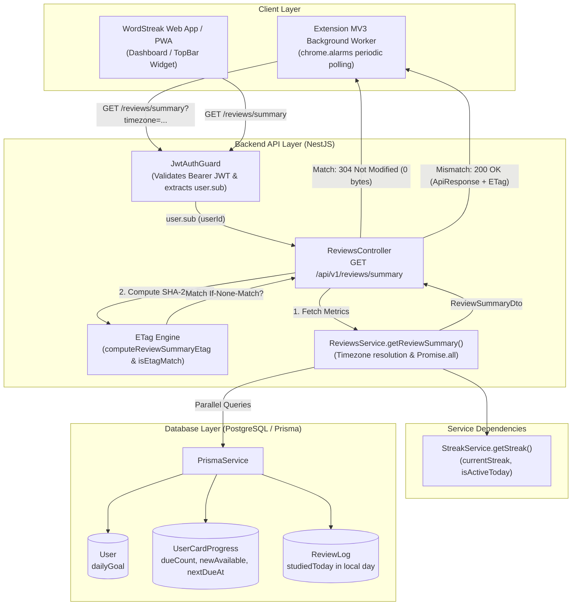
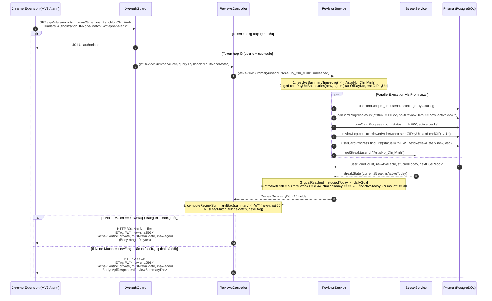

# Feature: API tóm tắt trạng thái học cho Extension (US-REM-01)

**Slug**: `review-summary-api`  
**Version**: 1.0  
**Ship date**: 2026-10-12  
**Spec**: [.specify/features/review-summary-api/](file:///Users/vutuanhau/Documents/PROJECT/WordStreak/.specify/features/review-summary-api/)  
**Baseline**: [SIGNED-OFF v1.0](file:///Users/vutuanhau/Documents/PROJECT/WordStreak/.specify/features/review-summary-api/baseline.md)  
**Contract**: [review-summary-api.md](file:///Users/vutuanhau/Documents/PROJECT/WordStreak/.specify/features/review-summary-api/contracts/review-summary-api.md)  
**User Story**: `US-REM-01` (EPIC 09: Ecosystem & Integrations)

---

## 1. Mô tả ngắn (Overview & Business Value)

Tính năng **Review Summary API** (`GET /api/v1/reviews/summary`) cung cấp một điểm cuối REST siêu nhẹ (lightweight), chuyên biệt hóa cho tiện ích mở rộng trình duyệt **WordStreak Chrome Extension (Manifest V3)** và Web App. Khi tiện ích mở rộng thức dậy định kỳ thông qua `chrome.alarms` để cập nhật huy hiệu số thẻ đến hạn (badge counter - `US-ECO-05`) hoặc đánh giá điều kiện gửi thông báo nhắc học (notification reminders - `US-ECO-06`), việc truy vấn endpoint hàng đợi đầy đủ (`GET /api/v1/reviews/due`) gây lãng phí băng thông và CPU do phải tải toàn bộ nội dung từ vựng ngữ cảnh, đồng thời thiếu các chỉ số tiến độ quan trọng trong ngày của người học.

Endpoint `GET /api/v1/reviews/summary` giải quyết triệt để vấn đề này bằng cách:
- Tập hợp đồng thời 10 chỉ số trạng thái học tập cô đọng trong một truy vấn song song tối ưu (`Promise.all`) với P95 latency `< 80ms`.
- Tách bạch số thẻ ôn tập định kỳ (`dueCount`) và số thẻ mới sẵn sàng nạp (`newAvailable`) thuộc các bộ thẻ đang kích hoạt (`isArchived: false`).
- Tự động nhận diện múi giờ IANA của client (`?timezone=` hoặc `X-Timezone`) để tính toán ranh giới ngày địa phương (`startOfDayUtc`, `endOfDayUtc`), tiến độ mục tiêu (`studiedToday`, `dailyGoal`, `goalReached`) và thời điểm kết thúc ngày (`endOfDayAt`).
- Cung cấp cờ cảnh báo sớm nguy cơ đứt chuỗi học (`streakAtRisk`) trong 3 giờ trước nửa đêm đối với người học có chuỗi học từ 3 ngày trở lên, giúp người dùng không bị lãng phí vật phẩm Streak Freeze.
- Triển khai cơ chế bộ nhớ đệm có điều kiện chuẩn RFC 9110 qua Weak ETag (`W/"<sha256>"`) và HTTP `304 Not Modified`, giảm payload về `0 bytes` khi trạng thái không thay đổi.

---

## 2. Phạm vi (MoSCoW Scope)

### 2.1. Phạm vi đã hoàn thành (Must-Have Delivered)

- [x] **Shared Contract DTO**: Định nghĩa [`ReviewSummaryDto`](file:///Users/vutuanhau/Documents/PROJECT/WordStreak/packages/shared-types/src/reviews.ts#L61-L72) trong `@wordstreak/shared-types` với 10 trường dữ liệu kiểu chặt chẽ.
- [x] **Timezone Resolution & Boundary Engine**: Triển khai [`resolveSummaryTimezone`](file:///Users/vutuanhau/Documents/PROJECT/WordStreak/apps/api/src/modules/reviews/reviews.service.ts#L23-L42) và [`getLocalDayUtcBoundaries`](file:///Users/vutuanhau/Documents/PROJECT/WordStreak/apps/api/src/modules/reviews/reviews.service.ts#L91-L130) hỗ trợ mọi múi giờ IANA (kể cả offset nửa giờ như `Asia/Kolkata`) với fallback an toàn về `'UTC'` (không bao giờ quăng lỗi 400).
- [x] **Concurrent Aggregation Service**: Thêm phương thức [`getReviewSummary`](file:///Users/vutuanhau/Documents/PROJECT/WordStreak/apps/api/src/modules/reviews/reviews.service.ts#L384-L462) trong [`ReviewsService`](file:///Users/vutuanhau/Documents/PROJECT/WordStreak/apps/api/src/modules/reviews/reviews.service.ts), gom 6 tác vụ Prisma + StreakService qua `Promise.all`.
- [x] **Active Deck Scope Filtering**: Loại trừ 100% thẻ thuộc các bộ từ đã lưu trữ (`isArchived: true`) khỏi `dueCount`, `newAvailable`, và `nextDueAt`.
- [x] **Streak Risk Calculation**: Tự động tính toán `streakAtRisk` dựa trên công thức `currentStreak >= 3 && studiedToday === 0 && !isActiveToday && msUntilEndOfDay <= 3h`.
- [x] **REST Controller with Weak ETag & 304**: Thêm endpoint [`getReviewSummary`](file:///Users/vutuanhau/Documents/PROJECT/WordStreak/apps/api/src/modules/reviews/reviews.controller.ts#L75-L102) tại [`ReviewsController`](file:///Users/vutuanhau/Documents/PROJECT/WordStreak/apps/api/src/modules/reviews/reviews.controller.ts) với các helper [`computeReviewSummaryEtag`](file:///Users/vutuanhau/Documents/PROJECT/WordStreak/apps/api/src/modules/reviews/reviews.controller.ts#L29-L46) và [`isEtagMatch`](file:///Users/vutuanhau/Documents/PROJECT/WordStreak/apps/api/src/modules/reviews/reviews.controller.ts#L48-L65).
- [x] **Comprehensive Test Suite**: Đạt 100% test coverage cho 12 test cases (`TC-REM-001` đến `TC-REM-012`) tại [`reviews.service.spec.ts`](file:///Users/vutuanhau/Documents/PROJECT/WordStreak/apps/api/src/modules/reviews/reviews.service.spec.ts) và [`reviews.controller.spec.ts`](file:///Users/vutuanhau/Documents/PROJECT/WordStreak/apps/api/src/modules/reviews/reviews.controller.spec.ts).

### 2.2. Ngoài phạm vi (Won't-Have Trong Giai đoạn này)

- Client listener trong Chrome Extension MV3 background worker (`US-ECO-05`).
- Hệ thống gửi push notification nhắc học trên hệ điều hành (`US-ECO-06`).
- Giao diện cài đặt nhắc nhở trong Extension Options (`US-ECO-07`).
- Bất kỳ sửa đổi nào đối với cơ sở dữ liệu hoặc Prisma schema (0 migrations).

---

## 3. Kiến trúc Kỹ thuật & Luồng Dữ liệu (Architecture & Data Flow)

### 3.1. Kiến trúc Thành phần (Component Architecture)



### 3.2. Sơ đồ tuần tự Polling & Caching (Sequence Diagram)



---

## 4. Quy tắc Nghiệp vụ Chi tiết (Business Rules `BR-REM-001` .. `BR-REM-008`)

| Mã quy tắc | Tên quy tắc | Nội dung chi tiết |
| :--- | :--- | :--- |
| **`BR-REM-001`** | **Timezone Resolution & Local Day Boundaries** | - Thứ tự ưu tiên phân giải múi giờ: `?timezone=` (hợp lệ qua `Intl.DateTimeFormat`) $\rightarrow$ header `X-Timezone` (hợp lệ) $\rightarrow$ `'UTC'`.<br/>- Múi giờ không hợp lệ hoặc thiếu **không bao giờ** làm ném lỗi `400 Bad Request`.<br/>- Dựa trên `now = new Date()`, tính toán chính xác ngày lịch địa phương `(year, month, day)` và suy ra `startOfDayUtc` (`00:00:00.000`) và `endOfDayUtc` (`23:59:59.999`) dưới dạng UTC timestamp. |
| **`BR-REM-002`** | **Active Deck Scope & Ownership Filter** | - Tất cả các truy vấn số thẻ (`dueCount`, `newAvailable`, `nextDueAt`) bắt buộc lọc theo điều kiện: `userId: authenticatedUserId` và `card: { deck: { userId: authenticatedUserId, isArchived: false } }`.<br/>- Các bộ thẻ đã lưu trữ (`isArchived: true`) bị loại trừ hoàn toàn. Nếu tất cả bộ thẻ đều archived, kết quả là `dueCount = 0`, `newAvailable = 0`, `nextDueAt = null`. |
| **`BR-REM-003`** | **`dueCount` & `newAvailable` Separation** | - `dueCount`: Số thẻ trong bộ thẻ active có `status !== 'NEW'` và `nextReviewDate <= now`.<br/>- `newAvailable`: Tổng số thẻ chưa học trong bộ thẻ active có `status === 'NEW'` (không bị giới hạn bởi `dailyGoal`).<br/>- Sự phân tách này đảm bảo thẻ mới không làm sai lệch số thẻ ôn tập đến hạn trên huy hiệu Extension. |
| **`BR-REM-004`** | **`studiedToday`, `dailyGoal`, & `goalReached`** | - `dailyGoal`: Lấy từ `User.dailyGoal` (mặc định `10` nếu rỗng/người dùng mới).<br/>- `studiedToday`: Số bản ghi `ReviewLog` của user trong khoảng `[startOfDayUtc, endOfDayUtc]`. Đếm toàn bộ lượt review trong ngày ngay cả khi bộ thẻ bị archive sau đó.<br/>- `goalReached`: Đánh giá theo điều kiện `studiedToday >= dailyGoal`. |
| **`BR-REM-005`** | **`nextDueAt` Calculation** | - Lấy mốc thời gian `nextReviewDate` nhỏ nhất (`orderBy: { nextReviewDate: 'asc' }`) của các thẻ trong bộ thẻ active có `status !== 'NEW'` và `nextReviewDate > now`.<br/>- Trả về chuỗi ISO 8601 UTC string (ví dụ `"2026-10-12T15:30:00.000Z"`) hoặc `null` nếu không còn thẻ nào có lịch trong tương lai. |
| **`BR-REM-006`** | **`currentStreak` & `streakAtRisk` Formula** | - Tái sử dụng [`StreakService.getStreak(userId, timezone)`](file:///Users/vutuanhau/Documents/PROJECT/WordStreak/apps/api/src/modules/streaks/streak.service.ts).<br/>- Tính số mili-giây còn lại đến nửa đêm địa phương: `msUntilEndOfDay = endOfDayUtc.getTime() - now.getTime()`.<br/>- Điều kiện kích hoạt `streakAtRisk = true`:<br/>&nbsp;&nbsp;1. `currentStreak >= 3`<br/>&nbsp;&nbsp;2. `studiedToday === 0` và `!isActiveToday`<br/>&nbsp;&nbsp;3. `msUntilEndOfDay > 0` và `msUntilEndOfDay <= 10,800,000` (còn 3 giờ trở xuống).<br/>- **Chính sách Freeze**: Cảnh báo `streakAtRisk = true` ngay cả khi `streakFreezes > 0` để nhắc nhở người dùng học trước khi hệ thống tự động trừ freeze. |
| **`BR-REM-007`** | **Response Envelope Contract** | - Phản hồi thành công `200 OK` luôn được bọc trong cấu trúc chuẩn: `{ success: true, data: ReviewSummaryDto }`. |
| **`BR-REM-008`** | **Weak ETag & `304 Not Modified` Caching** | - Tính toán chuỗi mã băm SHA-256 từ chuỗi JSON chuẩn hóa của 10 trường trong `ReviewSummaryDto` theo thứ tự xác định: `W/"<64-char-hex-hash>"`.<br/>- Đính kèm header `ETag: W/"..."` và `Cache-Control: private, must-revalidate, max-age=0`.<br/>- So sánh với header `If-None-Match` theo chuẩn RFC 9110 (hỗ trợ tiền tố yếu `W/`, chuỗi băm thuần, danh sách phân tách bằng dấu phẩy, và ký tự `*`). Khi khớp, trả về HTTP `304 Not Modified` với body rỗng (`0 bytes`). |

---

## 5. Chi tiết API Contract & Tham chiếu ETag / 304

### 5.1. Endpoint Reference

- **Method**: `GET`
- **Route**: `/api/v1/reviews/summary`
- **Bảo mật**: `Bearer JWT` qua [`JwtAuthGuard`](file:///Users/vutuanhau/Documents/PROJECT/WordStreak/apps/api/src/common/guards/jwt-auth.guard.ts)
- **Mã phản hồi**:
  - `200 OK`: Trả về dữ liệu tóm tắt đầy đủ khi chưa có ETag hoặc dữ liệu đã có sự thay đổi.
  - `304 Not Modified`: Khi dữ liệu khớp hoàn toàn với `If-None-Match` (không tốn dung lượng truyền tải).
  - `401 Unauthorized`: Khi token JWT bị thiếu hoặc không hợp lệ.

### 5.2. Tham số yêu cầu (Request Parameters & Headers)

| Vị trí | Tên | Kiểu | Bắt buộc | Mô tả |
| :--- | :--- | :--- | :---: | :--- |
| **Query** | `timezone` | `string` | Không | Định danh IANA timezone (ví dụ: `Asia/Ho_Chi_Minh`, `America/New_York`). Ưu tiên cao nhất. |
| **Header** | `Authorization` | `string` | **Có** | `Bearer <access_token>`. |
| **Header** | `X-Timezone` | `string` | Không | Múi giờ dự phòng khi tham số query bị khuyết hoặc không hợp lệ. |
| **Header** | `If-None-Match` | `string` | Không | Chuỗi ETag đã nhận ở lần gọi trước (ví dụ `W/"8f434346..."`). |

### 5.3. Cấu trúc Payload DTO (`ReviewSummaryDto`)

```typescript
export interface ReviewSummaryDto {
  dueCount: number;         // Số thẻ đến hạn ôn tập (status != 'NEW', nextReviewDate <= now)
  newAvailable: number;     // Tổng số thẻ mới chưa học (status == 'NEW')
  studiedToday: number;     // Số thẻ đã ôn tập trong ngày địa phương hôm nay
  dailyGoal: number;        // Mục tiêu học hàng ngày (User.dailyGoal, mặc định 10)
  goalReached: boolean;     // Đã đạt mục tiêu hôm nay (studiedToday >= dailyGoal)
  currentStreak: number;    // Chuỗi ngày học liên tục hiện tại
  streakAtRisk: boolean;    // Cảnh báo nguy cơ đứt chuỗi (streak >= 3, chưa học, còn <= 3h)
  timezone: string;         // Múi giờ IANA đã được phân giải (mặc định 'UTC')
  endOfDayAt: string;       // Thời điểm kết thúc ngày địa phương (ISO 8601 UTC)
  nextDueAt: string | null; // Lịch ôn tập sớm nhất kế tiếp trong tương lai (ISO 8601 UTC)
}
```

### 5.4. Ví dụ Phản hồi

#### 200 OK (Dữ liệu thay đổi hoặc lần gọi đầu tiên)
```http
HTTP/1.1 200 OK
Content-Type: application/json; charset=utf-8
ETag: W/"8f434346648f6b96df89dda901c5176b10a6d83961dd3c1ac88b59b2dc327aa4"
Cache-Control: private, must-revalidate, max-age=0

{
  "success": true,
  "data": {
    "dueCount": 12,
    "newAvailable": 35,
    "studiedToday": 4,
    "dailyGoal": 10,
    "goalReached": false,
    "currentStreak": 5,
    "streakAtRisk": false,
    "timezone": "Asia/Ho_Chi_Minh",
    "endOfDayAt": "2026-10-12T16:59:59.999Z",
    "nextDueAt": "2026-10-12T15:30:00.000Z"
  }
}
```

#### 304 Not Modified (Trạng thái không đổi)
```http
HTTP/1.1 304 Not Modified
ETag: W/"8f434346648f6b96df89dda901c5176b10a6d83961dd3c1ac88b59b2dc327aa4"
Cache-Control: private, must-revalidate, max-age=0
```
*(Body rỗng: 0 bytes)*

---

## 6. Các Thay đổi Kỹ thuật Chính (Technical Changes)

### 6.1. Shared Types (`packages/shared-types`)

- **File**: [`packages/shared-types/src/reviews.ts`](file:///Users/vutuanhau/Documents/PROJECT/WordStreak/packages/shared-types/src/reviews.ts#L61-L72)
- **Thay đổi**: Thêm và xuất interface [`ReviewSummaryDto`](file:///Users/vutuanhau/Documents/PROJECT/WordStreak/packages/shared-types/src/reviews.ts#L61-L72).

### 6.2. Backend NestJS (`apps/api`)

- **File**: [`apps/api/src/modules/reviews/reviews.service.ts`](file:///Users/vutuanhau/Documents/PROJECT/WordStreak/apps/api/src/modules/reviews/reviews.service.ts)
  - Khai báo các hằng số: `STREAK_RISK_MIN_DAYS = 3`, `STREAK_RISK_WINDOW_MS = 10,800,000`, `DEFAULT_DAILY_GOAL = 10`.
  - Hàm tiện ích: [`resolveSummaryTimezone`](file:///Users/vutuanhau/Documents/PROJECT/WordStreak/apps/api/src/modules/reviews/reviews.service.ts#L23-L42), `localWallClockToUtc`, [`getLocalDayUtcBoundaries`](file:///Users/vutuanhau/Documents/PROJECT/WordStreak/apps/api/src/modules/reviews/reviews.service.ts#L91-L130).
  - Phương thức: [`getReviewSummary(userId, queryTz, headerTz)`](file:///Users/vutuanhau/Documents/PROJECT/WordStreak/apps/api/src/modules/reviews/reviews.service.ts#L384-L462) tổng hợp dữ liệu qua `Promise.all`.
- **File**: [`apps/api/src/modules/reviews/reviews.controller.ts`](file:///Users/vutuanhau/Documents/PROJECT/WordStreak/apps/api/src/modules/reviews/reviews.controller.ts)
  - Helper functions: [`computeReviewSummaryEtag`](file:///Users/vutuanhau/Documents/PROJECT/WordStreak/apps/api/src/modules/reviews/reviews.controller.ts#L29-L46), [`isEtagMatch`](file:///Users/vutuanhau/Documents/PROJECT/WordStreak/apps/api/src/modules/reviews/reviews.controller.ts#L48-L65).
  - Endpoint handler: [`@Get('summary') getReviewSummary`](file:///Users/vutuanhau/Documents/PROJECT/WordStreak/apps/api/src/modules/reviews/reviews.controller.ts#L75-L102) hỗ trợ `@Res({ passthrough: true })` để set header ETag, Cache-Control và trả về status `304`.

### 6.3. Database (PostgreSQL / Prisma)

- **Schema changes**: Không có (0 thay đổi model, 0 migration).
- **Entities tái sử dụng**: `User`, `UserCardProgress`, `ReviewLog`, `UserStreak`, `Deck`.

---

## 7. Hướng dẫn Xác minh & Kiểm thử (How-To & Verification)

### 7.1. Chạy Unit Tests tự động

Để thực thi toàn bộ test suite của module `reviews` (bao gồm `reviews.service.spec.ts` và `reviews.controller.spec.ts`):

```bash
pnpm --filter api test apps/api/src/modules/reviews/
```

### 7.2. Bảng Ma trận Kiểm thử (Test Traceability Matrix)

| Test Case | Mô tả kiểm thử | File thực thi | Trạng thái |
| :--- | :--- | :--- | :---: |
| `TC-REM-001` | Tính toán tóm tắt 10 trường trong múi giờ `Asia/Ho_Chi_Minh` | [`reviews.service.spec.ts`](file:///Users/vutuanhau/Documents/PROJECT/WordStreak/apps/api/src/modules/reviews/reviews.service.spec.ts#L313-L351) | ✅ PASS |
| `TC-REM-002` | Đánh dấu `goalReached = true` khi `studiedToday >= dailyGoal` | [`reviews.service.spec.ts`](file:///Users/vutuanhau/Documents/PROJECT/WordStreak/apps/api/src/modules/reviews/reviews.service.spec.ts#L353-L376) | ✅ PASS |
| `TC-REM-003` | Kích hoạt `streakAtRisk = true` khi streak $\ge 3$, chưa học, trong 3h trước nửa đêm | [`reviews.service.spec.ts`](file:///Users/vutuanhau/Documents/PROJECT/WordStreak/apps/api/src/modules/reviews/reviews.service.spec.ts#L378-L410) | ✅ PASS |
| `TC-REM-004` | Giữ `streakAtRisk = false` khi streak $< 3$, ngoài cửa sổ 3h, hoặc đã học | [`reviews.service.spec.ts`](file:///Users/vutuanhau/Documents/PROJECT/WordStreak/apps/api/src/modules/reviews/reviews.service.spec.ts#L412-L467) | ✅ PASS |
| `TC-REM-005` | Lọc nghiêm ngặt các bộ thẻ active (`isArchived: false`) | [`reviews.service.spec.ts`](file:///Users/vutuanhau/Documents/PROJECT/WordStreak/apps/api/src/modules/reviews/reviews.service.spec.ts#L469-L520) | ✅ PASS |
| `TC-REM-006` | Phân giải độ ưu tiên timezone và fallback an toàn về `'UTC'` | [`reviews.service.spec.ts`](file:///Users/vutuanhau/Documents/PROJECT/WordStreak/apps/api/src/modules/reviews/reviews.service.spec.ts#L522-L564) | ✅ PASS |
| `TC-REM-007` | Xử lý an toàn người dùng mới với 0 deck và null dailyGoal | [`reviews.service.spec.ts`](file:///Users/vutuanhau/Documents/PROJECT/WordStreak/apps/api/src/modules/reviews/reviews.service.spec.ts#L566-L591) | ✅ PASS |
| `TC-REM-008` | Trả về `200 OK` với ApiResponse, Weak ETag và Cache-Control | [`reviews.controller.spec.ts`](file:///Users/vutuanhau/Documents/PROJECT/WordStreak/apps/api/src/modules/reviews/reviews.controller.spec.ts#L201-L246) | ✅ PASS |
| `TC-REM-009` | Trả về `304 Not Modified` với body rỗng khi If-None-Match khớp | [`reviews.controller.spec.ts`](file:///Users/vutuanhau/Documents/PROJECT/WordStreak/apps/api/src/modules/reviews/reviews.controller.spec.ts#L248-L300) | ✅ PASS |
| `TC-REM-010` | Xử lý `If-None-Match` dạng danh sách, chuỗi băm thuần và wildcard `*` | [`reviews.controller.spec.ts`](file:///Users/vutuanhau/Documents/PROJECT/WordStreak/apps/api/src/modules/reviews/reviews.controller.spec.ts#L302-L378) | ✅ PASS |
| `TC-REM-011` | Trả về `200 OK` với body mới khi `If-None-Match` bị cũ | [`reviews.controller.spec.ts`](file:///Users/vutuanhau/Documents/PROJECT/WordStreak/apps/api/src/modules/reviews/reviews.controller.spec.ts#L380-L413) | ✅ PASS |
| `TC-REM-012` | Xác minh `JwtAuthGuard` bảo vệ toàn bộ ReviewsController | [`reviews.controller.spec.ts`](file:///Users/vutuanhau/Documents/PROJECT/WordStreak/apps/api/src/modules/reviews/reviews.controller.spec.ts#L415-L422) | ✅ PASS |

### 7.3. Hướng dẫn Test Thủ công bằng cURL

#### Bước 1: Gọi lần đầu để nhận dữ liệu và ETag
```bash
curl -i -X GET "http://localhost:3000/api/v1/reviews/summary?timezone=Asia/Ho_Chi_Minh" \
  -H "Authorization: Bearer <your-jwt-token>"
```
*Kết quả kỳ vọng*: HTTP `200 OK`, header `ETag: W/"..."`, body chứa 10 trường JSON.

#### Bước 2: Gọi lần hai với header `If-None-Match` để kiểm tra 304
```bash
curl -i -X GET "http://localhost:3000/api/v1/reviews/summary?timezone=Asia/Ho_Chi_Minh" \
  -H "Authorization: Bearer <your-jwt-token>" \
  -H 'If-None-Match: W/"<etag-nhan-o-buoc-1>"'
```
*Kết quả kỳ vọng*: HTTP `304 Not Modified`, header `ETag` giữ nguyên, không có payload body (0 bytes).

---

## 8. Known Accepted Risks & Mitigations

- **Rủi ro lệch múi giờ trên máy client (`RISK-REM-001`)**: Client gửi chuỗi timezone rác hoặc đồng hồ hệ điều hành bị lệch.
  - *Giải pháp*: Endpoint sử dụng server-side UTC time làm mốc tính toán, kiểm tra múi giờ qua `Intl.DateTimeFormat`, và tự động fallback về `'UTC'` nếu không hợp lệ.
- **Rủi ro tải CPU khi Extension gọi định kỳ (`RISK-REM-004`)**: Polling thường xuyên làm quá tải backend.
  - *Giải pháp*: Truy vấn song song nhẹ (`Promise.all`) sử dụng index DB có sẵn, phản hồi `304 Not Modified` tiêu tốn cực ít tài nguyên server và băng thông mạng.
- **Rủi ro rò rỉ bộ nhớ đệm dùng chung CDN (`RISK-REM-005`)**: Cache proxy lưu chung thông tin cá nhân giữa các người dùng.
  - *Giải pháp*: Đặt cố định header `Cache-Control: private, must-revalidate, max-age=0`.

---

## 9. Tác giả & Trạng thái

- **Feature**: `review-summary-api` (`US-REM-01`)
- **Implemented by**: AI Pair Programmer (Antigravity)
- **Technical Documentation Architect**: `tech-doc-architect`
- **Reviewed by**: Senior Engineering Team
- **Trạng thái**: Hoàn thành (`Delivered`) & Sẵn sàng tích hợp với Extension MV3
