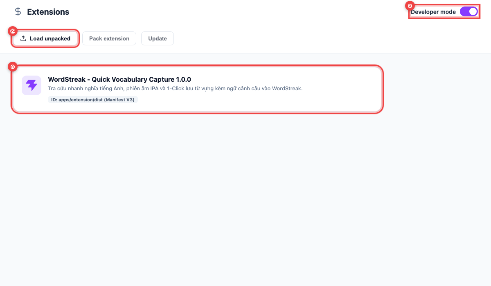
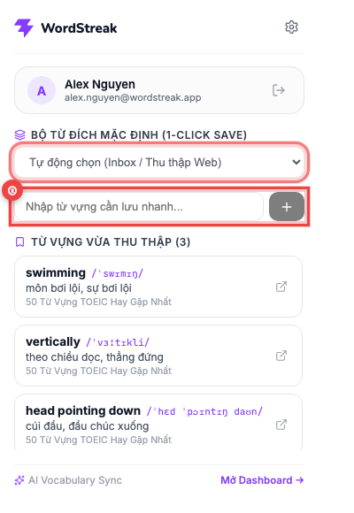

# 📖 Hướng dẫn Sử dụng: Huy hiệu Số thẻ Đến hạn trên Extension (US-ECO-05)

> **Đối tượng độc giả:** Người học WordStreak  
> **Phiên bản:** 1.0 (Extension Manifest V3)  
> **Tính năng liên quan:** `US-ECO-05` (Badge Toolbar), `US-REM-01` (Review Summary API)  
> **Cập nhật lần cuối:** 2026-10-12  

---

## 🎯 Giới thiệu Tính năng

**Huy hiệu Số thẻ Đến hạn (Due Cards Toolbar Badge)** là tính năng thông minh giúp bạn theo dõi việc học từ vựng một cách thụ động và nhẹ nhàng ngay trên thanh công cụ của trình duyệt:

- 🟣 **Hiển thị Số thẻ Cần ôn tập Tức thì:** Biểu tượng WordStreak trên thanh công cụ luôn hiển thị số lượng từ vựng cần ôn tập hôm nay (`1` đến `99`, hoặc `99+` nếu có trên 100 từ).
- 🔴 **Cảnh báo Sớm Nguy cơ Đứt Chuỗi (Streak at Risk):** Khi chuỗi học (streak) của bạn từ 3 ngày trở lên, chưa hoàn thành bài học hôm nay và còn dưới 3 tiếng trước nửa đêm, huy hiệu sẽ tự động chuyển sang **màu đỏ rực** để nhắc bạn ôn tập kịp thời trước khi bị mất chuỗi.
- ⚪ **Tự động Ẩn khi Đã Hoàn thành:** Khi không còn thẻ nào đến hạn (`0` thẻ), huy hiệu sẽ tự động ẩn đi để giữ giao diện trình duyệt luôn gọn gàng.
- ⚡ **Đồng bộ Thời gian thực:** Khi bạn vừa làm xong bài ôn tập trên Web App (`/review`), huy hiệu trên biểu tượng tiện ích sẽ tự động giảm số thẻ trong vòng 3 giây mà không cần bạn phải bấm nút tải lại trang.

---

## 🎨 Ý nghĩa Màu sắc & Con số trên Huy hiệu

| Trạng thái Huy hiệu | Ý nghĩa hiển thị | Hành động đề xuất |
| :---: | :--- | :--- |
| **`""`** *(Biểu tượng không có số)* | **0 thẻ đến hạn** hoặc **Chưa đăng nhập**. Tất cả từ vựng của bạn đều chưa tới lịch ôn tập. | Thư giãn hoặc bôi đen lưu thêm từ vựng mới khi đọc báo! |
| **`1` – `99`** **Nền Tím `#863BFF`** | **Có thẻ đến hạn ôn tập bình thường**. Ví dụ hiển thị số `12` nghĩa là bạn có 12 thẻ từ vựng đã đến lịch giãn cách SM-2. | Bấm vào biểu tượng hoặc mở Web App để làm một phiên ôn tập nhanh. |
| **`1` – `99+`** **Nền Đỏ `#EF4444`** | **CẢNH BÁO: Nguy cơ đứt chuỗi học!** Bạn đang có chuỗi học liên tục nhưng hôm nay chưa ôn tập và chỉ còn dưới 3 tiếng nữa là hết ngày. | Hãy ôn tập ngay để giữ vững Streak và không bị trừ vật phẩm Streak Freeze! |
| **`99+`** **Nền Tím `#863BFF` / Đỏ `#EF4444`** | **Có hơn 99 thẻ từ vựng tích lũy**. Hệ thống rút gọn số thẻ để chữ không bị tràn khung hiển thị của trình duyệt. | Hãy chia nhỏ thành các phiên học 10–15 thẻ để giải phóng hàng đợi từ vựng. |

---

## 🔄 Cơ chế Hoạt động Tự động

Bạn không cần phải cấu hình hay thao tác bất kỳ bước phức tạp nào:

1. **Khi mở trình duyệt (Browser Startup):** Extension tự động kết nối kiểm tra số thẻ đến hạn và cập nhật số trên biểu tượng.
2. **Theo dõi định kỳ 30 phút:** Tiện ích chạy ngầm một báo thức chu kỳ 30 phút để cập nhật số thẻ mới phát sinh mà không làm tốn pin hay nóng máy.
3. **Báo thức chính xác khi có thẻ đến hạn:** Nếu bạn vừa học xong một nhóm từ và nhóm từ tiếp theo sẽ đến hạn ôn sau 15 phút, tiện ích sẽ hẹn giờ chính xác 15 phút sau để cập nhật lại số thẻ trên huy hiệu.
4. **Tiết kiệm pin & mạng:** Tính năng sử dụng công nghệ bộ đệm ETag chuẩn quốc tế — khi số thẻ không có gì thay đổi, lượng dữ liệu tải về là **0 bytes**.

---

## 💡 Câu hỏi Thường gặp (FAQ)

### 1. Tại sao tôi vừa làm xong bài trên Web App nhưng số trên biểu tượng chưa đổi ngay lập tức?
Hệ thống sử dụng cơ chế gom thao tác (debounce 3 giây) để tránh gửi quá nhiều yêu cầu lên máy chủ khi bạn lướt chấm điểm thẻ liên tục. Biểu tượng sẽ tự động cập nhật chính xác trong vòng 3 đến 3.5 giây sau khi bạn hoàn thành thẻ bài.

### 2. Khi máy tính bị mất kết nối mạng (Offline) thì huy hiệu có biến mất không?
Không. Tiện ích sẽ ghi nhớ trạng thái số thẻ gần nhất để bạn vẫn nắm được tiến độ học. Ngay khi có mạng trở lại, hệ thống sẽ tự động đồng bộ lại số liệu mới nhất.

### 3. Làm sao để tắt huy hiệu nếu tôi muốn?
Chỉ cần hoàn thành tất cả các thẻ đến hạn ôn tập trong ngày, huy hiệu sẽ tự động biến mất và trả lại biểu tượng WordStreak tinh gọn trên thanh công cụ của bạn.
