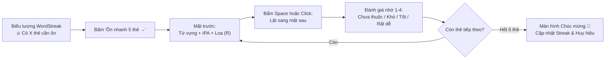

# ⚡ Hướng dẫn Sử dụng: Ôn nhanh Từ vựng trong Extension (Micro-Review) (US-ECO-08)

> **Đối tượng độc giả:** Người học WordStreak  
> **Phiên bản tiện ích:** 1.0+ (Chrome Extension Manifest V3)  
> **Mã tính năng:** `US-ECO-08` (Micro-Review Session in Extension Popup)  
> **Tính năng liên quan:** `US-ECO-03` (Browser Extension), `US-ECO-05` (Toolbar Due Badge), `US-ECO-06` (Reminder Notifications), `US-SRS-01` (Spaced Repetition SM-2)  
> **Cập nhật lần cuối:** 2026-10-14  

---

## 🎯 Giới thiệu Tính năng: Ôn nhanh trong Popup (Micro-Review)

Trong nhịp sống bận rộn hằng ngày, việc phải chuyển đổi qua lại giữa các tab trình duyệt hoặc mở toàn bộ ứng dụng web chỉ để ôn một vài từ vựng có thể khiến bạn mất tập trung vào công việc chính. 

Tính năng **Ôn nhanh trong Popup (Micro-Review)** ra đời nhằm giải quyết triệt để vấn đề này:

- ⏱️ **Tiết kiệm thời gian tối đa:** Chỉ mất đúng **1 phút** để hoàn thành một phiên ôn tập 5 thẻ từ vựng ngay trong cửa sổ nhỏ gọn của tiện ích mà không cần rời khỏi trang web bạn đang đọc.
- 🔥 **Duy trì Ngọn lửa Chuỗi học (Daily Streak):** Giải phóng nhanh gọn các từ vựng đến hạn, kích hoạt và giữ vững chuỗi ngày học liên tục mọi lúc mọi nơi.
- 🎧 **Luyện nghe & Nhận diện chuẩn xác:** Tích hợp nút loa phát âm giọng đọc bản xứ và phím tắt `R` để rèn luyện thính giác tự nhiên.
- ⌨️ **Trải nghiệm gõ phím siêu tốc:** Hỗ trợ hệ thống phím tắt toàn diện (`Space`, `R`, `1`–`4`) cho phép bạn lật thẻ và chấm điểm chỉ trong tích tắc bằng một tay.
- ⚡ **Đồng bộ dữ liệu tức thì (Real-time Sync):** Tự động đồng bộ với thuật toán Lặp lại ngắt quãng SM-2 và cập nhật ngay lập tức con số trên Huy hiệu thanh công cụ (Toolbar Badge).



---

## 🔄 Cách thức Hoạt động & Dấu hiệu Nhận biết

Bất cứ khi nào bạn có từ vựng đến hạn cần củng cố trí nhớ theo chu kỳ SM-2 (`dueCount > 0`), tiện ích WordStreak sẽ tự động hiển thị biểu ngữ mời học màu cam ấm áp ngay dưới thẻ tài khoản:

```
┌────────────────────────────────────────────────────────┐
│  🔥 Có 7 thẻ cần ôn             [⚡ Ôn nhanh 5 thẻ →]  │
│     Ôn nhanh chỉ mất 1 phút                            │
└────────────────────────────────────────────────────────┘
```

- **Biểu tượng ngọn lửa (`🔥`):** Nhắc nhở trực quan về số lượng thẻ từ vựng đang chờ bạn ôn tập hôm nay.
- **Lời nhắn thân thiện:** *"Ôn nhanh chỉ mất 1 phút"* giúp bạn cảm thấy nhẹ nhàng, không bị áp lực thời gian.
- **Nút hành động nhanh:** Nút đen nổi bật `Ôn nhanh 5 thẻ →` (hoặc số lượng thẻ thực tế nếu còn dưới 5 thẻ, ví dụ `Ôn nhanh 2 thẻ →`).

> [!NOTE]
> Khi danh sách thẻ đến hạn về `0` (bạn đã ôn hết bài trong ngày), biểu ngữ màu cam này sẽ tự động ẩn đi hoàn toàn để giữ cho cửa sổ tiện ích luôn tối giản và tinh gọn.

---

## 📖 Hướng dẫn Từng bước Sử dụng (5 Bước Chi tiết)

### Bước 1: Mở Cửa sổ Tiện ích & Bấm "Ôn nhanh 5 thẻ →"

1. Nhấp chuột vào **biểu tượng ngọn lửa WordStreak** trên thanh công cụ của trình duyệt Google Chrome (ở góc trên bên phải màn hình).
2. Khi cửa sổ Popup mở ra, bạn sẽ thấy biểu ngữ màu cam xuất hiện nổi bật với nội dung `🔥 Có X thẻ cần ôn`.
3. Bấm vào nút đen **"Ôn nhanh 5 thẻ →"** để bắt đầu ngay phiên học tập trung.

> [!TIP]
> Nếu bạn chỉ còn 2 hoặc 3 thẻ đến hạn, nút bấm sẽ tự động điều chỉnh hiển thị tương ứng (ví dụ: `Ôn nhanh 2 thẻ →` hoặc `Ôn nhanh 3 thẻ →`), rất trực quan và chính xác.

---

### Bước 2: Xem Từ vựng Mặt trước & Nghe Phát âm Chuẩn

Cửa sổ sẽ lập tức chuyển sang chế độ phòng ôn tập với thẻ từ vựng hiện đại, bo tròn tinh tế:

```
┌────────────────────────────────────────────────────────┐
│  ← Quay lại                                   Thẻ 1/5  │
│  ════════════════════════════════════════════════════  │
│                                                        │
│  [TOEIC 750]                                      (🔊) │
│                                                        │
│                     resilient                          │
│                   /rɪˈzɪl.jənt/                        │
│                                                        │
│             [Nhấn Space hoặc click để lật]             │
│                                                        │
└────────────────────────────────────────────────────────┘
```

1. **Nhãn Bộ từ (Deck Badge):** Nằm ở góc trên bên trái của thẻ (ví dụ `[TOEIC 750]`), giúp bạn nhận biết từ vựng này thuộc chủ đề hay bộ sưu tập nào.
2. **Từ vựng chính & Phiên âm IPA:** Được hiển thị to rõ ở chính giữa thẻ với phông chữ đậm nét dễ đọc.
3. **Nghe phát âm chuẩn (Audio Speaker):**
   - Nhấp vào **biểu tượng chiếc loa tròn màu tím `(🔊)`** ở góc phải thẻ, hoặc:
   - Nhấn ngay phím tắt **`R`** (hoặc `r`) trên bàn phím để nghe giọng đọc bản xứ chuẩn xác.
   - Nếu từ vựng chưa có file ghi âm chuyên biệt, tiện ích sẽ tự động sử dụng công nghệ đọc thông minh Web Speech để bạn luôn được nghe ngữ điệu chuẩn mà không gặp bất kỳ lỗi nào.

---

### Bước 3: Lật Thẻ sang Mặt sau xem Giải nghĩa & Câu Ví dụ

Sau khi nhìn từ vựng và tự nhẩm lại ý nghĩa trong đầu:

1. Nhấn phím cách **`Space`** trên bàn phím máy tính, hoặc:
2. Nhấp chuột trực tiếp vào bất kỳ vị trí nào trên bề mặt thẻ bài.

Thẻ sẽ lật sang mặt sau với đầy đủ ngữ cảnh ứng dụng thực tế:

```
┌────────────────────────────────────────────────────────┐
│  ← Quay lại                                   Thẻ 1/5  │
│  ════════════════════════════════════════════════════  │
│                                                        │
│  [TOEIC 750]                                      (🔊) │
│                                                        │
│                     resilient                          │
│               kiên cường, mau phục hồi                 │
│                                                        │
│    “She is resilient and managed to recover quickly”   │
│                                                        │
│   ┌──────────┐ ┌──────────┐ ┌──────────┐ ┌──────────┐  │
│   │    1     │ │    2     │ │    3     │ │    4     │  │
│   │Chưa thuộc│ │   Khó    │ │ Nhớ tốt  │ │ Rất dễ   │  │
│   └──────────┘ └──────────┘ └──────────┘ └──────────┘  │
└────────────────────────────────────────────────────────┘
```

- **Giải nghĩa tiếng Việt:** Được làm nổi bật với màu tím thương hiệu giúp não bộ ghi nhận ngay tức thì.
- **Câu ví dụ thực tế (Example Sentence):** Đặt trong khung xám thanh lịch với chữ nghiêng, giúp bạn hiểu sâu cách dùng từ trong tình huống giao tiếp thực tiễn.
- **Nút nghe lại âm thanh `(🔊)`:** Vẫn hiển thị ở góc trên để bạn bấm nghe lại bất cứ lúc nào.

---

### Bước 4: Đánh giá Độ nhớ bằng 4 Phím Số (1 đến 4)

Dưới chân mặt sau của thẻ là 4 nút đánh giá trực quan tương ứng với thuật toán ghi nhớ SM-2. Bạn chỉ cần nhấn phím số tương ứng trên bàn phím:

| Phím | Nút bấm | Màu sắc | Khi nào bạn nên chọn? | Thuật toán SM-2 sẽ làm gì? |
| :---: | :--- | :---: | :--- | :--- |
| **`1`** | **Chưa thuộc** | Đỏ nhạt (`#dc2626`) | Bạn hoàn toàn quên từ này hoặc đoán sai nghĩa. | Thẻ được đưa vào lịch ôn tập lại sớm nhất để bạn không bị rớt kiến thức. |
| **`2`** | **Khó** | Cam ấm (`#c2410c`) | Bạn phải suy nghĩ rất lâu mới nhớ ra nghĩa. | Rút ngắn khoảng thời gian lặp lại tiếp theo để củng cố trí nhớ. |
| **`3`** | **Nhớ tốt** | Xanh lá (`#047857`) | Bạn nhớ ra nghĩa chính xác sau vài giây suy nghĩ. | Giãn khoảng cách ôn tập tối ưu (1 ngày $\rightarrow$ 6 ngày $\rightarrow$ vài tuần). |
| **`4`** | **Rất dễ** | Tím sang (`#863bff`) | Bạn thuộc làu từ này ngay khi vừa nhìn thấy. | Tăng vọt khoảng thời gian giãn cách để bạn dành thời gian học các từ khó hơn. |

> [!IMPORTANT]
> **Cơ chế nộp điểm siêu tốc (Optimistic UI):** Ngay khi bạn bấm phím `1`, `2`, `3` hoặc `4`, thẻ tiếp theo sẽ xuất hiện ngay lập tức mà không có độ trễ gián đoạn hay chờ tải mạng! Tiện ích sẽ xử lý đồng bộ ngầm bên dưới một cách êm ái.

---

### Bước 5: Xem Màn hình Chúc mừng & Duy trì Chuỗi Ngày học (Streak)

Sau khi đánh giá xong thẻ thứ 5 (hoặc thẻ cuối cùng trong phiên), màn hình chúc mừng đầy hứng khởi sẽ hiện ra:

```
┌────────────────────────────────────────────────────────┐
│                                                        │
│                         ( ✓ )                          │
│                                                        │
│            🎉 Hoàn thành phiên ôn nhanh!               │
│             Đã ôn tập 5 thẻ thành công.                │
│             Chuỗi học hiện tại: 7 ngày 🔥              │
│                                                        │
│            [ 🚀 Mở app để học tiếp ]                   │
│                                                        │
│                   [ Hoàn tất ]                         │
│                                                        │
└────────────────────────────────────────────────────────┘
```

1. **Biểu tượng tích xanh tròn lớn `( ✓ )`**: Xác nhận thành quả bạn vừa củng cố 5 từ vựng.
2. **Thông báo chuỗi ngày học (`🔥 Chuỗi học hiện tại: X ngày`):** Ngọn lửa Streak của bạn đã được tiếp thêm năng lượng và duy trì an toàn!
3. **Tự động cập nhật Huy hiệu (Badge):** Con số thẻ đến hạn trên biểu tượng tiện ích ở thanh công cụ Chrome sẽ tự động giảm trừ ngay lập tức.
4. **Hai lựa chọn linh hoạt:**
   - **Bấm `🚀 Mở app để học tiếp`:** Mở ngay trang tổng quan Web App (`/dashboard`) trên một thẻ mới nếu bạn có thời gian rảnh rỗi và muốn ôn thêm nhiều từ hơn hoặc thử sức với các trò chơi trắc nghiệm.
   - **Bấm `Hoàn tất`:** Đóng phiên ôn và quay trở lại màn hình chính của Popup tiện ích để tiếp tục duyệt web hoặc lưu từ mới.

---

## ⌨️ Bảng Tổng hợp Phím tắt Nhanh (Keyboard Shortcuts)

Để có tốc độ học nhanh nhất mà không cần chạm tay vào chuột, hãy tận dụng trọn bộ phím tắt thông minh sau:

| Phím tắt | Thao tác tương ứng | Điều kiện áp dụng |
| :---: | :--- | :--- |
| **`Space`** *(Phím cách)* | **Lật thẻ** (Mặt trước $\rightarrow$ Mặt sau) | Đang ở mặt trước của thẻ |
| **`Enter`** | **Lật thẻ** (Mặt trước $\rightarrow$ Mặt sau) | Khi thẻ đang được trỏ tiêu điểm |
| **`R`** hoặc **`r`** | **Nghe phát âm chuẩn** tiếng Anh qua loa bản xứ | Hoạt động ở cả 2 mặt thẻ |
| **`1`** | Đánh giá **Chưa thuộc** (Again) | Chỉ hoạt động khi thẻ **đã lật mặt sau** |
| **`2`** | Đánh giá **Khó** (Hard) | Chỉ hoạt động khi thẻ **đã lật mặt sau** |
| **`3`** | Đánh giá **Nhớ tốt** (Good) | Chỉ hoạt động khi thẻ **đã lật mặt sau** |
| **`4`** | Đánh giá **Rất dễ** (Easy) | Chỉ hoạt động khi thẻ **đã lật mặt sau** |
| **`← Quay lại`** *(Nút góc trên)* | Thoát phiên ôn nhanh về trang chủ Popup | Bất cứ lúc nào trong phiên học |

> [!TIP]
> **Cơ chế chống gõ nhầm thông minh:** Nếu bạn vô tình nhấp vào ô nhập từ vựng (Input) trong tiện ích, các phím tắt `Space` và số `1`–`4` sẽ tạm thời tự động vô hiệu hóa để không gây ảnh hưởng đến nội dung bạn đang gõ.

---

## 💡 Câu hỏi Thường gặp (FAQ)

### 1. Tôi có cần mở ứng dụng Web App đầy đủ thì phiên ôn mới được tính điểm không?
**Hoàn toàn không cần.** Phiên ôn nhanh (Micro-review) được kết nối trực tiếp với cùng hệ thống cơ sở dữ liệu và thuật toán Spaced Repetition của WordStreak. Mọi đánh giá của bạn trong Popup đều được lưu lại vĩnh viễn, tính điểm kinh nghiệm (XP) và duy trì Chuỗi ngày học (Streak) y hệt như khi học trên Web App.

### 2. Nếu hôm nay tôi có 15 thẻ đến hạn thì phiên ôn nhanh hiển thị thế nào?
Biểu ngữ sẽ hiển thị `🔥 Có 15 thẻ cần ôn` và nút bấm sẽ là `Ôn nhanh 5 thẻ →`. Tiện ích cố ý chọn con số **5 thẻ** để bạn không cảm thấy choáng ngợp và chỉ mất đúng 1 phút hoàn thành. Sau khi ôn xong 5 thẻ đầu tiên, nếu còn hứng thú, bạn có thể bấm vào banner để làm tiếp một phiên 5 thẻ nữa, hoặc bấm `🚀 Mở app để học tiếp` để ôn tập hàng loạt trên màn hình lớn.

### 3. Nếu danh sách của tôi chỉ còn 2 thẻ cần ôn thì sao?
Hệ thống cực kỳ thông minh: Nút bấm sẽ hiển thị `Ôn nhanh 2 thẻ →`, phiên ôn sẽ chạy đúng 2 thẻ (`Thẻ 1/2` và `Thẻ 2/2`), và sau đó chúc mừng bạn đã hoàn thành bài học ngày!

### 4. Nếu tôi đang ôn dở đến thẻ số 3 mà bận việc đột xuất và bấm "← Quay lại" thì kết quả có mất không?
**Không mất.** Nhờ cơ chế lưu điểm từng thẻ tức thì, 2 thẻ bạn đã hoàn thành trước đó đã được ghi nhận thành công trên hệ thống. Khi bạn quay lại ôn sau, bạn chỉ cần ôn các thẻ còn lại.

### 5. Tại sao khi ở mặt trước thẻ, tôi bấm phím 1–4 không thấy phản hồi?
Đây là tính năng sư phạm có chủ đích: WordStreak cố ý khóa các phím đánh giá ở mặt trước nhằm khuyến khích não bộ bạn phải chủ động suy nghĩ và bấm `Space` để đối chiếu với câu trả lời ở mặt sau trước khi tự cho điểm, giúp khả năng ghi nhớ dài hạn đạt hiệu quả cao nhất.

### 6. Khi máy tính bị mất mạng (Offline) thì phát âm có nghe được không?
Có. Nhờ tích hợp bộ máy tổng hợp giọng nói trình duyệt (Web Speech API), WordStreak vẫn phát âm chuẩn xác ngay cả khi không thể tải file âm thanh từ máy chủ.

---

## 🌟 Mẹo Thực chiến: Học Từ vựng Không tốn Sức (Pro-Tips)

- ☕ **Tận dụng "khoảnh khắc chết" trong ngày:** Trong lúc chờ máy tính khởi động, chờ pha một tách cà phê, hoặc giải lao giữa hai cuộc họp, hãy bấm vào icon WordStreak và làm ngay một phiên 5 thẻ. Bạn vừa giữ được Streak vừa củng cố kiến thức mà không tốn công thu xếp thời gian riêng!
- 🎧 **Tập thói quen bấm phím `R` trước khi bấm `Space`:** Nghe phát âm và tự nhại lại trong miệng (shadowing) trước khi xem nghĩa tiếng Việt sẽ giúp bạn nhớ từ vựng lâu gấp đôi so với chỉ đọc bằng mắt.
