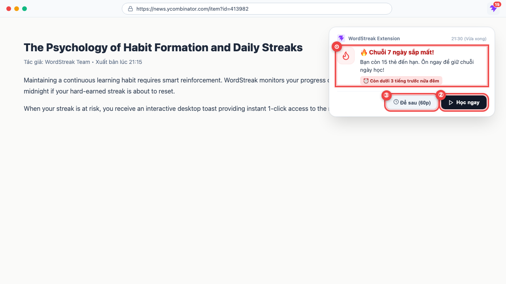
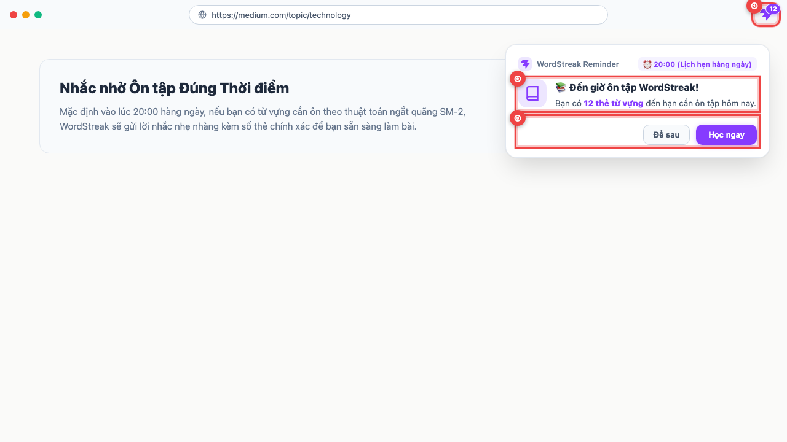
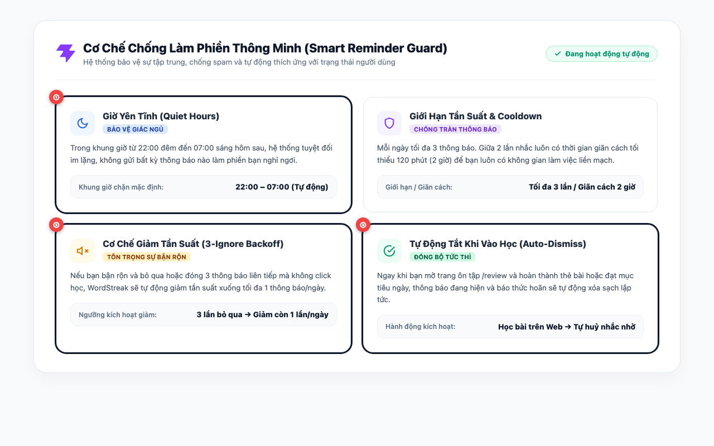
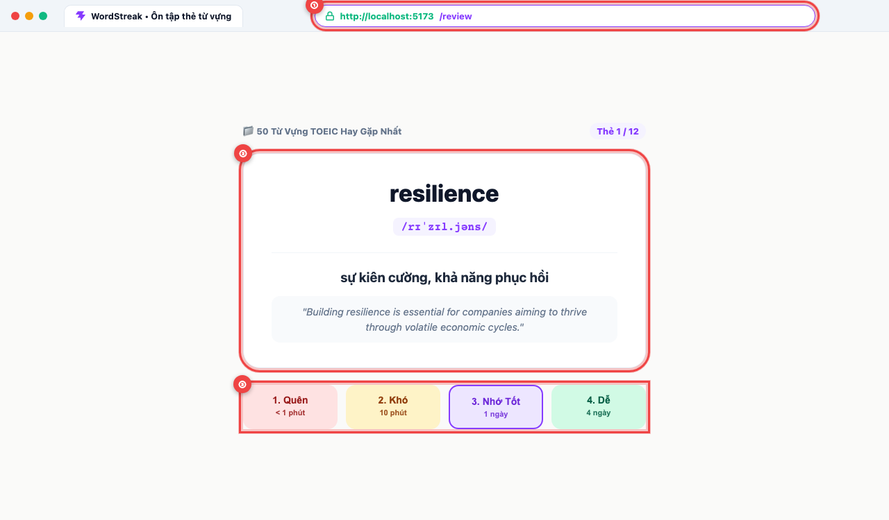

# 🔔 Hướng dẫn Sử dụng: Thông báo Nhắc học Thông minh trên Extension (US-ECO-06)

> **Đối tượng độc giả:** Người học WordStreak  
> **Phiên bản tiện ích:** 1.0 (Extension Manifest V3)  
> **Mã tính năng:** `US-ECO-06` (Conditional Study Reminder Notifications)  
> **Cập nhật lần cuối:** 2026-10-13  

---

## 🎯 Giới thiệu Tính năng

**Thông báo Nhắc học Thông minh (Extension Smart Study Reminders)** là hệ thống hỗ trợ học tập đắc lực được tích hợp ngay trong tiện ích mở rộng WordStreak trên trình duyệt máy tính của bạn.

Tính năng này được thiết kế dựa trên nguyên lý: **Nhắc đúng lúc – Không làm phiền – Bảo vệ chuỗi học**:

- ⏰ **Nhắc nhở đúng hẹn:** Mặc định gửi lời nhắc vào **20:00 hàng ngày** khi bạn có từ vựng đến hạn cần ôn tập theo phương pháp lặp lại ngắt quãng (Spaced Repetition SM-2).
- 🔥 **Bảo vệ ngọn lửa Streak:** Tự động phát cảnh báo khẩn cấp khi bạn sắp mất chuỗi ngày học liên tục (Streak-at-Risk) trước nửa đêm.
- ⚡ **Tương tác 1-Click tiện lợi:** Cung cấp hai lựa chọn rõ ràng: **"Học ngay"** (mở thẳng phòng ôn tập `/review`) hoặc **"Để sau"** (tạm hoãn 60 phút).
- 🛡️ **Cơ chế chống làm phiền thông minh:** Tự động kích hoạt **Giờ yên tĩnh (22:00 – 07:00)**, giới hạn tối đa 3 lần nhắc/ngày, giãn cách tối thiểu 2 giờ, tự động giảm tần suất nếu bạn bận và tự tắt ngay khi bạn vào web học bài.

---

## 1. Cảnh báo Sớm Nguy cơ Đứt Chuỗi Học (Streak at Risk)

Khi bạn đã nỗ lực xây dựng chuỗi ngày học liên tục từ 3 ngày trở lên, việc quên học một ngày có thể làm mất đi toàn bộ thành quả. Hệ thống sẽ theo dõi thầm lặng và gửi cảnh báo trước khi hết ngày.

- **① Hộp thoại cảnh báo khẩn cấp (Streak at Risk Alert):** Xuất hiện khi bạn đang có chuỗi học, chưa hoàn thành bài học hôm nay và đồng hồ điểm sau 21:00 (dưới 3 tiếng trước nửa đêm). Thông báo hiển thị rõ số ngày chuỗi hiện tại và số thẻ từ vựng cần giải quyết để giữ ngọn lửa học tập luôn rực cháy.
- **② Nút "Học ngay" (Study Now):** Nhấp chuột vào nút này để mở thẳng trang ôn tập từ vựng. Bạn không cần phải mở tab mới hay tự gõ địa chỉ web.
- **③ Nút "Để sau" (Snooze 60m):** Nếu bạn đang bận họp hoặc làm việc dở tay, hãy bấm nút này. Tiện ích sẽ tạm hoãn và hẹn giờ thông báo lại sau 60 phút.

---

## 2. Thông báo Lịch Ôn tập Định kỳ Lúc 20:00 (Daily Scheduled Reminder)

Khoảng 20:00 mỗi tối là "khung giờ vàng" thư giãn và củng cố trí nhớ sau một ngày làm việc. Nếu hôm nay bạn có từ vựng cần ôn tập, WordStreak sẽ gửi lời nhắc nhẹ nhàng kèm con số chính xác.

- **① Huy hiệu số thẻ đến hạn (Toolbar Due Badge):** Ngay trên góc phải thanh công cụ trình duyệt, biểu tượng tiện ích WordStreak luôn hiển thị số lượng thẻ cần ôn trong ngày (ví dụ: số `12` màu tím nổi bật).
- **② Lời nhắc ôn tập buổi tối (Daily Reminder):** Đúng 20:00, một thông báo trang nhã sẽ xuất hiện ở góc màn hình báo cho bạn biết chính xác số lượng thẻ đang chờ ôn theo thuật toán khoa học SM-2.
- **③ Thao tác xử lý nhanh gọn:** Bạn có thể bấm **"Học ngay"** để hoàn thành bài ôn tập chỉ trong 2–3 phút, hoặc bấm **"Để sau"** nếu muốn hoàn tất bữa tối trước.

---

## 3. Bộ Quy tắc Chống Làm Phiền Thông minh (Smart Reminder Guard)

Khác với các ứng dụng liên tục gửi thông báo làm bạn khó chịu, WordStreak sở hữu bộ quy tắc thông minh đảm bảo bạn luôn có không gian tập trung và giấc ngủ ngon:

- **① Khung giờ yên tĩnh (Quiet Hours: 22:00 – 07:00):** Từ 22:00 đêm đến 07:00 sáng hôm sau, tiện ích hoàn toàn "im lặng". Mọi thông báo nhắc học đều bị chặn lại để bảo vệ trọn vẹn giấc ngủ của bạn.
- **② Cơ chế tự động giảm tần suất (3-Ignore Backoff):** Nếu bạn quá bận rộn và bỏ qua hoặc đóng 3 thông báo liên tiếp mà không vào học, hệ thống sẽ tự hiểu bạn đang bận và tự động giảm số lần nhắc xuống **tối đa chỉ 1 thông báo/ngày** để không gây phiền hà.
- **③ Tự động tắt nhắc khi học trên Web (Auto-Dismiss on Activity):** Ngay khi bạn mở trình duyệt vào trang `/review` và học thẻ từ vựng hoặc hoàn thành mục tiêu ngày, thông báo đang hiện và các báo thức tạm hoãn sẽ tự động xóa sạch ngay lập tức!

### Bảng tóm tắt các giới hạn bảo vệ tự động:

| Quy tắc thông minh | Thông số cài đặt | Ý nghĩa và lợi ích cho bạn |
| :--- | :--- | :--- |
| 🌙 **Giờ yên tĩnh (Quiet Hours)** | `22:00 – 07:00` | Tuyệt đối không gửi thông báo trong thời gian ngủ nghỉ ban đêm. |
| 🛡️ **Giới hạn ngày (Daily Cap)** | Tối đa 3 thông báo/ngày | Tránh tình trạng bị "dội bom" thông báo nhiều lần trong ngày. |
| ⏱️ **Thời gian giãn cách (Cooldown)** | Tối thiểu 120 phút (2 giờ) | Giữa 2 lần nhắc luôn có ít nhất 2 giờ nghỉ ngơi để bạn tập trung làm việc. |
| ⏳ **Tạm hoãn thông minh (Snooze)** | 60 phút | Cho phép dời lịch nhắc thêm 1 tiếng khi bạn đang dở việc quan trọng. |
| 📉 **Tự giảm tần suất (Backoff)** | Bỏ qua 3 lần → Còn 1 lần/ngày | Tự thích ứng với người dùng bận rộn, không gây áp lực học tập tiêu cực. |
| ⚡ **Tự hủy thông minh (Auto-Dismiss)** | Đồng bộ tức thì | Tự tắt thông báo và hủy hẹn giờ hoãn ngay khi bạn đã chủ động vào học. |

---

## 4. Khởi động Thông minh Trang Ôn tập (/review Smart Tab Launch)

Khi bạn bấm nút **"Học ngay"** hoặc bấm vào thân thông báo, tiện ích sẽ dẫn bạn thẳng tới bài học một cách mượt mà và thông minh nhất:

- **① Tái sử dụng tab thông minh (Smart Tab Reuse):** Tiện ích tự động tìm xem bạn đã mở sẵn tab WordStreak nào trên trình duyệt chưa. Nếu có, trình duyệt sẽ chuyển ngay sang tab đó và trỏ đến địa chỉ `http://localhost:5173/review` thay vì mở thêm một tab mới gây lộn xộn trình duyệt.
- **② Thẻ từ vựng hiển thị sẵn sàng:** Màn hình ôn tập xuất hiện tức thì với từ vựng cần nhớ, phiên âm quốc tế chuẩn IPA, ngữ cảnh câu giao tiếp thực tế và giải nghĩa súc tích.
- **③ 4 Nút đánh giá trí nhớ khoa học (SRS Rating Controls):** Sau khi lật thẻ kiểm tra, bạn chỉ cần chọn mức độ ghi nhớ của mình:
  - **1. Quên (< 1 phút):** Thẻ sẽ được lặp lại ngay trong phiên học.
  - **2. Khó (10 phút):** Ôn lại sau một khoảng thời gian ngắn.
  - **3. Nhớ Tốt (1 ngày):** Giãn cách ngày ôn sang hôm sau.
  - **4. Dễ (4 ngày):** Tăng khoảng cách ôn tập dài hơn vì bạn đã nắm rất vững.

Ngay sau khi bạn hoàn thành thẻ đầu tiên, huy hiệu trên thanh công cụ tiện ích sẽ tự động đồng bộ giảm số lượng thẻ theo thời gian thực!

---

## 💡 Câu hỏi Thường gặp (FAQ)

### 1. Nếu tôi bấm "Để sau" vào lúc 21:30 thì tiện ích có nhắc tôi lúc 22:30 không?
**Không.** Quy tắc Giờ yên tĩnh (`22:00 – 07:00`) luôn có quyền ưu tiên cao nhất. Khi đồng hồ đã qua 22:00, báo thức tạm hoãn sẽ tự động bị chặn lại để giữ sự yên tĩnh tuyệt đối cho giấc ngủ của bạn.

### 2. Làm thế nào để khôi phục lại tần suất nhắc 3 lần/ngày sau khi hệ thống đã giảm về 1 lần/ngày?
Rất đơn giản! Bạn chỉ cần vào trang Web App và học ít nhất 1 thẻ từ vựng hoặc hoàn thành phiên học. Hệ thống sẽ ngay lập tức thiết lập lại bộ đếm bỏ qua về `0` và khôi phục tần suất chăm sóc bình thường.

### 3. Tiện ích hiển thị thông báo bằng ngôn ngữ nào?
Hệ thống tự động sử dụng ngôn ngữ hiển thị mà bạn cài đặt trong tài khoản WordStreak (Tiếng Việt hoặc Tiếng Anh). Nếu bạn chưa đặt ngôn ngữ, tiện ích sẽ tự nhận diện theo ngôn ngữ trình duyệt của bạn.

### 4. Khi máy tính không có kết nối mạng (Offline) thì thông báo có hoạt động không?
Có. Extension lưu bộ nhớ đệm lịch ôn tập và trạng thái chuỗi học gần nhất trong bộ nhớ trình duyệt, do đó các cảnh báo giờ học đã lên lịch vẫn hoạt động chính xác ngay cả khi ngắt kết nối mạng tạm thời.

---

## 🌟 Mẹo Sử dụng Hiệu quả (Pro-Tips)

- ⚡ **Học ngay khi nhận thông báo 20:00:** Mỗi phiên ôn tập hàng ngày thường chỉ kéo dài từ 2 đến 4 phút. Ôn tập dứt điểm vào 20:00 giúp bạn giải phóng tâm trí và giữ trọn vẹn chuỗi học thảnh thơi trước giờ đi ngủ.
- ⌨️ **Sử dụng phím tắt số khi ôn tập:** Trên màn hình `/review`, bạn có thể bấm trực tiếp các phím số `1`, `2`, `3`, `4` trên bàn phím để chấm điểm thẻ cực nhanh mà không cần dùng chuột.
- 🧘 **Đừng lo lắng nếu bận rộn:** Cơ chế 3-Ignore Backoff và Giờ yên tĩnh được tạo ra để đồng hành cùng bạn chứ không phải gây áp lực. Bạn hoàn toàn có thể an tâm làm việc khi bận rộn!
