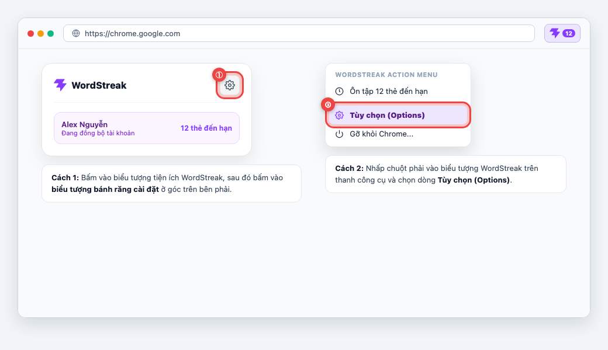
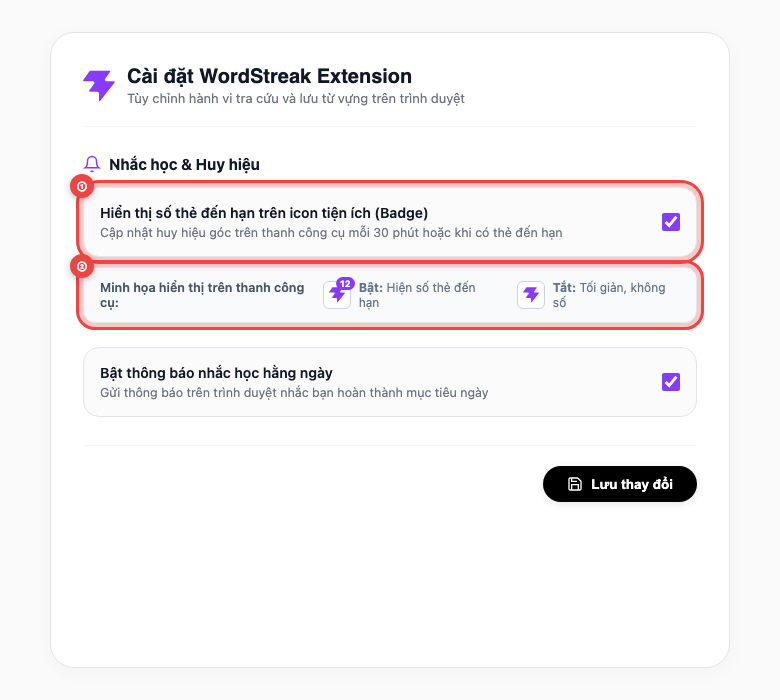
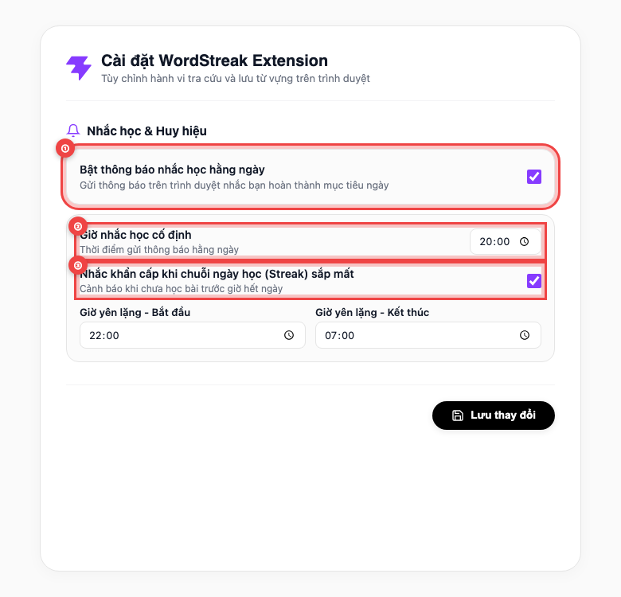
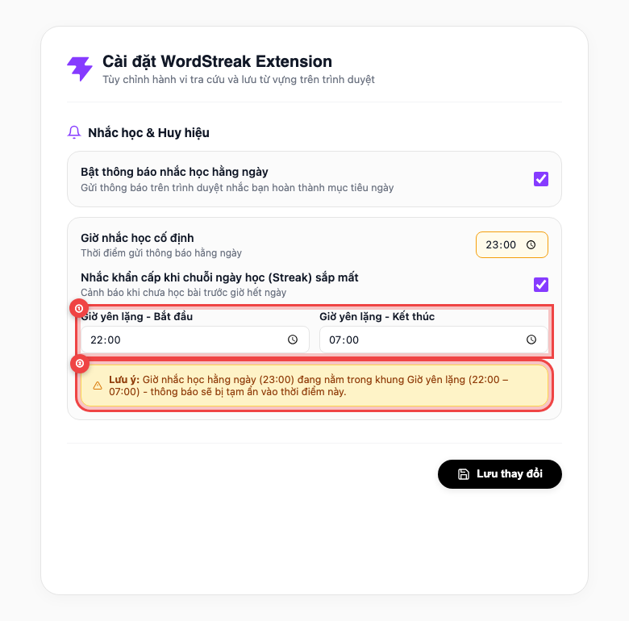
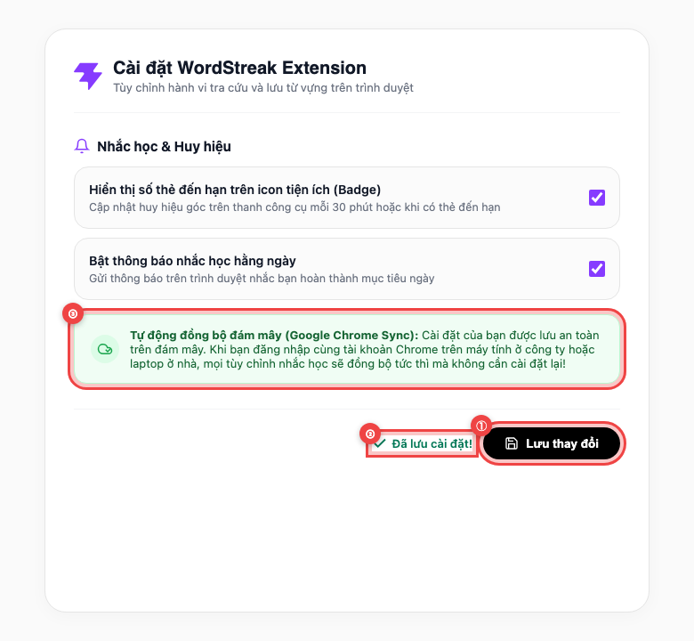

# ⚙️ Hướng dẫn Sử dụng: Cài đặt Nhắc học & Huy hiệu trên Extension (US-ECO-07)

> **Đối tượng độc giả:** Người học WordStreak  
> **Phiên bản tiện ích:** 1.0 (Extension Manifest V3)  
> **Mã tính năng:** `US-ECO-07` (Extension Reminder Settings — Options Page)  
> **Cập nhật lần cuối:** 2026-10-13  

---

## 🎯 Giới thiệu Tính năng

Trang **Cài đặt Tiện ích WordStreak (Options Page)** mang đến cho bạn quyền kiểm soát hoàn toàn mọi thông báo và huy hiệu nhắc học ngay trên trình duyệt:

- 🎛️ **Tùy chỉnh lịch học theo nhịp sinh hoạt:** Chọn chính xác khung giờ bạn muốn nhận thông báo ôn từ vựng mỗi tối (ví dụ: `20:00` hoặc `19:30`).
- 🌙 **Bảo vệ giấc ngủ với Khung Giờ yên lặng (Quiet Hours):** Thiết lập khoảng thời gian ban đêm (mặc định `22:00 – 07:00`) để tiện ích tuyệt đối không làm phiền bạn khi đang nghỉ ngơi.
- 🔥 **Cảnh báo khẩn cấp bảo vệ Chuỗi ngày học (Streak):** Bật/tắt lời nhắc giữ chuỗi trước khi hết ngày nếu bạn chưa hoàn thành bài học.
- 🏷️ **Bật/tắt Huy hiệu số thẻ đến hạn (Toolbar Badge):** Tùy ý chọn hiển thị con số thẻ cần ôn ngay góc biểu tượng tiện ích hoặc ẩn đi để thanh công cụ luôn tối giản.
- ☁️ **Tự động đồng bộ trên mọi máy tính (Cloud Sync):** Mọi cài đặt của bạn được lưu an toàn trên tài khoản Google Chrome — đổi máy tính bàn ở công ty hay laptop ở nhà đều tự động đồng bộ ngay lập tức!

---

## 1. Cách Mở Trang Cài đặt Tiện ích (Options Page)

Bạn có thể mở trang Cài đặt WordStreak cực kỳ nhanh chóng bằng 2 cách tiện lợi ngay trên thanh công cụ của trình duyệt:

- **① Mở từ Cửa sổ nổi Tiện ích (Cách 1):** Bấm chuột vào biểu tượng ngọn lửa tím **WordStreak** trên thanh công cụ trình duyệt để mở cửa sổ nổi, sau đó bấm vào **biểu tượng Bánh răng cài đặt (Settings)** ở góc trên bên phải.
- **② Mở từ Menu chuột phải (Cách 2):** Nhấp chuột phải trực tiếp vào biểu tượng WordStreak trên thanh công cụ trình duyệt và chọn dòng **Tùy chọn (Options)**.

Trang Cài đặt sẽ lập tức mở ra trong một tab trình duyệt mới với giao diện sáng sủa, tinh tế và dễ sử dụng.

---

## 2. Bật / Tắt Huy hiệu Số thẻ Đến hạn trên Thanh Công cụ (Toolbar Badge)

Huy hiệu là con số nhỏ xuất hiện ở góc trên biểu tượng WordStreak, giúp bạn biết ngay mình đang có bao nhiêu thẻ từ vựng cần ôn tập mà không cần mở trang web.

- **① Nút bật/tắt Huy hiệu (Badge Toggle):** Nhấp chuột vào ô chọn **"Hiển thị số thẻ đến hạn trên icon tiện ích (Badge)"** để bật hoặc tắt huy hiệu này.
- **② Minh họa trực quan trạng thái:**
  - **Khi Bật (Mặc định):** Biểu tượng WordStreak hiển thị con số thẻ đang chờ ôn (ví dụ số `12` màu tím, hoặc chuyển sang màu đỏ rực nếu chuỗi học của bạn đang có nguy cơ bị đứt).
  - **Khi Tắt:** Con số trên biểu tượng sẽ được ẩn đi hoàn toàn, giữ cho thanh công cụ của bạn luôn tinh gọn. Hệ thống vẫn theo dõi tiến độ học ngầm bên dưới mà không làm ảnh hưởng đến các tính năng khác.

---

## 3. Cài đặt Giờ Nhắc học Hằng ngày & Cảnh báo Chuỗi Ngày học (Streak)

Bạn có thể tự do lên lịch để WordStreak gửi lời nhắc học vào thời điểm phù hợp nhất với thói quen sinh hoạt của mình:

- **① Công tắc Thông báo nhắc học chính (Master Toggle):** Bấm chọn ô **"Bật thông báo nhắc học hằng ngày"** để kích hoạt toàn bộ hệ thống thông báo. Khi tắt ô này, các ô cài đặt giờ bên dưới sẽ tự động mờ đi và tạm dừng toàn bộ thông báo.
- **② Giờ nhắc học cố định (Daily Reminder Time):** Nhấp vào ô thời gian để chọn giờ nhận thông báo mỗi ngày (mặc định là `20:00`). Bạn có thể đổi sang `19:30`, `20:30` hoặc bất cứ thời điểm nào bạn rảnh rỗi sau bữa tối.
- **③ Cảnh báo nguy cơ mất Chuỗi ngày học (Streak-at-Risk Alert):** Tích chọn ô này để nhận lời nhắc khẩn cấp sau 21:00 nếu bạn đang có chuỗi học liên tục từ 3 ngày trở lên mà hôm nay chưa ôn tập bài học.

---

## 4. Thiết lập Khung Giờ Yên lặng (Quiet Hours) & Cơ chế Bảo vệ Giấc ngủ

Để bạn luôn có những đêm ngon giấc, WordStreak tích hợp cơ chế chống làm phiền thông minh qua khung **Giờ yên lặng**:

- **① Khung giờ ngủ đêm (Quiet Hours Window):** Nhập giờ bắt đầu (ví dụ `22:00`) và giờ kết thúc (ví dụ `07:00`). Trong suốt khoảng thời gian này, tiện ích tuyệt đối không gửi bất kỳ thông báo nhắc học nào đến màn hình của bạn.
- **② Cảnh báo thông minh khi trùng giờ (Conflict Hint Banner):** Nếu bạn vô tình đặt Giờ nhắc học (`23:00`) rơi vào khung Giờ yên lặng (`22:00 – 07:00`), một thông báo màu vàng dịu sẽ hiện lên nhắc nhở bạn. Hệ thống vẫn tôn trọng lựa chọn và cho phép bạn lưu, đồng thời tự động bảo vệ bằng cách tạm ẩn thông báo nếu thời điểm đó bạn đang ngủ.

> [!TIP]
> **Tắt Khung Giờ yên lặng:** Nếu bạn có thói quen làm việc và học tập ban đêm và muốn nhận thông báo mọi lúc, hãy đặt **Giờ bắt đầu trùng với Giờ kết thúc** (ví dụ cả hai ô đều đặt `22:00`). Hệ thống sẽ hiển thị gợi ý thông báo rằng Giờ yên lặng đang tạm tắt.

---

## 5. Lưu Thay đổi & Tự động Đồng bộ Đám mây (Cloud Sync)

Sau khi tùy chỉnh các thông số theo ý thích, bạn chỉ cần một cú nhấp chuột để áp dụng cài đặt:

- **① Nút Lưu thay đổi (Save Button):** Nhấp vào nút đen **"Lưu thay đổi"** ở góc dưới bên phải trang Cài đặt.
- **② Phản hồi lưu thành công tức thì:** Dòng chữ xanh lá **"✓ Đã lưu cài đặt!"** sẽ xuất hiện xác nhận thay đổi đã được áp dụng ngay lập tức mà không cần bạn phải khởi động lại trình duyệt.
- **③ Đồng bộ tự động trên mọi máy tính (Google Chrome Sync):** Nhờ cơ chế đồng bộ đám mây, mọi cấu hình bạn vừa lưu sẽ tự động xuất hiện trên tất cả máy tính đang đăng nhập cùng tài khoản Chrome của bạn.

---

## 📊 Bảng Tóm tắt Các Tùy chọn Cài đặt

| Tùy chọn cài đặt | Giá trị mặc định | Giải thích ý nghĩa & Tác dụng |
| :--- | :---: | :--- |
| **Hiển thị số thẻ đến hạn (Badge)** | `Bật` (Có) | Hiển thị số lượng thẻ từ vựng cần ôn hôm nay trên biểu tượng thanh công cụ. |
| **Bật thông báo nhắc học** | `Bật` (Có) | Bật/tắt toàn bộ hệ thống gửi thông báo nhắc học trên màn hình máy tính. |
| **Giờ nhắc học cố định** | `20:00` | Thời điểm tiện ích gửi thông báo nhắc bạn hoàn thành mục tiêu ngày. |
| **Nhắc khẩn cấp khi sắp mất Streak** | `Bật` (Có) | Cảnh báo trước nửa đêm khi bạn có chuỗi học nhưng hôm nay chưa ôn tập. |
| **Giờ yên lặng - Bắt đầu** | `22:00` | Thời điểm bắt đầu chặn mọi thông báo để không làm phiền giấc ngủ. |
| **Giờ yên lặng - Kết thúc** | `07:00` | Thời điểm kết thúc giờ yên tĩnh và sẵn sàng đón chào ngày học mới. |

---

## 💡 Câu hỏi Thường gặp (FAQ)

### 1. Cài đặt trên máy tính công ty có tự cập nhật sang laptop cá nhân của tôi không?
**Có.** Toàn bộ cài đặt được lưu trữ đồng bộ qua đám mây của tài khoản Google Chrome (`chrome.storage.sync`). Miễn là bạn đăng nhập cùng một tài khoản Chrome trên các máy tính, mọi thay đổi trên máy tính này sẽ tự động cập nhật ngay lập tức sang máy tính kia.

### 2. Nếu tôi tắt công tắc "Bật thông báo nhắc học hằng ngày", các giờ đã cài đặt có bị mất không?
**Không.** Khi bạn tắt công tắc chính, các ô chọn giờ sẽ tạm thời mờ đi và bị khóa để tránh nhầm lẫn, nhưng các mốc giờ bạn từng chọn (như `19:30`, `23:00`) vẫn được giữ nguyên vẹn. Bất cứ khi nào bạn bật lại công tắc, các mốc giờ quen thuộc sẽ xuất hiện trở lại ngay.

### 3. Tại sao đến giờ nhắc học mà tôi không thấy thông báo xuất hiện?
Có 3 lý do thông thường:
1. **Bạn đang trong Khung Giờ yên lặng:** Nếu giờ nhắc học rơi vào khung giờ ngủ bạn đã cài, hệ thống sẽ tự động tạm ẩn thông báo.
2. **Bạn không có thẻ từ vựng nào đến hạn ôn:** Tiện ích chỉ nhắc khi bạn thực sự có từ vựng cần ôn theo phương pháp lặp lại ngắt quãng SM-2, tránh làm phiền khi bạn không có bài học.
3. **Quyền thông báo của Windows / macOS / Trình duyệt:** Vui lòng kiểm tra xem bạn có đang bật chế độ "Không làm phiền" (Do Not Disturb / Focus Mode) trên hệ điều hành máy tính hay không.

### 4. Nếu tôi tắt Huy hiệu (Badge) số thẻ trên icon, tiện ích có còn nhắc học không?
**Vẫn nhắc bình thường.** Việc tắt hiển thị con số trên icon chỉ giúp thanh công cụ gọn gàng hơn theo sở thích thị giác của bạn. Hệ thống nhắc nhở thông báo qua màn hình và tính toán chuỗi ngày học vẫn hoạt động chính xác 100%.

---

## 🌟 Mẹo Sử dụng Hiệu quả (Pro-Tips)

- ⏰ **Đặt giờ nhắc học trước giờ đi ngủ 1–2 tiếng:** Đặt giờ học vào khoảng `20:00` hoặc `20:30` giúp bạn hoàn thành phiên học nhẹ nhàng trong 3 phút, giải tỏa tâm trí trước khi bước vào khung Giờ yên lặng (`22:00`).
- 🔄 **Kiểm tra bánh răng cài đặt khi đổi lịch làm việc:** Nếu bạn đi công tác hoặc thay đổi thói quen thức dậy, chỉ mất 10 giây mở trang Cài đặt để điều chỉnh lại Giờ yên lặng cho phù hợp với nhịp sinh hoạt mới.
- 🧘 **Thảnh thơi học tập không áp lực:** Tiện ích được thiết kế để trở thành trợ lý đồng hành thông minh, luôn tôn trọng sự tập trung và giấc ngủ của bạn!
